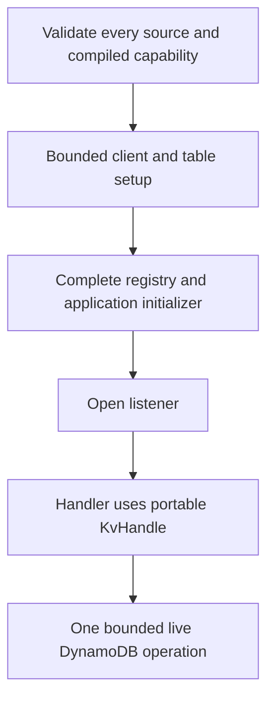

# Native DynamoDB KV

DynamoDB is an optional live KV provider for native Axum apps. It uses the existing
`Kv` extractor, `KvHandle` and per-ID registry. Config and Secrets Manager stores
remain independent startup snapshots. DynamoDB calls happen during KV operations,
not only at startup.

## Select a store

Enable `aws-dynamodb` on the generated Axum package, for example in
`edgezero.toml`:

```toml
[adapters.axum.build]
features = ["aws-dynamodb"]
```

`aws-stores` retains its existing AppConfig Agent and Secrets Manager membership.
Use `aws-stores,aws-dynamodb` to enable all three. DynamoDB is off by default and
its SDK is absent from settings-only, ordinary CLI/Axum, Agent-only and WASM
normal dependency graphs.

Declare a portable KV ID in the application as usual, then select its native
provider in an absolute bindings file:

```toml
version = 1

[kv.state]
provider = "aws-dynamodb"
region = "us-east-1"
table = "edgezero-kv-prod"
namespace = "checkout-prod/state"
```

Set `EDGEZERO__STORE_BINDINGS_FILE` to that file. Selection is explicit. A missing
feature, invalid binding or unavailable table fails before the listener opens.
There is no fallback to redb or another provider. A deployment with no local KV
IDs does not need `DATA_DIR`. Existing supplied/ready/deferred KV handles still
work and must not conflict with a binding for the same ID.

The SDK uses its supported operator-owned credential chain, including workload
roles and configured developer profiles. Do not put credentials in bindings,
images or application config. Region/table/namespace are explicit, and the
binding schema has no endpoint field. SDK profile/environment endpoint settings
remain operator-owned. Structural CLI validation makes no AWS request and reports
provider availability as unknown, not an offline Cargo proof.

## Operator-owned table

Create the table outside EdgeZero, in the selected region. The first version
requires an ACTIVE, single-region table with no secondary/vector indexes or
replicas, and exactly these String keys:

| Attribute       | Role                                                       |
| --------------- | ---------------------------------------------------------- |
| `pk`            | Partition key, the configured physical namespace           |
| `sk`            | Sort key, the exact portable UTF-8 key                     |
| `v`             | Non-key Binary value, including empty values               |
| `expires_at_ms` | Optional Number, logical Unix epoch millisecond expiration |
| `ttl_epoch_s`   | Optional Number, background cleanup timestamp              |

Enable DynamoDB TTL on `ttl_epoch_s` for garbage collection. The provider does not
create or mutate the table or its TTL setting. Disabled cleanup retains expired
records and storage costs, although reads/listings still treat them as missing.

Grant the runtime role only `dynamodb:DescribeTable`, `dynamodb:GetItem`,
`dynamodb:PutItem`, `dynamodb:DeleteItem` and `dynamodb:Query` on the reviewed table
ARN. Restrict `dynamodb:LeadingKeys` to approved namespaces where appropriate.
Table creation, schema/TTL configuration and other publication permissions belong
to the operator role, not the application. The bounded startup DescribeTable
checks shape/status, not write permissions, workload capacity or deployed IAM
correctness.

Physical namespaces must be nonempty, control-free and at most 512 UTF-8 bytes.
Different namespaces isolate data in a shared table. Two bindings to the same
region/table/namespace deliberately share data. Choose an app/environment-specific
namespace rather than a bare common logical ID. One namespace can become a hot
partition; this provider does not shard or certify throughput.

## Semantics and limits

- Keys retain their exact UTF-8 bytes and portable 512-byte limit. No normalization
  or case folding occurs. Prefix listing uses Query, never a whole-table Scan.
- Payloads are limited to **384 KiB**, below DynamoDB's 400 KiB whole-item ceiling.
  The portable 25 MiB validation ceiling does not override this backend limit.
  Excess input returns a fixed validation error before I/O. There is no chunking,
  S3 fallback or truncation.
- Put replaces the whole item. Put without TTL removes prior expiration metadata.
  TTL uses millisecond logical expiry and rounded-up seconds for service cleanup.
  Get/Exists/List check logical expiry after the response. Reads do not delete an
  expired item, avoiding a race with renewal. Synchronize application host clocks.
- Get and Query request strong consistency in the configured region. Pages are
  not snapshots across calls. Concurrent mutations can affect later pages, and
  `KvHandle::read_modify_write` remains non-atomic. There is no CAS, lock, atomic
  counter or distributed identity-graph guarantee.
- Each list call makes one Query with an evaluated-item limit. DynamoDB's 1 MiB
  evaluated-data boundary and expired rows can produce short or empty pages with
  a cursor. Continue until `cursor` is absent, not until `keys` is empty. Cursors
  are bounded and scoped to region/table/namespace/prefix. They are not secret or
  authenticated tokens and must not be logged.
- One SDK attempt is made per operation, with no application retry loop. A timeout
  or error can follow a committed Put/Delete. Retrying from application code can
  overwrite or delete a concurrent writer's newer state. No exactly-once claim is
  made. Missing/expired items alone are successful misses; provider failures are
  errors, never misses.
- Default budgets are 5 seconds per operation, 1 second connect and 2 seconds per
  attempt. A binding's strict `[kv.state.limits]` table can lower the payload cap
  and set ordered positive timeout values. Runtime calls receive fresh deadlines;
  the startup deadline is not reused after readiness. Dropping a future does not
  guarantee termination of credential subprocesses, DNS or socket work.



## Diagnostics and verification scope

EdgeZero-owned errors/debug output do not retain SDK response details or raw
keys, values, credentials or cursors. **Dependency DEBUG/TRACE is not suppressed.**
DynamoDB SDK model Debug can expose item keys and values, including binary bytes,
without Secrets Manager's sensitive-output protections. Review application logging
filters before enabling SDK diagnostics. The provider does not install subscriber
suppression or change global logging. Do not assume `LOG_SENSITIVE_BODIES=false`
redacts DynamoDB model Debug.

Default verification uses deterministic fixtures and the actual SDK wire path
with explicit dummy credentials and literal-loopback endpoints. CI also runs a
required [independent local-service suite](./native-aws-stores#account-free-integration-tests)
against DynamoDB Local, including base-table Query pagination across the 1 MiB
evaluation boundary. Neither suite proves AWS IAM, capacity, deployed service
behavior or global-table correctness. Real AWS acceptance requires separate
authorization and disposable-resource ownership.

See [native AWS stores](./native-aws-stores) for captured bootstrap and startup
composition.
