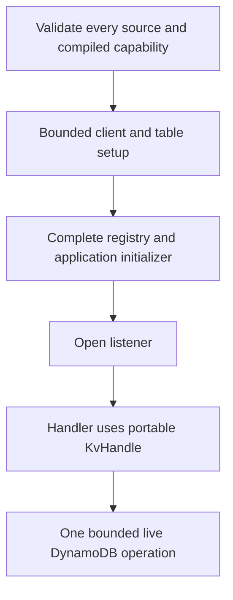

# DynamoDB KV

The native sections below describe the ordinary `aws-dynamodb` format. For
conditional records, partitioned storage and global Scan, see
[conditional KV records](./kv-records) and the
[portable DynamoDB records](#portable-dynamodb-records) section below.
The ordinary and record formats are explicit and do not migrate each other's rows.

DynamoDB is an optional live KV provider for native Axum apps. It uses the existing
`Kv` extractor, `KvHandle` and per-ID registry. Config and Secrets Manager stores
remain independent startup snapshots. DynamoDB calls happen during KV operations,
not only at startup.

## Select a store

Enable `aws-dynamodb` on the generated Axum package, for example in
`edgezero.toml`:

```toml
[adapters.axum.build]
features = ["aws-dynamodb"]
```

`aws-stores` retains its existing AppConfig Agent and Secrets Manager membership.
Use `aws-stores,aws-dynamodb` to enable all three. Native DynamoDB is off by
default on adapters. Its SDK is absent from settings-only, minimal CLI/Axum,
Agent-only and WASM portable-provider graphs. The bundled CLI's default
`bindings-pin` feature intentionally includes the native SDK for operator-run
preflight. An SDK-free CLI build uses
`--no-default-features --features cli,edgezero-adapter-axum`.

Declare a portable KV ID in the application as usual, then select its native
provider in an absolute bindings file:

```toml
version = 1

[kv.state]
provider = "aws-dynamodb"
region = "us-east-1"
table = "edgezero-kv-prod"
namespace = "checkout-prod/state"
```

Set `EDGEZERO__STORE_BINDINGS_FILE` to that file. Selection is explicit. A missing
feature, invalid binding or unavailable table fails before the listener opens.
There is no fallback to redb or another provider. A deployment with no local KV
IDs does not need `DATA_DIR`. Existing supplied/ready/deferred KV handles still
work and must not conflict with a binding for the same ID.

The SDK uses its supported operator-owned credential chain, including workload
roles and configured developer profiles. Do not put credentials in bindings,
images or application config. Region/table/namespace are explicit, and the
binding schema has no endpoint field. SDK profile/environment endpoint settings
remain operator-owned. Structural CLI validation makes no AWS request and reports
provider availability as unknown, not an offline Cargo proof.

## Operator-owned table

Create the table outside EdgeZero, in the selected region. The first version
requires an ACTIVE, single-region table with no secondary/vector indexes or
replicas, and exactly these String keys:

| Attribute       | Role                                                       |
| --------------- | ---------------------------------------------------------- |
| `pk`            | Partition key, the configured physical namespace           |
| `sk`            | Sort key, the exact portable UTF-8 key                     |
| `v`             | Non-key Binary value, including empty values               |
| `expires_at_ms` | Optional Number, logical Unix epoch millisecond expiration |
| `ttl_epoch_s`   | Optional Number, background cleanup timestamp              |

Enable DynamoDB TTL on `ttl_epoch_s` for garbage collection. The provider does not
create or mutate the table or its TTL setting. Disabled cleanup retains expired
records and storage costs, although reads/listings still treat them as missing.

Grant the runtime role only `dynamodb:DescribeTable`, `dynamodb:GetItem`,
`dynamodb:PutItem`, `dynamodb:DeleteItem` and `dynamodb:Query` on the reviewed table
ARN. Restrict `dynamodb:LeadingKeys` to approved namespaces where appropriate.
Table creation, schema/TTL configuration and other publication permissions belong
to the operator role, not the application. The bounded startup DescribeTable
checks shape/status, not write permissions, workload capacity or deployed IAM
correctness.

Physical namespaces must be nonempty, control-free and at most 512 UTF-8 bytes.
Different namespaces isolate data in a shared table. Two bindings to the same
region/table/namespace deliberately share data. Choose an app/environment-specific
namespace rather than a bare common logical ID. One namespace can become a hot
partition; this provider does not shard or certify throughput.

## Semantics and limits

- Keys retain their exact UTF-8 bytes and portable 512-byte limit. No normalization
  or case folding occurs. Prefix listing uses Query, never a whole-table Scan.
- Payloads are limited to **384 KiB**, below DynamoDB's 400 KiB whole-item ceiling.
  The portable 25 MiB validation ceiling does not override this backend limit.
  Excess input returns a fixed validation error before I/O. There is no chunking,
  S3 fallback or truncation.
- Put replaces the whole item. Put without TTL removes prior expiration metadata.
  TTL uses millisecond logical expiry and rounded-up seconds for service cleanup.
  Get/Exists/List check logical expiry after the response. Reads do not delete an
  expired item, avoiding a race with renewal. Synchronize application host clocks.
- Get and Query request strong consistency in the configured region. Pages are
  not snapshots across calls. Concurrent mutations can affect later pages, and
  `KvHandle::read_modify_write` remains non-atomic. There is no CAS, lock, atomic
  counter or distributed identity-graph guarantee.
- Each list call makes one Query with an evaluated-item limit. DynamoDB's 1 MiB
  evaluated-data boundary and expired rows can produce short or empty pages with
  a cursor. Continue until `cursor` is absent, not until `keys` is empty. Cursors
  are bounded and scoped to region/table/namespace/prefix. They are not secret or
  authenticated tokens and must not be logged.
- One SDK attempt is made per operation, with no application retry loop. A timeout
  or error can follow a committed Put/Delete. Retrying from application code can
  overwrite or delete a concurrent writer's newer state. No exactly-once claim is
  made. Missing/expired items alone are successful misses; provider failures are
  errors, never misses.
- Default budgets are 5 seconds per operation, 1 second connect and 2 seconds per
  attempt. A binding's strict `[kv.state.limits]` table can lower the payload cap
  and set ordered positive timeout values. Runtime calls receive fresh deadlines;
  the startup deadline is not reused after readiness. Dropping a future does not
  guarantee termination of credential subprocesses, DNS or socket work.



## Portable DynamoDB records

Fastly can use `provider = "aws-dynamodb-records"` with the default-off generated
adapter feature `aws-dynamodb-records`. The standalone provider crate feature is
`dynamodb-records-portable`. It implements DynamoDB JSON 1.0 with SigV4 over
EdgeZero outbound HTTP, without the AWS SDK or a native executor on WASM. Native
Axum keeps the SDK-backed `dynamodb-records` transport. Both transports use the
same record rows, allocator state and cursor scope.

Follow [portable providers on Fastly](./kv-records#portable-providers-on-fastly)
for the complete manifest, Config Store document, secrets and upload steps.
A DynamoDB binding declares `region`, `table`, `namespace`,
`credentials = { secrets = "<logical-secrets-id>" }` and a preflight-generated
`pinned` table ARN and optional TableId. Runtime credentials come from
`KV__<ID>__AWS_ACCESS_KEY_ID`, `KV__<ID>__AWS_SECRET_ACCESS_KEY` and optional
`KV__<ID>__AWS_SESSION_TOKEN` in that logical secrets store. They are read on first
use per request, never retained across requests. An STS rotator can update those
keys with short-lived credentials.

### Endpoints and pinned identity

Portable bindings accept an optional `endpoint`. Without it, EdgeZero derives the
regional DynamoDB endpoint from `region`, including the China partition suffix.
Use HTTPS. Plain HTTP is accepted only on a literal loopback IP for DynamoDB Local,
for example `endpoint = "http://127.0.0.1:18000"`. Userinfo, paths, queries and
fragments are rejected. Axum rejects the binding's `endpoint` and `credentials`
fields; its native SDK endpoint/credential sources remain unchanged.

`edgezero config bindings pin --adapter fastly --store-bindings <file>` uses the
AWS SDK credential chain and DescribeTable at that same explicit or regional
endpoint. It verifies table shape, captures ARN/TableId, checks the observed
endpoint identity and writes only `pinned`. It does not insert an endpoint or
credentials into the file, create a table or test write permissions.

The portable runtime makes no DescribeTable call and addresses the table by name.
Pins bind cursors to the configured identity, but do not detect same-name table
recreation at runtime. Native startup does reject a pin that differs from its
preflight observation. Do not recreate a bound table in place: recreation discards
allocator rows and can make old generation tokens collide. If it is unavoidable,
re-pin and redeploy bindings before serving, and invalidate outstanding generations.
Converting the table to a global table after pinning is unsupported because Add/CAS
requires the validated single-region table behavior.

### Runtime IAM

For a portable record binding on `ts-identity`, grant these six runtime actions
on one table ARN. Replace the account, region and table with the reviewed target:

```json
{
  "Version": "2012-10-17",
  "Statement": [
    {
      "Effect": "Allow",
      "Action": [
        "dynamodb:GetItem",
        "dynamodb:UpdateItem",
        "dynamodb:PutItem",
        "dynamodb:DeleteItem",
        "dynamodb:Query",
        "dynamodb:Scan"
      ],
      "Resource": "arn:aws:dynamodb:us-east-1:111122223333:table/ts-identity"
    }
  ]
}
```

DescribeTable belongs to the operator's preflight role and native preparation,
not the portable runtime role. Table creation, TTL configuration and permission
administration remain operator responsibilities. Global listing uses Scan, which
reads broadly across the table before namespace/format/prefix filtering. A
partition-only Query policy cannot support that listing path. This policy example
does not qualify hosted IAM or capacity.

### Deadlines and failures

Portable DynamoDB defaults to a 1,000 ms operation deadline and 250 ms connect
timeout. A strict per-binding `[kv.<id>.limits]` table may override timeout values
and lower the payload cap. Positive timeout values must satisfy
`connect_timeout_ms <= attempt_timeout_ms <= operation_timeout_ms`.
Native defaults remain 5,000 ms operation and 1,000 ms connect.

Every record insert makes UpdateItem then PutItem under one shared deadline,
including Add/CAS. Neither call is automatically retried. A definitive condition
failure is `PreconditionFailed`; failure before value dispatch or a definitive
service rejection is `Unavailable`. A dispatched value write with an uncertain
outcome returns `MutationUncertain`, never a successful miss or an automatic
replay. See [deadlines and uncertain writes](./kv-records#deadlines-and-uncertain-writes)
for reconciliation guidance and the pending real Fastly latency evidence.

## Diagnostics and verification scope

EdgeZero-owned errors/debug output do not retain SDK response details or raw
keys, values, credentials or cursors. **Dependency DEBUG/TRACE is not suppressed.**
DynamoDB SDK model Debug can expose item keys and values, including binary bytes,
without Secrets Manager's sensitive-output protections. Review application logging
filters before enabling SDK diagnostics. The provider does not install subscriber
suppression or change global logging. Do not assume `LOG_SENSITIVE_BODIES=false`
redacts DynamoDB model Debug.

Default verification uses deterministic fixtures and the actual SDK wire path
with explicit dummy credentials and literal-loopback endpoints. CI also runs a
required [independent local-service suite](./native-aws-stores#account-free-integration-tests)
against DynamoDB Local, including base-table Query pagination across the 1 MiB
evaluation boundary. Neither suite proves AWS IAM, capacity, deployed service
behavior or global-table correctness. Real AWS acceptance requires separate
authorization and disposable-resource ownership.

See [native AWS stores](./native-aws-stores) for captured bootstrap and startup
composition.
