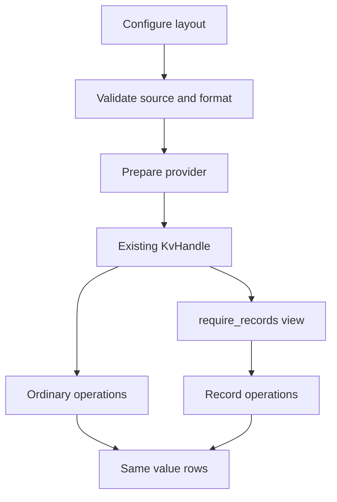

# Conditional KV records

A record-capable KV binding adds generations, atomic Add/CAS, exact authoritative
existence and strongly consistent partition pages. It uses the same value rows as
ordinary `KvHandle` operations. It is not a second store or registry.

Built-in implementations are Fastly KV and Axum's persistent redb, DynamoDB and
celld record modes. Cloudflare and Spin built-ins reject record requirements during
application construction. Ordinary-only KV bindings keep their existing behavior.

## Declare grouping before preparation

Declare the logical KV ID in `edgezero.toml`, then install its layout in the
portable application's configure hook:

```toml
[stores.kv]
ids = ["sessions"]
```

The application defines key meanings. This example puts `session/42` in the
complete `session/` partition:

```rust
use edgezero_core::key_value_store::KvError;
use edgezero_core::record_store::{RecordKeyLayout, RecordLayout};

struct FirstSegmentLayout;

impl RecordKeyLayout for FirstSegmentLayout {
    fn id(&self) -> &str { "example-first-segment" }
    fn version(&self) -> u32 { 1 }

    fn validate(&self) -> Result<(), KvError> {
        // Nonempty first segments followed by '/' form disjoint partitions.
        Ok(())
    }

    fn partition_prefix<'key>(&self, key: &'key str) -> Result<&'key str, KvError> {
        let slash = key.find('/')
            .ok_or_else(|| KvError::Validation("missing key group".to_owned()))?;
        if slash == 0 || slash + 1 == key.len() {
            return Err(KvError::Validation("invalid grouped key".to_owned()));
        }
        Ok(&key[..=slash])
    }

    fn validate_partition(&self, prefix: &str) -> Result<(), KvError> {
        if prefix.strip_suffix('/').is_some_and(|group| {
            !group.is_empty() && !group.contains('/')
        }) {
            Ok(())
        } else {
            Err(KvError::Validation("incomplete partition".to_owned()))
        }
    }
}
```

In your existing `Hooks::configure` implementation:

```rust
app.require_record_store("sessions", RecordLayout::new(FirstSegmentLayout)?)?;
```

Keep the layout's ID/version and placement rules stable. Changing placement needs
an explicit format/cutover decision, not different rules under the same identity.
Full keys remain the identity of point operations; grouping does not replace or
shorten them.

Declarations are sealed after configure. The initializer may call
`kv.require_records()?`, but cannot change routing. That acquisition performs no
I/O and does not upgrade an ordinary-only provider. Supplied ready/deferred handles
must already match. Local IDs sharing one backing name must request the same
layout and format; an ordinary alias cannot silently switch to the record table.



## Read and conditionally replace

Given a prepared `KvHandle` named `kv`:

```rust
use edgezero_core::record_store::{RecordWrite, RecordWriteMode, RecordWriteOutcome};

let records = kv.require_records()?;
let outcome = records.insert("session/42", RecordWrite {
    body: b"hello\0world",
    metadata: Some("application text"),
    ttl: None,
    mode: RecordWriteMode::Add,
}).await?;

if outcome == RecordWriteOutcome::Written {
    let current = records.lookup("session/42").await?;
    // A later lookup can observe another writer, not necessarily this write.
}
```

- `lookup` returns exact body bytes, optional UTF-8 metadata and a generation.
  Its consistency and TTL visibility remain provider-specific. A lookup miss is
  not necessarily authoritative absence.
- `Add` atomically rejects an existing value under the provider's expiry rules.
- `IfGenerationMatch(generation)` atomically checks that same key's generation.
  Generations support equality, not numeric ordering or business timestamps.
- `Overwrite` has no generation precondition. A rejection is an error, not normal
  Add/CAS contention.
- `exists_strong` checks exact authoritative existence, not prefix-neighbor
  presence. Ordinary `kv.exists` does not acquire that promise.
- `delete` succeeds for a missing value. It does not erase generation history.

An acknowledged insert returns `Written`, not a fabricated post-write generation.
`PreconditionFailed` means a definitive Add/CAS rejection. Reloading, merging,
retrying or deferring is application policy; `update` below covers the bounded
re-read and re-plan case.

`KvError::MutationUncertain` means a mutation may have committed. EdgeZero does not
replay it. Reconcile with storage before deciding what to do next; blindly retrying
an overwrite or delete can erase another writer's work.

## Re-plan after a lost precondition

`update` reads a record, asks a planner for its replacement and writes it with
`IfGenerationMatch` on the generation read, or `Add` when the lookup missed. When
the write loses its precondition, nothing was written, so the record is read and
planned again, up to the given number of attempts. At most one replacement lands.

```rust
use std::num::NonZeroU8;

use bytes::Bytes;
use edgezero_core::record_store::{RecordReplacement, RecordUpdateOutcome};

let attempts = NonZeroU8::new(2).expect("should be nonzero");
let update = records.update("session/42", attempts, |current| match current {
    Some(record) => Ok(RecordReplacement {
        body: Bytes::from(merge(&record.body)),
        metadata: None,
        ttl: None,
    }),
    None => Err("no session"),
}).await;

match update.result? {
    RecordUpdateOutcome::Written => {}
    RecordUpdateOutcome::Skipped(_reason) => { /* the planner declined */ }
    RecordUpdateOutcome::Conflict | RecordUpdateOutcome::StaleRead => {
        // Nothing was written.
    }
}
// `update.conflicts` counts lost preconditions, even when the update failed.
```

- A lost precondition proves the record exists under another generation. A
  re-read that returns the rejected generation or misses is stale, as an
  eventually consistent lookup can be, and ends with `StaleRead` instead of
  planning on it. A record deleted after the rejection reads the same way.
- Generations are not ordered, so an older distinct generation cannot be
  detected. A replacement planned on it loses its precondition.
- Read and write errors end the update without a retry. A
  `KvError::MutationUncertain` write is never replayed.
- A provider without record operations reports `KvError::Unsupported`. Falling
  back, for example to an ordinary last-write-wins put, is application policy.

## Ordinary access and TTL

Ordinary get/put/TTL-put/delete on this binding use the same record rows. Every
replacement changes the generation. Ordinary puts clear metadata; a no-TTL put
also clears the prior expiration and creates a non-expiring value. Empty metadata
and absent metadata both read as `None`. Metadata is text, while bodies may contain
arbitrary bytes.

TTL uses native provider behavior. There is no portable exact visibility/deletion
deadline or added expiry envelope. In particular, DynamoDB record values remain
visible and block Add while their expired TTL attribute awaits native deletion.
redb and celld can hide expired rows before physical cleanup. The existing portable
TTL input bounds remain 60 seconds through one year.

## Complete pagination

```rust
let partition = records.partition("session/")?;
let mut cursor = None;
loop {
    let page = records.list_partition(&partition, cursor.as_deref(), 100).await?;
    for key in page.keys {
        // Process the full logical key.
    }
    cursor = page.cursor;
    if cursor.is_none() { break; }
}
```

Each record partition page is strong. The traversal is live, unordered and not a
frozen snapshot. Continue through short or empty pages when a cursor is present.
Cursors belong to their binding, layout, operation and query; pass them back
unchanged. They are not authorization tokens and must not be logged.

Ordinary `kv.list_keys_page(prefix, cursor, limit)` still accepts arbitrary and
empty prefixes. On DynamoDB records it uses paginated **Scan**, separate from the
strong partition **Query**. Scan reads broadly before filtering namespace, format,
value kind and logical prefix. Internal allocator or foreign rows can consume a
page without producing keys. There is no global index or complete-store sort per
page.

## Select the native format

Fastly uses its native KV record operations. Axum's local provider selects an
explicit redb record table when the configured ID requires records. Old ordinary
tables are not converted or silently read as records.

For DynamoDB, opt in to the generated Axum feature and matching bindings tag:

```toml
# edgezero.toml
[adapters.axum.build]
features = ["aws-dynamodb-records"]
```

```toml
# Native bindings file selected by EDGEZERO__STORE_BINDINGS_FILE
version = 1

[kv.sessions]
provider = "aws-dynamodb-records"
region = "us-east-1"
table = "edgezero-records"
namespace = "example-prod/sessions"
```

Use an operator-owned ACTIVE table with String `pk`/`sk` keys and the supported
shape described in [DynamoDB KV](./dynamodb-kv). Record preparation also needs the
DescribeTable ARN to identify the backing account/table. It does not create a
table or certify write permissions. Enable native TTL on `ttl_epoch_s`; allocator
items have no TTL and must not be removed with values.

Record PKs encode format, namespace, layout identity and declared partition. Value
and retained allocator SKs contain the unchanged full key under separate `r#` and
`g#` kinds. Every attempted insert allocates a per-key u64 marker with UpdateItem,
then uses conditional or unconditional PutItem. Gaps and out-of-allocation-order
commits are valid. No namespace-wide item is updated by every insert.

The runtime needs DescribeTable, GetItem, UpdateItem, PutItem, DeleteItem, Query
and Scan on the reviewed table. Scan's broad read access differs from a
partition-only policy. This is not hosted IAM or capacity qualification.

For celld, select `celld-records` instead:

```toml
[adapters.axum.build]
features = ["celld-records"]
```

```toml
version = 1

[kv.sessions]
provider = "celld-records"
endpoint = "http://127.0.0.1:8090"
store = "sessions"
access = { mode = "trusted-network", allow_remote_http = false }
```

Use the EdgeZero-owned store service on official stock celld. Its record API
version 1 supplies keyset continuation, nullable expiry and the mutation ledger.
Preparation checks capabilities and captures the store instance without a test
write. Old or KV-only services fail rather than downgrade. Record and ordinary
operations share the service's `rows-v1` data; no modified celld build or separate
record dataset is needed. Each record operation carries the expected instance,
and the service checks it before mutation.
See [native celld stores](./native-celld-stores) for access and hosting setup.

Both native record features are off by default. `aws-dynamodb` and `celld-kv`
remain ordinary-only modes and are not automatically converted when an app
requires records. The standalone provider features are `dynamodb-records` and
`records` for the stock celld service. The fork-only v1/v2 clients are not retained
on this line. Settings-only,
ordinary-only and WASM builds do not gain native SDK/runtime dependencies.

## Binding limits

Existing portable key, body, TTL and page validation still applies, followed by
provider limits. `records.binding().max_metadata_bytes` reports the supported
metadata byte maximum, excluding empty/absent metadata.

| Binding          | Metadata supported by this binding                                                                                             |
| ---------------- | ------------------------------------------------------------------------------------------------------------------------------ |
| Fastly native    | 2000 UTF-8 bytes                                                                                                               |
| redb records     | Existing 25 MiB value ceiling                                                                                                  |
| DynamoDB records | Configured payload budget, default 384 KiB; body plus metadata must fit together and the complete native item must fit 400 KiB |
| celld service    | 1024 UTF-8 bytes                                                                                                               |

Generation history survives value overwrite, expiry, deletion/recreation and
provider reopen. It is not safe to delete allocator state while continuing to
use the same generation domain. No data migration, service image publication,
fleet failover or rolling-upgrade qualification is supplied by this feature.
