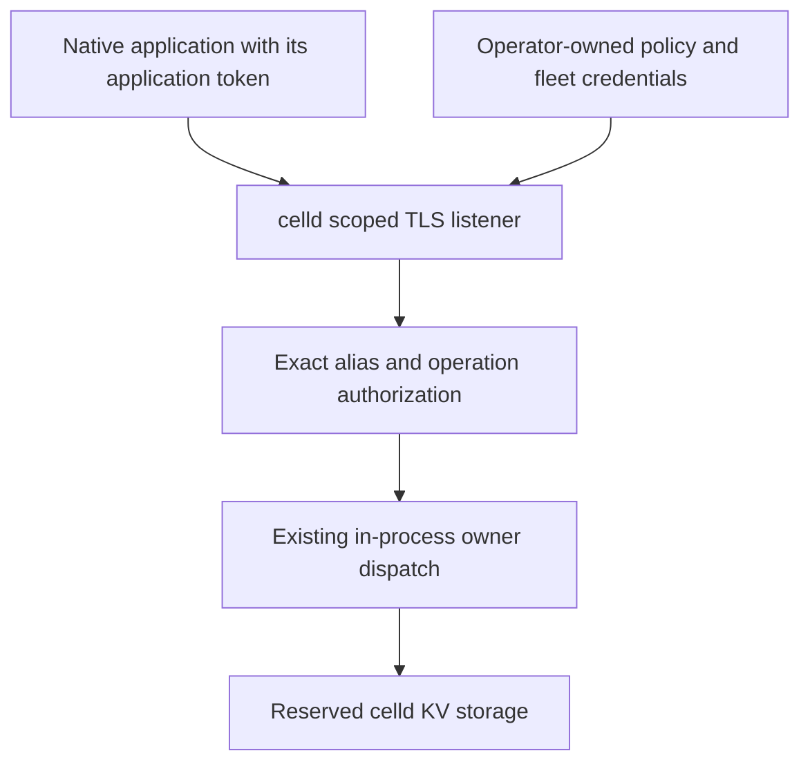

# Native celld stores

The native provider reads complete configuration documents at startup and exposes live KV operations through a scoped listener **inside celld**. There is no gateway, sidecar, Worker bridge or celld HTTP adapter.

This is an unreleased integration. It requires the modified celld revision `f72ae21a515859570622ac9d6ca9c19cf6870b81`. Upstream celld v0.6.2 does not have this API. Local tests do not establish fleet failover, deployment security or production readiness.

## Build only the providers you use

Generated Axum targets forward two independent, default-off features:

```toml
[adapters.axum.build]
features = ["celld-config", "celld-kv"]
```

The provider crate uses `config` and `kv`. Its settings compile without live transport dependencies. Applications do not depend on the celld runtime or V8. Existing AWS features and the `aws-stores` alias keep their current membership.

A deployment file cannot enable a provider omitted from the application binary. Startup checks the compiled capabilities before preparing any selected store.

## Keep declarations portable

The application declares logical IDs in `edgezero.toml`:

```toml
[stores.config]
ids = ["application"]
default = "application"

[stores.kv]
ids = ["state"]
default = "state"
```

A separate native deployment file selects providers:

```toml
version = 1

[config.application]
provider = "celld-config"
endpoint = "https://stores.example.internal:7780"
default_key = "settings"

[config.application.access]
mode = "authenticated"
token_env = "CHECKOUT_STORE_TOKEN"

[config.application.documents.settings]
store = "checkout-config"
key = "application-envelope"

[kv.state]
provider = "celld-kv"
endpoint = "https://stores.example.internal:7780"
store = "checkout-state"

[kv.state.access]
mode = "authenticated"
token_env = "CHECKOUT_STORE_TOKEN"
```

These are fictional resource names. `store` is a service-owned alias, never a physical namespace or runtime scope. The schema rejects unknown fields, malformed endpoints, undeclared IDs and conflicting sources. Endpoints are HTTP or HTTPS origins without userinfo, query, fragment or a non-root path. Keys and aliases retain their exact case and UTF-8 bytes.

Select the absolute file path with `EDGEZERO__STORE_BINDINGS_FILE`. The environment-loading runner captures the selected file and the union of selected config/KV token names once. Explicit `AxumRunOptions` uses supplied bootstrap values, not ambient variables. Tokens are 32 through 512 header-safe ASCII graphic bytes. Generate random application tokens and inject them through deployment secret management. Do not put token values in TOML or URLs.

Different IDs can select celld, AWS, local providers or supplied handles. Celld-only bindings need no AWS credentials or local roots. An unbound ID retains its existing local default and may require a local root. There is no celld secret provider. A typed celld config document may reference a separately bound AWS secret store.

## Configure the listener in celld

Add `--store-api-config /absolute/scoped-stores.json` to the existing celld deployment command. Without this selection, celld opens no scoped socket.

An authenticated policy has this form:

```json
{
  "version": 1,
  "listen": "0.0.0.0:7780",
  "tls": {
    "cert": "/etc/celld/server-chain.pem",
    "key": "/etc/celld/server-key.pem"
  },
  "stores": [
    { "alias": "checkout-config", "namespace": "production-checkout-config" },
    { "alias": "checkout-state", "namespace": "production-checkout-state" }
  ],
  "access": {
    "mode": "authenticated",
    "tokens": [
      {
        "id": "checkout",
        "sha256": "<lowercase SHA-256 verifier of the application token>",
        "grants": [
          { "store": "checkout-config", "operations": ["read"] },
          {
            "store": "checkout-state",
            "operations": ["read", "write", "delete", "list"]
          }
        ]
      }
    ]
  }
}
```

Replace the verifier placeholder through operator-owned provisioning. It is not a usable policy value. The application receives only its own bearer token. Celld owns the TLS key, policy, physical namespaces, fleet discovery and fleet credentials.

Celld captures policy and certificates at startup. Restart celld to adopt changed grants, replace certificates or revoke a token. Overlapping credential IDs permit staged token replacement. There is no issuance service or hot reload. Loaded application config snapshots remain available after remote revocation until the application restarts. Live KV calls use current server authorization.

### Trusted-network access

A binding may instead select:

```toml
[config.application.access]
mode = "trusted-network"
```

Literal loopback HTTP needs no further client opt-in. Remote HTTP requires `allow_remote_http = true`. This flag permits unencrypted transport; it does not establish network isolation. HTTPS still verifies the server certificate.

The corresponding celld policy uses `mode: "trusted-network"` with a `grants` list. Every reachable caller receives those grants. Non-loopback service binding also requires `allow_remote_trusted_network: true`. Trusted-network mode rejects supplied credentials, and authentication failure never falls back to anonymous access.

Restrict the scoped listener to intended workloads. Block application access to celld's internal operator listener and fleet credentials, including filesystem and process views. A private IP or successful TLS request does not prove these restrictions.



The diagram has no application route to the internal operator listener. Enforce that boundary in the actual deployment, not just in application code.

## Configuration lifecycle

Startup validates every source selection, policy, setting and selected credential before provider I/O or deferred preparation. It prepares config snapshots before running the application initializer, publishing readiness or accepting requests. Missing documents, invalid UTF-8, quota failures and remote errors fail startup without local or stale fallback.

The provider preserves whole UTF-8 documents, including whitespace and empty documents. It does not project JSON fields or resolve secrets. Core validates `BlobEnvelope`, typed configuration and secret references when the application initializer requests them.

Ordinary and bounded config reads use immutable shared values and perform no network I/O. Publish new complete documents through operator-owned tooling, then restart the app to adopt them. Multiple documents and providers are not an atomic release. `edgezero config push` refuses selected celld config bindings; it does not publish to celld or write a substitute local file.

## Live KV and limits

KV preparation builds a handle without probing the service. Startup success alone does not prove connectivity or operation grants. Each live call has a fresh deadline.

| Limit                                            | Default or service ceiling                               |
| ------------------------------------------------ | -------------------------------------------------------- |
| Raw value and config document                    | 1 MiB each                                               |
| Retained config snapshot per preparation session | 8 MiB                                                    |
| Logical mappings before deduplication            | 1,024, counting each config document and KV binding      |
| Preparation metadata                             | 1 MiB                                                    |
| Key page JSON                                    | 2 MiB                                                    |
| Page entries                                     | At most 1,000                                            |
| Service cursor / provider cursor                 | 2 KiB / 8 KiB                                            |
| Remote key                                       | Nonempty UTF-8, at most 512 bytes, no controls           |
| Store alias                                      | At most 64 ASCII letters, digits, underscores or hyphens |
| Preparation / operation / connect timeout        | 30 / 5 / 1 seconds                                       |

`[limits.celld]` or `with_celld_preparation_limits` selects one celld policy. File and explicit policies do not merge. AWS has an independent policy and accounting. Client caches hold at most 128 authorization-scoped entries. Accounting describes logical payload and metadata quotas, not process RSS.

Binary and empty values remain distinct from missing keys. Missing delete succeeds. TTL is between 60 and 31,536,000 seconds. Fractional valid durations round upward without shortening lifetime; unsupported durations fail rather than clamp. TTL overwrite renews expiry. Plain put removes expiry.

Listing returns one bounded page, including a short or empty continuing page. It is not a snapshot. Cursors bind endpoint, alias and prefix, but never confer authorization. Preserve a returned continuation rather than scanning repeatedly to fill a page.

The client disables redirects, ambient proxies, retries and decompression. It validates the version header and bounds streamed values, pages and error bodies. Celld scoped dispatch also disables ambiguous replay. A failed or timed-out mutation may have applied. The provider does not promise exactly-once operations, CAS or transactions.

Provider-owned errors and Debug output redact credentials and omit remote payloads, URLs and source chains. Dependency DEBUG/TRACE logging is outside that promise. Application-owned initializer errors and logs remain the application's responsibility. Review deployment logging before enabling it.

## Validation and local proofs

Offline validation remains structural-only:

```sh
edgezero config validate --adapter axum \
  --store-bindings /etc/my-app/native-stores.toml \
  --target-features celld-config,celld-kv
```

Provider availability is always unknown offline. Target controls normalize and forward Cargo arguments; validation does not resolve the application's feature graph, capture tokens, connect to endpoints or verify grants/content.

Normal CI uses deterministic loopback client and public-runner fixtures. The generated-consumer proof builds default-off, config-only, KV-only and combined targets. The separate real-service command requires an explicit modified celld executable, Linux namespace tools, curl and OpenSSL:

```sh
CELLD_BIN=/absolute/path/to/modified/celld \
EDGEZERO_GENERATED_TEST_TARGET_DIR=/absolute/path/to/disposable-build-cache \
node scripts/run_native_celld_integration.mjs
```

Missing prerequisites fail the command. It uses disposable data and dummy credentials, checks private namespace isolation, and runs a generated native app against the embedded API with certificate verification. It does not access a real fleet or AWS account. The plan records executed results and remaining gates. Multi-node forwarding, reload, production storage/replication, upgrades and stress acceptance remain separate work.
