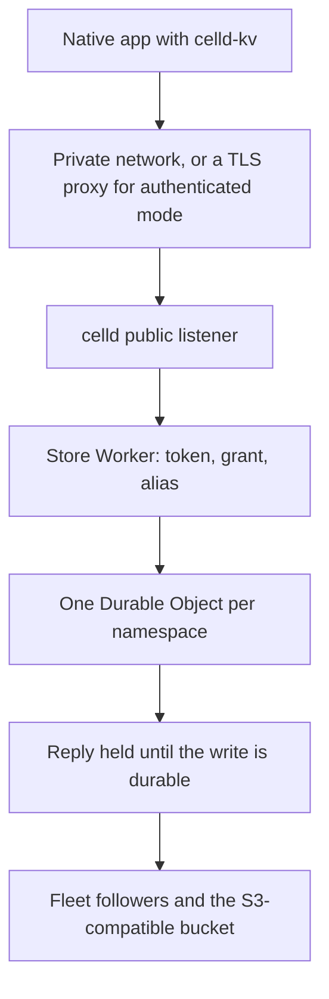

# celld stores

The native `celld-kv` provider gives an Axum application live KV backed by [celld](https://celld.dev). It talks over HTTP to the EdgeZero store service, a small Worker and Durable Object application in [`services/celld-store`](https://github.com/IABTechLab/edgezero/tree/main/services/celld-store) that the official celld release runs unmodified. Fastly can use the same service through the [portable celld record provider](#portable-celld-records-on-fastly).

This page targets celld v0.6.3. Local tests do not establish fleet capacity, production bucket durability or deployment security.



There is no celld config provider. Load application config through another provider and use celld for live KV.

## Build only the provider you use

Generated Axum targets forward the default-off feature:

```toml
[adapters.axum.build]
features = ["celld-kv"]
```

The provider crate's `kv` feature holds the HTTP client. Its settings compile without live transport dependencies, and applications never depend on celld or V8. AWS features and the `aws-stores` alias keep their membership. A deployment file cannot enable a provider the binary was built without; startup checks compiled capabilities first.

## Conditional records

Build with `celld-records` and select `provider = "celld-records"` for a declared
logical KV ID. Declare its layout through `App::require_record_store` before
provider preparation. The initializer acquires the existing prepared record
view; it does not reopen a provider.

The service in this revision supports record API version 1 over the same
`rows-v1` table as ordinary KV. Preparation reads its capability and instance.
Every operation on a record handle carries the expected instance, which the
service checks before effects. Ordinary replacements clear metadata and issue
a fresh generation. No-TTL replacements remove prior expiry.

The namespace allocator survives value deletion and sweeping. Conditional
writes and physical existence use the retained row, while lookup/list filter
expired values until physical cleanup. celld's internal redeliveries are answered
from the mutation ledger, including the original precondition rejection; the Rust
client never retries automatically. Same-instance snapshot rollback is still
not detected.

See [conditional KV records](./kv-records) for the shared API, limits and
pagination contract. The generated feature is `celld-records`; the provider
crate feature is `records`. No celld config provider is added.

## Portable celld records on Fastly

Enable the generated Fastly adapter's default-off `celld-records` feature:

```toml
[adapters.fastly.build]
features = ["celld-records"]
```

The standalone store crate feature is `portable-records`; native Axum continues
using `records`. Both transports share record API version 1, `rows-v1` encoding,
metadata limits, mutation IDs and cursor validation. No celld server, V8, reqwest
or native executor is linked into the portable provider.

Use this unpinned input alongside the logical `[stores.kv]` ID `sessions` and
`[stores.secrets]` ID `stores` in the application manifest:

```toml
version = 1

[kv.sessions]
provider = "celld-records"
endpoint = "https://celld.example.net"
store = "sessions"
access = { mode = "authenticated", token_secret = { secrets = "stores" } }
```

Portable celld accepts only authenticated HTTPS with `token_secret`.
`trusted-network` and `token_env` are native-only. Axum rejects `token_secret` and
keeps its startup environment token source. For authenticated access, put a TLS
terminator with a valid certificate in front of stock celld. Authentication does
not disable certificate verification.

For preflight, supply `KV__SESSIONS__CELLD_TOKEN` through the operator process's
environment, then run:

```sh
edgezero config bindings pin --adapter fastly --store-bindings portable-stores.toml
edgezero config validate --adapter fastly \
  --store-bindings portable-stores.toml --manifest edgezero.toml
```

The environment variable name is exactly the derived runtime secret key for this
KV ID. Pinning calls the read-only capabilities endpoint and inserts
`pinned = { instance = "<observed-store-instance>" }` without changing the
`token_secret` reference. It never probes with a write or stores the token value.
Validation is offline and reads no token.

At runtime, the logical Fastly Secret Store supplies `KV__SESSIONS__CELLD_TOKEN`
on the provider's first operation per request. It is reused within that request
only. The next request reads the current value, so updates and revocation do not
wait for a cached token in a retained application. Service policy changes still
follow celld's deployment adoption described below.

Every record request sends `x-edgezero-expected-instance` with the pinned instance.
A store reset or replacement fails requests until the bindings are re-pinned and
redeployed. Restoring a snapshot with the same instance is not detected.
The Fastly runtime does no capabilities discovery or other preparation I/O.

Portable celld uses a 1,000 ms operation deadline and a 250 ms connect timeout,
compared with native defaults of 5,000 ms and 1,000 ms. A write is one service call;
the portable client never retries it. A definitive Add/CAS rejection is
`PreconditionFailed`. A failure before dispatch or definitive service rejection is
`Unavailable`; a dispatched value mutation whose result is unknown is
`MutationUncertain`. Reconcile before issuing a new write.

Follow [portable providers on Fastly](./kv-records#portable-providers-on-fastly)
for the Config Store entry, build-feature forwarding, manual upload, no-fallback
rules and pending hosted latency evidence. The provider also compiles for
Cloudflare and Spin targets; their runtime wiring remains
[#479](https://github.com/IABTechLab/edgezero/issues/479) and
[#484](https://github.com/IABTechLab/edgezero/issues/484).

## Bind a logical store

The application declares logical IDs in `edgezero.toml`:

```toml
[stores.kv]
ids = ["state"]
default = "state"
```

A native deployment file selects the provider:

```toml
version = 1

[kv.state]
provider = "celld-kv"
endpoint = "http://celld-store.internal:8080"
store = "checkout-state"

[kv.state.access]
mode = "trusted-network"
allow_remote_http = true
```

`store` is an alias from the service policy, never a physical namespace. The schema rejects unknown fields, malformed endpoints, undeclared IDs and conflicting sources. Endpoints are HTTP or HTTPS origins without userinfo, query, fragment or path. Keys and aliases keep their exact case and UTF-8 bytes.

Select the absolute file path with `EDGEZERO__STORE_BINDINGS_FILE`. Different IDs can select celld, AWS, local providers or supplied handles. Celld-only bindings need no AWS credentials or local roots.

### Access modes

**Trusted network.** Every caller that reaches the service gets the policy's grants. Literal loopback HTTP needs no opt-in; remote HTTP needs `allow_remote_http = true`. That flag permits plaintext. It does not create network isolation. Restrict which workloads reach celld's public listener with your network policy.

**Authenticated.** The binding names a token variable:

```toml
[kv.state]
provider = "celld-kv"
endpoint = "https://celld-store.internal"
store = "checkout-state"

[kv.state.access]
mode = "authenticated"
token_env = "CHECKOUT_STORE_TOKEN"
```

Authenticated bindings require HTTPS. celld does not terminate TLS, so put a TLS proxy, ingress or service mesh in front of its public listener. The client verifies the certificate and disables redirects, ambient proxies, retries and decompression. Tokens are 32 to 512 header-safe ASCII graphic bytes. Generate random tokens and inject them through deployment secret management, never TOML or URLs. The environment runner captures each named token once at startup.

## Deploy the store service

Give the service its own celld fleet and bucket. celld runs one application per fleet.

1. Copy `services/celld-store/wrangler.template.jsonc` to `wrangler.jsonc` beside `src/`.
2. Write the policy into `vars.EDGEZERO_STORE_POLICY` as a JSON string.
3. Run `celld deploy <dir> --bucket s3://<fleet-bucket>`. Nodes adopt the new version within `CELLD_DEPLOY_POLL_S` (default 30 seconds) without restarting.

Keep the template's `name`, binding and class name. celld derives each Durable Object's identity from the script and class names, so a rename reaches new, empty storage. The client notices the changed store instance and fails rather than mixing old and new data.

The policy lists aliases and grants:

```json
{
  "version": 1,
  "stores": [
    { "alias": "checkout-state", "namespace": "production-checkout-state" }
  ],
  "access": {
    "mode": "authenticated",
    "tokens": [
      {
        "id": "checkout",
        "sha256": "<lowercase SHA-256 of the application token>",
        "grants": [
          {
            "store": "checkout-state",
            "operations": ["read", "write", "delete", "list"]
          }
        ]
      }
    ]
  }
}
```

For trusted-network mode, replace `tokens` with a `grants` list. The policy holds verifiers only, because celld `vars` live in the fleet bucket with the deployment. Unknown fields, duplicate aliases or token IDs, and unknown grant targets make every request fail with `unavailable` until a valid policy is deployed.

Replace a token by deploying a policy with both the old and new token IDs, rolling the application, then deploying without the old one. Revocation takes effect when nodes adopt the deployment.

### Deploy automatically

Run the deploy step from your manifests so operators have nothing to do by hand. A Kubernetes Job using the official image:

```yaml
apiVersion: batch/v1
kind: Job
metadata:
  name: edgezero-store-deploy
spec:
  backoffLimit: 3
  template:
    spec:
      restartPolicy: Never
      containers:
        - name: deploy
          image: ghcr.io/denoland/celld:0.6.3
          args:
            [
              'deploy',
              '/service',
              '--bucket',
              's3://celld-fleet',
              '--endpoint',
              'http://bucket.storage:9000',
            ]
          envFrom:
            - secretRef:
                name: celld-bucket-credentials
          volumeMounts:
            - { name: service, mountPath: /service, readOnly: true }
      volumes:
        - name: service
          configMap:
            name: edgezero-store-service
            items:
              - { key: wrangler.jsonc, path: wrangler.jsonc }
              - { key: index.js, path: src/index.js }
```

Create the ConfigMap from the pinned EdgeZero release. ConfigMap keys cannot contain `/`, so the `items` above put `index.js` back under `src/`:

```sh
kubectl create configmap edgezero-store-service \
  --from-file=wrangler.jsonc=./wrangler.jsonc \
  --from-file=index.js=services/celld-store/src/index.js
```

Use the same bucket credentials your celld nodes use, in celld's namespace, never in the application's. Re-running the Job with unchanged content redeploys the same code and keeps all stored data. The bucket names and endpoint are examples. Pin the celld image and EdgeZero release you tested.

The bucket must pass `celld diagnose`. celld's qualified stores are Amazon S3, Cloudflare R2, Tigris, Google Cloud Storage and Azure Blob Storage; test any other S3-compatible store before relying on it. Run at least two celld nodes, or every write waits for a bucket round trip.

Keep celld's internal listener unreachable from application workloads.

## Live KV behavior

KV preparation builds a handle without contacting the service. Startup success does not prove connectivity or grants. Each call has its own deadline.

| Limit                                     | Default or service ceiling                               |
| ----------------------------------------- | -------------------------------------------------------- |
| Value                                     | 1 MiB                                                    |
| Logical bindings                          | 1,024                                                    |
| Preparation metadata                      | 1 MiB                                                    |
| Key page JSON                             | 2 MiB                                                    |
| Page entries                              | At most 1,000                                            |
| Service cursor / provider cursor          | 2 KiB / 8 KiB                                            |
| Key                                       | Nonempty UTF-8, at most 512 bytes, no controls           |
| Store alias                               | At most 64 ASCII letters, digits, underscores or hyphens |
| Preparation / operation / connect timeout | 30 / 5 / 1 seconds                                       |

`[limits.celld]` or `with_celld_preparation_limits` selects one celld policy. File and explicit policies do not merge.

Binary and empty values stay distinct from missing keys. Missing delete succeeds. TTL is between 60 and 31,536,000 seconds; fractional durations round up and unsupported ones fail. TTL overwrite renews expiry. Plain put removes it. Reads, existence checks and listings hide a key from the moment it expires.

Listing returns one page in byte order, at most the requested size. Keep following the cursor until it is `null`; a short page can still continue. Pages are not a snapshot. Cursors bind the endpoint, alias, prefix and store instance, but never confer authorization.

Every write to a namespace runs on the one node that owns its object. That caps write throughput per namespace. Use separate namespaces for independent write-heavy data.

### Failed writes

The client sends each mutation once with a fresh `x-edgezero-mutation-id`. It never resends. A failed or timed-out mutation may have applied, and the error says only that.

Inside the fleet, celld can deliver one call twice when a peer connection fails after the owner ran it. Proxies can retry too. The service records each mutation ID in the same transaction as the write and answers a repeat with the first outcome, so a repeat never applies again. A mutation that reaches its object more than 10 seconds after the Worker received it is rejected without applying. The ordinary KV provider still does not promise exactly-once operations from the caller's point of view, CAS or transactions.

Provider errors and Debug output redact credentials and omit remote payloads, URLs and source chains.

## Validation and proofs

Offline validation is structural:

```sh
edgezero config validate --adapter axum \
  --store-bindings /etc/my-app/native-stores.toml \
  --target-features celld-kv
```

It does not resolve features, read tokens, contact endpoints or check grants.

Normal CI runs deterministic loopback client, public-runner and generated-consumer tests. Three explicit proofs use real services and fail when a prerequisite is missing.

The service unit tests run against real SQLite:

```sh
node --test services/celld-store/test/service.test.mjs
```

The generated consumer proof needs an official celld binary, Node.js and OpenSSL. It runs `celld dev` with the service behind a local TLS proxy, covering authentication, binary values, TTL expiry, restart and a rejected token:

```sh
CELLD_BIN=/absolute/path/to/official/celld \
EDGEZERO_GENERATED_TEST_TARGET_DIR=/absolute/path/to/disposable-build-cache \
node scripts/run_native_celld_integration.mjs
```

The fleet proof needs the binary, Docker and curl. It starts a disposable bucket container and two nodes, drops one reply between them, and checks that celld's resend applies nothing twice. It then kills the owning node and checks that every acknowledged write survives takeover:

```sh
CELLD_BIN=/absolute/path/to/official/celld node scripts/run_celld_store_fleet_proof.mjs
```

These are local proofs. Production bucket behavior, network isolation, upgrades under load and sustained throughput need separate acceptance.
