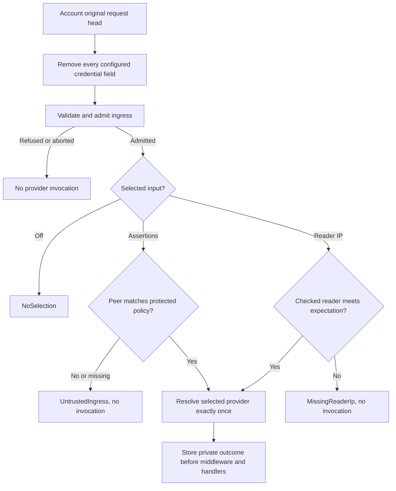

# Native Geo providers

Native Axum hosting can resolve estimated country and subdivision from an operator-supplied
local GeoLite database, protected CloudFront assertions, or a supplied local provider, once per
admitted request. Geo is off by default. There is no remote lookup, fallback provider, downloader,
hot reload, CLI option, environment selector, or manifest selector.

Geography is an estimate, not proof of residence, identity, consent, or permission. Applications
own jurisdiction recognition and policy. A missing subdivision stays unknown, and a
syntax-valid subdivision is not necessarily assigned or recognized.

## Select a provider in Rust

The public selection API lives in `edgezero_adapter_axum::geo` with the `axum` feature.
Built-in implementations use default-off features. Choose `geo-maxmind` for a local database,
`geo-cloudfront` for protected assertions, or both to make both implementations available.
Compiling both still selects only one provider:

```toml
[dependencies]
edgezero-adapter-axum = { version = "<your-edgezero-version>", default-features = false, features = ["geo-maxmind"] }
```

Use the same pinned EdgeZero release as your application. This feature enables `axum`, not
AWS stores or an AWS SDK. A Geo-only application needs no AWS credentials, config/data roots,
or declared stores. Existing declared stores keep their own startup requirements.

### Off

Every options constructor defaults to `Off`, including `from_env` and `from_vars`. Selection
is always programmatic, even when other hosting settings come from the environment.

```rust
use edgezero_adapter_axum::dev_server::AxumRunOptions;
use edgezero_adapter_axum::geo::{NativeGeoCapability, NativeGeoSelection};
let options = AxumRunOptions::new("127.0.0.1:8787".parse()?)?
    .with_geo(NativeGeoSelection::Off);
assert_eq!(options.geo_capability()?, NativeGeoCapability::Off);
```

### Local GeoLite database

Enable `geo-maxmind` and supply a regular MMDB file. Initially only metadata types
`GeoLite2-City` and `GeoLite2-Country`, with IP version 4 or 6, are supported. City supplies
country and optional first-level subdivision; Country supplies country only. Other MMDB
publishers or types are not supported merely because their format decodes.

For a server directly receiving reader connections:

```rust
use edgezero_adapter_axum::dev_server::AxumRunOptions;
use edgezero_adapter_axum::geo::{MaxMindGeoConfig, NativeGeoSelection, ReaderIpExpectation};

let options = AxumRunOptions::new("0.0.0.0:8787".parse()?)?
    .with_geo(NativeGeoSelection::MaxMind {
        config: MaxMindGeoConfig::new(
            "/var/lib/edgezero/geo/GeoLite2-City.mmdb",
            ReaderIpExpectation::PeerAllowed,
        ),
    });
let _configured = options.geo_capability()?;
```

Behind a reverse proxy, require an explicitly resolved forwarded reader instead of geolocating
the proxy. Protect the proxy-to-server network and configure the actual proxy peer ranges:

```rust
use edgezero_adapter_axum::dev_server::AxumRunOptions;
use edgezero_adapter_axum::geo::{MaxMindGeoConfig, NativeGeoSelection, ReaderIpExpectation};
use edgezero_adapter_axum::proxy::{ForwardingHeaderFamily, TrustedProxyPolicy};

let proxy = TrustedProxyPolicy::new(
    ForwardingHeaderFamily::Forwarded, ["10.20.0.8/32"],
)?;
let options = AxumRunOptions::new("0.0.0.0:8787".parse()?)?
    .with_trusted_proxy_policy(proxy)
    .with_geo(NativeGeoSelection::MaxMind {
        config: MaxMindGeoConfig::new(
            "/var/lib/edgezero/geo/GeoLite2-City.mmdb",
            ReaderIpExpectation::ForwardedRequired,
        ),
    });
```

Use `ForwardingHeaderFamily::XForwarded` for an ingress that owns the X-Forwarded chain.
See [trusted proxy configuration](./axum-diagnostics.md#what-makes-a-forwarding-assertion-trustworthy)
for chain validation and network controls. This is not the protected CloudFront/ALB policy.
No origin credential or geographic header is needed for local lookup.

| Checked ingress                                  | `PeerAllowed`       | `ForwardedRequired` |
| ------------------------------------------------ | ------------------- | ------------------- |
| Trusted Forwarded or X-Forwarded client resolved | Use checked client  | Use checked client  |
| Direct client with actual socket peer            | Use normalized peer | `MissingReaderIp`   |
| No usable checked reader or no actual peer       | `MissingReaderIp`   | `MissingReaderIp`   |

IPv4-mapped IPv6 addresses retain ingress normalization. A resolved forwarded client remains
usable when host or scheme is absent. Malformed or unresolved forwarding can leave direct facts;
`PeerAllowed` deliberately permits that peer, so it is the wrong expectation for a proxy-only
reader path. Raw headers, forged public extensions and caller-supplied connection metadata cannot
supply the private checked reader. Geographic headers never affect local lookup.

#### Mount and prepare the snapshot

Download and verify the dataset in your deployment process, outside the server. Check its
publisher-provided integrity information and protect the distribution channel. Do not put
MaxMind credentials in the runtime environment or image. For example, mount an already populated
host directory read-only into your existing application image:

```sh
docker run --rm \
  --mount type=bind,src=/srv/edgezero/geo,dst=/var/lib/edgezero/geo,readonly \
  -p 8787:8787 your-app-image
```

The Rust selection above supplies the path; the mount alone enables nothing. Make the file
readable by the runtime user. EdgeZero creates no database, sidecar or lock file and does not
need AWS credentials, a writable data root or a database server. File acquisition is currently
supported on Unix; other platforms reject preparation before opening the source.

Preparation reads the file once into an immutable in-memory reader before application
initialization, binding and readiness. It rejects missing/nonregular files, unsupported metadata,
corruption and incompatible consumed field types. Upstream verification is followed by a bounded
recursive structural pass over reachable data records and borrowed geographic projection checks.
The pinned reader still accepts some malformed unused metadata fields. This is an open
[#438 acceptance blocker](https://github.com/IABTechLab/edgezero/issues/438); the data-record pass
does not close it. Validation also does not prove publisher authenticity. Structurally valid but
unsupported code strings fail only when looked up.

`MaxMindGeoConfig::limits` is public `MaxMindPreparationLimits`, defaulting to
`max_database_bytes = 128 * 1024 * 1024` and `max_validation_networks = 32_000_000`.
The actual read is capped, including an extra-byte overflow check. The visit budget bounds the
upstream tree allowance and network iteration, including aliases and no-data leaves. The pinned
reader also bounds per-decode values, payload and depth; verification memoizes shared values,
while the structural pass expands them under decoder limits. Allocation grows with file bytes,
referenced values and visited records. These are not fixed-RSS or wall-clock guarantees.
Exceeding a bound fails startup, never skips validation. Raise limits deliberately and measure
preparation time and peak memory with your permitted production snapshot before rollout.

Preparation is synchronous and pre-runtime, before signal registration and polling an embedding
stop future. An already-requested stop still waits for preparation; an invalid selected database
still fails startup first. Early signals follow the caller/OS disposition. Filesystem I/O time is
not bounded by byte/work limits. Cooperative startup cancellation applies only after this phase.

After logging initialization, startup diagnostics identify the loaded database type, build epoch
and SHA-256 of the loaded bytes. These identify the snapshot, not freshness, accuracy or
signature verification. Configuration Debug redacts paths; reader input Debug redacts addresses.
Outcomes retain no reader address or database path. Default framework diagnostics do not log
reader IPs, geographic input headers or raw decode errors. Application code must preserve that
redaction and avoid address/code/checksum metric labels.

#### Updates, licensing and deletion

GeoLite data is free of charge. A free MaxMind account and download license key are required
for downloads, not for running a local snapshot. The `maxminddb` reader's ISC license is
separate from the dataset's [GeoLite EULA](https://www.maxmind.com/en/geolite/eula), incorporated
Creative Commons terms, attribution and redistribution obligations. Recheck the current terms
before distributing an image, dataset or derived data. EdgeZero does not bundle production data.

Provide the required attribution in the relevant product documentation and advertising, following
[MaxMind's guidance](https://support.maxmind.com/knowledge-base/articles/sell-or-display-data-from-geolite-databases-and-web-services):

> This product includes GeoLite Data created by MaxMind, available from https://www.maxmind.com.

Operators own [database updates](https://dev.maxmind.com/geoip/updating-databases/):

1. Download and verify a complete replacement outside the runtime. Never rewrite the source in
   place during preparation. Publish the finished file or update the mount/reference atomically.
2. Restart every serving process. Existing processes keep their old in-memory snapshot even if
   the source is replaced or deleted. A new process validates the replacement before readiness;
   invalid data fails startup without silently reusing an older file.
3. Track release dates and retire old data. The EULA requires promptly using updates and ceasing
   use of and destroying old versions within thirty days after an updated database is released.
   This includes running in-memory snapshots and retained rollback copies, images and backups.
   Stop/restart old processes and remove expired artifacts. Roll back only to data still allowed
   by the terms. Termination has its own immediate destruction requirement.

No updater, watcher, live swap or freshness cutoff is built in. File modification time, a
successful load and a checksum do not prove freshness. DB-IP City Lite is a separately licensed
MMDB alternative, not currently supported by this integration.

### CloudFront

First deploy and verify the [protected origin](#protect-the-cloudfront-origin). Selecting the
policy below declares that those infrastructure controls are enforced. It does not configure
or inspect AWS.

```rust
use edgezero_adapter_axum::dev_server::{AxumRunOptions, run_production_app_with_options_and_initializer};
use edgezero_adapter_axum::geo::{NativeGeoSelection, ProtectedCloudFrontAlb};
use edgezero_core::app::Hooks;

fn run<A: Hooks>() -> anyhow::Result<()> {
    let policy = ProtectedCloudFrontAlb::new(
        ["10.42.1.0/24", "10.42.2.0/24"], "x-origin-verify-randomsuffix",
    )?;
    let options = AxumRunOptions::new("0.0.0.0:8787".parse()?)?
        .with_geo(NativeGeoSelection::CloudFront { policy });
    let capability = options.geo_capability()?;
    run_production_app_with_options_and_initializer::<A, _>(
        options, move |_app, _stores| {
            Box::pin(async move {
                let _configured_capability = capability;
                // Validate application requirements here, without inferring
                // that every request will have geographic metadata.
                Ok(())
            })
        },
    )
}
```

The constructor accepts literal IPv4/IPv6 addresses or CIDRs, not DNS names or provider aliases.
The list must be nonempty, with at most 256 supplied entries and 16,384 input bytes including
separators. Duplicates count before normalization. Whole-address-family coverage, including
unions and unrestricted mapped-IPv4 ranges, is rejected. IPv4-mapped IPv6 peers match their
IPv4 equivalents. Use the narrowest actual ALB peer ranges and enforce their ownership through
security groups. A matching private address alone does not authenticate a distribution.

The dedicated credential-header name must be a valid ASCII HTTP token of at most 128 bytes.
After case normalization it must start with `x-`. These names are forbidden:

- Every `x-forwarded-*`, `x-amz-*`, `x-amzn-*`, and `x-edge-*` name.
- `x-real-ip`, `x-request-id`, and `x-correlation-id`.

The `x-` rule also excludes standard authorization, cookie, transport, and CloudFront geographic
headers. Do not include a credential value in this policy. EdgeZero never compares that value.
Policy debug output and configuration errors omit both the name and network literals.

Selecting `CloudFront` without compiling `geo-cloudfront` is a startup error, not `Off`.
The selector remains available so a missing implementation cannot silently disable a required
configuration. Invalid selections fail before runner resources, deferred store setup, the
application initializer, and listener binding.

### Application-supplied provider

Supply a local implementation of `edgezero_core::geo::GeoProvider`. It works with only `axum`
enabled, without either built-in implementation. This composition-only example
always returns missing metadata; replace `ExampleProvider` with your own bounded implementation:

```rust
use std::sync::Arc;
use edgezero_adapter_axum::dev_server::AxumRunOptions;
use edgezero_adapter_axum::geo::{NativeGeoSelection, ProtectedCloudFrontAlb};
use edgezero_core::geo::{GeoError, GeoInput, GeoProvider, GeoProviderId, GeoResolution};

struct ExampleProvider;
impl GeoProvider for ExampleProvider {
    fn resolve(&self, input: &GeoInput) -> GeoResolution {
        match input {
            GeoInput::Assertions { .. } => GeoResolution::MissingMetadata,
            GeoInput::ReaderIp { .. } => GeoResolution::Error(GeoError::ProviderFailure),
        }
    }
}
let policy = ProtectedCloudFrontAlb::new(
    ["10.42.1.0/24"], "x-origin-verify-randomsuffix",
)?;
let options = AxumRunOptions::new("127.0.0.1:8787".parse()?)?
    .with_geo(NativeGeoSelection::Supplied {
        policy,
        id: GeoProviderId::new("example.local")?,
        provider: Arc::new(ExampleProvider),
    });
let _capability = options.geo_capability()?;
```

Provider IDs are public diagnostic labels, never secrets. They match
`[a-z][a-z0-9._-]{0,63}`. The built-in `cloudfront` and `maxmind` identities are reserved and cannot label a
supplied provider, including IDs obtained through their built-in constructors.

`GeoProvider::resolve(&self, input: &GeoInput) -> GeoResolution` is synchronous, bounded local
computation. `GeoInput::Assertions { country, subdivision }` carries country and subdivision slots
of at most two and three bytes. Each slot is absent, bounded, or marked invalid. Preserve invalid
markers rather than turning them into missing data. `GeoInput::ReaderIp { address, source }`
carries a typed address and `GeoIpSource`, not arbitrary headers or service handles. Providers
must return `Error(GeoError::ProviderFailure)` for unsupported input variants, without probing
another input. Results use validated `CountryCode`, `SubdivisionCode` and `GeoLocation` types,
`NoMatch`, `MissingMetadata` or bounded `GeoError` categories.

Do not perform blocking I/O, remote requests, filesystem access, or background preparation.
The portable trait has no `Send`/`Sync` supertraits; native ownership adds these bounds to the
supplied object. Application Rust is trusted code, not a sandbox. `Supplied` uses the same
protected CloudFront/ALB assertion contract. For checked reader input, use
`NativeGeoSelection::SuppliedReaderIp { expectation, id, provider }`, where expectation is
`ReaderIpExpectation::PeerAllowed` or `ForwardedRequired`, ID is an application `GeoProviderId`
and provider is `Arc<dyn GeoProvider + Send + Sync>`. It works with `axum` alone and uses the same
private checked-reader admission as MaxMind, without claiming to be a local database.

There is exactly one selection. A later `with_geo` call replaces the entire earlier selection;
it does not merge policies or create a fallback chain. Provider failures do not switch providers.

### Inspect startup capability

Capture capability from the final options, then pass those same options to the existing
initializer-based runner. No extra initializer argument or App registry is needed.

Capability is `NativeGeoCapability::Off` or `NativeGeoCapability::Selected { provider, input }`.
Input is `NativeGeoInputContract::ProtectedCloudFrontAlb` or
`NativeGeoInputContract::ReaderIp { expectation }`. Inspection validates configuration and feature
availability without opening, reading or preparing a database, even for a nonexistent path.
It cannot report loaded metadata or eventual per-request provenance. The CloudFront example
above captures capability in the initializer closure.

The production runner above observes SIGINT and Unix SIGTERM, drains in-flight work, and
forces non-success shutdown on a second signal. It uses the supplied options without merging
ambient hosting/store settings. For embedding with a caller-owned stop future and no
process-wide signal handlers, use `run_app_with_options_and_initializer` instead.

Capability inspection returns `Result<NativeGeoCapability, NativeGeoConfigError>`. It confirms
validated selection, not per-request coverage, infrastructure protection, or readiness of a
downstream policy.

## Read the immutable request outcome

Middleware and handlers read `RequestContext::geo()`. An outcome does not set an HTTP status
or grant access. Call `describe(ctx.geo())` with the following classifier. Its labels describe
data availability, not permission. Applications must separately recognize each subdivision,
preserving unknown values rather than treating them as known non-regulated jurisdictions:

```rust
use edgezero_core::geo::{GeoError, GeoOutcome, GeoStatus, GeoUnavailableReason};
fn describe(outcome: &GeoOutcome) -> &'static str {
    match outcome {
        GeoOutcome::NoSelection => "not configured",
        GeoOutcome::Selected { status, .. } => match status {
            GeoStatus::Unavailable(GeoUnavailableReason::UntrustedIngress) => "source not admitted",
            GeoStatus::Unavailable(GeoUnavailableReason::MissingMetadata) => "metadata missing",
            GeoStatus::Unavailable(GeoUnavailableReason::MissingReaderIp) => "reader unavailable",
            GeoStatus::Unavailable(GeoUnavailableReason::NoMatch) => "no geographic match",
            GeoStatus::Error(GeoError::InvalidAssertion) => "assertion rejected",
            GeoStatus::Error(GeoError::ProviderFailure) => "provider failed",
            GeoStatus::Located { location, .. } if location.subdivision().is_none() => "country only",
            GeoStatus::Located { .. } => "country and unverified subdivision assertion",
        },
    }
}
```

Every selected outcome retains the selected provider identity, even when source admission
fails before invocation. Located assertion results carry `GeoSource::CloudFront` and
`GeoTrustBasis::DeclaredProtectedAlb`. Local MaxMind results carry `GeoSource::LocalDatabase`;
supplied reader results carry `GeoSource::CheckedReaderIp`. Both reader compositions carry
`GeoTrustBasis::CheckedReaderIp(source)` with `GeoIpSource::DirectPeer`, `TrustedForwarded` or
`TrustedXForwarded`. These describe admitted estimates, not identity or residence attestations.

For local databases, absent reader input means `MissingReaderIp` and zero provider calls.
A valid reader with no record, neither selected code, or IPv6 against an IPv4-only dataset means
`NoMatch` and one call. A valid country without subdivision is country-only. City reads only
`country.iso_code` and `subdivisions[0].iso_code`; Country reads only the country code.
Registered/represented country, names and later subdivisions never fill gaps. Leading zeroes
are preserved. Empty/malformed present codes, unsupported countries such as `XK`, or subdivision
without country produce `InvalidAssertion`, not a downgraded country-only result. Unexpected
reader failures produce `ProviderFailure`. Unknown but syntax-valid subdivisions stay assertions.



Ordinary trusted-proxy configuration, effective reader IP, forwarding headers, public
extensions, and caller-supplied `ConnectInfo` cannot create protected assertion admission.
Reader selections use only runner-owned checked ingress facts, not mutable public metadata. Admission
callbacks run before Geo exists. Header changes or extension insertion/removal by application
code cannot replace the managed outcome. Response finalization never resolves it again.

The unmanaged request converter, legacy dispatch, Fastly, Cloudflare, and Spin expose
`NoSelection`. Returning a context to an ordinary request and constructing a new unmanaged
context does not preserve its private Geo result.

For application-owned response headers, use middleware on `Ok(Response)` and install
`App::set_admitted_error_response_finalizer` for admitted dispatch errors. This optional
synchronous callback receives `&GeoOutcome` and `&mut Response` after the existing error
renderer, without resolving the provider again. EdgeZero preserves failure classification,
rendered status, and required protocol headers. Detached and pre-admission errors have no
resolved outcome and bypass the callback.

## CloudFront assertion rules

CloudFront must generate both `CloudFront-Viewer-Country` and
`CloudFront-Viewer-Country-Region` through an explicit origin request policy. Generic viewer
header forwarding is not enough. Never install static custom geographic values or an edge
function that rewrites the generated geography.

| Received assertions from an admitted source                                 | Outcome                                                                      |
| --------------------------------------------------------------------------- | ---------------------------------------------------------------------------- |
| Neither present                                                             | `MissingMetadata`                                                            |
| Country only                                                                | `Located`, subdivision unknown                                               |
| `us` and `ca`                                                               | `Located` with `US` and `CA`                                                 |
| `US` and `01`                                                               | `Located` with syntax-checked numeric subdivision                            |
| `US` and `ZZ`                                                               | `Located` with a syntax-valid assertion, not verified subdivision membership |
| Subdivision without country                                                 | `InvalidAssertion`                                                           |
| Unsupported/reserved country, including `XX`, `ZZ`, `UK`, or `XK`           | `InvalidAssertion`, no aliases                                               |
| Duplicate field instances, even identical, or comma-joined values           | `InvalidAssertion`                                                           |
| Empty, whitespace, non-ASCII, malformed, or oversized value in either field | `InvalidAssertion` for the whole result                                      |

Country is exactly two ASCII letters, normalized to uppercase and checked against the pinned,
checked-in list of 249 officially assigned ISO 3166-1 alpha-2 codes. The source revision and
checksum live beside `edgezero-core/src/geo/country_codes.rs`; updates are reviewed code changes,
not runtime downloads. Subdivision is one to three ASCII letters/digits, normalized to uppercase,
without a country prefix or separator. There is no subdivision catalogue. No trimming, decoding,
truncation into validity, or guessed geography occurs. These rules apply to values exposed by
the HTTP parser; upstream parser-stripped whitespace cannot be detected retroactively.

## Protect the CloudFront origin

Use AWS's [origin-secret ALB pattern](https://docs.aws.amazon.com/AmazonCloudFront/latest/DeveloperGuide/restrict-access-to-load-balancer.html).
All of these controls are required together:

1. Give the intended CloudFront distribution a dedicated high-entropy custom origin credential.
   Do not share it with unrelated distributions. Keep both header name and value out of request
   logs, responses, diagnostic exports, and test artifacts.
2. Require viewer HTTPS. Set the CloudFront origin protocol to HTTPS-only. For AWS's HTTPS ALB
   recipe, include `Host` in the origin request policy and configure the ALB certificate to match
   the routed hostname. Restrict served public hostnames; a viewer's arbitrary host is not an
   authorization decision.
3. Forward from the ALB listener to the application target group only when that credential
   matches an explicit non-wildcard value. The default action denies access. No alternate
   listener or rule may forward unchecked traffic to this target group.
4. Restrict the ALB security group to CloudFront origin-facing managed prefix lists for every
   enabled IP family. These ranges admit CloudFront infrastructure, not one distribution;
   they do not replace the credential gate.
5. Keep the Axum port private and reachable only from the intended ALB security group. Keep
   the ALB-to-Axum HTTP hop inside the isolated VPC. No public target, alternate proxy, listener,
   or network route may bypass the gate. This feature adds no native TLS server.

AWS documents that [custom origin headers replace viewer-supplied values](https://docs.aws.amazon.com/AmazonCloudFront/latest/DeveloperGuide/add-origin-custom-headers.html).
The ALB validates the credential. EdgeZero stores only its removal name, strips every occurrence
before application callbacks, and never receives the expected value as runtime configuration.
A correctly matched socket peer with an incorrectly configured ALB is still unsafe. EdgeZero
cannot inspect listener rules or security groups.

### Generated headers and missing subdivision

AWS documents [generated-header replacement after the viewer-request event](https://docs.aws.amazon.com/AmazonCloudFront/latest/DeveloperGuide/lambda-at-edge-function-restrictions.html#lambda-at-edge-restrictions-cloudfront-headers).
No Lambda@Edge function is required. The [header reference](https://docs.aws.amazon.com/AmazonCloudFront/latest/DeveloperGuide/adding-cloudfront-headers.html)
says subdivision is omitted for requests originating from the AWS network. Test spoofed viewer
subdivision in that case. Do not assume that omission of generated data safely removes a
viewer-supplied value.

### Disable shared caching

Apply CloudFront's managed [CachingDisabled policy](https://docs.aws.amazon.com/AmazonCloudFront/latest/DeveloperGuide/using-managed-cache-policies.html)
to these application routes, with minimum/default/maximum TTL zero. Set
[Error Caching Minimum TTL](https://docs.aws.amazon.com/AmazonCloudFront/latest/DeveloperGuide/custom-error-pages-expiration.html)
to zero for cacheable application-error statuses too; the default is ten seconds. Prevent any
other shared cache from reusing these responses. Forwarding geographic headers does not partition
cached responses by geography or permission. A custom Geo-aware cache-key recipe and automatic
response/cache-header mutation are outside this feature.

### Rotate the credential value

Keep the header name fixed during live rotation:

1. Generate a new high-entropy value through your secret-management process, without printing it.
2. Temporarily configure the ALB gate to accept old and new exact values.
3. Update the intended distribution's custom origin value and wait for deployment completion.
4. Verify intended traffic, denial of unrelated traffic, and application-side header removal.
5. Remove the old accepted value and verify it no longer passes the gate.

Renaming the credential header requires coordinated stop/reconfigure/restart so no in-flight
configuration leaves an unremoved credential field. V1 has no dual-name removal state.

## Acceptance boundaries

Local EdgeZero tests prove bounded parsing, selection failures, credential removal, real-socket
peer matching, one invocation, immutable outcomes, lifecycle preservation, and portable dependency
isolation. They do not prove AWS configuration or application permission policy.

Before production use, record separate evidence against the actual distribution, ALB, and target:

- Intended distribution traffic reaches the app. Direct ALB traffic and a different distribution
  without the credential cannot. A network denial is valid when prefix lists block connection.
- Direct target access, alternate listeners/proxies, and unintended security-group sources cannot
  bypass the credential gate.
- Forged viewer country/subdivision does not become accepted geography. Include the AWS-network
  missing-subdivision case.
- Credential replacement, validation, removal, and value rotation work without exposing name or
  value to application code, responses, or logs.
- Missing subdivision stays country-only and absent metadata stays missing, without fallback.
- Successful and cacheable error responses are not reused across requests by any shared cache.

A failed deployment check blocks production use of the declared policy. It does not justify
broader header trust or a fallback. Downstream policy-path tests remain another acceptance gate.
Trusted Server adoption, jurisdiction lists, consent interpretation, and Edge Cookie/identity
behavior are separate work; this feature does not relax their fail-closed requirements.

[AWS VPC origins](https://docs.aws.amazon.com/AmazonCloudFront/latest/DeveloperGuide/private-content-vpc-origins.html),
other adapters/sources, remote providers, hot reload and subdivision catalogues are deferred. VPC origins are not a second supported trust mode here.
See [Axum diagnostics and trusted proxies](./axum-diagnostics.md) for forwarding policy,
which supplies checked readers but remains independent from protected assertion admission.

## Pre-release API migration

This is a coordinated breaking migration in the unpublished workspace, not a compatibility shim.
External consumers must update before using the next release:

- Replace `GeoInput { country, subdivision }` literals with
  `GeoInput::Assertions { country, subdivision }`. Replace direct field access with matching;
  explicitly handle or reject `ReaderIp` in custom providers.
- Handle `GeoResolution::NoMatch`, `GeoUnavailableReason::MissingReaderIp` and `NoMatch` in
  exhaustive matches. Preserve uncertainty rather than granting permission on unavailable data.
- Handle `GeoSource::LocalDatabase`, `GeoSource::CheckedReaderIp` and
  `GeoTrustBasis::CheckedReaderIp(GeoIpSource)` in provenance consumers.
- Match capability's `{ provider, input }` instead of the removed `{ provider, source,
trust_basis }` fields. Startup input contract is not request provenance.
- Rename any custom provider previously called `maxmind`; it is now reserved like `cloudfront`.

MaxMind warns that GeoLite City is considerably less accurate than paid GeoIP City and does not
recommend it for commercial use cases. That accuracy warning is not a blanket commercial-use
prohibition. Evaluate state-level suitability on representative traffic. VPNs, carrier networks,
proxies and stale data can mislocate readers. No local fixture proves jurisdiction recognition,
consent compliance or production accuracy. Keep unknown geography fail-closed, test downstream
policy separately and prevent shared caches from reusing permission-sensitive responses across
visitors. No automatic response or cache header is added.
