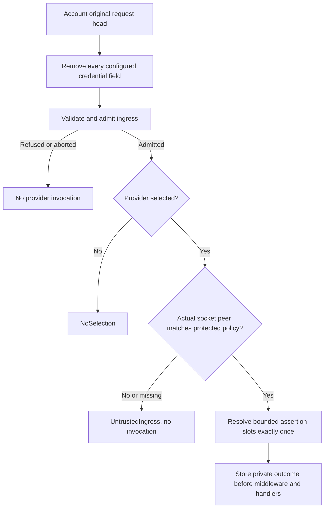

# Native Geo providers

Native Axum hosting can resolve CloudFront country and subdivision assertions once per admitted
request. Geo is off by default. There is no database, reader-IP lookup, remote call, fallback
provider, CLI option, environment selector, or manifest selector.

Geography is an estimate, not proof of residence, identity, consent, or permission. Applications
own jurisdiction recognition and policy. A missing subdivision stays unknown, and a
syntax-valid subdivision is not necessarily assigned or recognized.

## Select a provider in Rust

The public selection API lives in `edgezero_adapter_axum::geo` with the `axum` feature.
Only the built-in implementation needs the default-off `geo-cloudfront` feature:

```toml
[dependencies]
edgezero-adapter-axum = { version = "<your-edgezero-version>", default-features = false, features = ["geo-cloudfront"] }
```

Use the same pinned EdgeZero release as your application. This feature enables `axum`, not
AWS stores or an AWS SDK. A Geo-only application needs no AWS credentials, config/data roots,
or declared stores. Existing declared stores keep their own startup requirements.

### Off

Every options constructor defaults to `Off`, including `from_env` and `from_vars`. Selection
is always programmatic, even when other hosting settings come from the environment.

```rust
use edgezero_adapter_axum::dev_server::AxumRunOptions;
use edgezero_adapter_axum::geo::{NativeGeoCapability, NativeGeoSelection};
let options = AxumRunOptions::new("127.0.0.1:8787".parse()?)?
    .with_geo(NativeGeoSelection::Off);
assert_eq!(options.geo_capability()?, NativeGeoCapability::Off);
```

### CloudFront

First deploy and verify the [protected origin](#protect-the-cloudfront-origin). Selecting the
policy below declares that those infrastructure controls are enforced. It does not configure
or inspect AWS.

```rust
use edgezero_adapter_axum::dev_server::{AxumRunOptions, run_production_app_with_options_and_initializer};
use edgezero_adapter_axum::geo::{NativeGeoSelection, ProtectedCloudFrontAlb};
use edgezero_core::app::Hooks;

fn run<A: Hooks>() -> anyhow::Result<()> {
    let policy = ProtectedCloudFrontAlb::new(
        ["10.42.1.0/24", "10.42.2.0/24"], "x-origin-verify-randomsuffix",
    )?;
    let options = AxumRunOptions::new("0.0.0.0:8787".parse()?)?
        .with_geo(NativeGeoSelection::CloudFront { policy });
    let capability = options.geo_capability()?;
    run_production_app_with_options_and_initializer::<A, _>(
        options, move |_app, _stores| {
            Box::pin(async move {
                let _configured_capability = capability;
                // Validate application requirements here, without inferring
                // that every request will have geographic metadata.
                Ok(())
            })
        },
    )
}
```

The constructor accepts literal IPv4/IPv6 addresses or CIDRs, not DNS names or provider aliases.
The list must be nonempty, with at most 256 supplied entries and 16,384 input bytes including
separators. Duplicates count before normalization. Whole-address-family coverage, including
unions and unrestricted mapped-IPv4 ranges, is rejected. IPv4-mapped IPv6 peers match their
IPv4 equivalents. Use the narrowest actual ALB peer ranges and enforce their ownership through
security groups. A matching private address alone does not authenticate a distribution.

The dedicated credential-header name must be a valid ASCII HTTP token of at most 128 bytes.
After case normalization it must start with `x-`. These names are forbidden:

- Every `x-forwarded-*`, `x-amz-*`, `x-amzn-*`, and `x-edge-*` name.
- `x-real-ip`, `x-request-id`, and `x-correlation-id`.

The `x-` rule also excludes standard authorization, cookie, transport, and CloudFront geographic
headers. Do not include a credential value in this policy. EdgeZero never compares that value.
Policy debug output and configuration errors omit both the name and network literals.

Selecting `CloudFront` without compiling `geo-cloudfront` is a startup error, not `Off`.
The selector remains available so a missing implementation cannot silently disable a required
configuration. Invalid selections fail before runner resources, deferred store setup, the
application initializer, and listener binding.

### Application-supplied provider

Supply a local implementation of `edgezero_core::geo::GeoProvider`. It works with only `axum`
enabled, without the built-in `geo-cloudfront` implementation. This composition-only example
always returns missing metadata; replace `ExampleProvider` with your own bounded implementation:

```rust
use std::sync::Arc;
use edgezero_adapter_axum::dev_server::AxumRunOptions;
use edgezero_adapter_axum::geo::{NativeGeoSelection, ProtectedCloudFrontAlb};
use edgezero_core::geo::{GeoInput, GeoProvider, GeoProviderId, GeoResolution};

struct ExampleProvider;
impl GeoProvider for ExampleProvider {
    fn resolve(&self, _input: &GeoInput) -> GeoResolution {
        GeoResolution::MissingMetadata
    }
}
let policy = ProtectedCloudFrontAlb::new(
    ["10.42.1.0/24"], "x-origin-verify-randomsuffix",
)?;
let options = AxumRunOptions::new("127.0.0.1:8787".parse()?)?
    .with_geo(NativeGeoSelection::Supplied {
        policy,
        id: GeoProviderId::new("example.local")?,
        provider: Arc::new(ExampleProvider),
    });
let _capability = options.geo_capability()?;
```

Provider IDs are public diagnostic labels, never secrets. They match
`[a-z][a-z0-9._-]{0,63}`. The built-in `cloudfront` identity is reserved and cannot label a
supplied provider, including when obtained through `GeoProviderId::cloudfront()`.

`GeoProvider::resolve(&self, input: &GeoInput) -> GeoResolution` is synchronous, bounded local
computation. The input has only a country slot of at most two bytes and a subdivision slot of
at most three bytes. Each slot is absent, bounded, or marked invalid. Preserve invalid markers;
do not turn them into missing data. Results use validated `CountryCode`, `SubdivisionCode`,
and `GeoLocation` types or bounded `GeoError` categories.

Do not perform blocking I/O, remote requests, filesystem access, or background preparation.
The portable trait has no `Send`/`Sync` supertraits; native ownership adds these bounds to the
supplied object. Application Rust is trusted code, not a sandbox. In v1 the supplied provider
uses the same protected CloudFront/ALB source contract, not an alternative raw-header source.

There is exactly one selection. A later `with_geo` call replaces the entire earlier selection;
it does not merge policies or create a fallback chain. Provider failures do not switch providers.

### Inspect startup capability

Capture capability from the final options, then pass those same options to the existing
initializer-based runner. No extra initializer argument or App registry is needed.

Capability is `NativeGeoCapability::Off` or `NativeGeoCapability::Selected { provider, source,
trust_basis }`. The CloudFront example above captures it in the initializer closure.

The production runner above observes SIGINT and Unix SIGTERM, drains in-flight work, and
forces non-success shutdown on a second signal. It uses the supplied options without merging
ambient hosting/store settings. For embedding with a caller-owned stop future and no
process-wide signal handlers, use `run_app_with_options_and_initializer` instead.

Capability inspection returns `Result<NativeGeoCapability, NativeGeoConfigError>`. It confirms
validated selection, not per-request coverage, infrastructure protection, or readiness of a
downstream policy.

## Read the immutable request outcome

Middleware and handlers read `RequestContext::geo()`. An outcome does not set an HTTP status
or grant access. Call `describe(ctx.geo())` with the following classifier. Its labels describe
data availability, not permission. Applications must separately recognize each subdivision,
preserving unknown values rather than treating them as known non-regulated jurisdictions:

```rust
use edgezero_core::geo::{GeoError, GeoOutcome, GeoStatus, GeoUnavailableReason};
fn describe(outcome: &GeoOutcome) -> &'static str {
    match outcome {
        GeoOutcome::NoSelection => "not configured",
        GeoOutcome::Selected { status, .. } => match status {
            GeoStatus::Unavailable(GeoUnavailableReason::UntrustedIngress) => "source not admitted",
            GeoStatus::Unavailable(GeoUnavailableReason::MissingMetadata) => "metadata missing",
            GeoStatus::Error(GeoError::InvalidAssertion) => "assertion rejected",
            GeoStatus::Error(GeoError::ProviderFailure) => "provider failed",
            GeoStatus::Located { location, .. } if location.subdivision().is_none() => "country only",
            GeoStatus::Located { .. } => "country and unverified subdivision assertion",
        },
    }
}
```

Every selected outcome retains the selected provider identity, even when source admission
fails before invocation. Located results carry `GeoSource::CloudFront` and
`GeoTrustBasis::DeclaredProtectedAlb`. These describe the source and operator-declared path,
not a cryptographic attestation of distribution identity.



Ordinary trusted-proxy configuration, effective reader IP, forwarding headers, public
extensions, and caller-supplied `ConnectInfo` cannot create Geo source admission. Admission
callbacks run before Geo exists. Header changes or extension insertion/removal by application
code cannot replace the managed outcome. Response finalization never resolves it again.

The unmanaged request converter, legacy dispatch, Fastly, Cloudflare, and Spin expose
`NoSelection`. Returning a context to an ordinary request and constructing a new unmanaged
context does not preserve its private Geo result.

## CloudFront assertion rules

CloudFront must generate both `CloudFront-Viewer-Country` and
`CloudFront-Viewer-Country-Region` through an explicit origin request policy. Generic viewer
header forwarding is not enough. Never install static custom geographic values or an edge
function that rewrites the generated geography.

| Received assertions from an admitted source                                 | Outcome                                                                      |
| --------------------------------------------------------------------------- | ---------------------------------------------------------------------------- |
| Neither present                                                             | `MissingMetadata`                                                            |
| Country only                                                                | `Located`, subdivision unknown                                               |
| `us` and `ca`                                                               | `Located` with `US` and `CA`                                                 |
| `US` and `01`                                                               | `Located` with syntax-checked numeric subdivision                            |
| `US` and `ZZ`                                                               | `Located` with a syntax-valid assertion, not verified subdivision membership |
| Subdivision without country                                                 | `InvalidAssertion`                                                           |
| Unsupported/reserved country, including `XX`, `ZZ`, `UK`, or `XK`           | `InvalidAssertion`, no aliases                                               |
| Duplicate field instances, even identical, or comma-joined values           | `InvalidAssertion`                                                           |
| Empty, whitespace, non-ASCII, malformed, or oversized value in either field | `InvalidAssertion` for the whole result                                      |

Country is exactly two ASCII letters, normalized to uppercase and checked against the pinned,
checked-in list of 249 officially assigned ISO 3166-1 alpha-2 codes. The source revision and
checksum live beside `edgezero-core/src/geo/country_codes.rs`; updates are reviewed code changes,
not runtime downloads. Subdivision is one to three ASCII letters/digits, normalized to uppercase,
without a country prefix or separator. There is no subdivision catalogue. No trimming, decoding,
truncation into validity, or guessed geography occurs. These rules apply to values exposed by
the HTTP parser; upstream parser-stripped whitespace cannot be detected retroactively.

## Protect the CloudFront origin

Use AWS's [origin-secret ALB pattern](https://docs.aws.amazon.com/AmazonCloudFront/latest/DeveloperGuide/restrict-access-to-load-balancer.html).
All of these controls are required together:

1. Give the intended CloudFront distribution a dedicated high-entropy custom origin credential.
   Do not share it with unrelated distributions. Keep both header name and value out of request
   logs, responses, diagnostic exports, and test artifacts.
2. Require viewer HTTPS. Set the CloudFront origin protocol to HTTPS-only. For AWS's HTTPS ALB
   recipe, include `Host` in the origin request policy and configure the ALB certificate to match
   the routed hostname. Restrict served public hostnames; a viewer's arbitrary host is not an
   authorization decision.
3. Forward from the ALB listener to the application target group only when that credential
   matches an explicit non-wildcard value. The default action denies access. No alternate
   listener or rule may forward unchecked traffic to this target group.
4. Restrict the ALB security group to CloudFront origin-facing managed prefix lists for every
   enabled IP family. These ranges admit CloudFront infrastructure, not one distribution;
   they do not replace the credential gate.
5. Keep the Axum port private and reachable only from the intended ALB security group. Keep
   the ALB-to-Axum HTTP hop inside the isolated VPC. No public target, alternate proxy, listener,
   or network route may bypass the gate. This feature adds no native TLS server.

AWS documents that [custom origin headers replace viewer-supplied values](https://docs.aws.amazon.com/AmazonCloudFront/latest/DeveloperGuide/add-origin-custom-headers.html).
The ALB validates the credential. EdgeZero stores only its removal name, strips every occurrence
before application callbacks, and never receives the expected value as runtime configuration.
A correctly matched socket peer with an incorrectly configured ALB is still unsafe. EdgeZero
cannot inspect listener rules or security groups.

### Generated headers and missing subdivision

AWS documents [generated-header replacement after the viewer-request event](https://docs.aws.amazon.com/AmazonCloudFront/latest/DeveloperGuide/lambda-at-edge-function-restrictions.html#lambda-at-edge-restrictions-cloudfront-headers).
No Lambda@Edge function is required. The [header reference](https://docs.aws.amazon.com/AmazonCloudFront/latest/DeveloperGuide/adding-cloudfront-headers.html)
says subdivision is omitted for requests originating from the AWS network. Test spoofed viewer
subdivision in that case. Do not assume that omission of generated data safely removes a
viewer-supplied value.

### Disable shared caching

Apply CloudFront's managed [CachingDisabled policy](https://docs.aws.amazon.com/AmazonCloudFront/latest/DeveloperGuide/using-managed-cache-policies.html)
to these application routes, with minimum/default/maximum TTL zero. Set
[Error Caching Minimum TTL](https://docs.aws.amazon.com/AmazonCloudFront/latest/DeveloperGuide/custom-error-pages-expiration.html)
to zero for cacheable application-error statuses too; the default is ten seconds. Prevent any
other shared cache from reusing these responses. Forwarding geographic headers does not partition
cached responses by geography or permission. A custom Geo-aware cache-key recipe and automatic
response/cache-header mutation are outside this feature.

### Rotate the credential value

Keep the header name fixed during live rotation:

1. Generate a new high-entropy value through your secret-management process, without printing it.
2. Temporarily configure the ALB gate to accept old and new exact values.
3. Update the intended distribution's custom origin value and wait for deployment completion.
4. Verify intended traffic, denial of unrelated traffic, and application-side header removal.
5. Remove the old accepted value and verify it no longer passes the gate.

Renaming the credential header requires coordinated stop/reconfigure/restart so no in-flight
configuration leaves an unremoved credential field. V1 has no dual-name removal state.

## Acceptance boundaries

Local EdgeZero tests prove bounded parsing, selection failures, credential removal, real-socket
peer matching, one invocation, immutable outcomes, lifecycle preservation, and portable dependency
isolation. They do not prove AWS configuration or application permission policy.

Before production use, record separate evidence against the actual distribution, ALB, and target:

- Intended distribution traffic reaches the app. Direct ALB traffic and a different distribution
  without the credential cannot. A network denial is valid when prefix lists block connection.
- Direct target access, alternate listeners/proxies, and unintended security-group sources cannot
  bypass the credential gate.
- Forged viewer country/subdivision does not become accepted geography. Include the AWS-network
  missing-subdivision case.
- Credential replacement, validation, removal, and value rotation work without exposing name or
  value to application code, responses, or logs.
- Missing subdivision stays country-only and absent metadata stays missing, without fallback.
- Successful and cacheable error responses are not reused across requests by any shared cache.

A failed deployment check blocks production use of the declared policy. It does not justify
broader header trust or a fallback. Downstream policy-path tests remain another acceptance gate.
Trusted Server adoption, jurisdiction lists, consent interpretation, and Edge Cookie/identity
behavior are separate work; this feature does not relax their fail-closed requirements.

[AWS VPC origins](https://docs.aws.amazon.com/AmazonCloudFront/latest/DeveloperGuide/private-content-vpc-origins.html),
other adapters/sources, GeoIP databases, reader-IP inputs, remote providers, hot reload, and
subdivision catalogues are deferred. VPC origins are not a second supported trust mode here.
See [Axum diagnostics and trusted proxies](./axum-diagnostics.md) for ordinary forwarding policy,
which remains independent from Geo source admission.
