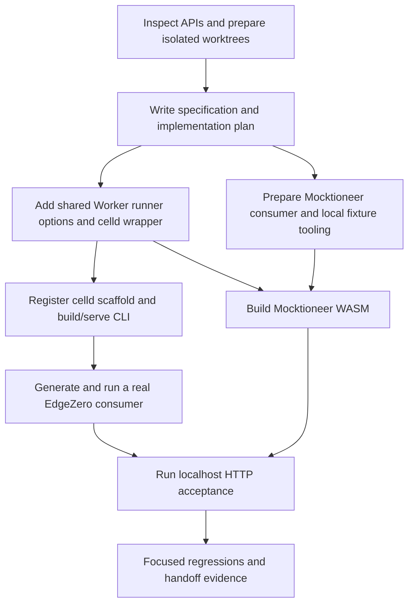

# Celld adapter implementation plan

## Delivery order

First prove a generated Worker WASM can enter EdgeZero through celld. Then wire Mocktioneer's real routes and typed config. Do not spend time on deployment or secret publication while the local application path is unproven.

This plan implements [[Celld Adapter Specification]]. It uses the two isolated worktrees created for this request. The EdgeZero checkout starts at current draft PR275 head `28038cce`; Mocktioneer starts at `cb6f238`. Original worktrees are not implementation targets.



## Ownership

The coordinator owns specification, plan, tool preparation, cross-repository consistency, runtime acceptance, review of the combined result, and the final run record.

The EdgeZero implementation worker owns only `/home/pav/worktrees/feat-celld-adapter` code, tests, templates, and CLI integration. It does not edit the vault or Mocktioneer.

The Mocktioneer implementation worker owns only `/home/pav/worktrees/feat-celld-demo` code, tests, manifests, demo fixture generator/wrapper, and local run documentation. It does not edit EdgeZero or the vault.

Workers report touched files, commands, failures, and unverified behavior. They do not commit, push, install global tooling, start cloud work, or rewrite other worktrees. The coordinator retains responsibility for accepting the implementation.

## 1. Worktree and tool preparation

Completed preparation:

- Create `feat/celld-adapter` through `gwa --no-switch`, based on the fetched #275 branch.
- Create `feat/celld-demo` through the same helper in Mocktioneer.
- Read local repository instructions and record original dirty/untracked state.
- Inspect existing Worker runtime, manifest/route selection, scaffolds, BlobEnvelope, and actual Mocktioneer config-consuming handlers.
- Read-only workers produced reports in `/tmp`; no application behavior has been proved by that research.
- Verify ports 9876 and 9877 are free before first launch. Recheck immediately before launch.

Tool setup is scoped to `~/.cache/edgezero-celld-demo`. Download celld v0.6.2's Linux release, check SHA-256 `ce0ee3552cc8d55dde3998dc3b1b0c8f547bbcb4bc803d2a94842368b047646c`, and verify GitHub provenance if available. Install esbuild 0.25.12 and worker-build 0.8.5 in that cache, using the configured Rust toolchain. Keep its `bin` on PATH only in demo/build commands. Capture tool versions and installation output.

Do not run a fleet bootstrap, bucket operation, account login, or deployment. A missing prerequisite should produce a documented local setup error.

## 2. Shared Worker runner and celld identity

Files expected:

- `crates/edgezero-adapter-cloudflare/src/lib.rs`
- `crates/edgezero-adapter-celld/Cargo.toml`
- `crates/edgezero-adapter-celld/src/lib.rs`
- Root workspace/dependency entries
- Narrow core adapter-name declaration if useful

Steps:

1. Add a runner/options seam carrying adapter key, platform metadata, secret policy, and explicit config reader mode.
2. Preserve existing Cloudflare runner APIs as wrappers with unchanged defaults.
3. Thread adapter selection through app build, environment lookup, stores, and dispatch. Preserve the existing no-op Worker logger; an application-owned logging backend is outside this demo. Existing route adapter lists remain metadata; the current macro registers all handlers. Do not introduce a broad route-filtering change.
4. Add the celld wrapper and its own metadata.
5. Block secret-store activation under celld. Plain variables are never a secret backend.
6. Keep Worker request/context ownership, response egress, ingress admission, and cancellation paths in the existing transport implementation.
7. Add tests for celld metadata, runtime key selection, and secret policy. Retain Cloudflare regression tests.

Exact seam naming is left to the implementer. A small options value is enough; do not add a dynamic plugin system or copy transport files.

Exit condition: the celld crate passes focused host checks and a thin fetch event consumer compiles for wasm. Any inability to load a generated workers-rs shim in celld stops broader CLI work until resolved.

## 3. Celld CLI and scaffold

Files expected:

- `crates/edgezero-adapter-celld/src/cli.rs` and templates
- `crates/edgezero-cli/Cargo.toml` registration/features
- Scaffold integration tests and any manifest default mapping actually needed

Steps:

1. Register ID `celld`, unique template names, runtime feature, and scaffold crate.
2. Emit JSON `wrangler.json`, generated shim path, Worker event entrypoint, and config/KV binding definitions from existing manifest contracts.
3. Implement only build and serve using the normal execution-target contract.
4. Invoke worker-build in the correct adapter crate. Preserve child-tool failures and artifact path.
5. Start `celld dev` against the chosen manifest. Force or validate loopback binding and reject public host arguments.
6. Return unsupported errors for auth, deploy, staging/release, provision, secret publication, and remote config operations.
7. Document prerequisites and beta/local-only scope in generated docs.
8. Test valid JSON, dependency/features, manifest key selection, correct command construction, public-bind rejection, and unsupported actions without cloud processes.

Exit condition: `edgezero new` or the repository's corresponding generator creates a celld consumer that builds and answers over localhost. The coordinator should inspect emitted source and manifests, not only a string-render test.

Prefer a temporary generated consumer outside either original checkout. Ignore all build output and local state. A fresh generated project has no seeded config; choose a config-free route for the first HTTP proof.

## 4. Mocktioneer consumer and dependency migration

Files expected:

- Root `Cargo.toml` and lockfile
- `crates/mocktioneer-adapter-celld/Cargo.toml`, `src/lib.rs`, and JSON manifests
- `edgezero.toml` celld adapter and route allowlists
- A small local-only fixture generator and JS wrapper
- Local run notes/script and ignore rules

Steps:

1. Patch every relevant EdgeZero git package to the local EdgeZero worktree. Keep exactly one core crate identity.
2. Add the sibling adapter crate with a fetch entrypoint calling `edgezero_adapter_celld::run_app::<MocktioneerApp>`.
3. Add celld to existing route allowlists and config-store metadata without changing route implementations.
4. Repair only actual #275 API incompatibilities discovered by compiler/tests. The first build found removed request access, app build, and legacy proxy APIs. Migrate the real JWKS fetch while preserving status and 64 KiB body bounds; unsigned smoke tests will not certify signed verification.
5. Emit a normal no-seed manifest pointing directly at the generated shim.
6. Add a separately selected local-demo manifest wrapping the same shim for explicit fixture initialization.
7. Generate a real envelope from the existing Mocktioneer type and loader with demo CPM 0.37. Write ignored plaintext dev setup containing public config only.
8. Use the real Worker KV binding to write the configured key before dispatch. No public setup endpoint, no database editing, no app fallback.
9. Test the wrapper disabled path, real key/value write, concurrent first requests, and seed failure behavior.
10. Explain that this is development setup, not a celld config-push implementation or secret delivery system.

Use normal Worker/WASM entrypoint code. Do not start the Axum binary. The wrapper must import the worker-build output, not replace it with handwritten route output.

Exit condition: the crate compiles to WASM against the single local EdgeZero revision; host core tests retain deterministic bidding and fail-loud config semantics.

## 5. Local runtime acceptance

The coordinator starts processes in visible, clearly named panes, or another recorded local process group. Check ports first. Use separate local state directories if negative and positive tests need independent config state. Do not delete an unrelated `.celld` directory.

Suggested order:

1. Generated EdgeZero fixture on port 9877. GET its config-free endpoint, assert status/body, then stop it after evidence capture.
2. Mocktioneer normal no-seed manifest on port 9876 with dedicated fresh local state. GET a config-free route and introspection. POST a valid OpenRTB request and assert the expected missing-config failure.
3. Stop that process and switch explicitly to local-demo manifest or a distinct state directory, without relying on stale values.
4. Start the seeded demo on 9876. Assert the same route returns a bid at 0.37 and preserves auction/impression IDs and deterministic seat/bid fields.
5. Check malformed input returns the existing application error. Exercise APS if it is straightforward and record the actual result.
6. If a development KV fixture is included, verify write/read/list/delete through celld, not an in-memory host mock.
7. Keep the final seeded Mocktioneer demo running for the user, with URL and a stop command/process-pane reference.

A fixture generator or Node unit test is not the HTTP proof. Capture actual curl/Python HTTP results, status/body assertions, and celld logs. No performance claims are allowed.

## 6. Focused verification and review

Run commands from each new worktree. Set PATH to the demo tools explicitly where needed.

EdgeZero initial checks:

```bash
cargo test -p edgezero-adapter-cloudflare
cargo test -p edgezero-adapter-celld --features cli
cargo test -p edgezero-cli
cargo fmt --all -- --check
cargo clippy -p edgezero-adapter-celld --features cli --all-targets -- -D warnings
```

Use exact feature selections the workspace requires; record changes to these commands. Test the shared runtime on wasm as well as host CLI because host-only cfg can hide Worker compile failures. Preserve existing Cloudflare behavior with its relevant tests. A workspace-wide check is useful if affordable, but should not repeatedly replace focused checks during iteration.

Mocktioneer initial checks:

```bash
cargo test -p mocktioneer-core
cargo fmt --all -- --check
cargo clippy -p mocktioneer-core -p mocktioneer-adapter-celld --all-targets -- -D warnings
```

Also run the actual worker-build command for the celld application and tests for the demo wrapper. Inspect `cargo tree -d` or equivalent metadata for duplicate EdgeZero core sources. If workspace tests/clippy fail because of an existing incompatible adapter API, distinguish that failure from the celld demo and decide whether the minimal migration belongs in scope.

Review the combined diff for accidental Cloudflare selection, plaintext secrets, unconditional config fallback, unsupported remote actions, invalid JSON templates, public listener options, and generated/state artifacts accidentally tracked.

Check both original checkouts after implementation and compare their status with the recorded initial state. Do not clean them.

## 7. Handoff and unresolved work

Create a dated work log under Trusted Server with:

- Worktree/branch paths and prerequisite base
- Files and major behavior changed
- Installed local tools and integrity/provenance outcomes
- Exact build/run/setup commands
- Checks and outcomes, including failed checks
- Missing-config versus seeded-auction results and CPM evidence
- Running demo URL, pane/PID, state location, and stop/restart instructions
- Unsupported secrets, remote deployment/config publication, geographic metadata, stronger identity stores, and unverified HTTP/fleet acceptance

Update this plan with actual completed steps and deviations after evidence exists. Do not mark it done solely because source was written. The proposal stays a broader draft; a local demo does not approve production adoption.

No PR or package publishing is part of this handoff.

## Completed local delivery

All seven local implementation stages completed on 2026-10-13. The proposal remains draft; production adoption is not approved.

- The shared `WorkerRuntimeOptions` selects celld identity, unknown provider facts, rejected secret declarations, and an explicit default-stream reader. Cloudflare keeps BYOB.
- The registered CLI builds and serves a fresh generated project. Empty command overrides are omitted, JSON uses default bundling, and generated Cargo includes the app-core dependency. Build/state/dev-variable outputs are ignored.
- Mocktioneer uses one local EdgeZero core source. Required #275 migrations preserve fallible app assembly, request method/URI access, and the JWKS response's 64 KiB bound.
- Final real WASM builds and artifact staging passed. The separate development wrapper awaits real KV publication of a verified 151-byte envelope before invoking the generated Worker class. It adds no public seed endpoint.
- Fresh generated-consumer acceptance passed five HTTP checks, including celld variable selection, KV CRUD/list, bounded config and expired-deadline rejection, ingress admission, and streaming.
- The final clean normal Mocktioneer run passed five HTTP checks. The final seeded run passed nine, including CPM 0.37 OpenRTB/APS responses, config introspection, malformed JSON 400, and validation 422.
- Focused host tests, the added Node-executed WASM cap regression, final CLI suite, formatting, diff checks, Clippy, adapter test compilation, and WASM checks passed. The dated work log records exact commands and inherited ignored coverage.

### Implementation deviations

The first seeded auction failed because celld's BYOB KV reader returned zero bytes for valid stored data. The fix adds an explicit `ConfigReadMode::DefaultStream`, not a text-materialization fallback. Host chunk allocation remains unsupported even though copies into Rust obey byte limits.

Celld rejected an out-of-project main path. Preparation now copies the genuine build tree beneath each normal/demo project. The generated Worker export is a class, so the wrapper constructs it with context/environment instead of calling `worker.fetch` as an object method.

An actual generated build found a missing app-core dependency. The source template now includes it, a generated-Cargo regression checks it, and acceptance used a newly generated project after the fix.

The generic EdgeZero CLI has no port-forwarding option for serve. Acceptance therefore used port 9876 serially rather than 9877 for the generated fixture. All temporary listeners stopped before the final Mocktioneer restart. Final ownership is terminal 28, celld child PID 3801536, URL `http://127.0.0.1:9876`.

See [[2026-10-13 - Celld Adapter Local Demo]] for replay, stop/restart instructions, acceptance artifacts, and unverified production work.

## Related

- Spec: [[Celld Adapter Specification]]
- Proposal: [[Celld Store Provider Evaluation]]
- Project: [[Trusted Server]]
