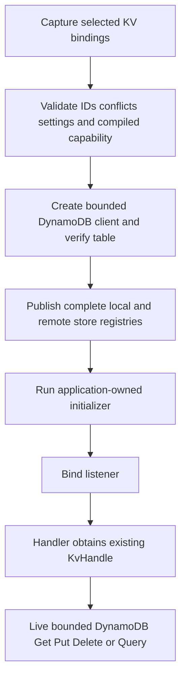

# Native DynamoDB KV implementation plan

- Status: Implemented, verified and pushed to existing draft [PR #414](https://github.com/stackpop/edgezero/pull/414) on `issue-410-native-store-providers`. The eight pre-existing files' unrelated hunks remain preserved and uncommitted.
- Requested outcome: Native apps can select DynamoDB independently per declared KV store ID, through the existing portable KV interface.
- Base: Draft [PR #414](https://github.com/stackpop/edgezero/pull/414), published head `b764a883ce57a323250d9d7a20787dc5937ef90e` at research time. Re-check the published head before implementation.
- Safety: No AWS calls, ambient credential discovery, infrastructure changes, deployments or image pulls during research or default checks. Literal-loopback SDK fixtures use dummy credentials and cleared environments. Real AWS acceptance requires separate authorization.

## Research findings

Core `KvStore` supports raw-byte get, overwrite put, delete, exists, TTL and lexicographic prefix pages. `KvHandle` validates 512-byte UTF-8 keys, up to 1,000 keys per page and a 25 MiB value ceiling. That ceiling does not guarantee every provider can accept that size. `read_modify_write` is explicitly non-atomic. There is no portable CAS, conditional-create, transaction, consistency selector or snapshot-list interface.

DynamoDB can implement the ordinary interface with a namespace partition key and the unchanged user key as sort key. Its item ceiling is 400 KiB including attribute names and values. Base-table Get/Query support strong reads, and Query sorts strings by UTF-8 bytes. Query evaluates its limit before filtering, stops at its 1 MiB data boundary, and can return an empty page with `LastEvaluatedKey`. Core already allows short/empty pages and terminates on cursor absence.

DynamoDB TTL is asynchronous garbage collection, not an expiry guarantee. The provider must check logical expiration on reads and listing. The shared raw-trait contract includes a 1 ms TTL test, despite the public handle's 60-second minimum.

A lost response or HTTP 500 can follow a committed write. Replaying an unconditional Put/Delete can overwrite or delete a concurrent writer's newer state. The first version will not automatically retry these calls or claim exactly-once effects.

SDK generated `AttributeValue`, `PutItemInput` and `GetItemOutput` derive Debug without redacting item contents. The locked Smithy Blob implementation formats bytes as hex. Do not assume DynamoDB values have Secrets Manager's sensitive-model protection. EdgeZero-owned diagnostics will be closed/redacted. Dependency DEBUG/TRACE exposure must be disclosed, without installing subscriber suppression or changing application logging.

Two read-only workers independently mapped the contracts/integration and researched service/SDK semantics, then proposed implementation alternatives. Reports and proposals are `/tmp/dynamodb-kv-{contract,service}-{research,proposal}.md`. No code, Cargo or AWS checks were run during research. The current checkout has unrelated ongoing modifications. Do not overwrite, stash, commit or migrate them as part of this task.

## Approved design decisions

### Scope and compatibility

- Implement in `edgezero-store-aws`, not a new HTTP adapter and not portable core.
- Add default-off provider feature `dynamodb-kv` and Axum/generated alias `aws-dynamodb`. Preserve the existing `aws-stores` alias membership so existing config/secrets users do not acquire DynamoDB unexpectedly. All three can be selected explicitly with `aws-stores,aws-dynamodb`.
- Add strict v1 `[kv.<declared-id>]` binding dispatch with provider `aws-dynamodb`. No provider-specific fields in portable `edgezero.toml`.
- Preserve existing `NativeStoreBindings::new(config, secrets)` callers through an additive KV builder/accessor. Preserve ready/deferred KV overrides and local redb defaults.
- Leave CLI validation structural-only with provider availability unknown. Actual native runtime capabilities reject a selected but uncompiled provider before setup, local opens or deferred polling.
- DynamoDB is live mutable storage. Preparing a client is not a startup snapshot. Runtime KV calls perform remote I/O and are not covered by the config/secret retained-payload quota.

```toml
version = 1

[kv.sessions]
provider = "aws-dynamodb"
region = "us-east-1"
table = "edgezero-kv-prod"
namespace = "checkout-prod/sessions"
```

### Table and key schema

Use an operator-owned, single-region, unindexed table with String partition key `pk` and String sort key `sk`. This first version does not provision or migrate tables and does not support global tables or secondary indexes. A bounded startup `DescribeTable` verifies the schema/status before the handle is published. This does not certify write permissions or capacity.

- `pk` is the explicitly configured physical namespace, nonempty, at most 512 UTF-8 bytes and without control characters. It is not derived from a bare logical ID. Two bindings with the same region/table/namespace intentionally share data.
- `sk` is the exact portable user key, without normalization, hashing, case folding or delimiter concatenation. Prefix matching remains literal.
- `v` is a Binary attribute containing the complete original bytes, including empty values.
- Optional `expires_at_ms` stores logical expiry. Optional `ttl_epoch_s` is the garbage-collection hint.
- Fixed attribute names avoid a configurable mapping/index framework. All namespaces in the table follow this schema. A high-traffic namespace can become a hot partition; no sharding or throughput certification is claimed.

### Values, expiration and listing

- Cap payloads at **384 KiB, 393,216 bytes**. Bound namespace/key/metadata and check item accounting before I/O. Return a fixed `KvError::Validation` for excessive inputs. Keep the portable 25 MiB ceiling unchanged. No chunking, S3 fallback or silent truncation.
- A normal Put replaces the whole item and clears both expiry fields. TTL Put computes a checked millisecond deadline without rounding expiration earlier than requested, plus `ttl_epoch_s = ceil(expires_at_ms / 1000)`.
- Get and the default Exists path enforce expiry at completion. Expired reads do not delete records, avoiding a race with concurrent renewal. DynamoDB TTL handles eventual cleanup if operators enable the documented attribute. Disabled cleanup can retain expired records and cost storage.
- List uses one ascending, strongly consistent base-table Query, constrained to configured `pk`, and `begins_with(sk, prefix)` for nonempty prefixes. Omit the sort condition for an empty prefix. Project keys/expiry, not values, and check expiration after receipt. This keeps malformed expiry handling explicit rather than trusting a filter to hide malformed records.
- Query's evaluated-item limit is the requested page size. A portable page may be short or empty with a continuation cursor. Do not loop to fill pages. Strong per-request reads do not make the page sequence a snapshot.
- Encode a bounded, versioned cursor containing region/table/namespace/prefix and the exact continuation key. Reject malformed/cross-scope cursors before provider I/O. Validate returned keys/order/continuation progress. Cursors are opaque, not secret or tamper-proof; every request remains constrained to the configured namespace and prefix. Never log them.

### SDK, deadlines and errors

- Exact pin `aws-sdk-dynamodb = "=1.120.0"`, defaults off with native HTTPS/Tokio support. Its manifest MSRV is 1.94.1. The selected graph compiled and passed isolated and combined tests without upgrading the existing AWS pins. The lockfile adds the SDK and its `http` 0.2 compatibility dependency; existing `http` 1.4 references are disambiguated.
- Reuse the existing fixed AWS behavior version and supported operator-owned credential chain. Settings remain SDK-free and contain no credentials or endpoint overrides. Tests inject only literal-loopback endpoints and dummy credentials.
- One retained client per compatible region/policy, with `max_attempts = 1` and no outer retry loop. This intentionally disables read retries too, avoiding dual-client policy complexity in the first slice.
- Start with a 5-second operation budget, 1-second connect timeout and 2-second attempt timeout. Validate finite positive policy values and ordering. Runtime deadlines are fresh per call, never the expired startup preparation deadline.
- Bound client/DescribeTable setup by the native startup preparation deadline. Reuse the existing sequential staging and publish only complete registries. Extend preparation accounting without pretending to retain live database contents.
- Missing and expired items alone return None/false. Access, credential, table/schema, throttling, transport and timeout failures remain closed errors. Discard SDK Display/Debug/source chains. Document that write failures may leave the effect unknown.
- No global/subscriber logging changes and no claim that dropping a future forcibly terminates credential subprocesses, DNS or socket work.



## Implementation sequence

- [x] **0. Isolate the work and establish the focused baseline.** Use the existing branch and PR #414 as explicitly requested. Record and preserve the eight pre-existing modified files; stage only DynamoDB-owned changes. Keep current unrelated changes untouched. Reuse existing evidence only when exact relevant inputs still match. Read-only worker reports are maps, not executed proof.
- [x] **1. Validate settings and dependency boundaries.** Add strict DynamoDB settings/policy and exact optional native dependency. Prove settings-only/default/Agent-only/Secrets-only graphs exclude DynamoDB, and Dynamo-only excludes the Secrets SDK. Demonstrate generated SDK model Debug disclosure with dummy data, and closed EdgeZero errors through loopback failures. Disclose dependency leakage rather than muting application logging; do not claim an ambient TRACE capture or universal redaction.
- [x] **2. Implement the real KV provider.** Add checked row codec/size/expiry/cursor logic and SDK Get/Put/Delete/Query. Use core `KvStore`, `KvHandle` and `KvError`; no new portable methods or Tokio/core dependencies. Expose preparation returning a portable handle and keep SDK models private.
- [x] **3. Prove provider behavior.** Run the shared KV contract against the actual provider using deterministic fixtures, not a replacement mock implementation. Drive the real SDK request/response path against a loopback fixture with cleared environments. Cover Unicode NFC/NFD distinction, 512-byte keys, arbitrary/empty binary, overwrite/delete/missing, millisecond expiry and renewal, no-TTL reset, size bounds, malformed records, short/empty pages, 1 MiB continuation shape, cursor scope/progress, denial/missing table, stalls and one-attempt ambiguous writes. Assert no owned diagnostic contains fixture keys/values/credentials.
- [x] **4. Wire per-ID native selection.** Extend KV binding schema, declared-ID/limit/conflict checks, capability/source resolution, startup session selection and existing KV staging loop. Test local+Dynamo+supplied mixtures, intentional shared namespaces, zero opens/polls on invalid sources, no fallback and no partial registry/initializer/listener on setup failure. All-Dynamo KV must not require or create a local DATA_DIR.
- [x] **5. Integrate CLI and actual generated consumers.** Add the generated opt-in alias and structural parser coverage. Reuse the generic Cargo normalizer rather than another resolver or shell interceptor. Prove generated default-off rejection and Dynamo-enabled CRUD/list/TTL through the public `Kv` extractor, with real SDK loopback traffic. Restart the generated consumer against the same fixture to prove data is not local process state. Preserve existing config push rules and config/secrets feature combinations.
- [x] **6. Document and run affected final gates.** Document schema creation/TTL cleanup/IAM as operator instructions, credentials, cost/hot partitions, smaller values, non-atomic read-modify-write, non-snapshot pages, write ambiguity and dependency logging caveat. Run focused tests after each coherent code unit, then affected workspace/native/feature/WASM, fmt, strict Clippy, SDK graph isolation and generated-consumer gates at a stable checkpoint. Do not repeat unaffected successful checks without input changes. Record commands, checked state and limitations. Commit and push the completed DynamoDB work to existing PR #414 after checks. Merges and infrastructure acceptance remain unauthorized.

## Likely affected files

| Area                | Files                                                                                                                                   |
| ------------------- | --------------------------------------------------------------------------------------------------------------------------------------- |
| Provider            | Root `Cargo.toml`/lock; AWS crate manifest, `src/settings.rs`, `src/lib.rs`, `src/preparation.rs`; new focused DynamoDB module/tests    |
| Native integration  | Axum manifest, `src/native_bindings.rs`, `src/native_stores.rs`, existing KV loop in `src/dev_server.rs`, relevant source/startup tests |
| Generated app / CLI | Axum `src/templates/Cargo.toml.hbs`; CLI generator/structural validation tests; a dedicated generated DynamoDB consumer proof           |
| Evidence / docs     | SDK isolation script and applicable CI feature jobs; focused DynamoDB guide linked from the existing native AWS guide                   |

Avoid unrelated HTTP/runtime refactors, portable manifest changes, generic provider registration, hot reload, cache layers or provisioning code.

## Approval and unverified work

Approval should settle the ordinary-CRUD scope, 384 KiB payload limit, operator-owned table schema, single-attempt policy and dependency DEBUG/TRACE limitation. CAS or 25 MiB transparent values would require a different design, not an incidental addition to this plan.

Implementation and offline verification are complete. No real DynamoDB/IAM/capacity/global-table acceptance is claimed or scheduled. The fixture verifies continuation wire shape, not the deployed service's 1 MiB evaluation boundary. SDK model Debug disclosure is executed evidence; no new ambient dependency TRACE capture or universal logging-safety claim is made. Generic native staging tests prove drop/atomicity behavior; mixed DynamoDB/local/ready/non-Send-deferred selection is directly tested, not presented as a deployed mixed-backend acceptance test.

## Executed verification

The exact staged source tree `2fa76fb26377cf41203c255f924d988d6b657002` was archived and checked independently of the eight dirty baseline files. Both CLI capability literals in the published source receive the new flag; the unrelated working-copy CLI refactor is excluded. Before/after SHA-256 manifests match. Subsequent publication-record edits are Markdown-only.

- Workspace default tests: **1,999 passed, 0 failed, 16 ignored**. Required SDK/native feature scopes and the two native generated consumers were executed separately; this is not a claim that every unrelated ignored test ran.
- Provider library scopes: DynamoDB **44**, Agent **26**, Secrets **26**, all providers **74**. The all-provider suite used one test thread after an inherited Secrets timeout test transiently returned `Unavailable` instead of `Deadline` under parallel load. That test passed alone, then the complete serial suite passed. The initial failure log is retained; no production or unrelated test was changed to hide it.
- Native DynamoDB-only library: **229 passed**; native all-feature test/doc suites: **302 passed**. The publishable tree excludes six native tests added by the pre-existing unrelated changes.
- Actual CLI-generated DynamoDB consumer: **1 passed**, including default-off rejection before SDK I/O, enabled put/get/list/TTL-write/read, restart persistence and delete. Public-handle TTL is 60 seconds; elapsed millisecond expiry is exercised by the provider contract, not this subprocess proof.
- Existing CLI-generated AppConfig/Secrets consumer: **1 passed** again.
- Strict workspace all-target/all-feature Clippy, independent provider Clippy scopes, native default Clippy, strict provider/native rustdoc, formatting, dependency isolation and Cloudflare/Fastly/Spin WASM checks passed.
- Docs lint, formatting and production build passed after removing a link to process-only documents excluded from the documentation site.
- Loopback fixtures explicitly configure dummy credentials and endpoints. Put and Delete tests apply the mutation before a scripted 500, then assert `Unavailable`, one attempt and the retained/removed row. SDK GetItemOutput Debug contains a sentinel key and binary hex; owned error assertions remain source-free.

Commands, logs and fingerprints: `/tmp/dynamodb-baseline/final-checks.sh`, `/tmp/dynamodb-baseline/final/`, `snapshot-{before,after}.sha256`. Read-only final provider review: `/tmp/dynamodb-provider-final-review.md`; no confirmed findings, and no execution claims from that review.

## Publication

Implementation commit `883354f98dfd4437eb60faaac12d4469f65aa158` was pushed to the existing branch and verified as PR #414's remote head. Only owned DynamoDB changes were staged, including narrowly projected edits in the two overlapping baseline files. The eight unrelated working-copy modifications remain unstaged; no stash, prerequisite rewrite, merge, deployment or AWS acceptance occurred. This final publication record changes only this Markdown plan, so the passing code gates remain applicable.

## Sources

- Portable implementation and shared tests: `crates/edgezero-core/src/key_value_store.rs`, especially `KvError`, `KvHandle`, `KvPage`, `KvStore` and `key_value_store_contract_tests!`.
- Native selection and staging: `crates/edgezero-adapter-axum/src/{native_bindings,native_stores,dev_server}.rs`.
- [DynamoDB constraints and item limits](https://docs.aws.amazon.com/amazondynamodb/latest/developerguide/Constraints.html).
- [Query request/response and pagination](https://docs.aws.amazon.com/amazondynamodb/latest/APIReference/API_Query.html).
- [Read consistency](https://docs.aws.amazon.com/amazondynamodb/latest/developerguide/HowItWorks.ReadConsistency.html).
- [Expired TTL records](https://docs.aws.amazon.com/amazondynamodb/latest/developerguide/ttl-expired-items.html).
- [Error handling and ambiguous writes](https://docs.aws.amazon.com/amazondynamodb/latest/developerguide/Programming.Errors.html).
- [SDK 1.120.0 manifest](https://docs.rs/crate/aws-sdk-dynamodb/1.120.0/source/Cargo.toml).
- [AttributeValue source](https://docs.rs/aws-sdk-dynamodb/1.120.0/src/aws_sdk_dynamodb/types/_attribute_value.rs.html), [PutItemInput source](https://docs.rs/aws-sdk-dynamodb/1.120.0/src/aws_sdk_dynamodb/operation/put_item/_put_item_input.rs.html), [GetItemOutput source](https://docs.rs/aws-sdk-dynamodb/1.120.0/src/aws_sdk_dynamodb/operation/get_item/_get_item_output.rs.html), [Smithy Blob source](https://docs.rs/aws-smithy-types/1.8.1/src/aws_smithy_types/blob.rs.html).
- [SDK logging controls](https://docs.aws.amazon.com/sdk-for-rust/latest/dg/logging.html).
- [Current SDK registry metadata](https://crates.io/api/v1/crates/aws-sdk-dynamodb).

## Related

- [Native store composition design](../specs/2026-10-07-native-store-providers-design.md).
- [Native provider implementation and publication record](2026-10-07-native-store-providers.md).
- [Native AWS guide](../../guide/native-aws-stores.md).
- [Owning self-hosted support epic #391](https://github.com/stackpop/edgezero/issues/391).
