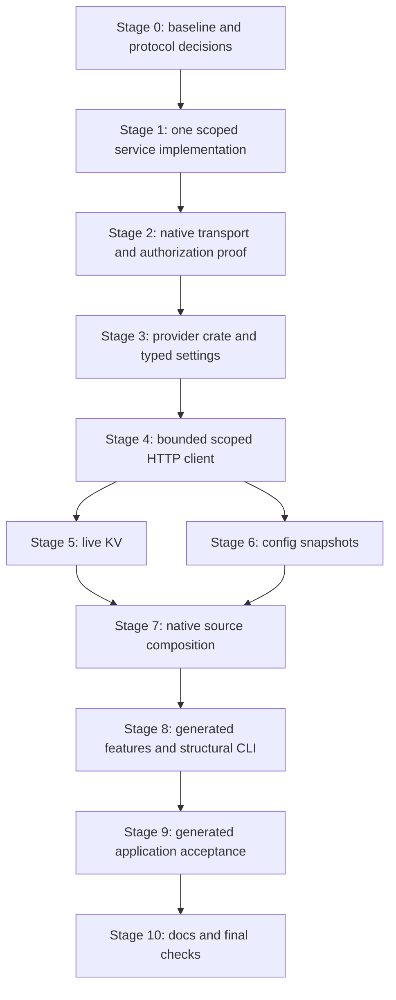

# Native celld store providers implementation plan

- Status: draft. Planning only; implementation and runtime acceptance have not started.
- Governing spec: [Native celld store providers](../specs/2026-10-15-native-celld-store-providers-design.md).
- EdgeZero baseline: `350527e4b7387a86da3f4cdaea0e8459665aa0f6`, with the spec introduced at `32737dd29b8f1fefd6e035be8036780e58b2412c` and the approved structural-only CLI clarification applied afterward.
- celld research baseline: `90b43017241f81189453d326d05948f388b34652`, version 0.6.2. Recheck the selected source and executable before running proofs.
- Approved scope clarification: offline CLI validation stays structural-only and reports target provider availability as unknown. Do not add a Cargo feature-graph resolver.
- Authority: this request authorizes writing the plan, not implementing it, changing celld, deploying services, using fleet credentials, pulling images, publishing commits or opening PRs.

## 1. Outcome and invariants

A native application can select celld independently for each declared configuration or KV store ID. Configuration is an immutable startup snapshot. KV operations remain live. AWS, celld, local stores and supplied handles can coexist in the same native runner without changing portable application declarations or HTTP handlers.

Required invariants:

- Keep core `ConfigStore`, `KvStore`, handles, registries, bounded-read contracts and `#[async_trait(?Send)]` future bounds unchanged.
- Applications call a scoped service API using store aliases. They never receive fleet HMAC secrets, fleet-bucket discovery credentials, internal node addresses or arbitrary runtime scopes.
- Support explicit trusted-network and authenticated listeners. Both modes enforce store and operation grants before backend dispatch. Authentication failure never selects anonymous access.
- Config preparation finishes before the app initializer, readiness and listener acceptance. A missing mapped document or failed remote call never falls back to local data.
- Validate the complete source plan, selected credentials, settings and compiled capabilities before opening runner-owned providers or polling supplied deferred futures.
- A celld-only deployment needs no AWS credentials and no local roots for remotely bound IDs. Local defaults still require their existing roots.
- No automatic replay of mutations with an ambiguous outcome, at either client or service layer. A timeout does not mean that no write occurred.
- Errors owned by EdgeZero contain fixed categories and validated logical IDs, not credentials, physical namespaces, URLs, response bodies or arbitrary source chains.
- Default-generated applications, AWS-only builds and WASM adapters do not acquire celld runtime, V8 or Worker tooling dependencies.

Out of scope: a celld HTTP adapter, Worker bridge or application runtime; celld secrets; fleet provisioning; config publication; secret management; live config refresh; CAS, transactions or counters; dynamic provider registration; extraction of existing local stores; AWS redesign; process-wide memory guarantees; automatic fleet failover acceptance.

## 2. Decisions required before implementation

The scoped API does not exist in the researched celld version. A provider cannot be completed by adding an HTTP client alone. Resolve the following in the governing spec before implementing the service or freezing public provider settings.

| Decision | Required output | Constraint |
| --- | --- | --- |
| Service placement and owner | Choose upstream celld integration or one separately operated native gateway, with its repository and release owner | Implement one path, not both. An upstream implementation needs a concrete supported celld revision. A gateway needs its own deployment and compatibility ownership. |
| Listener policy | Exact configuration schema for mode, bind address, alias mapping and operation grants | Disabled by default; tokenless loopback default; explicit non-loopback opt-in and separately enforced network restrictions. No client-supplied caller identity. |
| Authenticated access | Token verifier format, secret injection, reload, overlap, revocation and restart policy | Random application bearer tokens over TLS. No issuance service or application fleet credentials. A documented bounded restart-based service policy is acceptable if hot reload is unnecessary. |
| HTTP protocol | Version, methods, status/error schema, TTL units/rounding, cursor shape, malformed-input and body rules | Missing differs from empty. No mutation replay. An incompatible version fails explicitly. Routes in the spec are proposals until this gate closes. |
| Transport policy | TLS termination owner, certificate validation, trusted-network HTTP opt-in and internal network protection | Bearer tokens require TLS. A private address is not proof of isolation or encryption. Both the application client and privileged service-to-celld transport disable redirects and ambient proxy discovery unless a specific exception is reviewed here. |
| Limits and compatibility | Concrete service/client limits, deadlines, preparation quotas and supported celld revision policy | Account separately for raw bytes, backend JSON byte-array/base64 encoding, decoded payloads, key pages, cursors, metadata and retained snapshots. No claim that the portable 25 MiB ceiling is always reachable. |
| Public settings | Provider tags, feature names, alias/endpoint/access settings and policy ownership | Proposed names below must be reconciled with the chosen service contract. Settings contain references, not credentials. |

Do not hide these decisions in test fixtures or silently treat this plan's examples as approved public contracts. If service ownership cannot be settled, stop after contract research rather than publishing a nonfunctional provider tag.

## 3. Delivery order



The settings and client stages may use fake scoped-service fixtures after the contract is frozen, but only after Stage 2 proves the chosen real celld path is feasible. KV and config work can be researched independently. Keep shared manifests, lockfiles, settings, session state and native composition under one edit owner. Serialize Cargo commands that share a target directory.

## 4. File map and proposed API shape

Existing production files expected to change narrowly:

| Area | Files | Change |
| --- | --- | --- |
| Workspace | `Cargo.toml`, `Cargo.lock` | Native provider member, workspace dependency and reviewed HTTP feature selection |
| Native features | `crates/edgezero-adapter-axum/Cargo.toml`, `src/lib.rs` | Settings-only dependency and independent `celld-config` / `celld-kv` forwarding |
| Bindings | `crates/edgezero-adapter-axum/src/native_bindings.rs` | Strict config/KV variants, capabilities and independent provider policy validation |
| Credential capture | `crates/edgezero-adapter-axum/src/run_options.rs` | Capture selected celld token names once without coupling them to `AgentAccessToken` |
| Preparation | `crates/edgezero-adapter-axum/src/native_stores.rs`, `src/dev_server.rs` | Typed provider dispatch, separate preparation sessions and existing staging/readiness path |
| Generated features | `crates/edgezero-adapter-axum/src/templates/Cargo.toml.hbs`, CLI generator tests | Default-off independent celld aliases, preserving AWS alias membership |
| CLI | `crates/edgezero-cli/src/config.rs` | Structural celld validation, availability unknown and remote config-push refusal |
| Dependency checks and CI | `scripts/check_native_store_dependency_contract.sh`, `.github/workflows/test.yml`, applicable format workflow | Isolated feature graphs, focused provider/startup/generated checks and explicit service-proof job |
| Documentation | New `docs/guide/native-celld-stores.md`; existing Axum, configuration, CLI and navigation pages where applicable | Deployment boundaries, bindings, limits, operator publication and proof limitations |

Proposed new EdgeZero files:

```text
crates/edgezero-store-celld/
  Cargo.toml
  src/lib.rs
  src/settings.rs
  src/client.rs
  src/preparation.rs
  src/config.rs
  src/kv.rs

crates/edgezero-adapter-axum/tests/
  native_celld_startup.rs
  fixtures/native_celld_host.rs

crates/edgezero-cli/tests/
  celld_generated_proof.rs

scripts/
  run_native_celld_integration.mjs
  run_native_celld_integration.test.mjs
```

Keep ordinary unit tests colocated. Separate test modules only when fixture size warrants them. Add one shared test-support module if actual repeated fixture code needs it, not a public transport/provider framework.

The scoped service lives in the repository selected at Stage 0, not automatically in EdgeZero. For upstream work, inspect celld's `operator_cell.rs`, `kv_cli.rs`, `peer_auth.rs`, `crates/logic/kv.rs` and `js/services/kv.js` plus the actual listener routing modules. For a gateway, use an independent native package that speaks the pinned backend protocol and owns privileged discovery. Do not depend on the full celld crate or copy its runtime into the application provider. Record exact external files after choosing placement.

Proposed provider interface:

- `edgezero-store-celld` has no default features. Strict settings and redacted credential types remain available without the HTTP client or Tokio. Native-only `config` and `kv` features share one internal scoped HTTP implementation.
- Typed config settings map each local lookup key to a scoped store alias and remote key. The default key must name a mapping. Typed KV settings select one scoped store alias. Physical namespace mapping stays in service policy.
- A `CelldPreparation` session owns the aggregate config deadline, mapping/metadata and snapshot accounting, and compatible client reuse. Programmatic callers create and reuse an explicit session. Live KV contents are outside snapshot quotas.
- Factories return existing `ConfigStoreHandle` and `KvHandle` outputs. No new portable store trait, global provider registry or executor.
- Preserve `NativeStoreBindings::new(config, secrets)`, `with_kv`, `with_aws_limits`, existing AWS settings and ready/deferred override behavior. Add celld policy inputs without forcing existing callers through a new constructor.

Illustrative deployment bindings, subject to Stage 0 schema approval:

```toml
version = 1

[config.app]
provider = "celld-config"
endpoint = "http://127.0.0.1:7780"
default_key = "settings"

[config.app.access]
mode = "trusted-network"

[config.app.documents.settings]
store = "checkout-config"
key = "application-envelope"

[kv.state]
provider = "celld-kv"
endpoint = "https://stores.example.internal"
store = "checkout-state"

[kv.state.access]
mode = "authenticated"
token_env = "CHECKOUT_STORE_TOKEN"
```

The first alias has read-only grants; the second has the required KV operations. The example hostname is fictional. The service owns physical namespace selection, TLS and grants. An authenticated binding with a selected missing/empty token fails startup; it never becomes anonymous. Neither binding contains a fleet credential. Represent `access` as a validated tagged type, not an untyped field bag.

## 5. Stage 0: record baseline and close the contract gate

### Work

- [ ] Record HEAD, dirty files and governing spec hash. Preserve the current approved spec edits and unrelated work. Recheck local repository instructions.
- [ ] Inventory the actual core store contracts, native source plan, startup staging, bootstrap token capture and generated feature tests. Confirm that offline validation normalizes controls but does not resolve target capabilities.
- [ ] Verify the selected celld source, executable version, backend protocol and test tooling. Record whether the scoped API will need an external change or release. At the researched pin, operator values use byte arrays inline and `put-base64`/`valueEncoding` above 1 MiB; listing uses a raw last-key `after`, not a scoped opaque cursor; there is no native `exists` operation. Specify the service's bounded existence implementation and cursor wrapper rather than assuming those HTTP operations map one-to-one.
- [ ] Resolve every decision in section 2 in the governing spec. Include an operation/error table, limit table and deployment trust-boundary diagram. Link the chosen service repository and immutable source revision when available.
- [ ] Define a fixture policy using isolated local storage, dummy application tokens, explicit ports and resource ownership. No ambient cloud credentials, production fleet discovery, internet-exposed listeners or real AWS acceptance.
- [ ] Record a focused baseline for existing source validation, startup, CLI structure and dependency graphs before production edits. Classify pre-existing failures once; do not silently exclude them.

### Exit gate

One service owner and placement, a frozen first-version contract, a safe runnable local setup and explicit permission to start implementation. Contract research alone is not runtime proof.

## 6. Stage 1: implement the scoped service boundary

### Work

- [ ] Implement only the selected placement. Keep alias/grant policy separate from privileged celld transport, with no administrative proxy or arbitrary scope/address input.
- [ ] Validate all listener policy at startup. Disabled means no listener. Enabled tokenless access defaults to loopback. Missing/invalid mode cannot select trusted-network access.
- [ ] Resolve aliases and authorize the exact operation before constructing a backend request. Config aliases are read-only. Whole-namespace grants and dedicated config namespaces are sufficient for v1.
- [ ] Implement authenticated credential verification, TLS ownership and the approved replacement/revocation policy. Never log supplied tokens or verifier material. Trusted-network listeners grant the same configured permissions to every reachable caller.
- [ ] Implement the approved versioned raw-byte value operations, existence check and bounded JSON key pages. Reject duplicate/malformed parameters and unsupported operations. Return a distinct missing response for reads and body-free existence responses.
- [ ] Keep discovery, fleet authentication, namespace-to-scope derivation and wire compatibility inside this boundary. Bound privileged encoded requests/responses independently of the public raw-byte budget, including inline byte-array expansion and the pinned base64 form. Reject over-cap writes before backend dispatch and over-cap responses before unbounded decoding, including encoding paths excluded by approved value caps.
- [ ] Disable redirects and ambient proxy discovery on the privileged backend transport as well as the application client. Constrain discovered destinations to the approved internal-network policy. The pinned `operator_cell::Reachable` helper configures timeouts but is not evidence of these controls or bounded response parsing; do not copy its client unchanged.
- [ ] Define one retry owner. Permit only explicitly proven pre-dispatch refusals if the approved contract needs them; never replay an ambiguous mutation or add nested client/service retry loops.
- [ ] Apply finite request deadlines and body, page, cursor and concurrency limits. Bound work and memory under slow callers and disconnects. Do not claim dropping a request undoes an applied backend write.

### Tests and exit gate

Drive public handlers with an instrumented backend. Prove zero backend calls for out-of-grant aliases, config writes, malformed input and denied operations in both modes. Prove credential isolation, missing/revoked-token rejection, no auth fallback, disabled/loopback defaults, remote-tokenless opt-in rejection, body/page limits, deadline termination and redacted error responses. Test both backend encodings and their encoded/decoded budgets, or explicit over-cap rejection where a path is unsupported. Use service-side redirect/proxy sentinels to prove signed backend requests and mutations cannot reach alternate destinations. Test the actual chosen service implementation, not a second policy implementation in EdgeZero fixtures.

Before moving on, document how application workloads are prevented from reaching celld's internal listener or reading fleet credentials. An HTTP authorization test does not establish deployment network isolation.

## 7. Stage 2: prove scoped native access against real celld

### Work

- [ ] Start one disposable local fleet and the chosen service using the pinned executable/revision. Record commands, environment, acquisition and storage of fixture-only fleet credentials, listener addresses and cleanup.
- [ ] Use a small native client without an application Worker. Through the service, exercise binary and empty put/get, missing reads, exists, overwrite, idempotent delete, prefix pages and two isolated stores.
- [ ] Exercise trusted-network loopback and authenticated TLS with valid certificate verification. Use a test CA through test setup, never a production `accept_invalid_certs` switch.
- [ ] Drive incompatible protocol versions, invalid tokens, out-of-grant stores and config write denial. Observe backend dispatch counts for authorization denials.
- [ ] Verify real operator-wire TTL set, renewal and plain-put reset, and document how fractional `Duration` values will map to the approved wire units without shortening lifetime. Record the value encodings and size range exercised; a small-value result does not verify the bucket-backed/base64 path.
- [ ] Exercise a listing larger than one page and record ordering and continuation behavior. Preserve empty/partial pages where the backend can return them; deterministic malformed-page cases belong in later fixtures.
- [ ] Demonstrate network/credential isolation using the actual deployment arrangement selected for the proof. Host loopback success alone does not establish container or multi-host isolation.

### Exit gate

Retain a rerunnable command or script and explicit observed results for transport and authorization. The client has no fleet credentials and sends no internal runtime requests. A missing executable, failed fleet startup, absent scoped API or skipped authenticated case leaves this gate unverified. Do not proceed on the strength of source inspection alone.

## 8. Stage 3: add the native provider crate and strict settings

### Work

- [ ] Add the workspace member/dependency with independent native-only `config` and `kv` features and no defaults. Keep settings usable in CLI-only builds without service clients, Tokio or celld runtime code.
- [ ] Use existing workspace dependency versions where compatible. Review `reqwest` feature unification, since workspace defaults already include blocking/JSON support. Enable only necessary provider features and record the resolved graph rather than assuming manifest defaults prove isolation.
- [ ] Implement strict endpoint, access, alias, document and limit settings. Reject unknown fields, invalid combinations, empty mappings, a missing default mapping, malformed URLs, userinfo, queries/fragments and unsupported endpoint paths.
- [ ] Normalize caller input once into typed internal settings. Preserve exact remote keys and alias case; do not Unicode-normalize or reinterpret them as runtime scopes.
- [ ] Validate finite positive limits, checked arithmetic and relationships among encoded/decoded/body/page and session budgets. Keep service limits and application/provider limits distinct.
- [ ] Add a redacted celld token wrapper separate from AWS `AgentAccessToken`. A selected token source must resolve to a valid nonempty header-safe value. No ambient lookup inside the provider.
- [ ] Define closed preparation/client error categories and fixed mappings into current portable errors. Do not add provider codes or source chains to core.

### Tests and exit gate

Settings-only tests cover every rejected shape, URL encoding boundary, token Debug redaction, case sensitivity, limit overflow and access-mode combination without network calls or ambient variables. Independently check settings-only, config-only and KV-only dependency graphs. No Axum, CLI, AWS, full celld, V8, `workers-rs` or `worker-build` dependency enters the provider graph.

## 9. Stage 4: implement the bounded scoped HTTP client

### Work

- [ ] Construct requests using an encoding library and the frozen contract. Test empty prefixes, Unicode, reserved delimiters and percent encoding without allowing path/query injection or double decoding.
- [ ] Disable redirects, ambient proxies and implicit mutation replay. Set finite connect and whole-operation deadlines. Preserve normal application logging; do not install a logger or subscriber.
- [ ] Require TLS for bearer credentials and validate certificates. Enforce the explicit trusted-network HTTP policy selected at Stage 0. Do not infer permission from a private hostname/IP.
- [ ] Stream and cap response bodies before accumulation. Request identity encoding and either reject non-identity encoding initially or implement separately budgeted wire/decoded limits under an approved contract. Bound error bodies too.
- [ ] Apply endpoint, header, request-value, decoded-value, page-entry, key-byte and cursor bounds. A bounded value count alone does not bound page JSON bytes or nesting.
- [ ] Distinguish valid empty values from misses and protocol failures. Validate success/error status combinations and response shapes. Unsupported versions, malformed pages and auth failures must not become misses.
- [ ] Reuse compatible clients by normalized endpoint and complete transport/authorization policy. Never reuse one credential's authorized state for another. Keep secrets out of cache-key Debug and diagnostics.
- [ ] Close errors at the transport boundary. Document dependency DEBUG/TRACE limitations separately if testing finds them; do not promise universal redaction from sanitizing owned errors alone.

### Tests and exit gate

Exercise the actual HTTP client against loopback HTTP/TLS fixtures. Cover exact key bytes, binary/empty bodies, all operation/error categories, bad versions, slow headers/body, chunked bodies, oversized declared/streamed bodies, compression refusal, malformed JSON, page/cursor limits, disconnects and certificate errors. Have a fixture apply a PUT/DELETE and then lose the reply; assert one request, a closed error and the retained effect. Add redirect and proxy sentinels proving no alternate destination receives credentials or mutations.

## 10. Stage 5: implement live KV

### Work

- [ ] Implement existing `KvStore` get, put, TTL put, delete, exists and paginated prefix listing over the scoped client. Return existing `Bytes`/`KvPage` types; do not expose transport models.
- [ ] Enforce actual provider/service limits in addition to `KvHandle` validation. Smaller configured/provider limits fail explicitly before requests, without truncation or chunking.
- [ ] Preserve binary bytes, misses and empty values. Missing delete succeeds. Plain overwrite clears prior expiry; TTL overwrite renews it under verified celld semantics.
- [ ] Validate and encode TTL with checked arithmetic and the approved rounding rule. Accept the public handle's 60-second minimum and reject unsupported direct-trait durations rather than silently clamping them.
- [ ] Preserve bytewise lexicographic prefix order. Bind client continuation state to the configured endpoint/store/prefix and wire version as required; reauthorize every service page. A cursor never authorizes a different store or prefix.
- [ ] Return one bounded page per operation, including short or empty continuation pages. Validate malformed, oversized, out-of-prefix, out-of-order or non-progressing continuation responses. Do not scan indefinitely to fill a page.
- [ ] Create fresh runtime operation deadlines per call. Do not reuse an expired startup-preparation deadline for a live handle.

### Tests and exit gate

Run non-TTL portable contracts against the real provider using its scoped HTTP fixture and a native Tokio runtime. A current-thread runtime/`LocalSet` can drive the existing non-`Send` futures; `futures::executor::block_on` alone cannot drive Tokio HTTP/timers. The shared full contract macro contains direct sub-second TTL cases that celld rejects, so do not invoke it unchanged or change core semantics to fit celld. Add provider-specific TTL tests for valid durations, minimum rejection, overflow, rounding, renewal, expiry and reset. Cover namespace isolation, explicit shared aliases, NFC/NFD distinction, 512-byte keys, binary/empty values, page scope/progress and one-attempt ambiguous writes. Distinguish fixture expiry proof from the real 60-second expiry check in Stage 9.

## 11. Stage 6: implement immutable config preparation

### Work

- [ ] Fetch every explicitly mapped document during one bounded `CelldPreparation` session, sequentially initially. Require all mapped documents; an unmapped local lookup key remains a successful miss.
- [ ] Validate UTF-8 without parsing, reserializing, projecting JSON fields or resolving secrets. Preserve whitespace, empty documents and exact complete `BlobEnvelope` text.
- [ ] Account for each mapping and its metadata before deduplication. Deduplicate successful fetches only for identical endpoint, alias, remote key and full access/transport policy. Count shared immutable payload allocations once.
- [ ] Enforce per-document transfer/value limits, total retained snapshot bytes and an aggregate preparation deadline across all runner-owned celld config IDs. Bound transient buffers too, without describing these counters as an RSS guarantee.
- [ ] On any failure drop staged state and publish no partial config registry. Never reuse a prior process snapshot or add a stale/local fallback.
- [ ] Implement both ordinary and bounded core reads over immutable `ConfigValue`. Use the existing bounded-read helper where appropriate: deadline precedence, independent backend/value allowances, correct payload-byte accounting and zero bytes for a miss.
- [ ] Keep typed envelope validation and nested secret resolution in core/app startup. A celld document may reference an independently bound AWS secret. Multiple documents/providers are not an atomic release.

### Tests and exit gate

Cover complete document preservation, empty/raw/typed documents, invalid UTF-8, missing mapped documents, unmapped keys, duplicate-target sharing versus credential isolation, mapping/metadata/per-value/session cap boundaries, zero/expired deadlines, failure cleanup and bounded snapshot reads. Prove preparation reads once and later `get` calls perform no network I/O. A remote edit remains invisible to a running snapshot and is adopted by a fresh preparation.

## 12. Stage 7: integrate existing native composition

### Work

- [ ] Add typed celld config/KV variants and independent `NativeProviderCapabilities` fields. Replace current kind-map nonemptiness checks with actual-variant capability checks, so celld config/KV do not require AppConfig/DynamoDB features. Reject celld under secrets, unknown fields/tags and undeclared or conflicting sources.
- [ ] Separate AWS and celld policy tables and mapping counters. Existing `[limits.aws]` documents and explicit `with_aws_limits` behavior remain compatible; celld-only policy must not require an AWS table, inherit AWS quotas or create an AWS session. A file celld policy must not conflict with an explicit AWS policy, or vice versa. Preserve existing public parse/read/validate signatures where possible through additive methods. Add only the celld policy inputs required by the approved budgets.
- [ ] Replace the AWS-only config-source tuple with provider-specific typed source payloads carrying captured credentials. KV sources also need captured celld credentials. Do not reuse AWS token types or put opaque futures around session-borrowing built-in preparation.
- [ ] Extend the existing bootstrap capture boundary to selected token names in celld config and KV bindings. `from_env` captures once; explicit options use only `with_bootstrap_values` or other supplied values. Missing, empty, duplicate and non-Unicode selected values fail before preparation. Unrelated ambient variables stay irrelevant.
- [ ] Select preparation sessions by actual provider variants, not `BuiltIn(_)`. Create one celld session for selected celld bindings and the existing AWS session only for selected AWS bindings. Keep their state/budgets separate.
- [ ] Extend the existing per-kind staging loops in `build_production_stores`. Preserve original defaults, shared handles, app initializer timing, readiness, failure cleanup and local root selection.
- [ ] Register `fixtures/native_celld_host.rs` as a feature-gated `[[bin]]` and `native_celld_startup.rs` as the corresponding `[[test]]` in the Axum manifest, following the existing AWS fixture pattern. Verify all-target builds still work with celld features off.
- [ ] Keep duplicate-source rejection and all-source validation before local opens, remote setup or supplied future polling. Existing ready handles remain caller-owned; the runner cannot undo their prior side effects.

### Tests and exit gate

Drive the public native runner in subprocess fixtures where environment capture matters. Cover local-only, AWS-only, celld-only and mixed providers across multiple IDs, plus ready and non-`Send` deferred inputs. Table-test actual-variant capabilities with celld-only/AWS-disabled, AWS-only/celld-disabled and each missing provider in mixed bindings. Separately prove mapping counters and policy-source conflicts are scoped to their provider. Count local opens, remote calls and deferred polls on invalid settings/capabilities/sources. Prove zero preparation on validation failure, no local fallback, no initializer/listener on failed setup, unchanged defaults and local roots only where needed. Include different config/KV tokens, one token used by both, explicit missing tokens and celld-only startup with ambient AWS discovery disabled. Reuse existing AWS regressions unchanged unless the changed dispatch requires an additive case.

## 13. Stage 8: generated features and structural-only CLI

### Work

- [ ] Forward independent default-off `celld-config` and `celld-kv` features from Axum and generated native target manifests. Do not expand `aws-stores` or add an all-provider alias without a concrete need.
- [ ] Add only settings support to CLI/native-bindings dependencies. The CLI need not compile live celld clients merely to parse deployment files.
- [ ] Extend existing structural bindings validation to celld syntax, policy, declared IDs and conflicts. Continue reporting target provider availability as unknown regardless of requested feature names. Do not resolve Cargo metadata, probe endpoints, fetch tokens or validate remote authorization/content.
- [ ] Reuse current Cargo argument normalization and forwarding unchanged where possible. Do not add a parallel resolver or rewrite arbitrary custom shell commands.
- [ ] Generalize the config-push guard by selected remote config variant so both AWS-bound and celld-bound config IDs reject unsupported publication before writing local files. Keep local-bound IDs' current behavior.
- [ ] Update generator/parser assertions and CLI messages, preserving existing command arguments and AWS behavior. Check `crates/edgezero-cli/src/args.rs` help text for inherited claims of target-feature resolution and describe normalization/forwarding without an availability verdict.

### Tests and exit gate

Test valid/invalid celld deployment documents through public `config validate`, including absent tokens, an unreachable endpoint and disabled target provider features. A structurally valid document still reports availability unknown and performs zero remote/token lookup. Verify feature controls are normalized/forwarded, not interpreted as a capability verdict. Prove selected remote config push fails without local side effects and local config push still works. Compile generated targets independently with neither feature, each feature alone, both and combined AWS features; startup, not offline CLI validation, rejects an uncompiled selected provider.

## 14. Stage 9: generated consumer and real-service acceptance

### Work

- [ ] Generate an actual application using the existing CLI scaffold. Use portable logical declarations and handlers/extractors, the production native runner and a normal typed app initializer. Do not substitute a hand-written adapter host for this proof.
- [ ] First run against the deterministic scoped fixture to prove default-off rejection before I/O, feature forwarding, source conflicts, root handling, closed failures and CLI behavior.
- [ ] Then run the same generated native target against the chosen scoped service and real disposable celld. Test trusted-network loopback and authenticated TLS. Keep all fleet credentials in service/fleet setup, not the app's environment or filesystem view.
- [ ] Through normal application endpoints, observe binary/empty KV, put/get/delete/exists/list, multi-page order, two-store isolation and intentional sharing. Restart the app against the same fleet to prove persistence is not process-local state.
- [ ] Exercise a valid real TTL for at least the service's 60-second minimum, renewal and no-TTL reset. Use a bounded opt-in slow test and finite polling, not sub-second durations or a fixture clock presented as celld evidence.
- [ ] Publish a new complete config document using operator-owned test setup. The running app keeps its initialized snapshot; a fresh process adopts the new version. Missing, oversized, invalid UTF-8 or invalid typed config fails before readiness as applicable.
- [ ] Where installed fixtures permit it, compose celld config/KV with AWS secret fixtures and local bindings through the same generated app. Mark missing fixture coverage as unverified; do not obtain real AWS credentials to complete it.
- [ ] Verify network isolation and credential-file denial in the actual tested deployment arrangement. Retain authorization dispatch observations and fixture resource identities.

### Harness and exit gate

Add one explicit local-service harness using the repository's existing Node test-harness style if it reduces repeated setup. It must check tool/version availability, use isolated state and dummy/test credentials, clear ambient deployment credentials, set startup/operation/shutdown deadlines, reap owned process trees and clean up in a `finally` path. It must never kill an arbitrary listener or remove non-fixture storage. Unit-test orchestration and failure cleanup without launching real services.

The real-service command must fail or report an explicit unverified gate when prerequisites are missing, not exit successfully after skipping all assertions. Default unit tests stay deterministic and require no external services or credentials. Run real-service acceptance explicitly in a prepared job or with operator permission. Record exact command, app/service/celld revisions, tested features, outcome, elapsed time and redacted log path. Single-node proof does not establish fleet failover, crash recovery, encrypted overlays, large-value bucket operation, upgrades or performance.

## 15. Stage 10: documentation and stable integration checks

### Work

- [ ] Document service placement/version requirements, application bindings, operator-owned aliases/grants and both access modes. Include TLS and network restrictions, token injection, replacement/revocation, fleet credential separation and safe examples.
- [ ] Explain startup-only config adoption, non-atomic multi-document releases, optional independent secret providers, service/provider limits, TTL constraints, empty continuation pages, non-snapshot listing and ambiguous mutation outcomes.
- [ ] Explain that offline CLI validation is structural-only, startup checks compiled capabilities, and config push does not publish remote config. Keep resource provisioning/publication instructions operator-owned.
- [ ] Extend isolated dependency checks and focused CI commands. Use the nonzero-test wrapper for new ignored/generated suites so a mistaken test filter cannot produce a passing zero-test job.
- [ ] Add the real-service job only after the chosen service artifact and safe local setup are pinned and available. Keep it separate from default no-service unit suites.
- [ ] Inspect the combined diff, rerun affected gates at a stable checkpoint and record remaining blockers without changing unrelated work. Do not commit, push or deploy without a separate request.

### Planned commands

These are future checks, not results. New feature/test names below are proposed by this plan. Finalize them with the files they exercise. Use `--offline --locked` once the reviewed dependency graph is fetched and locked; dependency acquisition itself needs an explicit prepared environment.

```sh
# Focused provider units after their corresponding stages.
cargo test --offline --locked -p edgezero-store-celld --no-default-features --lib
cargo test --offline --locked -p edgezero-store-celld --no-default-features --features config --lib
cargo test --offline --locked -p edgezero-store-celld --no-default-features --features kv --lib
cargo test --offline --locked -p edgezero-store-celld --all-features --lib

# Native and CLI integration, serialized when using the same Cargo target directory.
cargo test --offline --locked -p edgezero-adapter-axum --no-default-features --features axum,celld-config,celld-kv --lib
cargo test --offline --locked -p edgezero-adapter-axum --features celld-config,celld-kv,test-utils --test native_celld_startup
cargo test --offline --locked -p edgezero-adapter-axum --features aws-stores,aws-dynamodb,celld-config,celld-kv --lib
cargo test --offline --locked -p edgezero-cli --no-default-features --features cli,edgezero-adapter-axum --lib
scripts/run_test_nonzero.sh --ignored generated_celld_default_off_kv_and_config_restart cargo test --offline --locked -p edgezero-cli --test celld_generated_proof

# Existing AWS regressions and isolated dependency contracts.
cargo test --offline --locked -p edgezero-store-aws --all-features --lib
cargo test --offline --locked -p edgezero-adapter-axum --features aws-stores,test-utils --test native_aws_startup
bash scripts/check_native_store_dependency_contract.sh

# Stable combined checkpoint and repository-required gates.
cargo fmt --all -- --check
cargo clippy --workspace --all-targets --all-features -- -D warnings
cargo test --workspace --all-targets
cargo check --workspace --all-targets --features "fastly cloudflare spin"
cargo check -p edgezero-adapter-spin --target wasm32-wasip2 --features spin

# Explicit local-service harness once implemented and its prerequisites are prepared.
node --test scripts/run_native_celld_integration.test.mjs
node scripts/run_native_celld_integration.mjs
```

Also run independent no-default/config-only/KV-only Axum/provider lint and compile scopes, existing generated AWS/DynamoDB proofs affected by shared dispatch/template changes, and selected Fastly/Cloudflare/Spin WASM graph/build checks. Extend `scripts/check_adapter_feature_matrix.sh` or add explicit provider combinations; its existing adapter/CLI/test-utils matrix does not cover celld feature isolation. For published docs changes run `npm run lint`, `npm run format` and `npm run build` from `docs/` with dependencies already prepared. Do not infer formatting coverage for process documents excluded by `docs/.prettierignore`.

Developer/CI dependency-graph audits do not add a capability resolver to the CLI. The dependency script must assert separate normal dependency graphs for settings-only CLI, new provider settings/config/KV modes, default native targets, each WASM adapter and AWS-only builds. Also inspect selected provider-root feature edges: default Axum already uses HTTP/Tokio, and CLI/default native builds may include celld settings types, so package presence alone cannot prove live-provider activation. Check both directions: celld must not add AWS service SDKs, and default/AWS-only graphs must not activate celld live transport features. Assert config-only versus KV-only feature separation and no full celld runtime, V8 or Worker tooling. Workspace `--all-features` alone cannot prove isolation.

## 16. Evidence, stopping rules and handoff

For each behavioral unit record `check | tested revision or input fingerprint | result | elapsed time | log`. Reuse passing evidence while its relevant source, fixture, dependency and environment inputs remain unchanged. Run narrow checks during editing, neighboring checks at each completed unit, and broader suites at the stable combined checkpoint.

The two highest-risk facts need direct executed evidence:

1. Out-of-grant access and config writes never reach the privileged backend in either mode. Handler source and policy design alone are insufficient. Instrument service dispatch, then exercise the real scoped service under the tested network boundary.
2. The native transport preserves values/expiry and never replays an ambiguous mutation. Inspect pinned wire handling, execute client fault fixtures and drive a generated app through the actual service/celld path. State exactly which claims each level proves.

Stop and revise the plan if safe scoped access cannot be delivered without app fleet authority, a full celld runtime dependency, a Worker bridge, a portable core contract change or an additional unapproved service. Do not conceal that change behind custom overrides or a test-only transport.

Handoff must include changed files, concrete protocol decisions, service/provider versions, completed stages, exact checks and results, known baseline failures, intentionally unexecuted acceptance cases and remaining operational risks. No stage is complete merely because a package compiles or a service starts.

## Related

- [Native celld provider spec](../specs/2026-10-15-native-celld-store-providers-design.md).
- [Native provider composition design](../specs/2026-10-07-native-store-providers-design.md).
- [Native provider implementation plan](2026-10-07-native-store-providers.md).
- [DynamoDB KV implementation and proof](2026-10-14-dynamodb-kv.md).
