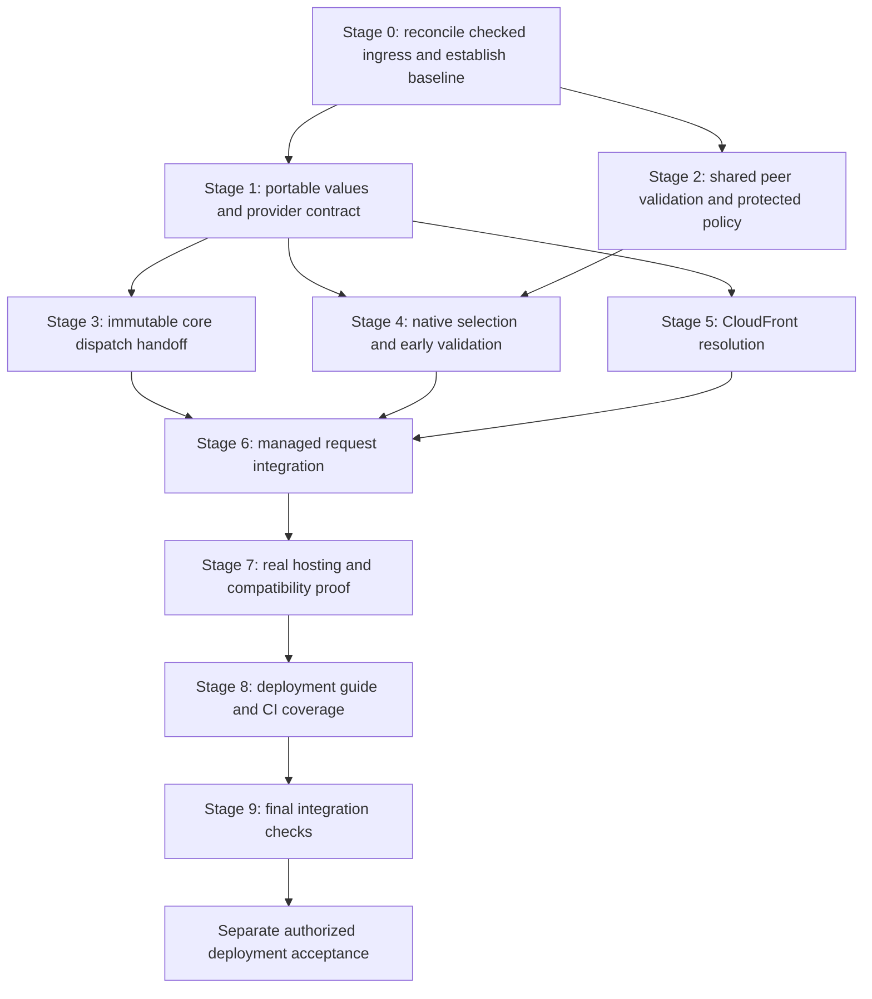

# Pluggable Geo providers implementation plan

- Status: full local implementation and verification complete. Draft publication is authorized on top of native celld #422. Cloud deployment, local GeoIP #438 and downstream adoption remain separate.
- Governing spec: [Pluggable Geo providers](../specs/2026-10-22-pluggable-geo-providers-design.md).
- Planning baseline: `5426ea65f642beafc59e6b4a4d198220d3c20e57`, branch `feature/pluggable-geo-providers`.
- Reviewed design SHA-256: `12eeada53b62663923531fa43e27aac08386df1c97dbc3b66a032b504c7f9f2b`. It matched before implementation. Final spec SHA-256: `7de048a373628d552a7e0e450e0b2f97d8927cf52ce88345348cd7722dcc6502`. Final edits update status, prerequisite reconciliation and the #438 scope link without expanding the provider contract.
- Ingress reference: [#409 at `66a05e25bee674ced69387467acec3c87b06c8b6`](https://github.com/IABTechLab/edgezero/tree/66a05e25bee674ced69387467acec3c87b06c8b6). Its checked-ingress contract is reconciled in `5da2000f`, not merged as an old tree. The distinct #407 body feature is excluded explicitly below.
- Authority: the user authorized full implementation, commits, push and a draft pull request stacked on native celld on 2026-10-22. AWS deployment and downstream adoption remain separate acceptance work.

## 1. Outcome and limits

Deliver one native CloudFront provider with explicit selection, a synchronous portable contract and one immutable outcome per managed request. Accept geographic assertions only through the declared protected-ALB path. Preserve the existing native lifecycle, checked forwarding interpretation and application ownership of policy.

The implementation must not add GeoIP databases, reader-IP inputs, remote lookups, asynchronous provider preparation, environment/manifest selectors, generated CLI configuration, alternative trust modes or Trusted Server changes. CloudFront and ALB provisioning remain operator work. Runtime code must not call AWS to inspect or configure infrastructure.

Two safety assumptions govern the proof:

1. Only the operator-protected CloudFront path can supply accepted assertions. Local tests prove policy/real-peer enforcement. Deployed tests must prove the ALB credential gate, network isolation and CloudFront header behavior.
2. Missing, partial, malformed or unrecognized geography does not imply permission. Core preserves these distinctions; downstream policy tests must prove their interpretation. This implementation does not certify downstream policy.

## 2. Decisions fixed by this plan

These are proposed APIs to implement, not APIs already present in the repository.

| Decision              | Implementation                                                                                                                                                                                                                                                 |
| --------------------- | -------------------------------------------------------------------------------------------------------------------------------------------------------------------------------------------------------------------------------------------------------------- |
| Provider placement    | Core types and synchronous trait in `edgezero-core::geo`; CloudFront implementation inside the native Axum adapter. No new crate.                                                                                                                              |
| Feature               | `edgezero-adapter-axum/geo-cloudfront`, default-off, enabling `axum` but no AWS service feature. The selector remains available under `axum` when the implementation feature is absent.                                                                        |
| Provider ownership    | Native selection/service state holds an `Arc<dyn GeoProvider + Send + Sync>`. The portable trait itself has no `Send`/`Sync` supertraits and no future.                                                                                                        |
| Compatibility         | Preserve `AxumRunOptions: Clone + Send + Sync`, `App: Send + Sync`, existing initializer signatures and local/non-`Send` startup futures. Do not add a provider factory to support non-`Send` native provider objects.                                         |
| Selection             | One `NativeGeoSelection` value: `Off`, `CloudFront { policy }`, or `Supplied { policy, id, provider }`. Repeated consuming `with_geo` calls explicitly replace the whole selection before startup; there is no merge or precedence between independent inputs. |
| Capability inspection | `AxumRunOptions::geo_capability()` returns a validated, owned description. The caller captures it from finalized options in the existing initializer closure. No new `App` capability field, state registry or `PreparedStores` field.                         |
| Trust                 | One opaque `ProtectedCloudFrontAlb` policy, distinct from ordinary proxy trust. Source admission uses the actual connection peer and an adapter-private request-bound witness.                                                                                 |
| CIDRs                 | Extract and reuse #409's internal bounded network set and matcher. No second parser and no dummy forwarding-family policy.                                                                                                                                     |
| Request storage       | Private outcome field in `AdmittedIngress`, transferred to a private `RequestContext` field. No import from public extensions and no live setter.                                                                                                              |
| Cross-crate handoff   | One explicit `App::dispatch_admitted_with_geo` operation consumes an owned outcome alongside the existing admission token. Existing dispatch APIs supply `NoSelection`.                                                                                        |
| Geographic validation | Checked-in ISO country-code table with source attribution and pinned snapshot; syntax-only subdivision validation. No new runtime dependency or subdivision catalogue.                                                                                         |
| Request preparers     | Neither the inspected native baseline nor pinned #409 has a request-preparer callback. Do not add one. Preserve existing Fastly preparer APIs and test that their scratch extensions cannot supply Geo.                                                        |

The native-only provider bounds preserve existing options auto-traits. Portable provider implementations may still use `Rc` or `Cell`; they simply cannot be supplied to the native options API without satisfying its bounds. No application handler, startup future or portable interface gains a new future `Send` requirement.

The core dispatch operation is a trusted Rust integration API, not proof of origin authentication. Rust code can deliberately start another core dispatch with an explicit outcome. Managed Axum never obtains its outcome from such caller-controlled metadata. The adapter-private witness establishes source admission for that managed path.

## 3. Existing integration points and file map

All unqualified anchors below refer to the planning baseline. Anchors marked #409 refer to the pinned commit and must be reconciled before implementation.

| Existing location                                                                                  | Relevant behavior                                                                                                                                                     |
| -------------------------------------------------------------------------------------------------- | --------------------------------------------------------------------------------------------------------------------------------------------------------------------- |
| `crates/edgezero-adapter-axum/src/run_options.rs`, `AxumRunOptions`                                | Cloneable explicit native settings. Constructors currently default Geo implicitly to absent because no Geo field exists.                                              |
| `crates/edgezero-adapter-axum/src/dev_server.rs`, `run_production_selected`                        | Validates native store sources, builds the app/stores/transport and invokes the existing initializer. Geo validation must precede its call to `run_local`.            |
| `dev_server.rs`, `PreparedApp`, `run_owned`                                                        | Private prepared resources flow into service construction before listener adoption/readiness. Carry Geo separately from stores.                                       |
| #409 `crates/edgezero-adapter-axum/src/service.rs:329-418`                                         | Actual-peer cleanup, original normalized-head summary, forwarding normalization/removal and admission. Insert protected-source resolution after successful admission. |
| #409 `service.rs:265-327`, `dispatch_prepared`                                                     | Converts the admitted body, installs stores and dispatches with `FrameworkErrorDetail::CategoryOnly`. Preserve this behavior.                                         |
| #409 `crates/edgezero-adapter-axum/src/proxy.rs:115-174,293-359`                                   | Bounded CIDR validation, IPv4-mapped normalization, whole-family union rejection and containment matching.                                                            |
| `crates/edgezero-core/src/ingress.rs`, `AdmittedIngress`, `PreparedIngress`                        | Private request-lifetime data already passes from admission to routed context. Do not expose a public Geo setter on either token.                                     |
| #409 `crates/edgezero-core/src/app.rs:247-299`                                                     | Admitted dispatch and fixed framework error detail. Add an owned-outcome overload without losing failure classification.                                              |
| `crates/edgezero-core/src/router.rs`, `dispatch_found`                                             | App state overwrites public extension types before constructing the context. Geo must travel outside that extension map.                                              |
| `crates/edgezero-core/src/context.rs`, `new`, `new_routed`, `parts_mut`, `extensions_mut`          | Add private Geo storage; unmanaged construction ignores any forged Geo extension.                                                                                     |
| `crates/edgezero-adapter-axum/tests/production_hosting.rs` and `tests/fixtures/production_host.rs` | Existing child-process, readiness, raw-socket, initializer and shutdown fixtures. Extend these rather than building another server harness.                           |

New files:

```text
crates/edgezero-core/src/geo.rs
crates/edgezero-core/src/geo/country_codes.rs
crates/edgezero-adapter-axum/src/geo.rs
crates/edgezero-adapter-axum/src/geo/cloudfront.rs
crates/edgezero-adapter-axum/src/peer_networks.rs
scripts/check_geo_dependency_contract.sh
docs/guide/native-geo.md
```

Existing files expected to change narrowly:

- Core `src/lib.rs`, `src/ingress.rs`, `src/context.rs` and `src/app.rs`. Keep the existing router production interface; add router tests only if needed for state-extension overwrite coverage.
- Axum `Cargo.toml`, `src/lib.rs`, `src/run_options.rs`, `src/dev_server.rs`, `src/service.rs` and reconciled `src/proxy.rs`.
- Axum `tests/fixtures/production_host.rs` and `tests/production_hosting.rs`.
- Existing adapter contract tests for portable no-selection behavior, including the Fastly preparer fixture where available.
- `.github/workflows/test.yml`, `docs/.vitepress/config.mts` and `docs/guide/adapters/axum.md`.

No workspace member, production binary, CLI template or new third-party dependency is planned for Geo itself. #409 reconciliation may have its own manifest/lockfile changes; record those separately. Do not churn lockfiles or fold unrelated provider refactoring into this work.

## 4. Execution order



Work in coherent, testable units. Add a failing regression first, implement the behavior, run its focused checks, then continue. Record test names and commands before relying on filters. Use `scripts/run_test_nonzero.sh` for named sentinels so a renamed or feature-gated test cannot produce a false pass.

One implementation owner should handle core/native dispatch integration. Independent policy/type research may overlap, but serialize shared Cargo targets, manifest edits and global formatting. Reuse passing checks while their relevant inputs remain unchanged. Do not run every workspace gate after every small edit.

## 5. Stage 0: reconcile prerequisites and record the baseline

### Work

- [x] Read repository instructions, record HEAD/status and recompute the governing spec hash. Preserve uncommitted spec/plan and unrelated work. HEAD is still `5426ea65f642beafc59e6b4a4d198220d3c20e57`; the spec hash matches the reviewed hash above. Initially only the untracked spec and plan were present.
- [x] Split the local GeoIP/database/input-contract work into #438 and record the narrowed initial scope on #432. CloudFront does not satisfy that follow-up.
- [x] Reconcile the pinned #409 checked-ingress delta with explicit preservation of the newer native-store, async EOF and Connections owners. The narrower reconciliation is reviewed below; only the separate #407 buffered JSON-cap/body-carrier feature is excluded. No old whole-file replacement or second forwarding parser was used.
- [x] Preserve current `NativeSourcePlan`, native store overrides, asynchronous store preparation, current logging behavior and the reconciled body/lifecycle/egress ownership. The pinned branch and HEAD diverge beyond Geo; whole-file replacement would discard newer work.
- [x] Confirm original head accounting, missing-peer cleanup, checked proxy normalization, forwarding-header removal, native diagnostics and category-only framework error behavior survive the reconciliation.
- [x] Record the resulting integration revision and the exact baseline checks below. If integration uses a later #409 revision, inspect its changed contract rather than relying on this plan's old line numbers.

Useful inspection commands, not merge instructions:

```sh
git status --short
git rev-parse HEAD
sha256sum docs/superpowers/specs/2026-10-22-pluggable-geo-providers-design.md
git merge-base HEAD 66a05e25bee674ced69387467acec3c87b06c8b6
git diff --stat HEAD 66a05e25bee674ced69387467acec3c87b06c8b6 -- crates/edgezero-core crates/edgezero-adapter-axum
git show 66a05e25bee674ced69387467acec3c87b06c8b6:crates/edgezero-adapter-axum/src/service.rs
```

### Baseline checks after reconciliation

```sh
cargo test --locked -p edgezero-core --lib ingress::
cargo test --locked -p edgezero-core --lib router::
cargo test --locked -p edgezero-adapter-axum --lib proxy::tests
cargo test --locked -p edgezero-adapter-axum --lib run_options::tests
cargo test --locked -p edgezero-adapter-axum --lib dev_server::native_store_tests
cargo test --locked -p edgezero-adapter-axum --features test-utils --test production_hosting
```

Use the pinned sentinels `owned_peer_checked_metadata_precedes_all_managed_consumers` and `original_forwarding_head_overages_reject_before_stripping_or_body_poll` to confirm the relevant #409 tests survived. Record any renamed equivalents. These tests do not exist at the current planning baseline.

### Exit gate

A reviewed integrated ingress baseline with passing neighboring checks, or documented pre-existing failures isolated once. No second forwarding parser, no loss of current store startup behavior, and no unresolved ownership conflict with #409. Native Geo work does not bypass this gate.

## 6. Stage 1: portable values and synchronous provider contract

Files: new core `geo.rs` and `geo/country_codes.rs`; core `lib.rs` exports.

### Work

- [x] Add bounded `GeoProviderId`, `CountryCode`, `SubdivisionCode` and `GeoLocation` values with private fields and validated constructors. `GeoLocation` requires a country and accepts an optional subdivision. Avoid unchecked conversions or deserializers that bypass validation.
- [x] Give provider IDs the ASCII format `[a-z][a-z0-9._-]{0,63}`. Reserve `cloudfront` for the built-in provider. They are public diagnostic labels, never credentials. Native supplied selection receives the validated ID explicitly, so provider identity cannot vary per request.
- [x] Add bounded assertion slots, such as `GeoAssertion<const N: usize>` with absent/value/invalid states. A private bytes/length representation prevents out-of-bounds access. `GeoInput` contains exactly a country slot of capacity two and a subdivision slot of capacity three, with no request/service/IP fields.
- [x] Keep provider results separate from framework outcomes. `GeoResolution` allows missing metadata, a validated location or a bounded provider error. Providers do not choose `NoSelection`, `UntrustedIngress`, selected identity or source provenance.
- [x] Add `GeoOutcome::NoSelection` and a selected outcome carrying a validated provider ID plus unavailable/located/error status. Located data includes `CloudFront` source and the declared protected-ALB trust basis. Errors contain only `InvalidAssertion` or `ProviderFailure`, not an arbitrary error chain.
- [x] Add the synchronous `GeoProvider::resolve(&self, input: &GeoInput) -> GeoResolution` trait. No async method, I/O context, mutable request, future or portable `Send`/`Sync` bound. Document bounded local computation and the trusted-Rust limitation.
- [x] Check in the officially assigned ISO 3166-1 alpha-2 codes. Record the authoritative ISO source URL, captured revision/date, imported-data checksum and applicable attribution in the table file. Review the exact imported list and any licence obligations before committing it. No runtime downloads, country-name database or dependency added just for two-letter membership.
- [x] Normalize ASCII case once in the value constructors. Country is two letters and must be assigned in the pinned list. Subdivision is one to three ASCII alphanumerics and preserves leading zeroes. It is not checked against a subdivision-membership database.
- [x] Make raw assertion debug output redacted. Outcome debug output may contain normalized codes and bounded public categories, never raw source bytes or credential data.

### Tests

Add sentinel `geo_country_codes_normalize_and_reject_unsupported`. Cover lowercase normalization, empty/non-ASCII/whitespace/oversize values, reserved and user-assigned country exclusions including `XX`, `ZZ`, `UK`, `XK`, and valid numeric subdivisions. Prove `US/ZZ` is a syntax-valid assertion rather than validated US membership. Validate the country table's ordering, uniqueness and recorded snapshot size.

Add constructor, equality and debug tests. Compile a portable `GeoProvider` implementation containing `Rc<Cell<_>>` to prove the trait itself has no native thread bounds. Verify no public constructor can create a subdivision-only location.

```sh
scripts/run_test_nonzero.sh geo_country_codes_normalize_and_reject_unsupported cargo test --locked -p edgezero-core --lib geo::
```

### Exit gate

Portable types and provider behavior compile and pass their focused tests without a native dependency or country/subdivision inference.

## 7. Stage 2: shared peer matching and protected-ALB policy

Files: new Axum `peer_networks.rs` and `geo.rs`; reconciled `proxy.rs`; Axum module declarations.

### Work

- [x] Extract #409's existing literal-network validation and matching into a crate-private `PeerNetworks` type. Preserve its 256-entry and 16-KiB input budgets, accounting before deduplication, network truncation, mapped-address normalization, and rejection of whole-family unions as well as `/0`.
- [x] Delegate ordinary `TrustedProxyPolicy` to that helper without changing its public API, forwarding-family semantics or empty-policy behavior. Do not move forwarding interpretation into the helper.
- [x] Add opaque `ProtectedCloudFrontAlb` with a nonempty `PeerNetworks` and one credential-header name. It contains no credential value, distribution-authentication claim or AWS handle.
- [x] Use one bounded header-name rule: a valid literal HTTP token, at most 128 ASCII bytes, beginning with `x-` after case normalization. Reject `x-forwarded-*`, `x-real-ip`, `x-amz-*`, `x-amzn-*`, `x-edge-*`, and native request/correlation-ID header names. Standard transport, authorization, cookie and CloudFront Geo names are excluded by the custom-name rule. Do not trim malformed names into validity.
- [x] Keep the configured header name, network contents and parser input out of errors and `Debug`; emit fixed configuration categories and bounded counts only. Guide examples use a dedicated name such as `x-origin-verify-<random-suffix>`.
- [x] Add a private request-bound admission helper that compares the actual socket peer with the protected policy. It must not accept `ConnectInfo`, `AxumRequestContext`, public checked metadata, effective reader IP or forwarding values as evidence.

### Tests

Preserve all existing proxy-policy assertions and coverage. Mechanically adapt tests that inspect private network fields, or move their helper-level assertions beside `PeerNetworks`; do not weaken them to make the extraction pass. Add sentinel `geo_protected_policy_reuses_network_bounds` covering empty policies, exact/over entry and byte limits, duplicates, IPv4/IPv6, mapped peers, multiple ranges covering an entire family, and missing/nonmatching peers. Add case-insensitive credential-name collision and redaction tests.

```sh
cargo test --locked -p edgezero-adapter-axum --lib proxy::tests
scripts/run_test_nonzero.sh geo_protected_policy_reuses_network_bounds cargo test --locked -p edgezero-adapter-axum --no-default-features --features axum --lib geo::
```

### Exit gate

One reused network validator, distinct proxy and protected-source policies, and no credential comparison or forwarding-family dependency in Geo admission.

## 8. Stage 3: immutable core handoff

Files: core `app.rs`, `ingress.rs`, `context.rs`; tests in those modules and, if useful, `router.rs`.

### Work

- [x] Add private Geo outcome storage to `AdmittedIngress`, defaulting to `NoSelection` in every ordinary/fallback admission constructor. Add only a crate-private consuming installation method for core dispatch code.
- [x] Add `App::dispatch_admitted_with_geo(prepared, request, detail, outcome)`, preserving the pinned `FrameworkErrorDetail` parameter and classified failure behavior. This is the explicit public cross-crate handoff, not a public native trust witness.
- [x] Factor existing admitted dispatch methods through the same implementation with `NoSelection`. Preserve their signatures and existing rendering, response metadata, completion, grant and fallback behavior.
- [x] Install the owned outcome into private admitted state before passing it through the existing router path. The router's public signature need not change.
- [x] Transfer the result into a private `RequestContext` field in `new_routed`; add only `geo(&self) -> &GeoOutcome`. `RequestContext::new` explicitly defaults to `NoSelection` regardless of public extensions.
- [x] Do not preserve Geo by placing it in extensions when converting a context back into an ordinary request. Constructing a later unmanaged context creates a new no-selection dispatch. Keep existing body transfer semantics intact.

### Tests

Add sentinel `geo_owned_outcome_survives_public_request_mutation`. Read the same outcome in multiple middleware layers and a handler after changing geographic headers, inserting a contradictory `GeoOutcome` extension, removing it, clearing extensions and injecting same-type app state. Test legacy dispatch and unmanaged construction with forged selected-outcome extensions; both remain no-selection.

Retain `App: Send + Sync`, token ownership, stale/foreign token rejection, method/path mutation rejection, grant-drop and category-only 404/405 tests. A Geo error must not change HTTP status automatically; the handler must be able to return an unrelated success response.

```sh
scripts/run_test_nonzero.sh geo_owned_outcome_survives_public_request_mutation cargo test --locked -p edgezero-core --lib geo_
cargo test --locked -p edgezero-core
```

### Exit gate

There is no extension-based or public context setter path to replace a live result. Existing adapters still compile against unchanged dispatch APIs and obtain `NoSelection`.

## 9. Stage 4: native selection and early startup validation

Files: Axum `geo.rs`, `run_options.rs`, `dev_server.rs`, `service.rs`, `lib.rs` and `Cargo.toml`.

### Work

- [x] Add `geo-cloudfront = ["axum"]` without adding it to default features, AWS aggregates, CLI features or generated templates. Keep the selection enum and supplied-provider support under native Axum, not the implementation feature.
- [x] Add one private Geo selection field to `AxumRunOptions`, initialized to `Off` by every constructor. Add consuming `with_geo(selection)` and read-only `geo_capability()`; do not read any new environment variables.
- [x] Validate typed policy/identity and implementation availability through one pure validation function shared by capability inspection and runner setup. `CloudFront` without its feature returns a fixed unavailable-implementation category, never `Off`.
- [x] Represent a supplied provider with `Arc<dyn GeoProvider + Send + Sync>`, without requiring provider `Clone`. Keep the ID and policy on the same enum variant. The capability description contains only off/selected identity/source facts, not the provider or credential name.
- [x] Run Geo validation synchronously at the start of `run_production_selected`, before `run_local` creates runtime/signal resources. Keep existing store validation/preparation sequencing and initializer cancellation behavior.
- [x] Construct the stateless built-in provider locally and carry validated composition alongside the existing private prepared resources into `AxumServiceState`. Do not put it in `App`, request extensions or `PreparedStores`. Do not add an async preparation step.
- [x] Preserve every development/unconfigured entrypoint with off composition. The explicit options path is the only new selection path.
- [x] Demonstrate capability inspection by capturing the owned result of `finalized_options.geo_capability()?` in the existing initializer closure, then moving those same finalized options into the runner. The runner validates again. No initializer signature or global capability registry changes.

### Tests

Add compile-time assertions for `AxumRunOptions: Clone + Send + Sync` and retain the existing local-`Rc` initializer test. Test off defaults, explicit whole-selection replacement and supplied-provider composition.

Add sentinel `geo_unavailable_selection_fails_before_runner_resources` under `cfg(not(feature = "geo-cloudfront"))`. Do not gate its module or the public selector on the implementation feature. Prove feature/policy failure precedes the application initializer and deferred store preparation. The test should also work when called from an existing runtime, demonstrating rejection before a nested runner runtime is created. Check no listener is bound and no local store root is created.

```sh
scripts/run_test_nonzero.sh geo_unavailable_selection_fails_before_runner_resources cargo test --locked -p edgezero-adapter-axum --no-default-features --features axum --lib geo_
cargo test --locked -p edgezero-adapter-axum --lib run_options::tests
cargo test --locked -p edgezero-adapter-axum --lib dev_server::native_store_tests
```

### Exit gate

Default-off and unavailable-feature behavior are executed, native options retain their compatibility bounds, and Geo adds no dependency on store roots, AWS credentials or provider preparation.

## 10. Stage 5: CloudFront resolution

Files: Axum `geo/cloudfront.rs`, with unit tests; shared values remain in core.

### Work

- [x] Implement the stateless built-in `GeoProvider` behind `geo-cloudfront`. It accepts only the two bounded assertion slots and returns a `GeoResolution`.
- [x] Map absent country plus absent subdivision to missing metadata. A subdivision without country is invalid. Any invalid slot makes the whole result invalid.
- [x] Delegate country/subdivision normalization to the shared validated constructors. A valid country with absent subdivision is a located country-only result. Never repair an unsupported country or malformed subdivision.
- [x] Keep provider selection, source admission, provider ID and provenance outside the provider implementation. It performs no header lookup, HTTP status choice, logging policy or fallback.

### Tests

Add sentinel `geo_cloudfront_parsing_matches_spec`. Cover every trusted parsing row in spec section 6, including identical duplicates represented as invalid slots, joined values, invalid UTF-8/non-ASCII, zero/one/two/three/four-byte boundaries, lowercase, numeric subdivision components and leading zeroes. Cover `US` without a subdivision, `US/ZZ`, unsupported countries and region-only input.

Use a table-driven test with expected typed outcomes rather than assertions against display strings. Keep provider failure testing in a supplied test implementation; header parsing does not invent internal failure cases.

```sh
scripts/run_test_nonzero.sh geo_cloudfront_parsing_matches_spec cargo test --locked -p edgezero-adapter-axum --no-default-features --features geo-cloudfront --lib geo::
```

### Exit gate

The built-in returns the spec's outcomes with no external operations or silent loss of malformed assertions.

## 11. Stage 6: managed request integration

Files: reconciled Axum `service.rs`, `geo.rs` and service tests. Keep the unmanaged request converter unchanged.

### Work and exact ordering

- [x] Preserve #409's clock, native request guard, drain gate and actual-peer replacement/removal behavior. These early hooks receive no raw headers; do not change lifecycle timing merely to add Geo.
- [x] Split the unpolled request. Compute the original normalized-head validation/summary result before removing headers, so credential bytes and duplicate fields still count against limits.
- [x] Remove every instance of the configured credential header from live parts. Then handle the saved validation result. No callback that can observe the request or its headers may run before removal, including future callbacks added to this path. Do not retain values or reflect the name in validation diagnostics.
- [x] Run the existing checked forwarding normalization/removal and admission on sanitized parts. Keep #409's original count/byte summary. Refused, aborted, invalid-ingress and draining paths perform no Geo resolution.
- [x] After admission, use only the runner-owned `remote_addr` and selected protected policy to create the private request-bound witness. Off returns `NoSelection`; missing/nonmatching peer returns selected `UntrustedIngress`. Neither path inspects Geo values or calls a provider.
- [x] With a witness, inspect both original Geo header names in the still-owned parts. Admission received a cloned immutable head, so it cannot have changed these values. Detect duplicates and oversize input without collecting values or copying more than two/three bytes. Do not retain another raw HeaderMap.
- [x] Invoke the selected provider exactly once, including both-absent and invalid-slot inputs. Wrap its result with the selection-owned ID and, for located results, source/trust basis. Perform this before `dispatch_prepared` conversion/dispatch; later conversion failures do not retry resolution.
- [x] Pass the owned outcome separately through `dispatch_prepared` to `App::dispatch_admitted_with_geo`, retaining `FrameworkErrorDetail::CategoryOnly` and the existing native egress owner.
- [x] Do not expose the witness, policy, provider handle or a mutable outcome to request extensions, middleware, finalizers or the unmanaged converter.

### Tests

Add sentinel `geo_managed_resolution_runs_once_from_owned_ingress`. Use an atomic counting supplied provider to prove one invocation on trusted admitted requests, including absent and invalid input, and zero on off/untrusted/rejected/aborted/draining paths. Finishing, dropping or failing egress must not invoke it again. Test a reported provider failure without fallback or automatic HTTP rejection.

Forge public `ConnectInfo`, `AxumRequestContext`, checked metadata and Geo outcome extensions while passing a missing/nonmatching actual peer. None may establish trust. An ordinary trusted-proxy configuration with Geo off must return `NoSelection`, not a located result. Active selection cannot omit its protected policy. Separately prove that a matching protected ALB peer admits geography without forwarding assertions or ordinary proxy trust. Do not require `effective_client()` to be absent: #409 initializes that field from the direct peer even when no forwarded viewer identity is resolved.

Test credential removal in admission and handler observations, repeated credential fields, and validation-error paths. A request whose original head exceeds a limit must still fail even if stripping the credential would make it fit. Summary counters must include removed bytes/fields while logs and responses contain neither the name nor sentinel value.

No managed-Axum preparer hook exists. Cover mutation at the actual middleware/context boundary and leave that hook absent.

```sh
scripts/run_test_nonzero.sh geo_managed_resolution_runs_once_from_owned_ingress cargo test --locked -p edgezero-adapter-axum --no-default-features --features geo-cloudfront --lib geo_
cargo test --locked -p edgezero-adapter-axum --features geo-cloudfront --lib service::tests
```

### Exit gate

Actual managed dispatch uses owned peer/input facts and a private immutable result, with the specified call counts and unchanged admission/egress ownership. Tower-only calls with no socket peer must remain untrusted; they are not trusted-path proof.

## 12. Stage 7: hosting and compatibility proof

Files: existing native production fixture/tests; existing portable adapter contract tests where needed.

### Work

- [x] Add programmatic fixture modes for off, compiled-out CloudFront, enabled CloudFront, supplied provider, invalid policy and provider failure. Fixture-only CLI/environment knobs must not become production Geo selectors.
- [x] Use a no-store fixture profile so a CloudFront-only application proves it needs no config/data roots or AWS settings. Reuse existing `env_clear`, child output capture, readiness polling and shutdown helpers.
- [x] Add raw-header request support through the existing socket helper. Use a real loopback listener and a matching `/32` policy for successful source admission. Use a different policy range for real-peer rejection. Missing-peer and forged-extension cases remain private service tests.
- [x] Observe normalized outcomes and credential absence in a test handler. Do not turn test observation into built-in Geo response headers or a public diagnostics endpoint.
- [x] Test the same public `CloudFront` selector in feature-disabled and enabled fixture builds. Disabled selection must exit nonzero before readiness/initializer and never bind the selected port.
- [x] Prove a supplied provider works with the CloudFront implementation feature disabled. This distinguishes pluggable composition from availability of the built-in parser.
- [x] Retain local initializer, cancellation, shutdown, refused/aborted ingress and store-preparation regression checks. Match the existing terminal call counts rather than introducing another completion owner.
- [x] Add a no-selection assertion to existing Fastly, Cloudflare and Spin dispatch contracts. For Fastly's existing preparer, insert a forged Geo outcome into scratch extensions and verify no-selection at the handler. Preserve callback ordering and signatures; do not implement platform Geo.

### Checks

Add process sentinels `geo_hosting_proves_real_peer_and_shared_outcome` for the enabled path, `geo_hosting_rejects_unavailable_cloudfront` for the disabled path, and `geo_hosting_supplied_provider_without_builtin` for supplied composition.

```sh
scripts/run_test_nonzero.sh geo_hosting_rejects_unavailable_cloudfront cargo test --locked -p edgezero-adapter-axum --no-default-features --features axum,test-utils --test production_hosting
scripts/run_test_nonzero.sh geo_hosting_supplied_provider_without_builtin cargo test --locked -p edgezero-adapter-axum --no-default-features --features axum,test-utils --test production_hosting
scripts/run_test_nonzero.sh geo_hosting_proves_real_peer_and_shared_outcome cargo test --locked -p edgezero-adapter-axum --no-default-features --features geo-cloudfront,test-utils --test production_hosting
```

The second disabled-build command may reuse the first suite's execution when its log lists both sentinels and the tested inputs are unchanged. Do not rebuild merely to repeat identical passing evidence.

### Exit gate

A real native listener proves the local path, supplied-provider composition and no-store startup. Other adapters retain no-selection behavior. All production-cloud assertions remain unproven until separate deployment checks.

## 13. Stage 8: deployment guide and CI coverage

### Documentation

- [x] Add `docs/guide/native-geo.md`, link it from the Axum guide and navigation. Include programmatic examples for off, CloudFront, supplied provider, startup capability capture and application handling of every outcome. Keep the same snippets in native module rustdoc and execute its doc tests; use `no_run`, not `ignore`, for examples that would start a server. Compare the guide snippets with those compiled examples before acceptance.
- [x] Describe the selected HTTPS CloudFront/ALB path, dedicated origin credential, default-deny listener, CloudFront prefix-list restriction and target security-group isolation. Distinguish declared infrastructure protection from runtime source attestation.
- [x] Show the exact supported credential-header naming rule and a value-only rotation sequence. Renaming requires coordinated stop/reconfigure/restart. Redact both name and value in operational output.
- [x] Require explicit configuration of the two CloudFront-generated headers, not generic viewer-header forwarding or static geographic values. Explain the AWS-network missing-subdivision case and the required spoofing test.
- [x] Require `CachingDisabled`, zero error-caching TTLs for cacheable application-error statuses and no other shared reuse of these responses. No Geo-aware cache-key recipe or automatic cache mutation is added.
- [x] Link the AWS sources already recorded in the spec. If their behavior has changed by implementation time, review the difference before modifying the chosen contract.
- [x] Keep Trusted Server adoption and VPC origins in deferred-work notes, not executable steps in this feature.

### Feature and dependency checks

- [x] Add `scripts/check_geo_dependency_contract.sh` using the repository's shell/Cargo-tree conventions. It must fail on missing expected data, not merely print graphs.
- [x] Compare isolated native normal dependency sets with `axum` versus `geo-cloudfront`: the new feature adds implementation code but should add no third-party runtime dependencies. Assert it is absent from defaults and present when explicitly selected.
- [x] Inspect core and all three WASM adapter normal graphs for new Axum/native-runtime/AWS SDK leakage. Preserve the existing native-store graph checks rather than adding Geo to a store registry or changing store feature semantics.
- [x] Add CI steps for the enabled Geo unit suite, disabled-feature sentinel, supplied-provider sentinel, real hosting sentinel and dependency script. Existing default workspace tests do not exercise the opt-in implementation, and all-features tests do not prove disabled behavior.
- [x] Run the new no-selection assertions through the existing WASM contract-test jobs and their runtime runners. Keep them attached to established dispatch sentinels rather than adding a separate deployment harness.

### Exit gate

Published examples compile against the implemented API. CI selects nonzero tests in both feature states. No new CLI/environment interface or cloud acceptance claim appears in the guide.

## 14. Stage 9: final integration checkpoint

Run these after the coherent implementation is stable. Reuse recorded passing focused results for unchanged inputs. Prepare locked dependencies and installed targets first; an unavailable toolchain or dependency is a coverage gap, not a passing check.

```sh
cargo fmt --all -- --check
cargo test --locked --workspace --all-targets
cargo test --locked -p edgezero-adapter-axum --all-targets --all-features
cargo test --locked -p edgezero-adapter-axum --features geo-cloudfront --doc
cargo clippy --locked --workspace --all-targets --all-features -- -D warnings
cargo check --locked --workspace --all-targets --features "fastly cloudflare spin"
cargo check --locked -p edgezero-adapter-axum --no-default-features
cargo check --locked -p edgezero-adapter-axum --no-default-features --features native-bindings
cargo check --locked -p edgezero-adapter-fastly --no-default-features --features fastly --target wasm32-wasip1
cargo check --locked -p edgezero-adapter-cloudflare --no-default-features --features cloudflare --target wasm32-unknown-unknown
cargo check --locked -p edgezero-adapter-spin --no-default-features --features spin --target wasm32-wasip2
bash scripts/check_geo_dependency_contract.sh
bash scripts/check_native_store_dependency_contract.sh
RUSTDOCFLAGS='-D warnings' cargo doc --locked --workspace --all-features --no-deps
cargo test --locked --manifest-path examples/app-demo/Cargo.toml --workspace --all-targets
cargo check --locked --manifest-path tests/fixtures/reusable-app/Cargo.toml -p fixture-axum
```

Also retain the explicit disabled/enabled hosting and unit commands from earlier stages. Run the existing WASM dispatch test jobs with their configured Viceroy, wasm-bindgen and Wasmtime runners. Compile-only WASM results do not satisfy those runtime tests.

For published documentation changes, install the locked docs dependencies if needed, then run:

```sh
cd docs
npm run lint
npm run format
npm run build
```

The internal `docs/superpowers` documents are excluded from published-site builds and Prettier. Check their relative links, section references, fenced blocks and whitespace separately. A documentation-only plan update does not require executing the implementation commands above.

### Exit gate

All applicable local gates pass or have explicit, evidenced baseline exclusions. Report changes, exact tested revisions/features, runtime versus compile-only evidence, and remaining cloud/downstream gaps. Do not call the feature production-accepted solely because local CI is green.

## 15. Separate deployment acceptance

This stage requires separate authorization and access to an isolated CloudFront/ALB deployment. It is not part of local CI and does not authorize provisioning from the provider implementation.

- [ ] Record the application build, enabled features and sanitized CloudFront/ALB/network configuration identifiers. Never store origin credentials in the plan, shell history, screenshots or test logs.
- [ ] Prove an intended request reaches the application, while direct ALB requests and a different distribution without the credential cannot reach it. With prefix-list restrictions, a network denial is an acceptable direct-access result; do not require an HTTP 403 where no connection is admitted.
- [ ] Prove the application target cannot be reached through another listener, proxy, public address or unintended security-group source.
- [ ] Send forged country/subdivision values through the intended distribution. Compare with generated metadata and prove viewer assertions are not accepted. Include an AWS-network request with a forged subdivision while CloudFront omits its own subdivision.
- [ ] Verify country-only and missing-metadata outcomes without guesses or local/remote fallback.
- [ ] Exercise value rotation under the fixed credential-header name, including temporary old/new acceptance at the ALB, CloudFront deployment and old-value removal. Prove the application never sees the credential header and operational outputs do not reveal it.
- [ ] Exercise success and cacheable error responses across requests with different geographic/policy inputs. Verify CloudFront and any other shared cache do not reuse them. Do not infer cache safety from origin-request policy configuration alone.

Any failure blocks production use of the declared protected policy. Do not work around it by trusting additional headers or adding fallback providers. Trusted Server policy-path tests remain a separate downstream adoption task even after these checks pass.

## 16. Final evidence and completion

### Tested source and reconciliation

The implementation is committed as `d5ec14ed` and `5da2000f` on top of native celld `5426ea65`, with the final test-only split at `56eab85fee2499d46984b077fc9e167693bd4e67`. Remaining publication edits affect only this evidence record and design status. No production source changed after the native all-feature check. The final workspace suite, real-hosting suites and WASM runtime contracts cover the final test state.

The pinned #409 branch shares merge-base `5527b58e` with the native celld stack but its checked-ingress implementation was absent here. Two read-only investigations compared direct-delta adaptation and selective reimplementation. The selected approach adapted only #409's own commit delta, reused its parser/counters/tests and extracted its bounded peer-network matcher. Newer native stores, local non-Send initialization, `Connections`/`FuturesUnordered`, ingress/config bounds and asynchronous EOF/zero-length validation remain authoritative. No old tree was copied over newer files.

The separate #407 managed Body carrier, `JsonBodyLimit` setting and 413-cap behavior are intentionally not imported. Native JSON error privacy instead travels through private admitted/context state. Only #407-dependent cap/carrier tests and claims are excluded; checked ingress, original-head limits, routing/JSON privacy, terminal ownership and TLS proxy fixture tests are retained. This is checked-ingress reconciliation, not full #409-plus-#407 parity.

The required #409 sentinels `owned_peer_checked_metadata_precedes_all_managed_consumers` and `original_forwarding_head_overages_reject_before_stripping_or_body_poll` pass in the native unit suites. A read-only correctness review found no remaining implementation findings. Its credential-error ordering concern was fixed before acceptance: save original validation Result, remove all credential occurrences, then handle the saved Result. Direct rejected-head and managed overage regressions execute that path.

### Local checks

All Cargo commands below used Rust/Cargo 1.95.0 and locked dependencies. The workspace test process used stdin from `/dev/null`, matching noninteractive CI consent tests. Logs are local temporary artifacts, not durable CI records. Rows run before `56eab85f` retain their evidence because that commit only split an already-passing core test into two tests; the production implementation is unchanged. The final workspace suite retests both.

| Check                                           | Tested features/state                                                         | Result                                                                                               | Elapsed                             | Local evidence                                            |
| ----------------------------------------------- | ----------------------------------------------------------------------------- | ---------------------------------------------------------------------------------------------------- | ----------------------------------- | --------------------------------------------------------- |
| `cargo test --locked --workspace --all-targets` | `56eab85f`, workspace defaults                                                | 2,115 passed, 6 existing ignored, none failed                                                        | 55.754 s                            | `/tmp/geo-workspace-tests-final.log`                      |
| Native `--all-targets --all-features` tests     | `5da2000f`, all native providers + Geo                                        | 422 passed across 8 suites, including 367 units, 6 AWS/mixed startup, 4 celld startup and 32 hosting | 182.120 s                           | `/tmp/geo-native-all-features-tests.log`                  |
| Enabled native library                          | `--no-default-features --features geo-cloudfront`                             | 322 passed; parser and managed-resolution sentinels included                                         | 13.192 s                            | `/tmp/geo-final-enabled-units.log`                        |
| Disabled native library                         | `--no-default-features --features axum`                                       | 323 passed; resource-precedence, supplied and policy paths included                                  | 19.779 s                            | `/tmp/geo-final-disabled-units.log`                       |
| Final core Geo regressions                      | Final test split, `--lib geo_`                                                | 3 passed, including immutable roundtrip and legacy-forgery cases                                     | 17.64 s compile                     | `/tmp/geo-core-final-regressions.log`                     |
| Final enabled real hosting                      | `56eab85f`, `--no-default-features --features geo-cloudfront,test-utils`      | Nonzero sentinel and full suite, 32 passed                                                           | 50.890 s                            | `/tmp/geo-final-enabled-hosting.log`                      |
| Final disabled/supplied real hosting            | `56eab85f`, `--no-default-features --features axum,test-utils`                | Full suite, 33 passed; both unavailable and supplied-without-built-in sentinels logged               | 16.919 s                            | `/tmp/geo-final-disabled-hosting.log`                     |
| Workspace Clippy                                | `--workspace --all-targets --all-features -- -D warnings`                     | Pass after splitting the long core regression                                                        | 27.72 s                             | `/tmp/geo-workspace-clippy.log`                           |
| Native disabled Clippy                          | `--no-default-features --features axum --lib -- -D warnings`                  | Pass, including absent-implementation cfg                                                            | 2.14 s                              | `/tmp/geo-final-disabled-clippy.log`                      |
| Workspace feature compilation                   | `--all-targets --features "fastly cloudflare spin"`                           | Pass                                                                                                 | 78 s                                | `/tmp/geo-feature-compilation.log`                        |
| Minimal native / bindings-only                  | No defaults; then `native-bindings` only                                      | Both pass                                                                                            | 3 / 4 s                             | `/tmp/geo-native-{minimal,bindings-only}.log`             |
| Three WASM target checks                        | Fastly wasip1, Cloudflare unknown-unknown, Spin wasip2; adapter feature only  | All pass, compile-only                                                                               | 11 / 32 / 39 s                      | `/tmp/geo-*-wasm-check.log`                               |
| Fastly WASM contracts                           | Viceroy 0.21.0, `fastly,test-utils` on wasip1                                 | 24 runtime tests passed; preparer/closed-lifecycle sentinel separately passed                        | 35 / 6 s                            | `/tmp/geo-fastly-{wasm,preparer}-runtime.log`             |
| Cloudflare WASM contracts                       | wasm-bindgen-test-runner 0.2.128, Node 24.12.0, `cloudflare,test-utils`       | 29 runtime tests passed                                                                              | 59 s                                | `/tmp/geo-cloudflare-wasm-runtime.log`                    |
| Spin WASM contracts                             | Wasmtime 48.0.2, async component/P3/HTTP enabled, `spin,test-utils` on wasip2 | 35 runtime tests passed, including managed Geo-forgery case                                          | 32 s                                | `/tmp/geo-spin-wasm-runtime.log`                          |
| Geo / native-store dependency scripts           | Isolated normal graphs from final manifests/locks                             | Both pass; Geo adds no third-party runtime package relative to Axum                                  | 2 / 6 s                             | `/tmp/geo-{dependency-final,native-store-dependency}.log` |
| Native Geo public doc tests                     | `--features geo-cloudfront --doc`                                             | 5 passed, including all four guide examples                                                          | 4.16 s compile + 2.16 s doc harness | `/tmp/geo-native-doc-tests-final.log`                     |
| Workspace rustdoc                               | `RUSTDOCFLAGS='-D warnings'`, all features, no deps                           | Pass                                                                                                 | 64 s                                | `/tmp/geo-workspace-rustdoc.log`                          |
| App-demo workspace                              | Final consumer lock, all targets                                              | 54 passed, none failed                                                                               | 170.338 s                           | `/tmp/geo-demo-tests.log`                                 |
| Reusable native consumer                        | Final consumer lock, `-p fixture-axum`                                        | Pass                                                                                                 | 109.243 s                           | `/tmp/geo-reusable-check.log`                             |
| Published docs                                  | Locked npm dependencies; lint, format, site build                             | All pass, exact guide/rustdoc snippets matched                                                       | 3.272 / 2.912 / 8.401 s             | `/tmp/geo-docs-{lint,format,build}.log`                   |
| Dependency-script failure cases                 | 16 mocked success/failure graph scenarios                                     | All pass; real graphs also checked above                                                             | 3.206 s                             | `/tmp/geo-docs-dependency-mocks.log`                      |
| Formatting, whitespace and internal links       | `cargo fmt --all -- --check`, `git diff --check`, local Markdown checks       | Pass                                                                                                 | Not separately timed                | Final coordinator checks                                  |

The runtime contract commands use the existing `scripts/run_test_nonzero.sh` harness with their established dispatch sentinels. Fastly used the official Viceroy 0.21.0 binary, archive SHA-256 `52ed3c3ed59d926c81015d637509942c3195443c02c2eebbded9125484336a9e`; the installed 0.17.0 binary was not used. Cloudflare used the absolute installed 0.2.128 runner rather than an unconfigured mise shim. Spin used `wasmtime run -W component-model-async=y -S p3=y -S http=y`.

### Dependencies and proof limits

The root lockfile adds only four dependency edges for reconciled #409 runtime/test support. Each excluded consumer lockfile adds only two native dependency edges; no package versions were changed. Minimum compatible `getrandom = "0.4.2"` and `ipnet = "2.12.0"` constraints preserve independently locked consumer patch versions instead of forcing unrelated downgrades and WASI dependency churn. Root tests use the pinned lock's 0.4.2/2.12.0; app-demo tests also prove its existing 0.4.3/2.12.2 lock. These are ingress prerequisites, not new Geo feature dependencies. The portable country allowlist is checked in with source revision, attribution and checksums, with no runtime dataset download.

The Geo graph script explicitly permits the existing Cloudflare `worker 0.8.5 -> tokio 1.52.3` normal edge only with empty Tokio features. Native runtime/network companions or changed versions/features still fail. This baseline is not newly introduced native-runtime leakage.

The six normally ignored workspace tests are existing generated-consumer or real-service acceptance harnesses. They were not silently selected or treated as passes: generated celld/default-off/restart, real celld TLS with explicit modified binary, generated DynamoDB lifecycle, generated-workspace compilation, native AWS emulator services, and generated native AWS build/startup qualification. The final demo/reusable builds and native mixed-provider startup tests pass, but do not replace those external harnesses. No manual `edgezero serve` run or actual cloud deployment was performed.

Published docs dependencies report seven existing audit vulnerabilities, two moderate and five high, in their unchanged lockfile. No unrelated dependency upgrades were attempted. ShellCheck was unavailable; Bash syntax, 16 failure-case regressions and actual graph execution passed. Existing ignored core rustdoc examples remain ignored; the new Geo examples execute.

### Safety evidence and separate acceptance

1. **Protected source ownership.** Runtime evidence now proves actual-peer policy matching, missing/nonmatching peer rejection despite forged public metadata, distinct ordinary proxy trust, stripping before callbacks/error handling, original-head accounting, and exactly-once resolution only for admitted trusted requests. Evidence is the managed-resolution sentinel and both final real-hosting suites. This proves the local declared-policy boundary, not an ALB listener rule.
2. **Immutable and partial outcomes.** Executed core and real-hosting tests prove consumers share one outcome across header/extension mutation, same-type app-state injection and cleared extensions. Managed context roundtrip and legacy dispatch reset to NoSelection. Country-only, syntax-valid unknown subdivisions, missing/error distinctions, source failures, cancellation/drop/failing egress and no fallback retain their defined behavior. Portable runtime tests prove raw or forged Geo metadata cannot select a source.

Actual ALB credential enforcement, network isolation, alternate-path denial, CloudFront header replacement including missing subdivision, value rotation and shared-cache isolation remain unproven until separately authorized deployment checks in section 15. Trusted Server policy translation and interpretation are outside this change. Deferred local databases and reader-IP input extension are tracked in [#438](https://github.com/IABTechLab/edgezero/issues/438), with the initial split recorded on [#432](https://github.com/IABTechLab/edgezero/issues/432#issuecomment-6349594498).

Completion:

- [x] Full local implementation has its focused and integration proof; the #409/#407 prerequisite distinction is explicit.
- [x] Default-off, no-fallback and unknown/error distinctions survive real native dispatch.
- [x] Provider objects, source admission and outcomes each have one owner; public request mutation cannot rewrite a live managed outcome.
- [x] Existing store preparation, native lifecycle, framework error privacy and portable adapter behavior are preserved.
- [x] Deployment, database and downstream acceptance remain separate from local implementation.
- [x] User-authorized commits and draft publication target `feat/native-celld-stores`, on top of #422; no unrelated edits or automatic deployment are included.
