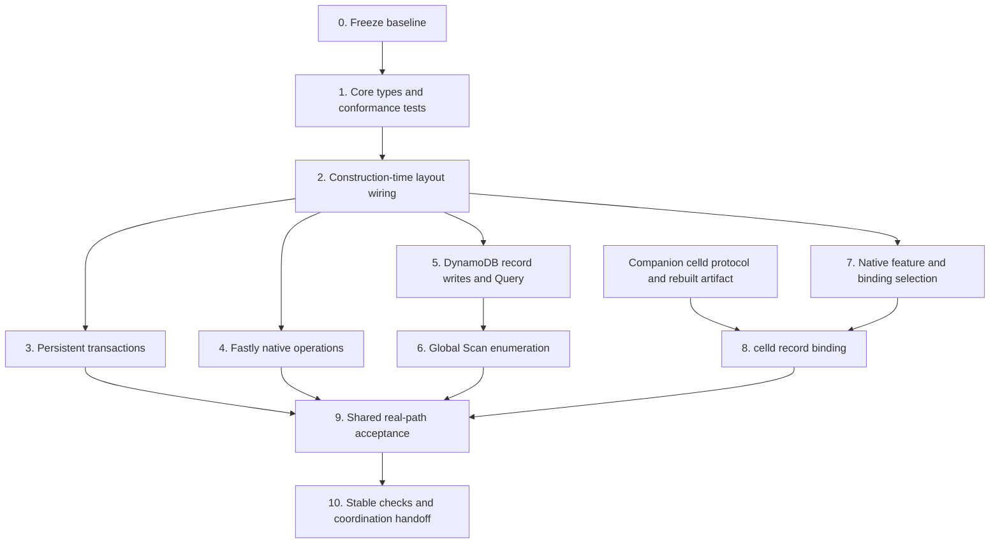

# Portable KV records implementation plan

Status: implementation and required workspace, provider, generated-consumer and selected Fastly CI checks passed on 2026-11-13. Local risk-based review is underway. The pre-existing Cloudflare SDK dependency-graph question remains open. TS adoption and public changes have not started.

Worktree: `/home/pav/worktrees/feat-kv-record-contract`, branch `feat/kv-record-contract`, initially based on #439 at `645703bf39f5965dad5b54d7907e28c9197a7034`.

This file owns EdgeZero task-level progress and checks. The Obsidian plan at `Projects/Trusted Server/plans/Implement the Record Contract and Reconcile Provider Adoption.md` owns celld source/artifact coordination, TS #1536/#1537 reconciliation, publication and stack disposition. The spec owns behavior. Keep those responsibilities separate rather than maintain competing copies of this checklist.

## Delivery contract

- One EdgeZero PR closes #472 and #473, after #439 and before #454. Use forward merges; #495 remains outside the official stack.
- Implement the same public record contract on Fastly KV, PersistentKvStore, DynamoDB on Axum and celld on Axum.
- Install application-owned grouping before provider preparation. Ordinary and record operations share the same value and invalidate generations consistently.
- Preserve ordinary global listing without ordering guarantees. DynamoDB uses Scan for that operation and strong Query for explicit partition listing.
- Include complete pagination, text metadata with empty/absent normalization, native TTL behavior and explicit uncertain mutation outcomes without hidden replay.
- Reuse DynamoDB Local and local celld infrastructure. No Floci, hosted AWS/IAM qualification, migration implementation, deployment or main merge.

## Execution order



Complete one behavior and its focused proof before building on it. After code changes run the affected `cargo test` selection. At a stable combined checkpoint run the broader gates below. Independent investigations may overlap; give each edited file, build directory and mutable service fixture one command owner.

## 0. Freeze the baseline

- [x] Create the isolated worktree from the recorded #439 head without changing unrelated main-checkout work.
- [x] Record the spec decisions, including unordered global Scan and strong partition Query.
- [x] Rechecked #439 ownership and head before edits: ChristianPavilonis, unchanged `645703bf`. Its ancestry includes recorded #422 `4ea31995`. No parent merge was needed.
- [x] Recorded clean code baseline plus the two untracked planning documents. Explicit Rust 1.98.1 is installed; shell default 1.93.1 is not used. `cargo +1.98.1 test --locked --offline -p edgezero-core` passed before source edits.
- [x] Confirm the reviewed spec's concrete choices: construction-time layouts, retained per-key u64 generation allocation, ordinary replacement clearing metadata and explicit celld no-expiry format.

Exit: exact starting source and chosen design recorded. No repair to an unrelated prerequisite is hidden in this feature.

## 1. Define the portable record contract and shared tests

Files:

- New `crates/edgezero-core/src/record_store.rs`, or an equivalently focused module.
- `crates/edgezero-core/src/key_value_store.rs`.
- `crates/edgezero-core/src/lib.rs` and focused public-API tests under `crates/edgezero-core/tests/`.

Work:

- [x] Add the record value, equality-only generation marker, write modes, acknowledged outcomes, page and validated partition types from the spec.
- [x] Add object-safe record methods/capability to `KvStore`, with Unsupported defaults. Keep ordinary-only implementations and test doubles compiling.
- [x] Add `KvHandle::require_records()` as a non-mutating view over that exact provider. Do not add a second provider registry or independently routed record wrapper.
- [x] Add payload-free uncertain-mutation errors. Keep definitive precondition rejection separate from transport/protocol failures and unconditional overwrite errors.
- [x] Implement text metadata normalization/validation, current key/value/page limits and query-bound continuation. Do not add binary metadata or an expiry envelope.
- [x] Update ordinary listing documentation so it does not promise alphabetical ordering on the new partitioned binding. Preserve existing ordinary-only behavior.
- [x] Add one reusable public-handle conformance suite. Keep provider setup/runtime differences in fixture factories, not in duplicated assertions.

Tests to add: unsupported acquisition without I/O, exact body/text fidelity, empty/absent metadata, Add/CAS outcomes, same-row ordinary/record operations, replacement generation invalidation, no-expiry, continuation completeness and uncertainty classification. Provider-specific success is established in later tasks, not by an in-memory double alone.

Check: `cargo test -p edgezero-core`. Add a public consumer compilation test for the final signatures. New test/type names are planned work, not existing APIs.

## 2. Install layouts before stores are prepared

Files:

- `crates/edgezero-core/src/app.rs` and `store_registry.rs`.
- `crates/edgezero-adapter-axum/src/dev_server.rs` and `native_stores.rs`.
- Other adapters' existing registry construction paths as needed for portable declarations and unsupported capability handling.

Work:

- [x] Register immutable per-ID record requirements through App configure. Resolve full keys to stable enumerable prefixes without embedding TS key meanings in core.
- [x] Validate declarations after App construction and before `build_production_stores`. Initializer acquisition must not change routing after handles exist.
- [x] Thread the same declaration through production, development and provider constructors. Ready/deferred handles must already match the required layout/mode.
- [x] Handle IDs that resolve to a shared backing name consistently; reject conflicting declarations before publishing stores.
- [x] Keep ordinary arbitrary-prefix/global listing distinct from complete-partition validation. An empty global prefix must not fail merely because it is not a partition.
- [x] Preserve existing source-selection validation, preparation ordering, immutable snapshots and no-fallback behavior. Do not rewrite the hosting lifecycle.

Checks: core layout tests and focused Axum startup tests prove configure-before-prepare, acquisition without mutation, mismatched supplied handles, shared-name declarations, ordinary-only compatibility and unsupported providers. Run `cargo test -p edgezero-adapter-axum` with the selected relevant features after wiring.

## 3. Implement transactional persistent records

File: `crates/edgezero-adapter-axum/src/key_value_store.rs`, with colocated tests and existing adapter contract coverage.

- [x] Add an explicit record-capable redb format; leave old ordinary-only files readable by their existing path.
- [x] Store body, metadata, generation and optional expiry together. Evaluate Add/CAS and write the new row inside one write transaction.
- [x] Keep durable generation history outside value expiry/deletion. Reopen/restart must not reset it or allow an old token to match a recreated key.
- [x] Route ordinary get/put/TTL-put/delete through the same record rows. Ordinary replacement clears metadata, changes generation and applies the requested expiry or no expiry.
- [x] Preserve the expiry recheck before lazy cleanup so cleanup cannot erase a concurrent fresh overwrite.
- [x] Implement strong partition pages with a read view and bounded scan batches. Preserve continuation when scanned expired rows or scan limits produce short/empty pages.

Check: `cargo test -p edgezero-adapter-axum --lib key_value_store` plus the common record suite against a real temporary database. Include reopen, delete/recreate, cleanup races and ordinary/record coherence.

## 4. Map native Fastly record operations

Files: `crates/edgezero-adapter-fastly/src/key_value_store.rs`, `tests/contract.rs` and the existing Fastly integration fixture paths.

- [x] Use `current_generation()`, native Add and `if_generation_match`. Never use the deprecated generation accessor or get-then-put CAS.
- [x] Normalize native metadata into optional UTF-8 text and preserve native TTL behavior. Do not return a fabricated post-write generation.
- [x] Implement authoritative exact existence with Strong prefix listing and exact key equality. Follow continuation; descendants and truncated pages cannot prove presence/absence.
- [x] Preserve native Strong list cursors for partition pages. Keep groups as prefixes in the existing physical store.
- [x] Map only definitive Add/CAS rejection to normal contention. Surface uncertain mutation completion without library replay.

Check: add and execute the common suite under Viceroy using `scripts/test_integration.sh --adapter fastly --suite ci` with a nonzero selector for the new cases. SDK compilation/native Rust tests do not replace runtime proof. Keep current runtime/SDK pins unless an independently reviewed prerequisite requires change.

## 5. Implement partitioned DynamoDB record writes and Query

Files:

- `crates/edgezero-store-aws/src/dynamodb_kv.rs`, `dynamodb_tests.rs`, settings and preparation code.
- Add focused record implementation modules rather than overloading unrelated snapshot code.

Work:

- [x] Add explicit record-format preparation using existing native SDK clients, deadlines, table-key validation and redacted error handling.
- [x] Encode format/namespace/group into distinct PK values. Separate value and per-key allocator SK kinds without changing the full logical key returned to callers.
- [x] Allocate u64 markers atomically per key, then use native conditional PutItem for Add/CAS or unconditional replacement. No namespace-wide item is mutated by every insert.
- [x] Retain allocator state across value delete/TTL; exclude it from user reads/listing. Prevent wrap/reset. Gaps and out-of-allocation-order unconditional commits are valid.
- [x] Apply one absolute operation budget across allocation and value write. Preserve single-attempt SDK mutations. An allocator-only interruption must not be confused with an acknowledged value write.
- [x] Implement authoritative strong GetItem and strong base-table Query for a declared partition. Carry LastEvaluatedKey through internal/filtered rows, even for an empty returned page.
- [x] Keep ordinary point operations coherent with record rows. Use native TTL on the explicit new format and preserve the legacy ordinary binding's existing format/expiry behavior.

Tests: different groups produce different actual PKs; no global allocator traffic; independent Add/CAS races; stale-token rejection after overwrite/delete/expiry/restart; lost acknowledgement; allocation-only failure; exhaustion; byte/text limits; Query continuation and namespace isolation.

Check: extend existing SDK loopback fixtures and DynamoDB Local proof. The current `cargo test -p edgezero-store-aws --no-default-features --features dynamodb-kv` is an existing entry point; add/select the record feature before claiming record coverage.

## 6. Retain unordered global enumeration with Scan

Files: DynamoDB record provider, cursor encoding/validation, provider wire tests and local generated-consumer proof.

- [x] Implement ordinary `list_keys_page` across all groups and arbitrary/empty prefixes with native paginated Scan. Do not reject cross-group requests.
- [x] Filter by the binding's versioned namespace, value-row kind and requested logical prefix. Return logical keys only, never allocator rows or foreign namespace values.
- [x] Preserve native LastEvaluatedKey. The Scan limit counts evaluated rows, so short/empty output with continuation is valid.
- [x] Allow a native continuation position that belongs to a filtered physical row. Validate cursor structure and bind the outer token to operation, binding, layout/format and requested prefix; do not treat the native position as a returned value.
- [x] Reject Scan/Query cursor interchange. Keep strong partition listing and authoritative exact existence off this global Scan path.
- [x] Do not sort all groups, rescan the complete namespace per output page or create a global index/catalog. Document broad read cost and the required Scan operation without adding hosted IAM acceptance.

Check: local DynamoDB traversal over multiple groups/namespaces with allocator-only pages, empty prefixes, nonmatching prefixes, exact page multiples and live changes. In a quiescent dataset compare complete key sets and duplicate counts, not order. Verify page-sized work uses native continuation rather than restarting at the beginning.

## 7. Add explicit native binding and feature selection

Files:

- `crates/edgezero-adapter-axum/src/native_bindings.rs`, `native_stores.rs`, `native_build.rs` and `Cargo.toml`.
- `crates/edgezero-store-aws/Cargo.toml`, `crates/edgezero-store-celld/Cargo.toml`.
- `crates/edgezero-cli/src/generator.rs` and generated consumers.
- `scripts/check_native_store_dependency_contract.sh`.

Work:

- [x] Add strict, explicit record-mode selection and constructor arguments. Do not silently convert a raw KV binding or fall back to its old format.
- [x] Add default-off record feature forwarding. Proposed names are `dynamodb-records` in the AWS crate, `aws-dynamodb-records` and `celld-records` in Axum; verify the final names and update commands/tests together.
- [x] Preserve settings-only/default-off builds and current AWS/celld config/secret independence. Do not add native dependencies to core or WASM graphs.
- [x] Extend generated consumer templates, strict validation and negative dependency tests. Record capability does not mean offline CLI can certify runtime permissions/connectivity.

Checks: selected feature tests, generated Cargo checks, startup suites and dependency graph script, independently disabled and enabled. Broad all-features success alone is insufficient.

## 8. Integrate the matching celld record service

EdgeZero files: `crates/edgezero-store-celld/src/records.rs`, `client.rs`, settings/preparation, `tests/records_interop.rs`, native binding wiring and generated proof.

The service change is mandatory companion work, not another EdgeZero PR or a deferred follow-up. Its implementation/publication is coordinated in Obsidian Phase 4. The available old service has neither record continuation nor ordinary no-expiry record writes.

- [x] Agree and implement the matching versioned protocol for record pagination and no-expiry. Coordinate server `scoped_record.rs`, service `kv.js` and required client/CLI paths in the celld repository; preserve full extension source, not just a pagination patch against an unpublished base.
- [x] Prepare the EdgeZero binding with a read-only capability/version check for the required protocol. Old services must fail preparation, not silently downgrade.
- [x] Route all ordinary methods on this binding through the record dataset, never `/value` raw KV. Keep raw-only bindings unchanged.
- [x] Support actual non-expiring records, not a fabricated long TTL. Apply the reviewed fresh-format/no-migration approach consistently to read, write, Add/CAS, list, sweep and alarm behavior.
- [x] Implement record keyset continuation, scope/prefix/mode-bound cursors, end detection and text metadata normalization.
- [x] Rebuild the matching service from exact source/lockfile and record source/tree/toolchain/build command/binary hash through the coordination plan. Do not use the cached old binary as new-protocol evidence.

Checks: wire fixtures for old/malformed protocols, uncertainty and cursor validation; then common public-handle tests against the actual rebuilt local service. Prove same-row ordinary access, metadata clearing, no-expiry across restart/sweep and complete pagination. No claim of fleet/rolling-upgrade or production isolation qualification.

## 9. Exercise generated consumers and all four providers

Existing files to extend:

- `crates/edgezero-cli/tests/dynamodb_generated_proof.rs` and `native_aws_emulator_proof.rs`.
- `crates/edgezero-cli/tests/celld_generated_proof.rs`.
- `crates/edgezero-adapter-axum/tests/native_aws_startup.rs` and `native_celld_startup.rs`.
- `scripts/run_native_aws_integration.mjs`, `run_native_celld_integration.mjs` and their existing Node tests.

- [x] Run the same semantic assertions on Fastly, persistent redb, DynamoDB Local and real local celld. Independent writers must share the backing store; a client mutex is not an atomicity proof.
- [x] Require nonzero execution of selected generated/service tests. Missing services or ignored tests cannot count as passes.
- [ ] Exercise same-row get/write/delete, ordinary TTL/no-TTL replacement, metadata, stale tokens and reopen/recreate behavior on actual providers.
- [ ] Fault-inject a lost response after value commit and prove no hidden replay. For the two-stage DynamoDB design, distinguish one allocation plus one value mutation from retrying either request.
- [x] Exercise page continuation and live changes without asserting a frozen snapshot or alphabetical order. Include separate strong Query and ordinary global Scan cases.
- [x] Retain the exact rebuilt celld artifact and source identity for TS adoption. Record local DynamoDB image/configuration and dummy endpoint/credential use.

Existing runner entry points, to be extended before they count as new record acceptance:

```sh
node --test scripts/run_native_aws_integration.test.mjs scripts/run_native_celld_integration.test.mjs
node scripts/run_native_aws_integration.mjs
CELLD_BIN=/absolute/path/to/rebuilt/celld node scripts/run_native_celld_integration.mjs
scripts/test_integration.sh --adapter fastly --suite ci
```

## 10. Stable checks and handoff

- [x] Run focused tests after each code change and the full required gates on a stable combined state.
- [ ] Run default-off/enabled feature graphs and target-matched SDK/runtime checks. Add the final record feature selections to the command record.
- [ ] Review the entire feature diff against the refreshed #439 parent. No #454 prototype, unrelated prerequisite repair or TS business policy belongs in this PR.
- [x] Document record binding selection, native TTL/metadata limits, generation allocation cost, Scan versus Query, protocol/artifact requirements and migration exclusions.
- [ ] Give the Obsidian coordination plan an exact verified EdgeZero source/dependency/service checkpoint for TS adoption. Do not claim runtime readiness from the spec or historical receipts.
- [ ] Use the coordination plan for owned TS PR reconciliation, preserving old public heads, forward merge into #454 and official stack recreation. Do not execute publication, deployment or main merges from this checklist alone.

Required stable EdgeZero commands:

```sh
cargo fmt --all -- --check
cargo clippy --workspace --all-targets --all-features -- -D warnings
cargo test --workspace --all-targets
cargo check --workspace --all-targets --features 'fastly cloudflare spin'
cargo check -p edgezero-adapter-spin --target wasm32-wasip2 --features spin
```

Also run affected docs, demo/generated-consumer and other required WASM checks from current repository instructions. Internal superpowers documents are excluded by the existing docs Prettier configuration; do not present an ignored file as a formatting pass.

## Requirement coverage

| Spec requirements | Execution tasks |
| --- | --- |
| R1, R4, R7, R9 | 1, then provider implementations and 9 |
| R2, R11 | 2 and 7, plus startup acceptance in 9 |
| R3, R10 | 3, 4, 5 and 8 |
| R5 | 9 and 10 |
| R6 | 5, with stored-key/traffic assertions in 9 |
| R8 | 3, 4, 5 and 8, then 9 |
| R12 | 7 and 10 |
| R13 | 6 and global Scan acceptance in 9 |

## Progress and evidence

All commands use Rust `+1.98.1`, `--locked --offline`, task-local TMPDIR and isolated local services. This is executed local acceptance, not hosted deployment qualification. No publication or TS source edits have occurred.

| Checkpoint | Current result | Evidence under `/home/pav/.cache/edgezero-kv-record-contract/` |
| --- | --- | --- |
| Workspace | Strict all-target/all-feature Clippy and full all-target tests passed | `noninteractive-clippy.log`, `noninteractive-tests.log`. Workspace feature unification ran 1174 core, 503 Axum and 261 CLI unit tests, plus other workspace targets. Separate core run included 15 doctests. |
| Persistent records | Transactional contract, lifetime, native races and expiry cleanup passed | 36 selected KV cases, including 9 record cases. Final workspace rerun covers the test-only convention fixes. |
| Fastly records | Target-matched provider tests/lint and full selected CI passed | `fastly-style-all-targets-clippy-final.log`, `fastly-style-all-targets-unit.log`; `fastly-ci-20261113/` records all ten CI stages. Independent Add/CAS each had one winner, 1001 descendants crossed two pages, exact existence and cleanup passed, shared suite executed exactly once. |
| DynamoDB | Record66, legacy46, settings11, strict lint and Local2 passed | `aws-verify-*.log`. Scope includes resolved endpoint, table ARN and optional TableId. Expiry/reopen proof simulates physical value-row removal, not an AWS TTL sweep. |
| Native/platform selection | Combined features, native startup, unsupported providers and WASM checks passed | `final-check.log`, `final-native-records.log`, `final-spin-wasm.log`; both-native `record_`13 and `native_`63, plus earlier platform/CLI/template selections. |
| celld service/client | Protocol12, process4, startup10 plus explicit TLS/60s2; client wire8, neighbors64, default5 and strict lint passed | `celld-worker-*-current.log`, service receipts in the cross-repository plan. Real interop includes independent races, post-commit dropped PUT/DELETE replies and 512-byte escaped/Unicode keys at limit1. |
| Generated consumers | Both old/new AWS consumers2 plus Local2; both old/new celld TLS consumers2 plus real interop1 passed | `generated-aws-runner.log`, `generated-celld-runner.log`. Existing runners require exact nonzero sentinels. |
| Runner/docs | Node18 and affected published docs passed | `record-runner-node-tests.log`, `docs-build.log`, `docs-lint.log`; Prettier3.9.10 checked the five published-doc files. |

### Inputs and retained limitations

- Working-tree review fingerprint `eb6310f2b68da5f09d4ae5b7cd13de3d31d0a30ae830ea70ad24cc86e38c2fae` covers both repositories, tracked changes and untracked source. Recompute with `bun /home/pav/.cache/edgezero-kv-record-contract/reviews/review-target.mjs`. It is not an immutable published dependency revision.
- Explicit repaired Viceroy0.21.0 is `/home/pav/.cache/rc-refresh-20261110/target-viceroy-repair/debug/viceroy`, SHA256 `c846e8db180beeb1477fb504ec1d89c09251203633cd98c7fd9d97abbd7b9755`. The global0.17 binary was not used; SDK pins and host ABI were not changed.
- Retained service `artifacts/celld-v2-f345ffd84455`, SHA256 `f345ffd844551c6dd3780cd2b8a5b9d2c0dc5ecd33522e17edea7ca5d2c53e39`, comes from base9350a043 plus `artifacts/celld-v2-source.patch`. Exact source/lock/build manifest remains in `artifacts/celld-v2-checkpoint.json`. Source publication must include the full base extension.
- Native Fastly lost-ack, TTL-after-wait and restart token lifetime remain unproven. No delegating fault wrapper or host stub is offered as native proof. DynamoDB wire uncertainty and celld actual post-commit reply-loss proofs have their stated scopes.
- The first parallel workspace attempt exceeded an unchanged TCP test's205ms ceiling by0.263ms. Its isolated rerun and final serial workspace run passed without changing the timing bound. A later CLI test assumed non-TTY stdin; the corrected full invocation closes stdin with `</dev/null` and uses `RUST_TEST_THREADS=1`. No product workaround or passing skip was added.
- The user requested less delegation. All implementation workers have finished and were removed. Remaining review and TS work are coordinator-owned; no reviewer agents were launched.

### Feature-aware portable dependency checks

The user approved checking enabled Tokio runtime/native-I/O features instead of adding a baseline exception. Both native-store and Geo checks now share `scripts/portable_dependency_checks.sh`. WASM graphs may use portable Tokio traits/utilities, but runtime/native-I/O features fail. Core still rejects Tokio packages entirely, and native client/SDK bans remain. The Geo check no longer has a Worker/Tokio version allowlist. No dependency, pin or lockfile changed.

Both complete graph checks pass. A disposable real Cloudflare consumer passes with featureless Tokio and fails when the same Cargo graph enables `tokio/rt`. The new regressions cover forbidden features, duplicate/multiple versions, malformed feature output and retained core/SDK bans. Tooling189, scoped Core configuration4, ShellCheck, formatting and diff checks pass. Receipts: `portable-{native,geo}-graphs.log`, `portable-probe-result.log`, `portable-tooling-tests.log` and `portable-core-regression.log` in the task cache. Implementation commit: `5e0e34ea`.

## References

- [Reviewed spec](../specs/2026-11-13-kv-record-contract-design.md).
- [EdgeZero #472](https://github.com/IABTechLab/edgezero/issues/472) and [#473](https://github.com/IABTechLab/edgezero/issues/473).
- [Native AWS foundation plan](2026-10-07-native-store-providers.md) and [celld foundation plan](2026-10-15-native-celld-store-providers.md), historical receipts rather than new record proof.
- Obsidian coordination plan: `Projects/Trusted Server/plans/Implement the Record Contract and Reconcile Provider Adoption.md`.
- Obsidian decisions: `Projects/Trusted Server/notes/Record Contract and Provider Reconciliation Decisions.md`.
