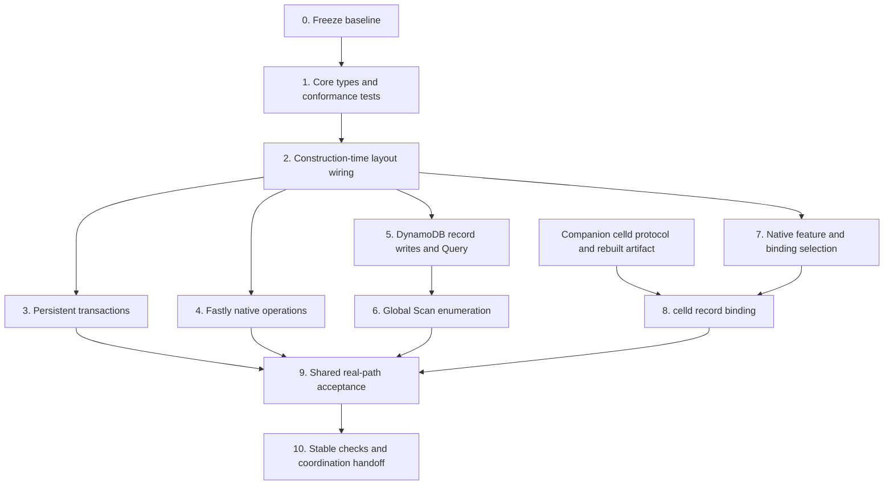

# Portable KV records implementation plan

Status: implementation authorized and started on 2026-11-13. The user reviewed the [spec](../specs/2026-11-13-kv-record-contract-design.md) and requested this execution checklist. Focused core tests and the shared suite on real redb and Fastly/Viceroy have passed. DynamoDB SDK-wire and companion celld service tests have passed. Combined construction, DynamoDB Local, the EdgeZero celld provider and lint gates remain incomplete.

Worktree: `/home/pav/worktrees/feat-kv-record-contract`, branch `feat/kv-record-contract`, initially based on #439 at `645703bf39f5965dad5b54d7907e28c9197a7034`.

This file owns EdgeZero task-level progress and checks. The Obsidian plan at `Projects/Trusted Server/plans/Implement the Record Contract and Reconcile Provider Adoption.md` owns celld source/artifact coordination, TS #1536/#1537 reconciliation, publication and stack disposition. The spec owns behavior. Keep those responsibilities separate rather than maintain competing copies of this checklist.

## Delivery contract

- One EdgeZero PR closes #472 and #473, after #439 and before #454. Use forward merges; #495 remains outside the official stack.
- Implement the same public record contract on Fastly KV, PersistentKvStore, DynamoDB on Axum and celld on Axum.
- Install application-owned grouping before provider preparation. Ordinary and record operations share the same value and invalidate generations consistently.
- Preserve ordinary global listing without ordering guarantees. DynamoDB uses Scan for that operation and strong Query for explicit partition listing.
- Include complete pagination, text metadata with empty/absent normalization, native TTL behavior and explicit uncertain mutation outcomes without hidden replay.
- Reuse DynamoDB Local and local celld infrastructure. No Floci, hosted AWS/IAM qualification, migration implementation, deployment or main merge.

## Execution order



Complete one behavior and its focused proof before building on it. After code changes run the affected `cargo test` selection. At a stable combined checkpoint run the broader gates below. Independent investigations may overlap; give each edited file, build directory and mutable service fixture one command owner.

## 0. Freeze the baseline

- [x] Create the isolated worktree from the recorded #439 head without changing unrelated main-checkout work.
- [x] Record the spec decisions, including unordered global Scan and strong partition Query.
- [x] Rechecked #439 ownership and head before edits: ChristianPavilonis, unchanged `645703bf`. Its ancestry includes recorded #422 `4ea31995`. No parent merge was needed.
- [x] Recorded clean code baseline plus the two untracked planning documents. Explicit Rust 1.98.1 is installed; shell default 1.93.1 is not used. `cargo +1.98.1 test --locked --offline -p edgezero-core` passed before source edits.
- [x] Confirm the reviewed spec's concrete choices: construction-time layouts, retained per-key u64 generation allocation, ordinary replacement clearing metadata and explicit celld no-expiry format.

Exit: exact starting source and chosen design recorded. No repair to an unrelated prerequisite is hidden in this feature.

## 1. Define the portable record contract and shared tests

Files:

- New `crates/edgezero-core/src/record_store.rs`, or an equivalently focused module.
- `crates/edgezero-core/src/key_value_store.rs`.
- `crates/edgezero-core/src/lib.rs` and focused public-API tests under `crates/edgezero-core/tests/`.

Work:

- [x] Add the record value, equality-only generation marker, write modes, acknowledged outcomes, page and validated partition types from the spec.
- [x] Add object-safe record methods/capability to `KvStore`, with Unsupported defaults. Keep ordinary-only implementations and test doubles compiling.
- [x] Add `KvHandle::require_records()` as a non-mutating view over that exact provider. Do not add a second provider registry or independently routed record wrapper.
- [x] Add payload-free uncertain-mutation errors. Keep definitive precondition rejection separate from transport/protocol failures and unconditional overwrite errors.
- [x] Implement text metadata normalization/validation, current key/value/page limits and query-bound continuation. Do not add binary metadata or an expiry envelope.
- [x] Update ordinary listing documentation so it does not promise alphabetical ordering on the new partitioned binding. Preserve existing ordinary-only behavior.
- [x] Add one reusable public-handle conformance suite. Keep provider setup/runtime differences in fixture factories, not in duplicated assertions.

Tests to add: unsupported acquisition without I/O, exact body/text fidelity, empty/absent metadata, Add/CAS outcomes, same-row ordinary/record operations, replacement generation invalidation, no-expiry, continuation completeness and uncertainty classification. Provider-specific success is established in later tasks, not by an in-memory double alone.

Check: `cargo test -p edgezero-core`. Add a public consumer compilation test for the final signatures. New test/type names are planned work, not existing APIs.

## 2. Install layouts before stores are prepared

Files:

- `crates/edgezero-core/src/app.rs` and `store_registry.rs`.
- `crates/edgezero-adapter-axum/src/dev_server.rs` and `native_stores.rs`.
- Other adapters' existing registry construction paths as needed for portable declarations and unsupported capability handling.

Work:

- [x] Register immutable per-ID record requirements through App configure. Resolve full keys to stable enumerable prefixes without embedding TS key meanings in core.
- [ ] Validate declarations after App construction and before `build_production_stores`. Initializer acquisition must not change routing after handles exist.
- [ ] Thread the same declaration through production, development and provider constructors. Ready/deferred handles must already match the required layout/mode.
- [ ] Handle IDs that resolve to a shared backing name consistently; reject conflicting declarations before publishing stores.
- [ ] Keep ordinary arbitrary-prefix/global listing distinct from complete-partition validation. An empty global prefix must not fail merely because it is not a partition.
- [ ] Preserve existing source-selection validation, preparation ordering, immutable snapshots and no-fallback behavior. Do not rewrite the hosting lifecycle.

Checks: core layout tests and focused Axum startup tests prove configure-before-prepare, acquisition without mutation, mismatched supplied handles, shared-name declarations, ordinary-only compatibility and unsupported providers. Run `cargo test -p edgezero-adapter-axum` with the selected relevant features after wiring.

## 3. Implement transactional persistent records

File: `crates/edgezero-adapter-axum/src/key_value_store.rs`, with colocated tests and existing adapter contract coverage.

- [x] Add an explicit record-capable redb format; leave old ordinary-only files readable by their existing path.
- [x] Store body, metadata, generation and optional expiry together. Evaluate Add/CAS and write the new row inside one write transaction.
- [x] Keep durable generation history outside value expiry/deletion. Reopen/restart must not reset it or allow an old token to match a recreated key.
- [x] Route ordinary get/put/TTL-put/delete through the same record rows. Ordinary replacement clears metadata, changes generation and applies the requested expiry or no expiry.
- [x] Preserve the expiry recheck before lazy cleanup so cleanup cannot erase a concurrent fresh overwrite.
- [x] Implement strong partition pages with a read view and bounded scan batches. Preserve continuation when scanned expired rows or scan limits produce short/empty pages.

Check: `cargo test -p edgezero-adapter-axum --lib key_value_store` plus the common record suite against a real temporary database. Include reopen, delete/recreate, cleanup races and ordinary/record coherence.

## 4. Map native Fastly record operations

Files: `crates/edgezero-adapter-fastly/src/key_value_store.rs`, `tests/contract.rs` and the existing Fastly integration fixture paths.

- [x] Use `current_generation()`, native Add and `if_generation_match`. Never use the deprecated generation accessor or get-then-put CAS.
- [ ] Normalize native metadata into optional UTF-8 text and preserve native TTL behavior. Do not return a fabricated post-write generation.
- [ ] Implement authoritative exact existence with Strong prefix listing and exact key equality. Follow continuation; descendants and truncated pages cannot prove presence/absence.
- [ ] Preserve native Strong list cursors for partition pages. Keep groups as prefixes in the existing physical store.
- [ ] Map only definitive Add/CAS rejection to normal contention. Surface uncertain mutation completion without library replay.

Check: add and execute the common suite under Viceroy using `scripts/test_integration.sh --adapter fastly --suite ci` with a nonzero selector for the new cases. SDK compilation/native Rust tests do not replace runtime proof. Keep current runtime/SDK pins unless an independently reviewed prerequisite requires change.

## 5. Implement partitioned DynamoDB record writes and Query

Files:

- `crates/edgezero-store-aws/src/dynamodb_kv.rs`, `dynamodb_tests.rs`, settings and preparation code.
- Add focused record implementation modules rather than overloading unrelated snapshot code.

Work:

- [ ] Add explicit record-format preparation using existing native SDK clients, deadlines, table-key validation and redacted error handling.
- [ ] Encode format/namespace/group into distinct PK values. Separate value and per-key allocator SK kinds without changing the full logical key returned to callers.
- [ ] Allocate u64 markers atomically per key, then use native conditional PutItem for Add/CAS or unconditional replacement. No namespace-wide item is mutated by every insert.
- [ ] Retain allocator state across value delete/TTL; exclude it from user reads/listing. Prevent wrap/reset. Gaps and out-of-allocation-order unconditional commits are valid.
- [ ] Apply one absolute operation budget across allocation and value write. Preserve single-attempt SDK mutations. An allocator-only interruption must not be confused with an acknowledged value write.
- [ ] Implement authoritative strong GetItem and strong base-table Query for a declared partition. Carry LastEvaluatedKey through internal/filtered rows, even for an empty returned page.
- [ ] Keep ordinary point operations coherent with record rows. Use native TTL on the explicit new format and preserve the legacy ordinary binding's existing format/expiry behavior.

Tests: different groups produce different actual PKs; no global allocator traffic; independent Add/CAS races; stale-token rejection after overwrite/delete/expiry/restart; lost acknowledgement; allocation-only failure; exhaustion; byte/text limits; Query continuation and namespace isolation.

Check: extend existing SDK loopback fixtures and DynamoDB Local proof. The current `cargo test -p edgezero-store-aws --no-default-features --features dynamodb-kv` is an existing entry point; add/select the record feature before claiming record coverage.

## 6. Retain unordered global enumeration with Scan

Files: DynamoDB record provider, cursor encoding/validation, provider wire tests and local generated-consumer proof.

- [ ] Implement ordinary `list_keys_page` across all groups and arbitrary/empty prefixes with native paginated Scan. Do not reject cross-group requests.
- [ ] Filter by the binding's versioned namespace, value-row kind and requested logical prefix. Return logical keys only, never allocator rows or foreign namespace values.
- [ ] Preserve native LastEvaluatedKey. The Scan limit counts evaluated rows, so short/empty output with continuation is valid.
- [ ] Allow a native continuation position that belongs to a filtered physical row. Validate cursor structure and bind the outer token to operation, binding, layout/format and requested prefix; do not treat the native position as a returned value.
- [ ] Reject Scan/Query cursor interchange. Keep strong partition listing and authoritative exact existence off this global Scan path.
- [ ] Do not sort all groups, rescan the complete namespace per output page or create a global index/catalog. Document broad read cost and the required Scan operation without adding hosted IAM acceptance.

Check: local DynamoDB traversal over multiple groups/namespaces with allocator-only pages, empty prefixes, nonmatching prefixes, exact page multiples and live changes. In a quiescent dataset compare complete key sets and duplicate counts, not order. Verify page-sized work uses native continuation rather than restarting at the beginning.

## 7. Add explicit native binding and feature selection

Files:

- `crates/edgezero-adapter-axum/src/native_bindings.rs`, `native_stores.rs`, `native_build.rs` and `Cargo.toml`.
- `crates/edgezero-store-aws/Cargo.toml`, `crates/edgezero-store-celld/Cargo.toml`.
- `crates/edgezero-cli/src/generator.rs` and generated consumers.
- `scripts/check_native_store_dependency_contract.sh`.

Work:

- [ ] Add strict, explicit record-mode selection and constructor arguments. Do not silently convert a raw KV binding or fall back to its old format.
- [ ] Add default-off record feature forwarding. Proposed names are `dynamodb-records` in the AWS crate, `aws-dynamodb-records` and `celld-records` in Axum; verify the final names and update commands/tests together.
- [ ] Preserve settings-only/default-off builds and current AWS/celld config/secret independence. Do not add native dependencies to core or WASM graphs.
- [ ] Extend generated consumer templates, strict validation and negative dependency tests. Record capability does not mean offline CLI can certify runtime permissions/connectivity.

Checks: selected feature tests, generated Cargo checks, startup suites and dependency graph script, independently disabled and enabled. Broad all-features success alone is insufficient.

## 8. Integrate the matching celld record service

EdgeZero files: `crates/edgezero-store-celld/src/records.rs`, `client.rs`, settings/preparation, `tests/records_interop.rs`, native binding wiring and generated proof.

The service change is mandatory companion work, not another EdgeZero PR or a deferred follow-up. Its implementation/publication is coordinated in Obsidian Phase 4. The available old service has neither record continuation nor ordinary no-expiry record writes.

- [ ] Agree and implement the matching versioned protocol for record pagination and no-expiry. Coordinate server `scoped_record.rs`, service `kv.js` and required client/CLI paths in the celld repository; preserve full extension source, not just a pagination patch against an unpublished base.
- [ ] Prepare the EdgeZero binding with a read-only capability/version check for the required protocol. Old services must fail preparation, not silently downgrade.
- [ ] Route all ordinary methods on this binding through the record dataset, never `/value` raw KV. Keep raw-only bindings unchanged.
- [ ] Support actual non-expiring records, not a fabricated long TTL. Apply the reviewed fresh-format/no-migration approach consistently to read, write, Add/CAS, list, sweep and alarm behavior.
- [ ] Implement record keyset continuation, scope/prefix/mode-bound cursors, end detection and text metadata normalization.
- [ ] Rebuild the matching service from exact source/lockfile and record source/tree/toolchain/build command/binary hash through the coordination plan. Do not use the cached old binary as new-protocol evidence.

Checks: wire fixtures for old/malformed protocols, uncertainty and cursor validation; then common public-handle tests against the actual rebuilt local service. Prove same-row ordinary access, metadata clearing, no-expiry across restart/sweep and complete pagination. No claim of fleet/rolling-upgrade or production isolation qualification.

## 9. Exercise generated consumers and all four providers

Existing files to extend:

- `crates/edgezero-cli/tests/dynamodb_generated_proof.rs` and `native_aws_emulator_proof.rs`.
- `crates/edgezero-cli/tests/celld_generated_proof.rs`.
- `crates/edgezero-adapter-axum/tests/native_aws_startup.rs` and `native_celld_startup.rs`.
- `scripts/run_native_aws_integration.mjs`, `run_native_celld_integration.mjs` and their existing Node tests.

- [ ] Run the same semantic assertions on Fastly, persistent redb, DynamoDB Local and real local celld. Independent writers must share the backing store; a client mutex is not an atomicity proof.
- [ ] Require nonzero execution of selected generated/service tests. Missing services or ignored tests cannot count as passes.
- [ ] Exercise same-row get/write/delete, ordinary TTL/no-TTL replacement, metadata, stale tokens and reopen/recreate behavior on actual providers.
- [ ] Fault-inject a lost response after value commit and prove no hidden replay. For the two-stage DynamoDB design, distinguish one allocation plus one value mutation from retrying either request.
- [ ] Exercise page continuation and live changes without asserting a frozen snapshot or alphabetical order. Include separate strong Query and ordinary global Scan cases.
- [ ] Retain the exact rebuilt celld artifact and source identity for TS adoption. Record local DynamoDB image/configuration and dummy endpoint/credential use.

Existing runner entry points, to be extended before they count as new record acceptance:

```sh
node --test scripts/run_native_aws_integration.test.mjs scripts/run_native_celld_integration.test.mjs
node scripts/run_native_aws_integration.mjs
CELLD_BIN=/absolute/path/to/rebuilt/celld node scripts/run_native_celld_integration.mjs
scripts/test_integration.sh --adapter fastly --suite ci
```

## 10. Stable checks and handoff

- [ ] Run focused tests after each code change and the full required gates on a stable combined state.
- [ ] Run default-off/enabled feature graphs and target-matched SDK/runtime checks. Add the final record feature selections to the command record.
- [ ] Review the entire feature diff against the refreshed #439 parent. No #454 prototype, unrelated prerequisite repair or TS business policy belongs in this PR.
- [ ] Document record binding selection, native TTL/metadata limits, generation allocation cost, Scan versus Query, protocol/artifact requirements and migration exclusions.
- [ ] Give the Obsidian coordination plan an exact verified EdgeZero source/dependency/service checkpoint for TS adoption. Do not claim runtime readiness from the spec or historical receipts.
- [ ] Use the coordination plan for owned TS PR reconciliation, preserving old public heads, forward merge into #454 and official stack recreation. Do not execute publication, deployment or main merges from this checklist alone.

Required stable EdgeZero commands:

```sh
cargo fmt --all -- --check
cargo clippy --workspace --all-targets --all-features -- -D warnings
cargo test --workspace --all-targets
cargo check --workspace --all-targets --features 'fastly cloudflare spin'
cargo check -p edgezero-adapter-spin --target wasm32-wasip2 --features spin
```

Also run affected docs, demo/generated-consumer and other required WASM checks from current repository instructions. Internal superpowers documents are excluded by the existing docs Prettier configuration; do not present an ignored file as a formatting pass.

## Requirement coverage

| Spec requirements | Execution tasks |
| --- | --- |
| R1, R4, R7, R9 | 1, then provider implementations and 9 |
| R2, R11 | 2 and 7, plus startup acceptance in 9 |
| R3, R10 | 3, 4, 5 and 8 |
| R5 | 9 and 10 |
| R6 | 5, with stored-key/traffic assertions in 9 |
| R8 | 3, 4, 5 and 8, then 9 |
| R12 | 7 and 10 |
| R13 | 6 and global Scan acceptance in 9 |

## Progress and evidence

Implementation is in progress. Checkmarks record implemented behaviors with focused evidence, not a completed provider/startup qualification. Broad lint, generated-consumer and real-service gates remain separate.

For each completed behavior, record the exact source/dependency/service inputs, command, result, elapsed time and log. Reuse results only while relevant inputs remain unchanged. Report baseline failures separately and do not relax bounds to turn them green.

| Checkpoint | State | Evidence |
| --- | --- | --- |
| Core contract and layout | Functional checks passed; lint pending | `record_api`: 12 passed; `record_configuration`: 4 passed. Full core tests reached the subsequent Clippy command with task-local TMPDIR. Clippy failed on new-code conventions and ordinary-only default-method lint sites. |
| Persistent records | Focused checks and lib lint passed | 36 selected KV tests passed, including 9 record cases, the public shared suite, independent Add/CAS writers, delete/reopen, missing allocator state, delayed cleanup and expiry/recreation. A reproduced strong-existence expiry mismatch was fixed. Axum lib Clippy passed after source organization/style fixes. |
| Fastly records | Basic real-path suite passed; driver/edge cases pending | Release WASM fixture built; explicit repaired Viceroy 0.21.0 returned HTTP 200 and `executed_suites=1` after the public shared assertions. No native race/restart/ack-loss claim. |
| DynamoDB writes/Query/global Scan | SDK-wire and Local checks passed; lint/generated proof pending | Updated crate: 66 passed after endpoint/ARN/table identity correction and 3 scope regressions. Both explicitly selected Local tests passed against the existing pinned DynamoDB Local 3.3.1 image, including real group/allocator rows, shared suite, independent clients, complete Query/Scan and simulated physical expiry removal/reopen. |
| Feature/binding selection | Default-native checks passed; broader selections pending | Default Axum `record_`: 13 passed, `native_`: 63 passed. Explicit mode/layout/shared-name/ready/deferred checks executed. Platform/CLI/template and selected native-feature checks are still being collected. |
| Matching celld protocol and provider | Service tested; EdgeZero client in progress | 12 HTTP/protocol cases and 4 new real-process v2 cases passed. Startup neighbors: 10 default cases plus both explicitly selected TLS/60-second cases passed. EdgeZero records-v2 wire unit: 8 passed; real client/service interop remains pending. |
| Four-provider real-path conformance | Basic shared suite passed on all four; combined acceptance pending | Real redb, Fastly/Viceroy, DynamoDB Local and the EdgeZero client against rebuilt celld have executed the shared assertions. Celld additionally passed independent native races/global listing and committed PUT/DELETE dropped-reply proof. New automatic Fastly race/continuation/CI, generated consumers, broad gates and review remain pending. |
| Stable integration and coordination handoff | Pending | No TS adoption or public mutation yet. |

Checkpoint logs and inputs live under `/home/pav/.cache/edgezero-kv-record-contract/`:

- `core-redb-expanded.log`: API/configuration and persistent focused commands; builds 1.89s and 12.57s, persistent tests 0.24s. `first-record-checkpoints.sha256` records relevant inputs before the later redb cleanup/expiry test additions.
- `core-neighbors-lint.log`: first broad core attempt, 11 existing temporary-file writes failed with EDQUOT on `/tmp`. No application limit or test was weakened. Scoped TMPDIR rerun proceeded to Clippy; `core-neighbors-lint-disk-tmp.log` retains its lint diagnostics. Subsequent checks use the task-local disk-backed `tmp/` directory.
- `dynamodb-records-unit.log`: 63 SDK-wire/settings cases passed, build 27.75s and tests 3.07s. A neighboring ordinary-only feature run, crate lint and real DynamoDB Local proof are still required.
- `fastly-fixture-build.log` and `fastly-runtime-receipt.json`: build 25.35s; one real shared suite passed. Guest SHA-256 `e5fc4beb55042df62504d60e76db8475bf9429de9d1bd931e2fae90635128ddd`; selected runtime SHA-256 `c846e8db180beeb1477fb504ec1d89c09251203633cd98c7fd9d97abbd7b9755` at `/home/pav/.cache/rc-refresh-20261110/target-viceroy-repair/debug/viceroy`. The global 0.17.0 binary was not used. The earlier native Fastly lib-test attempt failed on unresolved SDK host imports and is not a test pass or established baseline regression.
- `celld-protocol-unit.log`, `celld-v2-runtime.log` and `celld-startup-neighbors.log`: 12 HTTP cases, 4 v2 real-process cases and 10 nonignored startup neighbors passed. Builds took 77s and 54.23s; v2 runtime tests took 0.77s. Both explicit ignored neighbors passed in `celld-startup-ignored.log`, 2 cases in 61.20s.
- `artifacts/celld-v2-f345ffd84455`: retained rebuilt service, SHA-256 `f345ffd844551c6dd3780cd2b8a5b9d2c0dc5ecd33522e17edea7ca5d2c53e39`, from companion base `9350a043860c4f41dccb692ec9de98ebd9dac3ae` plus `artifacts/celld-v2-source.patch`, SHA-256 `0427280d95893fb45aa28d085a42e75ab06e1de39b40cc676411234a11494980`. Source fingerprints are in `artifacts/celld-v2-source.sha256`; Cargo.lock SHA-256 is `d6a17422788aa910ba76bed9cf59ac15767f93fe107ebdb336954d0e9efe052b`. Rust 1.98.1 built the binary through the focused service integration command. Full source publication must include the base extension, not only this v2 delta.

Additional current receipts:

- `redb-native-check.log`: 36 persistent, 13 record-filtered and 63 native-filtered cases passed. `redb-expiry-red2.log` is the intentional failing expiry-consistency regression before the fix. `redb-style-tests.log` passed 36 cases again after moving the private implementation to `src/key_value_store_records.rs`; `axum-clippy-recheck.log` passed lib Clippy.
- `core-tests-recheck.log`: all core targets passed, including 1147 unit, 12 API, 4 configuration and 15 doc tests. `core-clippy-recheck.log` reduced new-code lint failures from 148 to 10; those last fixes and the generic pagination test-loop correction remain pending.
- `fastly-wasi-unit.log`: 9 provider tests passed on wasm32-wasip1 with the explicit repaired runtime, including 6 new cases. `fastly-harness-unit.log`: 4 nonzero/readiness/evidence validator tests passed. Expanded native races/1001-descendant proof still needs its new runtime receipt.
- `dynamodb-scope-test.log`: 66 SDK-wire/settings cases passed. `dynamodb-local-records.log`: 2 explicitly ignored Local cases and their isolated exact-test children passed, build 3.40s and execution 1.26s. The expiry case labels manual physical value-row deletion as simulation, not a Local/native AWS TTL sweep. `dynamodb-local-container.json` records the task-owned loopback container and pinned image digest.
- `celld-client-unit.log`: 8 wire cases passed. `celld-client-interop.log`: 8 current wire cases and 1 explicitly selected real-service case passed, the latter in 0.26s. The service used the retained f345 artifact and a fresh writable `identity` alias; both parent and worker temporary listeners were subsequently stopped.
- `record-runner-node-tests.log`: 18 tests passed, including mandatory old/new generated sentinels, both Local provider cases, zero-test rejection, interruption cleanup and credential/trust-input isolation. Existing runners are being extended, not replaced with another emulator framework.
- Public `docs/guide/kv-records.md` and links now document the actual API, explicit formats, native TTL/metadata, generation cost and Scan/Query distinction. Prettier 3.9.10 check passed for the five touched published-doc files.

### Open dependency baseline question

The added absolute no-Tokio check found that pinned Cloudflare `worker =0.8.5` already brings `tokio` into its WASM graph. Root Cargo/lock, core Cargo and Cloudflare Cargo inputs are unchanged from #439. The inverse graph is `tokio -> worker -> edgezero-adapter-cloudflare`; `cloudflare-sdk-tokio-baseline.log` records selected features. The user was asked whether this pre-existing SDK dependency is outside the record work or a separate prerequisite. No SDK pin, global lint or dependency policy has been relaxed. The stricter graph gate remains incomplete while that scope question is open.

## References

- [Reviewed spec](../specs/2026-11-13-kv-record-contract-design.md).
- [EdgeZero #472](https://github.com/IABTechLab/edgezero/issues/472) and [#473](https://github.com/IABTechLab/edgezero/issues/473).
- [Native AWS foundation plan](2026-10-07-native-store-providers.md) and [celld foundation plan](2026-10-15-native-celld-store-providers.md), historical receipts rather than new record proof.
- Obsidian coordination plan: `Projects/Trusted Server/plans/Implement the Record Contract and Reconcile Provider Adoption.md`.
- Obsidian decisions: `Projects/Trusted Server/notes/Record Contract and Provider Reconciliation Decisions.md`.
