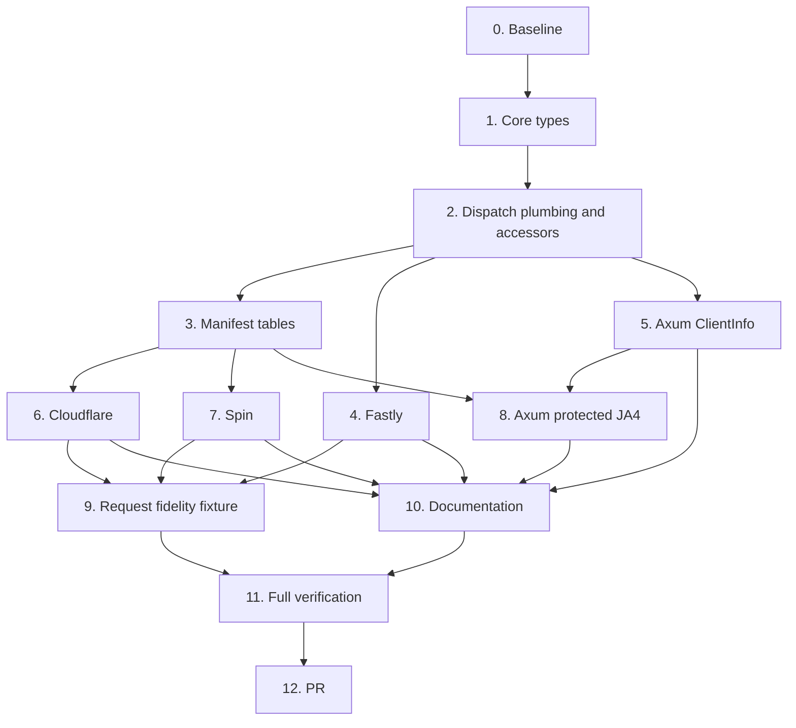

# Portable ClientInfo implementation plan

**Spec:** [`docs/superpowers/specs/2026-11-18-portable-client-info-design.md`](../specs/2026-11-18-portable-client-info-design.md). The spec owns behavior. This plan owns task order, files and checks.
**Issues closed by the PR:** #475, #89, #90, #91, #92, #485.
**Worktree:** `/home/pav/worktrees/feat-portable-client-info`, branch `feat/portable-client-info`.
**Baseline:** `feature/kv-geoip` at `925fe019`, plus local merges of #469 (`078d872b`) and #514 head `ec0b912b` (`c8613016`). Spec committed at `9469c8ae`.

**Goal:** one read-only `ClientInfo` snapshot per managed request on Fastly, Axum, Cloudflare and Spin, carried through admitted dispatch next to `GeoOutcome`, plus protected CloudFront JA4 on Axum.

**Architecture:** a new `edgezero_core::client_info` module owns the types. `AdmittedIngress` carries an optional snapshot beside `request_geo`, so `RequestContext` and `PreDispatchRequest` read it the same way they read Geo today. Each adapter builds the snapshot from facts it already holds and passes it to a new dispatch entry point. No adapter parses a new forwarding format.

**Rules for this work:**

- Add nothing the spec does not require. If a check, limit or setting has no evidence behind it, leave it out and raise it instead.
- Write the focused tests for a task before or with its code. Run the affected crate's tests after every change.
- Do not change #469 or #514 behavior except where a task says so. The one planned change is the split of `SpinKvGeo::resolve` in Task 7.
- New type and function names below are proposals. Keep the spec's distinctions; rename freely.

## Execution order

Tasks 4 to 8 touch separate adapter crates once Tasks 2 and 3 land and can run in parallel. Give each crate one owner at a time.

## 0. Baseline

- [x] Confirm `HEAD` contains `9469c8ae`, `c8613016` and `078d872b`, and the working tree is clean.
- [x] Record the Rust toolchain from `.tool-versions` and use it explicitly.
- [x] Run and record baseline results before edits:
  - `cargo test -p edgezero-core`
  - `cargo test -p edgezero-adapter-axum`
  - `cargo test -p edgezero-adapter-spin`
  - `cargo check --workspace --all-targets --features "fastly cloudflare spin"`
  - `cargo check -p edgezero-adapter-spin --target wasm32-wasip2 --features spin`
- [x] Note any baseline failure as pre-existing. Do not repair prerequisite work in this branch.

Exit: known-good starting point recorded in the verification log below.

## 1. Core ClientInfo types

Spec: Handler contract, Viewer TLS values.

Files: new `crates/edgezero-core/src/client_info.rs`; `crates/edgezero-core/src/lib.rs`.

- [x] Add `ClientInfo`, `Capture<T>`, `UnavailableReason { NotExposed, Missing, Rejected }`, `ClientAddress`, `ClientIpSource` (including `PeerFallback(UnavailableReason)` and `AuthenticatedHeader`), `ViewerTlsValue` and `ViewerTlsSource`. Mark the enums `#[non_exhaustive]`. Keep fields private.
- [x] Public constructors for adapter crates: `ClientInfo::new(direct_peer, effective_client, tls_version, tls_cipher)`, `ClientAddress::new(ip, source)`, `ViewerTlsValue::new(value, source)`, and a `ClientInfo::not_exposed()` convenience for opted-out requests.
- [x] Accessors: `direct_peer()`, `effective_client()`, `tls_version()`, `tls_cipher()`, `ClientAddress::{ip, source}`, `ViewerTlsValue::{as_str, source}`.
- [x] `effective_client_ip()` returns `Some` only for `Fastly`, `Cloudflare`, `TrustedForwarded`, `TrustedXForwardedFor`, `AuthenticatedHeader` and `DirectPeer`. `PeerFallback` returns `None`.
- [x] Hand-written `Debug` for `ClientInfo`, `ClientAddress` and `ViewerTlsValue` that prints capture state and source, never the IP or TLS string. No `Display`, no `Serialize`.
- [x] TLS classification helper shared by Fastly and Cloudflare: input is "absent", "present text" or "present but not text"; empty text is `Missing`; non-text is `Rejected`; any non-empty text is captured as reported. No grammar, allowlist, character rule or length limit.
- [x] A Fastly-shaped entry point on the same helper that takes `Result<Option<&str>, Utf8Error>`, so the whole Fastly TLS mapping is a pure function tested here, not only inside the `fastly`-gated adapter module.
- [x] `pub mod client_info;` in `lib.rs`.

Tests (colocated):

- Each `ClientIpSource` against `effective_client_ip()`, including every `PeerFallback` reason.
- `Debug` output for captured IPv4, IPv6 and TLS values contains none of the values.
- TLS helper: absent, `""`, non-text, and two real provider strings (`ECDHE-RSA-AES128-GCM-SHA256`, `AEAD-AES128-GCM-SHA256`) pass through unchanged.

Check: `cargo test -p edgezero-core client_info`.

## 2. Dispatch plumbing and accessors

Spec: Capture and dispatch.

Files: `crates/edgezero-core/src/ingress.rs`, `app.rs`, `context.rs`, `pre_dispatch.rs`.

- [x] `AdmittedIngress` gains `request_client_info: Option<ClientInfo>` next to `request_geo`. Extend `with_request_context`, `request_context` and `take_request_context` to carry it. Default `None`.
- [x] Add `App::dispatch_admitted_with_client_info(prepared, request, detail, geo, client_info)`. Make `dispatch_admitted_with_geo` delegate with `None` so existing callers and tests keep compiling.
- [x] `RequestContext` stores the snapshot. Set it in `new_pre_dispatch` from `AdmittedIngress::request_context` and in `finish_pre_dispatch` from `take_request_context`, exactly where `geo` is set today.
- [x] `RequestContext::client_info() -> Option<&ClientInfo>` and `PreDispatchRequest::client_info()` delegating to the wrapped context. Do not add `geo()` to `PreDispatchRequest`. The admission hook gets nothing.
- [x] Rustdoc on both accessors: `None` means no adapter snapshot; public headers and extensions never replace it.

Tests, modeled on `geo_owned_outcome_survives_public_request_mutation` and `geo_legacy_dispatch_ignores_forged_extensions` in `app.rs`:

- A pre-dispatch hook and a handler read the same snapshot after the hook edits headers and inserts and removes extensions, including an inserted `ClientInfo` extension.
- Middleware sees the same snapshot as the handler.
- `dispatch_admitted_with_geo` and unmanaged `RequestContext::new` report `None`. A forged `ClientInfo` extension is ignored.
- Existing Geo tests still pass unchanged.

Check: `cargo test -p edgezero-core`.

## 3. Manifest tables

Spec: Cloudflare, Spin, Protected CloudFront JA4 on Axum, Configuration.

Files: `crates/edgezero-core/src/manifest.rs` and its tests.

- [x] `ManifestAdapterClientInfo { direct_ingress: Option<bool> }` with `deny_unknown_fields`, as `ManifestAdapter::client_info`.
- [x] `ManifestAdapterJa4 { source: Option<ManifestJa4Source> }` with `ManifestJa4Source::ProtectedCloudFront` serialized as `"protected-cloudfront"`, as `ManifestAdapter::ja4`.
- [x] Placement validation in the style of `validate_manifest_adapter_geo_placement`: `client_info` only on `cloudflare` and `spin`; `ja4` only on `axum`. Update the legacy catch-all's list of canonical sub-tables.
- [x] Baked-manifest round trip keeps both tables.
- [x] No environment overrides for these keys. The spec does not ask for them.

Tests: valid tables load and round-trip; each table on a wrong adapter is rejected; unknown keys are rejected; an unknown `source` value is rejected.

Check: `cargo test -p edgezero-core manifest`.

## 4. Fastly mapping

Spec: Fastly, Viewer TLS values. Issues: #90.

Files: `crates/edgezero-adapter-fastly/src/request.rs`, `tests/contract.rs`.

- [x] Add `request_client_info(&FastlyRequest) -> ClientInfo` beside `request_geo`.
  - Direct peer: `NotExposed`.
  - Effective client: `get_client_ip_addr()` as source `Fastly`; `None` is `Missing`.
  - TLS: pass `get_tls_protocol()` and `get_tls_cipher_openssl_name()` straight to the Task 1 Fastly-shaped helper. `Ok(None)` and `Ok(Some(""))` are `Missing`; `Err(Utf8Error)` is `Rejected`.
- [x] In `dispatch_with_handles`, capture it with `ingress` and `geo`, before `apply_request_prepare`. Thread it through `dispatch_ingress_reader` and `dispatch_core_request` into `dispatch_admitted_with_client_info`.
- [x] Leave `FastlyRequestContext` and the lower-level `into_core_request` unchanged. Unmanaged conversion attaches no snapshot.

Tests:

- The pure Fastly TLS mapping is tested in `edgezero-core` (Task 1) with populated (`TLSv1.3`, an OpenSSL cipher name), empty, absent and non-UTF-8 inputs.
- Viceroy contract: a handler's effective client equals `FastlyRequestContext::client_ip`; TLS is `Missing` on Viceroy's plain HTTP; a raw prepare hook that inserts a `ClientInfo` extension does not change `ctx.client_info()`.
- A non-client request has a `Missing` effective client.

Checks:

- `cargo test -p edgezero-core client_info` for the pure mapping.
- Adapter tests, as the harness's `runtime-unit-tests` phase runs them: `CARGO_TARGET_WASM32_WASIP1_RUNNER="viceroy run" cargo test -p edgezero-adapter-fastly --no-default-features --features fastly,test-utils --target wasm32-wasip1 --lib`. `request.rs` compiles only with the `fastly` feature, so plain `cargo test -p edgezero-adapter-fastly` does not run these tests.
- Contract tests, as the `sdk-tests` phase runs them: the same command with `--test contract` instead of `--lib`.

Record in the verification log that these checks prove the mapping and plain-HTTP absence only. They do not prove positive viewer TLS capture on Fastly; that is a live follow-up.

## 5. Axum ClientInfo

Spec: Axum and its fallback table. Issues: #92.

Files: `crates/edgezero-adapter-axum/src/trusted_proxy.rs`, `service.rs`, `tests/production_hosting.rs`, `tests/fixtures/production_host.rs`, `dev_server.rs` tests.

- [x] `CheckedProxyMetadata` gains `peer_trusted: bool`, set in `normalize()` from `policy.trusts(peer)`. No other parser change.
- [x] Add a projection, for example `CheckedProxyMetadata::client_info()`, that implements the spec's fallback table:
  - Client accepted from the chain: source `TrustedForwarded` or `TrustedXForwardedFor` from `client_source()`.
  - Peer not trusted: `DirectPeer`.
  - Trusted peer with `Absent`, `Partial` without a client, or `UnresolvedChain`: `PeerFallback(Missing)`.
  - Trusted peer with `Malformed`: `PeerFallback(Rejected)`.
  - No peer: `Unavailable(NotExposed)`.
  - Direct peer: the owned socket address, or `NotExposed` without one. TLS: `NotExposed`.
- [x] In `service.rs`, build the snapshot from `checked` right after `normalize()`, before the metadata moves into `NativeIngressMetadata`. Thread it through `dispatch_prepared` to `dispatch_admitted_with_client_info`. The dev server shares this service, so both listeners get it.

Tests:

- Unit tests of the projection for every row of the fallback table, including an obfuscated `for=_hidden` node, repeated `X-Forwarded-For` fields joining into one chain, and duplicate `X-Forwarded-Host` and `X-Forwarded-Proto` producing `PeerFallback(Rejected)`.
- Real-TCP managed listener tests: no-trust default; untrusted loopback peer with spoofed `Forwarded` and `X-Forwarded-For` gives `DirectPeer`; trusted loopback with a valid chain gives the forwarded client; trusted loopback with no header gives `PeerFallback(Missing)` and `effective_client_ip() == None`; an accepted forwarded host with a client fallback; IPv4, IPv6 (`::1`) and IPv4-mapped IPv6.
- Existing `trusted_proxy.rs` tests pass unchanged.

Check: `cargo test -p edgezero-adapter-axum`.

## 6. Cloudflare mapping

Spec: Cloudflare, Viewer TLS values. Issues: #91.

Files: `crates/edgezero-adapter-cloudflare/src/lib.rs`, `src/request.rs`, `tests/contract.rs`, `tests/ingress_fidelity.rs`.

- [x] Resolve `direct_ingress` once from `A::manifest()` in `lib.rs`, where runtime variables are already read, and pass it to `dispatch_with_handles`.
- [x] Add `request_client_info(&CfRequest, direct_ingress) -> ClientInfo` beside `request_geo`, before the native request is consumed.
  - Direct peer: `NotExposed`.
  - Opt-in off: effective client and both TLS fields are `NotExposed`. Read neither `CF-Connecting-IP` nor `cf`.
  - Opt-in on, effective client: parse `CF-Connecting-IP` as one IP literal, source `Cloudflare`. Absent is `Missing`; any other value, including Workers' comma-joined repeats, is `Rejected`. No fallback header.
  - Opt-in on, TLS: read `cf` from `req.inner()` with `worker::js_sys::Reflect`, then `tlsVersion` and `tlsCipher` independently, `as_string()` into the Task 1 helper. A missing `cf`, `undefined` or `null` is `Missing`; a non-string or a throwing read is `Rejected`. Do not call `worker::Cf::tls_version()` or `tls_cipher()`.
- [x] Thread the snapshot through `dispatch_ingress_stream_and` to `dispatch_admitted_with_client_info`. Do not change `request_geo` or the JA4 read.

Tests (`wasm-bindgen-test`, synthetic `cf` set with `Reflect` as `ingress_fidelity.rs` already does):

- Opt-in off: a request carrying `CF-Connecting-IP` and a synthetic `cf` with `tlsVersion` and `tlsCipher`, the shape a service-binding caller can send, reports the effective client and both TLS fields `NotExposed`.
- Opt-in on: TLS captured from synthetic `cf` with source `Cloudflare`.
- Opt-in on: IPv4 and IPv6 captured; missing header `Missing`; malformed and comma-joined values `Rejected`.
- TLS: `""`, `null`, absent property, non-string value, and no `cf` object; each field independent of the other.
- Geo and JA4 results are unchanged in both modes.

Check: Cloudflare contract and ingress-fidelity suites under `wasm-bindgen-test-runner`, as `scripts/run_tests.sh` runs them.

## 7. Spin mapping

Spec: Spin, all three subsections. Issues: #485.

Files: `crates/edgezero-adapter-spin/src/context.rs`, `src/request.rs`, `src/geo.rs`, `src/geo/kv_tests.rs`, `src/lib.rs`, `tests/contract.rs`.

- [x] Resolve `direct_ingress` from the baked manifest wherever `SpinKvGeo::from_config` already runs for `run_app` and `dispatch_app`. If it is `true` and the Spin Geo selection is KV, which requires `reader_ip = "authenticated-header"`, return #514's configuration error.
- [x] `SpinRequestContext::client_addr` and `full_url` read the last field with `get_all(..).iter().next_back()`.
- [x] Change #514's private capture in `geo::ingress::capture_inputs` so the token is recorded as absent, valid, or invalid (malformed or duplicated) before the headers are removed. Today all three become `None`. Keep the header removal, the IP capture and the token syntax rules unchanged.
- [x] Split `SpinKvGeo::resolve` into:
  - `authenticate(...) -> SpinIpAdmission` with variants for admitted IP, no token, invalid token, token not matching the secret, secret failure (including an expired deadline before comparison), missing IP and invalid IP.
  - `lookup(admitted_ip, ...) -> GeoOutcome` for the existing manifest, root and lookup work.
  - Keep every existing Geo outcome identical: no token, invalid token, mismatched token and invalid IP give `UntrustedIngress`; secret failure gives `ProviderFailure`; missing IP gives `MissingReaderIp`.
- [x] Build the snapshot in `dispatch_ingress_stream_with_timer_and`, after admission and before `dispatch_core_request`:
  - Off: direct peer and effective client `NotExposed`.
  - Direct ingress: parse the last `spin-client-addr` as a `SocketAddr`; direct peer is that address and effective client is its IP with source `DirectPeer`. No field is `Missing`; non-UTF-8 or unparsable is `Rejected`. Read it before the request moves.
  - Authenticated header: map `SpinIpAdmission` per the spec's table. Admitted IP is `AuthenticatedHeader`; no token and missing IP are `Missing`; everything else is `Rejected`. Direct peer is `NotExposed`. Geo lookup runs only for an admitted IP; its result never changes the snapshot.
  - TLS is `NotExposed` in every mode.
- [x] Pass the snapshot to `dispatch_admitted_with_client_info` from `dispatch_core_request`.

Tests:

- Native colocated: `SpinRequestContext` last-field reads with a client-prepended value; direct-ingress parsing of `ip:port`, `[ipv6]:port`, bare IP (`Rejected`), garbage and non-UTF-8; the config conflict error from both entry points.
- #514's existing Geo tests pass unchanged after the split. Add tests that each `SpinIpAdmission` variant maps to the same Geo outcome as before.
- Authenticated-header snapshot for every row of the spec's table, driven from request headers through `capture_inputs` and `authenticate`, not from prebuilt admission values: no token header, a malformed token, two token headers, a wrong token, a valid token with no, duplicated, malformed, IPv4, IPv6 and IPv4-mapped IP; `client_info()` and `ctx.geo()` describe the same IP on a successful lookup; a failed or timed-out lookup leaves the snapshot `AuthenticatedHeader`.
- Wasmtime contract: off and direct ingress under `wasmtime serve` give `NotExposed` and `Missing`.

Checks: `cargo test -p edgezero-adapter-spin`; `cargo check -p edgezero-adapter-spin --target wasm32-wasip2 --features spin`; the Spin contract suite under Wasmtime.

## 8. Axum protected CloudFront JA4

Spec: Protected CloudFront JA4 on Axum, Configuration.

Files: `crates/edgezero-adapter-axum/src/ja4.rs`, `geo.rs`, `request.rs`, `service.rs`, `run_options.rs`, `dev_server.rs`, `tests/production_hosting.rs`.

- [x] `NativeGeo` exposes the selected `ProtectedCloudFrontAlb` for `CloudFront` and supplied providers, and `None` for off and KV.
- [x] One Axum JA4 selection with two modes: the existing generic `TrustedJa4Header`, and protected CloudFront holding the Geo policy. Protected capture admits the peer with the policy, then calls `CapturedJa4::from_trusted_proxy_header` on `cloudfront-viewer-ja4-fingerprint`. A peer that is not admitted gives `NotExposed` without parsing.
- [x] Capture JA4 in the managed service from the listener's `remote_addr` and the sanitized headers, after `sanitize_received_head` and next to `normalize()`. Pass the `CapturedJa4` to `into_core_request_parts` as an argument. Stop inserting `Arc<TrustedJa4Header>` into request extensions on the managed path, so the application's received-head preparer, which gets `&mut Extensions`, cannot change the peer or the trust configuration. This applies to the generic mode too; its results for an unmodified request do not change. The lower-level public `into_core_request` keeps its current extension-based behavior and is not the managed trust boundary.
- [x] Resolve `[adapters.axum.ja4] source` alongside Geo in `run_options` and the dev runner, using the same precedence and dev-runner rule as Geo. Fail before listening when protected JA4 is selected and Geo is off, Geo is KV, or `EDGEZERO__ADAPTER__JA4_*` is also set.
- [x] Leave `strip_credential` as is; the policy that enables protected JA4 already triggers it.

Tests:

- Generic proxy behavior unchanged; existing `ja4.rs` and dev-server JA4 tests pass.
- A received-head preparer that replaces `ConnectInfo` with a trusted address, removes it, or inserts its own JA4 trust extension does not change the JA4 result on a managed listener, in both modes.
- Protected mode over a managed listener: admitted peer with a valid, missing, malformed and duplicated fingerprint; denied peer with a valid fingerprint; the generic header is ignored in protected mode and the CloudFront header in generic mode.
- An unknown country or failed Geo lookup leaves JA4 capture unchanged.
- The credential header is absent from handler headers with protected JA4 on.
- Startup fails for each invalid combination; Geo-only configurations and `EDGEZERO__ADAPTER__GEO__*` overrides behave as before.

These tests prove the peer check, not CloudFront's behavior. The two CloudFront deployment requirements in the spec need the live checks listed in Task 12.

Check: `cargo test -p edgezero-adapter-axum`, with and without the Geo features the existing CI matrix uses.

## 9. Request fidelity fixture

Spec: Evidence and review, Spin row.

Files: `crates/edgezero-test-harness/fixtures/request-fidelity/src/lib.rs`, `src/spin.rs`, the fixture manifest wiring, `observations.json`, `crates/edgezero-test-harness/src/fidelity.rs`.

- [x] The fixture's pre-dispatch hook reads `PreDispatchRequest::client_info()` and adds a fixed `client_state` label to its verdict, such as `none`, `not_exposed`, `missing`, `rejected`, `runtime` or `spoofed`. Never echo the address.
- [x] Enable Spin `direct_ingress` for the fixture through a baked manifest.
- [x] Extend `verify_observation`: in the `spoof` case, Spin must report `runtime`, never the client's `192.0.2.1`. Fastly and Cloudflare report their expected local states.
- [x] Refresh `observations.json` through the harness's normal baseline process. Only the new field may change.

Check: `./scripts/test_integration.sh --adapter all --suite ingress-fidelity`.

## 10. Documentation

Spec: Documentation.

- [x] `docs/guide/handlers.md`, Request Context: `ctx.client_info()`, accessors, `effective_client_ip()`, `None` versus unavailable fields, the three reasons, and links to `ctx.geo()` and `ctx.ja4()`.
- [x] `docs/guide/capabilities.md`: client metadata matrix per adapter for direct peer, effective client, TLS version, TLS cipher, Geo and JA4.
- [x] `docs/guide/adapters/fastly.md`, `axum.md`, `cloudflare.md`, `spin.md`: the content each spec row lists. `axum.md` states the two CloudFront deployment requirements for protected JA4 (origin request policy includes the header; no viewer-supplied value of that name reaches the origin) and the checks to run before enabling it. `cloudflare.md` explains that service bindings can carry caller-supplied `cf`, which is why TLS is behind `direct_ingress`.
- [x] `docs/guide/configuration.md`: `[adapters.cloudflare.client_info]`, `[adapters.spin.client_info]`, `[adapters.axum.ja4] source`.
- [x] Every example compiles or matches a tested behavior; the matrix agrees with the adapter tests.

Check: docs ESLint and Prettier as Docs CI runs them.

## 11. Full verification

- [x] `cargo fmt --all -- --check`
- [x] `cargo clippy --workspace --all-targets --all-features -- -D warnings`
- [x] `cargo test --workspace --all-targets`
- [x] `cargo check --workspace --all-targets --features "fastly cloudflare spin"`
- [x] `cargo check -p edgezero-adapter-spin --target wasm32-wasip2 --features spin`
- [x] `cargo test --offline --locked --manifest-path crates/edgezero-test-harness/Cargo.toml`
- [ ] `scripts/run_tests.sh`, including the Fastly Viceroy, Cloudflare `wasm-bindgen` and Spin Wasmtime suites. Not run end to end locally; its suites were run individually (see the log)
- [x] `./scripts/test_integration.sh --adapter all --suite ingress-fidelity`: Spin and Fastly pass; Cloudflare could not run locally (see the log)
- [x] Docs ESLint and Prettier
- [x] Review the diff against the spec section by section. Confirm nothing outside the spec was added.

Record results in the verification log. A failure that also occurs at the Task 0 baseline is reported as pre-existing, not fixed here. Label local Fastly TLS results as mapping and plain-HTTP evidence, not positive capture.

## 12. Pull request

- [ ] Base `feature/kv-geoip`. State that the diff includes #469 and #514 until they land, and list the ClientInfo commits for review.
- [ ] Merge order: after #469 and #514. When #514 merges into `feature/kv-geoip`, merge that branch back in.
- [ ] Closes #475, #89, #90, #91, #92 and #485.
- [ ] Follow-up live checks, not closing conditions: positive Fastly viewer TLS; Cloudflare direct-ingress IP and viewer TLS on a live Worker; Spin client address on each hosted Spin runtime; protected CloudFront JA4 on a real distribution: a generated fingerprint on HTTPS, no fingerprint over plain HTTP, a viewer-sent `CloudFront-Viewer-JA4-Fingerprint` never reaching the origin, and origin isolation.
- [ ] Raise with #502 and #469's author that `ctx.geo()` and `ctx.ja4()` on Cloudflare read `cf` without an opt-in, and service-binding callers can supply it. Not changed in this PR.
- [ ] Note the `SpinKvGeo::resolve` split so #514's author can reconcile it.

## Verification log

All results below are local, on Rust 1.98.1, at the implementation head before the PR.

| Date | Check | Result |
| --- | --- | --- |
| 2026-11-18 | Task 0 baseline: `edgezero-core`, `edgezero-adapter-axum`, `edgezero-adapter-spin` tests | Pass before edits |
| 2026-11-18 | `cargo fmt --all -- --check`, plus the harness, `reusable-app` and `request-fidelity` workspaces | Pass |
| 2026-11-18 | `cargo clippy --workspace --all-targets --all-features -- -D warnings` | Pass |
| 2026-11-18 | Axum clippy without features, `--all-features`, and `axum,geo-kv` | Pass |
| 2026-11-18 | Cloudflare clippy for `wasm32-unknown-unknown` with `cloudflare,test-utils`; Spin clippy for `wasm32-wasip2` with `spin` | Pass |
| 2026-11-18 | `cargo test --workspace --all-targets` | 3,098 passed, 0 failed |
| 2026-11-18 | `cargo check --workspace --all-targets --features "fastly cloudflare spin"` | Pass |
| 2026-11-18 | `cargo check -p edgezero-adapter-spin --target wasm32-wasip2 --features spin` | Pass |
| 2026-11-18 | `cargo test --offline --locked --manifest-path crates/edgezero-test-harness/Cargo.toml` | 680 passed, 0 failed |
| 2026-11-18 | `examples/app-demo` `cargo test --workspace --all-targets` | 68 passed, 0 failed |
| 2026-11-18 | `reusable-app` fixture check, native workspace and `fixture-spin`, `fixture-fastly`, `fixture-cloudflare` on their WASM targets | Pass |
| 2026-11-18 | Fastly `--test contract` under Viceroy 0.21.0 | 37 passed |
| 2026-11-18 | Fastly `--lib` under Viceroy 0.21.0, filters `request::` and `context::` | 25 and 6 passed |
| 2026-11-18 | Cloudflare `--test contract`, `--test ingress_fidelity`, `--lib` under `wasm-bindgen-test-runner` 0.2.128 and Chromium | 33, 7, 142 passed |
| 2026-11-18 | Spin native `spin,test-utils --all-targets`; Wasmtime 48.0.2 `--test contract --test sdk_resources` | All pass; 39 and 25 passed |
| 2026-11-18 | Ingress fidelity, Spin 4.1.0 `spin up` | Pass. The `spoof` case sends `spin-client-addr: 192.0.2.1:1` first; `client_state` is `runtime` |
| 2026-11-18 | Ingress fidelity, Fastly Viceroy 0.21.0 | Pass; `client_state` is `runtime` |
| 2026-11-18 | Docs Prettier, ESLint, VitePress build; `check_outbound_docs_contract.mjs`; `check_outbound_legacy_api.sh` | Pass |

Notes:

- Fastly TLS: the local checks prove the mapping and plain-HTTP absence (`Missing` under Viceroy). They do not prove positive viewer TLS capture on Fastly; that is a live follow-up.
- The full Fastly `--lib` run aborts under stock Viceroy 0.21.0 in outbound backend tests such as `configured_connect_timeout_reads_registered_sdk_timeout_settings`. #502 reported this abort with Viceroy 0.21.1 on its unmodified #439 base, and CI uses a patched Viceroy. I did not rerun it on this branch's baseline. The `request::` and `context::` tests this change touches pass.
- Cloudflare ingress fidelity could not run locally: `npm ci` fails building `sharp` from source on this machine. The Worker contract tests cover the Cloudflare cases with synthetic `cf` data.
- `production_hosting::geo_hosting_proves_real_peer_and_shared_outcome` failed once during a parallel `--all-features` run and passed on five later runs, alone and in the full suite.
- Spin contract tests cannot construct a `spin_sdk` request outside a Spin host, so the Spin snapshot is proven by native tests and the `spin up` fidelity run instead of a Wasmtime contract test.
