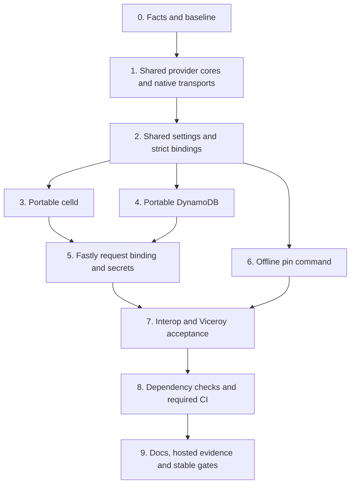

# Portable record providers implementation plan

Status, 2026-11-19: plan approved by the user, including the two decisions below. Implementation in progress.

Worktree: `/home/pav/worktrees/feat-474-portable-record-providers`, branch `feat/474-portable-record-providers`, based on `origin/feat/portable-client-info` at `10ed38035cfa1ab2c88005f113720ff99a233893`. This already includes outbound HTTP and the native record contract. No merge is needed.

The [agreed design](../specs/2026-11-19-portable-record-providers-design.md) owns behavior. This file owns implementation tasks and verification. Deliver one EdgeZero PR for [#474](https://github.com/IABTechLab/edgezero/issues/474), stacked on #517. Do not push, open a PR, merge or deploy without separate permission.

## Delivery contract

- One row/cursor/validation/error-classification core per provider, with native and portable transports beneath it. Existing Axum callers and unpinned native bindings keep their behavior.
- Portable celld requires HTTPS and bearer authentication. Portable DynamoDB uses JSON 1.0 and `aws-sigv4`, not the AWS SDK. Neither transport retries.
- Fastly selects each declared KV ID from the runtime bindings document. Unbound IDs remain Fastly KV. Invalid or unavailable configured providers fail without fallback.
- Prepared settings, pins and secret references live on the retained App. The bound provider and lazy credentials belong to one request. No runtime DescribeTable, capabilities call or preparation write.
- Portable defaults are a 1,000 ms whole-operation deadline and 250 ms connect timeout. DynamoDB allocation and value mutation share that deadline. Native defaults stay 5,000/1,000 ms.
- Required proof includes two-way native/portable interoperability, both portable providers' Viceroy contracts, independent Add/CAS races, 1001-key pages, required CI, three-target compilation and real Fastly latency evidence before merge.
- Cloudflare and Spin receive provider compile checks only. Their runtime wiring, native store replacement, migration and hosted IAM/capacity qualification stay outside this PR.

## Execution order



Each numbered unit ends with its focused tests before the next dependent unit. Run affected `cargo test` selections after code changes. Keep one command owner per Cargo target directory, generated workspace and mutable service fixture. Reuse passing checks while their relevant inputs remain unchanged. New feature, module and test names below are planned names, not existing APIs.

## 0. Confirm facts and establish the baseline

- [x] Read the complete agreed spec, `gh issue view 474`, the record guide and the referenced native provider, Fastly, Axum and runner code.
- [x] Confirm HEAD and the local parent ref both equal `10ed38035cfa1ab2c88005f113720ff99a233893`. The supplied design spec was the only untracked input at arrival.
- [x] Confirm `aws-sigv4 1.6.0` with `sign-http,http1` builds for `wasm32-wasip1`, `wasm32-unknown-unknown` and `wasm32-wasip2`. Execute timestamp/signing probes in WASI Preview 1, Preview 2 and a JavaScript host.
- [x] Execute a pinned Viceroy Config Store, Secret Store and wall-clock smoke request using the exact runtime names and derived secret-key shape from the spec.
- [x] Confirm prepared state fits existing `App::insert_state(Arc<T>)` and `App::state::<Arc<T>>()`, retained through `Sandbox<App>`. Record evidence and qualifications in the spec.
- [ ] After approval, run focused native provider and startup baselines before extraction. Capture commands, counts, code identity and logs in this plan.
- [ ] Reproduce the existing Fastly `record-contract` suite once on the unchanged baseline with the pinned Viceroy. The earlier record plan records a native CAS two-winner failure in Viceroy `0.21.0`, and `scripts/run_tests.sh` runs `--adapter fastly --suite ci`, which includes that suite. Record the failure signature, or a pass, before any change. Treat it as a known baseline result, not a regression from this work.

Fact-check output and source are retained under `/home/pav/.cache/edgezero-474-facts/`. Rust is `+1.98.1`. Wasmtime is `48.0.2`. Use the explicit pinned/repaired Viceroy from the spec, not the PATH `0.17.0` executable. These probes establish dependency, clock and local-store support, not record-provider acceptance.

Exit: no contradictory fact is known. If implementation uncovers one, stop and report it rather than substitute a different design.

## 1. Extract provider cores while preserving native behavior

Files:

- `crates/edgezero-store-aws/src/dynamodb_records.rs`, `dynamodb_kv.rs`, settings/preparation and record tests.
- `crates/edgezero-store-celld/src/records.rs`, `client.rs`, settings/preparation and record tests.
- Both provider `Cargo.toml` files and `src/lib.rs` feature gates.

Work:

- [ ] Separate provider policy from SDK/reqwest mechanics. Each core owns row encoding, generation handling, limits, kind checks, scope and cursor validation, and normalized failure classification.
- [ ] Add a small SDK-free DynamoDB attribute model for the record format's strings, numbers and binary bytes. Define only the six operation inputs/results the existing core needs. Native conversion rejects unsupported/malformed types; do not expose `AttributeValue`, SDK builders or `SdkError` to the core.
- [ ] Keep AWS preparation, SDK configuration and timeout execution native. Preserve strong GetItem/Query, unordered Scan, retained `g#` allocators, `r#` values, exact cursor encoding and the endpoint/ARN/optional TableId/region/table/namespace scope tuple.
- [ ] Separate celld exchange construction and response validation from reqwest send/stream mechanics. Reuse version/instance/content-type/strict-JSON checks, caps, mutation IDs, and no-redirect/no-decompression/no-retry policy for both transports.
- [ ] Give transport failures enough dispatch/status information for the shared classifier. Preserve native classification, including conservative treatment of malformed acknowledgements and allocator-only interruption. Do not turn every error into a definitive mutation failure.
- [ ] Expose native read-only identity preflight independently of RecordLayout/handle creation. Pinning must reuse validators, not invent a layout or parse `RecordBinding.scope`.
- [ ] Preserve ordinary-only DynamoDB/celld paths and existing public native preparation entry points. Keep native-only runtime dependencies behind native gates.
- [ ] Replace `std::time` clock reads in code shared with WASM by `web_time` equivalents. Today `DynamoDbKvLimits::validate` and `AwsPreparationLimits::validate` call `std::time::Instant::now()` (`settings.rs`), and record TTL calls `std::time::SystemTime::now()` (`dynamodb_records.rs`). Both panic on `wasm32-unknown-unknown`. `web_time` re-exports `std::time` on native targets, so Axum behavior is unchanged.

Checks: native AWS record and legacy unit/wire tests; celld record, client and ordinary tests; affected Axum startup tests; exact row/cursor golden tests before and after extraction. Run DynamoDB Local and official-stock-celld native checks at this checkpoint so the refactor is proved through real native transports, not only doubles.

Exit: the same native callers, rows, cursor bytes, deadlines and error outcomes work before adding portable behavior.

## 2. Share the bindings document and distinguish validated states

Files:

- New feature-gated `crates/edgezero-adapter/src/store_bindings.rs` and its manifest/module export.
- Provider-owned pure settings/pin types in the two store crates.
- `crates/edgezero-adapter-axum/src/native_bindings.rs`, `native_stores.rs`, and startup tests.
- `crates/edgezero-cli/src/config.rs` and binding validation tests.

Work:

- [ ] Extract the strict version 1 document/provider dispatch into a settings-only shared module. Keep Axum file I/O and native source selection in Axum, retaining existing public type reexports and error behavior. Fastly must not depend on the native Axum adapter.
- [ ] Add an optional DynamoDB record `endpoint`, pinned identity and logical `credentials.secrets`; add celld pinned instance and authenticated `token_secret.secrets`. Keep old ordinary provider tags and fields unchanged. Reject unknown/mixed fields.
- [ ] When `endpoint` is absent, derive the partition-aware regional endpoint from `region`. The spec's example binding has no endpoint, so this default is required. Normalize it with the same `endpoint_identity` function native preparation applies to its observed request URI, because the identity is part of `RecordBinding.scope` and every cursor. A mismatched string would break cursor interop.
- [ ] Separate parsing a preflight input from constructing a ready portable binding. The pin command can consume an unpinned file; Fastly-ready validation requires its pins, appropriate credential source and compiled provider capability.
- [ ] Validate that bound KV IDs and referenced secrets IDs are declared. Portable-provider KV IDs contain only nonempty lowercase ASCII `[a-z0-9_]`. Derive keys in one place from the KV ID; accept no arbitrary secret key field.
- [ ] Reject `trusted-network` and environment-token sources for portable celld. Require HTTPS. Keep native env/SDK-chain sources; Axum rejects `credentials`, `token_secret` and the DynamoDB `endpoint`, accepts pins, and compares them with native preflight identity before publishing stores.
- [ ] Preserve the optional native TableId representation and its scope encoding. Never manufacture a TableId for DynamoDB Local. Include a configured endpoint in native SDK client-cache identity if endpoint support reaches that path.
- [ ] Resolve portable 1,000/250 ms defaults separately from native defaults. Keep user-specified limits validated consistently, including AWS attempt/connect/operation ordering, without resetting deadlines between requests in a single operation.
- [ ] On Fastly, accept only the `aws-dynamodb-records` and `celld-records` KV providers. Reject Axum-only entries such as `aws-dynamodb`, `celld-kv`, `[config]` AppConfig and `[secrets]` Secrets Manager bindings with a typed unsupported-provider error.
- [ ] Extend `config validate --adapter fastly --store-bindings <file>` with structural, declaration, pin and target-feature checks only. It must not read tokens, contact services, invoke Cargo or upload configuration.

Checks: parser/feature-off tests, native binding tests, offline CLI tests with absent credentials/unreachable endpoints, typed redaction tests and pinned-mismatch startup tests. Test missing/unknown providers, undeclared secret IDs, uppercase/colliding IDs, missing pins, mixed source fields and unchanged Axum ordinary bindings. Verify the shared schema introduces no SDK/live transport into settings-only consumers.

## 3. Add portable celld

Files: celld core/transport modules, pure settings, manifest and focused tests. Add standalone feature `portable-records`; retain native `records` and `kv` features.

- [ ] Add prepared `Send + Sync` state holding validated settings, pin, RecordBinding and the logical secret reference. `bind(HttpClient)` returns a cheap request-bound KvStore with a fresh lazy token cache.
- [ ] Use `HttpClient` for bounded exchanges. Share core request/response policy with native reqwest, including fresh mutation IDs, expected-instance header on every record call, strict metadata/base64/generation checks, content type, size limits and cursor binding.
- [ ] Read the namespaced bearer token only on the first operation and reuse that result for that request. Preparation, binding and `require_records()` read no secret and perform no HTTP.
- [ ] Apply the portable operation deadline and connect timeout, disabling redirects and decompression. No capability probe, retry or downgrade at runtime.
- [ ] Make randomness and monotonic/wall-clock dependencies compile on all three WASM targets without adding an executor. The workspace pins `getrandom 0.4.2`; on `wasm32-unknown-unknown` it needs its `wasm_js` feature, enabled only for that target. Keep native behavior and credential sources unchanged.
- [ ] Send requests with `HttpClient::send`, never `follow`, so redirects are returned, not followed. Set `ResponseDecoding` so bodies are not decoded, send `Accept-Encoding: identity`, and keep the existing rejection of non-identity `Content-Encoding`. Set `max_response_bytes` from the record or page cap, since the outbound default is 1 MiB and the celld page cap is 2 MiB.

Checks: shared validation tests with both transports; outbound request/response fixtures for headers, errors, malformed/oversized bodies, redirects, compressed responses, stale instances and postdispatch uncertainty; no-retry request counts; no-I/O acquisition; lazy token read counts. Run native neighbors after extraction changes and compile `portable-records` for all three targets.

## 4. Add portable DynamoDB

Files: AWS core/portable transport/signing modules, pure settings, workspace dependencies and focused tests. Add standalone feature `dynamodb-records-portable`; retain native `dynamodb-records` and `dynamodb-kv` features.

- [ ] Build JSON 1.0 GetItem, UpdateItem, PutItem, DeleteItem, Query and Scan requests from the shared operation model. Use exact binary base64 and decimal generation/TTL representations. Preserve native projection/filter/condition expressions and continuation semantics.
- [ ] Sign with the confirmed `aws-sigv4` HTTP features, service `dynamodb`, configured region, actual endpoint and payload bytes. Use portable wall time converted to the signer's `std::time::SystemTime`. Include the optional session token.
- [ ] Add prepared/bound state matching celld's lifetime model. Resolve the derived access key, secret key and optional session token once on first use per request. No AWS credential chain on WASM.
- [ ] Share one absolute operation deadline across UpdateItem allocation and PutItem. Match native classification: any allocation failure is Unavailable, because it cannot change a value row; an exhausted budget before PutItem dispatch is Unavailable; a definitive 4xx on PutItem is Unavailable; a transport error, timeout, 5xx or unreadable response after PutItem dispatch is MutationUncertain, as is an acknowledgement observed after the deadline expired. No automatic retry of either call.
- [ ] Apply the same `send`, response-decoding and response-size settings as portable celld. Allow `http` endpoints only on loopback, for DynamoDB Local; require `https` otherwise. This mirrors the existing celld loopback rule and is a recorded decision.
- [ ] Parse service error `__type` and map definitive conditional rejection only for Add/CAS. Use the shared native classifier for other failures, redacting response bodies and credentials from errors/logs.
- [ ] Keep consistent-read flags, native TTL visibility, item/payload caps, allocator exhaustion checks, Query membership checks and filtered/empty Scan continuation unchanged.

Checks: deterministic signing vectors, session-token/no-token cases, all six wire shapes, native/portable normalization parity, conditional-error spellings, predispatch failure, transport reset, 4xx/5xx, unreadable acknowledgements, one shared two-call deadline and request-count assertions. Compile the portable feature for all three WASM targets.

## 5. Wire Fastly prepared providers and request-local secrets

Files:

- `crates/edgezero-adapter-fastly/src/lib.rs`, `request.rs`, `config_store.rs`, a focused new bindings module, and tests.
- Adapter `Cargo.toml` and `crates/edgezero-adapter-fastly/src/templates/Cargo.toml.hbs`.

- [ ] Add default-off `aws-dynamodb-records` and `celld-records` adapter features forwarding to the portable provider features. Add matching forwarding features to the generated Fastly crate template and generator tests, like the existing Axum forwarding assertions in `crates/edgezero-cli/src/generator.rs`. The bindings parser must still recognize and reject configured providers absent from the binary.
- [ ] Make `[adapters.fastly.build] features` reach the WASM `cargo build`. Today only Axum forwards manifest build features to Cargo (`crates/edgezero-cli/src/adapter.rs`, which checks `eq_ignore_ascii_case("axum")`). The Fastly path runs `fastly compute build`, whose `[scripts] build` command in the generated `fastly.toml` has no features. The app-demo already declares `features = ["fastly"]` for Fastly without effect. Choose the forwarding mechanism in this unit and prove it with a generated-project build that enables both provider features.
- [ ] Read optional Config Store `edgezero_store_bindings`, entry `EDGEZERO__STORE_BINDINGS`, reusing existing optional-open/error distinctions and the platform's 8,000-character entry model. Missing configuration means native bindings; parse/open/read failures must not masquerade as missing configuration.
- [ ] After App construction and sealed record declarations, validate and install `Arc<PreparedPortableProviders>` with `App::insert_state`. Keep only settings, pins, bindings and logical/stateless secret references there. Leave Sandbox lifecycle unchanged.
- [ ] Defer canonical manifest KV binding until request preparation extensions have merged into the core request. Clone that request's effective HttpClient, including a hook-supplied override, and bind portable providers there. Do not create a second unrelated client before the hook runs.
- [ ] Construct each request's KV registry with portable providers for explicit bindings and the existing declared FastlyKvStore for absent bindings. Keep explicit FastlyService/manual handle precedence unchanged. Validate record requirements after binding.
- [ ] Resolve declared logical Secret Store aliases using existing stateless SecretHandle/BoundSecretStore support. Cache plaintext/results only inside the newly bound provider, never on App or in a global. Ensure the lazy cache meets KvStore's Send + Sync bounds and concurrent first-use behavior.
- [ ] Validate the bindings document in `build_target_app`. A document that fails to parse, or names a provider absent from the binary, fails App assembly with a typed error. Every request then receives the existing assembly-error response, and `Sandbox` retries construction on the next request. Never fall back to Fastly KV, and never include secret values in diagnostics.

Checks: missing/valid/malformed bindings, provider feature combinations, mixed native/portable IDs, declared-record validation, hook-selected client identity, unused bindings causing no secret reads or HTTP, successful-only App retention, credential read counts, and rotation/revocation across multiple requests to the same retained App. Include actual canonical adapter wiring in Viceroy acceptance, not just direct provider construction.

## 6. Implement native bindings pin preflight

Files: CLI `args.rs`, `main.rs`, `lib.rs`, a focused bindings/preflight module, `config.rs`, manifest/features, generated CLI template and tests.

- [ ] Add untyped `edgezero config bindings pin --adapter fastly --store-bindings <file>` in bundled and generated CLIs. It does not need an AppConfig type.
- [ ] Keep native preflight dependencies behind an explicit `bindings-pin` Cargo feature. Enable it for the normal bundled CLI build and provide generated CLI feature forwarding. Preserve the existing SDK-free `--no-default-features --features cli,edgezero-adapter-axum` graph; a minimal binary reports that pinning support is not compiled.
- [ ] Use the existing AWS SDK credential chain and shared DescribeTable validation. Send DescribeTable to the binding's explicit or derived endpoint, so preflight describes the same table the runtime uses. Check that the endpoint identity native observes equals the identity the portable runtime will derive, and fail on mismatch. Capture the native ARN/TableId representation.
- [ ] For celld, use the same capabilities/instance validators, never a write probe. Read the preflight token from an environment variable named after the derived secret key, for example `KV__SESSIONS__CELLD_TOKEN`. This needs no new flag, and the binding keeps its runtime `token_secret` reference.
- [ ] Preflight every selected record binding before changing the file. Write only `pinned` back, as the spec states, without dropping unrelated TOML fields or comments. On failure leave the input unchanged. Do not replace runtime credential references with env sources.
- [ ] Keep errors and success output secret-free. Do not add Config Store upload or change offline validation into online preparation.

Checks: CLI parse/help and generated consumer tests; mock preflight failures and input preservation; malformed/unsupported targets; absent env token; exact identity capture; no mutation calls; successful pin followed by offline validation; real local native preflight against the services used in acceptance; Axum rejects stale pins.

## 7. Prove interop and the Viceroy record contracts

Files:

- Native provider integration tests and the existing AWS/celld integration scripts and Node tests.
- `crates/edgezero-test-harness/src/runners/record_contract.rs`, Fastly/CI dispatch and evidence tests.
- Reusable fixture `fixture-fastly` manifest, `fastly.toml`, `src/bin/record_contract.rs`, `src/record_cases.rs`, and relevant fixture core hooks/routes.
- Root, standalone harness and reusable fixture lockfiles as required.

- [ ] Reuse pinned DynamoDB Local `3.3.1` at the existing digest and official stock celld `0.6.3` plus EdgeZero's store service. Each run owns disposable state, ports, process cleanup and artifacts. No Floci or modified celld binary.
- [ ] Establish authenticated HTTPS from Viceroy to local celld early. Reuse the local TLS terminator and use process-local CA trust through Viceroy's native-root loader if supported. Prove valid cert/auth success and invalid-cert failure. Do not disable certificate checks or use trusted-network mode on WASM.
- [ ] Add mandatory nonzero two-way interop tests per provider against the same table/namespace or celld store/instance. Native-write/portable-read and portable-write/native-read must preserve body, metadata, generations, conditions, ordinary access, partition/global pages and compatible cursors. Run them as Axum adapter integration tests, which have both native transports and a real EdgeZero outbound client. Enable the portable provider features there as dev-dependency features only.
- [ ] In the Viceroy portable suite, also read one natively written row per provider, so the shipping Fastly path is covered by interop, not only by host tests.
- [ ] Add a separate `portable-record-contract` suite to the record runner for `dynamodb-portable` and `celld-portable` receipts. Keep the existing `record-contract` suite and its `fastly-native` receipt unchanged. Each suite validates its own exact provider set, so the known native Viceroy CAS result can neither fail nor be hidden by the portable job. Portable variants use the real Config Store, logical secrets and adapter registry path. Readiness is read-only and distinct from the single mutating contract execution.
- [ ] Require exactly one passing shared suite per expected provider, numeric `executed_suites = 1`, independent two-writer Add and CAS with one write/one rejection and stored-winner readback, 1001 descendants over at least two pages, all exact-existence transitions and zero remaining logical keys after cleanup.
- [ ] Drain global cleanup pages to exhaustion, including empty pages with cursors, and detect repeated continuation. Never delete DynamoDB allocator rows to make cleanup pass.
- [ ] Put provider identity on every relevant receipt/event. Add negative validator tests for missing, duplicate, failed, substituted, zero-count and malformed evidence. One provider's success must not satisfy another provider's requirements.
- [ ] Retain staged WASM/config/runtime hashes, exact runtime version, service identity, build/runtime logs and `qualification = false`. Add real transport uncertainty/no-replay proofs without representing emulator timings as POP latency.
- [ ] Preserve existing native Fastly assertions. The historical Viceroy CAS two-winner limitation remains a separately disclosed baseline issue unless new direct evidence clears it. Do not repair Viceroy, weaken one-winner assertions or present portable receipts as clearing native CAS.
- [ ] If controller functions change, inspect those changes and explicitly review/update ownership fingerprints and tests. Do not blindly regenerate fingerprints or loosen evidence bounds.

Checks: runner/fixture unit tests and negative receipts, extended Node runner tests, required nonzero native/portable interop tests, pinned Viceroy `portable-record-contract` suite, then the `record-contract` and full Fastly `ci` suites compared with the task 0 baseline. Failed/skipped/zero-test service execution is not a pass.

## 8. Enforce portable dependencies, compilation and required CI

Files: `scripts/check_native_store_dependency_contract.sh`, existing dependency-policy tests, `scripts/run_tests.sh`, `.github/workflows/test.yml` and any focused new portable-record runner script/tests.

- [ ] Extend isolated graphs for each portable provider feature, individually and together on Fastly. Check all three WASM targets and default-off/native-only builds. Require signing dependencies only when the portable DynamoDB feature is enabled.
- [ ] Preserve bans on aws-config/aws-sdk*, reqwest, server celld and native runtimes in portable graphs. Preserve the core-wide Tokio ban and existing Tokio-feature-aware checks outside core. Do not add broad exemptions or version allowlists.
- [ ] Add compile-only CI commands for the two portable provider features on `wasm32-unknown-unknown` and `wasm32-wasip2`, plus Fastly `wasm32-wasip1`. Feature-off settings checks alone cannot satisfy P12.
- [ ] Add an unconditional CI job `portable-record-contracts`, named `Portable record contracts (Fastly)`, with pinned Viceroy, DynamoDB Local and official celld. Run the `portable-record-contract` suite, independent races, pages, cleanup and interop with strict receipts. The existing native suite stays in its current job.
- [ ] CI does not provision official celld today; the existing celld runner only requires a local `CELLD_BIN`. Download the pinned `0.6.3` release in CI and verify its SHA256 before use, with the same version and hash checks `scripts/run_native_celld_integration.mjs` applies. Cache it like the existing Viceroy step.
- [ ] Integrate the new runner into the prescribed local suite and artifact validation. Preserve exact nonzero execution checks, failure propagation and service cleanup; upload evidence on failure too.

Branch-protection required-check configuration is a repository setting, not a workflow file. Report `Portable record contracts (Fastly)` for maintainers to mark as required. Do not modify GitHub settings without permission.

## 9. Document operations, collect hosted evidence and run stable gates

Files: `docs/guide/kv-records.md`, `docs/guide/dynamodb-kv.md`, `docs/guide/native-celld-stores.md`, relevant CLI documentation, and a new receipt under `docs/audits/evidence/`.

- [ ] Document Fastly build features, runtime TOML, the optional DynamoDB endpoint and its regional default, pinned identities, the preflight command and its derived token variable, logical Secret Store declaration and all derived keys. Include optional AWS session token and next-request rotation/revocation.
- [ ] Give a least-privilege runtime IAM policy for GetItem, UpdateItem, PutItem, DeleteItem, Query and Scan on one table. DescribeTable belongs to offline preflight/native preparation, not portable runtime. Document Scan's broad read cost and unsupported post-pin global-table changes.
- [ ] Document manual `fastly config-store-entry` upload, 8,000-character entry size, no-fallback behavior, stale celld instance handling and refreshing pins. Upload remains operator-owned.
- [ ] Explain native versus portable timeout defaults, two sequential DynamoDB calls under one deadline, one celld call, error/uncertainty semantics and no automatic retries.
- [ ] With separately approved scratch-service access, measure real Fastly conditional writes for both providers against `us-east-1`. Record named POP, exact build/config, operation type, sample counts, successes/failures/timeouts, p50 and p95, and sampling method without secrets. Link evidence from the guide. Do not substitute local/Viceroy measurements or claim the 1,000 ms budget alone proves latency.
- [ ] Run stable checks below, inspect the combined diff against `10ed3803`, and record exact counts, outcomes, evidence paths and remaining limitations here. Keep failure/uncertainty evidence separate from passes.
- [ ] Present the completed commits, checks and unverified requirements. Recheck parent/public heads before any requested publication. No push, PR, merge or deployment is authorized by plan approval alone.

### Focused and stable command record

All implementation commands use `+1.98.1` and locked/offline mode after intentional lockfile updates. Newly named features/tests must exist before these commands count as proof.

```sh
# Wrappers spawn plain cargo, so select the same compiler/network policy for them.
export RUSTUP_TOOLCHAIN=1.98.1
export CARGO_NET_OFFLINE=true

# Native behavior and portable host-side tests.
cargo +1.98.1 test --locked --offline -p edgezero-store-aws --no-default-features --features dynamodb-records
cargo +1.98.1 test --locked --offline -p edgezero-store-celld --no-default-features --features records
cargo +1.98.1 test --locked --offline -p edgezero-store-aws --no-default-features --features dynamodb-records-portable
cargo +1.98.1 test --locked --offline -p edgezero-store-celld --no-default-features --features portable-records
cargo +1.98.1 test --locked --offline -p edgezero-adapter-axum --features aws-dynamodb-records,celld-records,test-utils
# CLI tests assume non-TTY stdin; the earlier record plan needed both settings.
RUST_TEST_THREADS=1 cargo +1.98.1 test --locked --offline -p edgezero-cli </dev/null
RUST_TEST_THREADS=1 cargo +1.98.1 test --locked --offline -p edgezero-cli --features bindings-pin </dev/null
cargo +1.98.1 test --locked --offline --manifest-path crates/edgezero-test-harness/Cargo.toml

# Compile actual portable implementations, not settings-only shells.
for target in wasm32-wasip1 wasm32-unknown-unknown wasm32-wasip2; do
  cargo +1.98.1 check --locked --offline -p edgezero-store-aws --no-default-features --features dynamodb-records-portable --target "$target"
  cargo +1.98.1 check --locked --offline -p edgezero-store-celld --no-default-features --features portable-records --target "$target"
done
cargo +1.98.1 check --locked --offline -p edgezero-adapter-fastly --features fastly,aws-dynamodb-records,celld-records --target wasm32-wasip1
bash scripts/check_native_store_dependency_contract.sh
node --test scripts/run_native_aws_integration.test.mjs scripts/run_native_celld_integration.test.mjs scripts/portable_dependency_checks.test.mjs
node scripts/run_native_aws_integration.mjs
CELLD_BIN=/absolute/official/celld node scripts/run_native_celld_integration.mjs
VICEROY_BIN=/absolute/pinned/viceroy scripts/test_integration.sh --adapter fastly --suite portable-record-contract --output /new/empty/portable-run
# These two include the native record suite; compare with the task 0 baseline result.
VICEROY_BIN=/absolute/pinned/viceroy scripts/test_integration.sh --adapter fastly --suite record-contract --output /new/empty/record-run
VICEROY_BIN=/absolute/pinned/viceroy scripts/test_integration.sh --adapter fastly --suite ci --output /new/empty/ci-run

# Stable repository gates, plus the prescribed complete suite.
cargo +1.98.1 fmt --all -- --check
cargo +1.98.1 clippy --locked --offline --workspace --all-targets --all-features -- -D warnings
cargo +1.98.1 test --locked --offline --workspace --all-targets
cargo +1.98.1 check --locked --offline --workspace --all-targets --features 'fastly cloudflare spin'
cargo +1.98.1 check --locked --offline -p edgezero-adapter-spin --target wasm32-wasip2 --features spin
cargo +1.98.1 fmt --manifest-path crates/edgezero-test-harness/Cargo.toml --all -- --check
cargo +1.98.1 fmt --manifest-path crates/edgezero-test-harness/fixtures/reusable-app/Cargo.toml --all -- --check
cargo +1.98.1 clippy --locked --offline --manifest-path crates/edgezero-test-harness/Cargo.toml --all-targets -- -D warnings
cargo +1.98.1 clippy --locked --offline --manifest-path crates/edgezero-test-harness/fixtures/reusable-app/Cargo.toml -p fixture-core -p fixture-axum --all-targets -- -D warnings
scripts/run_tests.sh
(cd docs && npm ci && npm run lint && npm run format && npm run build)
git diff --check
```

Also run target-matched Fastly tests/lint, affected generated consumers/templates, service protocol tests and any new runner Node tests. If native all-feature Fastly linking encounters host ABI symbols, disclose it and use target-matched runtime proof; do not call an unsupported host invocation a pass. Internal superpowers Markdown is ignored by the docs formatter, so inspect it directly rather than claiming an ignored-file formatting pass.

## Decisions made during planning

The spec left these open. The user decided them on 2026-11-19.

1. Axum rejects the DynamoDB `endpoint` field, like `credentials`, so native keeps SDK endpoint resolution. The pin command still honors it, because it must describe the table the Fastly runtime will use.
2. Portable DynamoDB may use `http` only on a loopback endpoint, for DynamoDB Local. Every other endpoint requires `https`.

## Requirement coverage

| Spec requirement | Tasks and acceptance |
| ---------------- | -------------------- |
| P1 | 1, native regressions and shared-core tests |
| P2 | 4, six wire operations and signing tests |
| P3 | 1 and 7, actual two-way row/cursor interop |
| P4 | 4, 5 and 9, session token, rotation and IAM docs |
| P5 | 2, 3 and 7, rejected trusted-network and real authenticated TLS |
| P6 | 7 and 8, provider-specific races/pages/receipts and required CI |
| P7 | 2 and 5, per-ID selection and feature-off/no-fallback tests |
| P8 | 1, 2, 5 and 6, native preflight plus I/O-free runtime binding |
| P9 | 2 and 5, derived keys and retained-App request isolation |
| P10 | 1, 3, 4 and 7, shared classification and no-replay proofs |
| P11 | 3, 4 and 9, enforced shared budgets plus real Fastly p50/p95 |
| P12 | 3, 4 and 8, enabled portable-feature builds on all three targets |

## Proposed commit boundaries

1. Extract record provider cores, normalized transports and native identity preflight.
2. Share strict binding settings and add pin/source validation without changing old native behavior.
3. Implement portable celld and focused tests.
4. Implement portable DynamoDB and focused tests.
5. Wire Fastly runtime bindings, features and request-local credentials.
6. Add bindings pin to bundled/generated CLIs and offline validation.
7. Add real interop, provider-specific Viceroy contracts and strict receipts.
8. Enforce portable graphs, WASM builds and the required CI job.
9. Finish operator docs and evidence after separately authorized hosted measurements.

Commit only tested coherent units. Keep related regressions with their behavior. These boundaries are one PR's review sequence, not permission to publish it.

## Progress and evidence

| Check | Tested state | Result | Evidence |
| ----- | ------------ | ------ | -------- |
| Starting branch/parent | `10ed38035cfa1ab2c88005f113720ff99a233893` | Same HEAD and parent ref, no merge needed | `git rev-parse`, `git status` inspection |
| SigV4 three-target build | Disposable probe, `aws-sigv4 1.6.0`, Rust `1.98.1` | Pass on all three targets | `/home/pav/.cache/edgezero-474-facts/confirmed.log` and retained source/lock |
| Timestamp and signing execution | Wasmtime `48.0.2` p1/p2; Node `24.20.0` and bindgen `0.2.128` | Two WASI `sigv4_hex_len=64` receipts; JS assertions pass | `confirmed.log`, `js-probe.log` |
| Viceroy config/secret/clock | Repaired `0.21.0` binary from the earlier record plan, SDK `0.13.1`, fake key | HTTP 200, config and secret checks pass, epoch seconds returned | `viceroy/response.headers`, `viceroy/response.txt`, retained probe inputs |
| Prepared state lifetime | Current App/router and Fastly Sandbox source | Insertion/read/retention path confirmed, runtime regression pending | Spec fact findings and methods cited there |
| Native baselines before extraction | `10ed3803` + plan | AWS 66, celld 42, Axum 487 + 5 + 4 (1 ignored), CLI bindings 7 | `/home/pav/.cache/edgezero-474/logs/base-*.log` |
| Native Fastly `record-contract` baseline | `10ed3803`, repaired Viceroy 0.21.0 | Fails as previously recorded: both Add writers reported `written` (the earlier plan saw it on CAS) | `/home/pav/.cache/edgezero-474/runs/base-record/` |
| Native regression after core split | Commits `2528f595`, `37e38c53` | AWS 66, celld 42, Axum and CLI counts unchanged; DynamoDB Local generated consumers 2 and record checks pass; official celld 0.6.3 consumers 2 + stock interop 1 pass | `logs/u1-*.log`; one DynamoDB Local runner cleanup `docker rm` exceeded its 30 s limit under load after all tests passed |
| Portable providers, store level | Commits through `78071bea` | AWS 113 incl. portable wire, contract, interop, lazy credentials, no-retry and shared-deadline tests; celld 47 incl. portable exchanger; all feature sets and all three WASM targets Clippy-clean | crate test and Clippy runs in this session |
| Shared bindings document and Axum pins | Commit `775080dd` | Shared parser 4 tests; Axum rejects `credentials`, `token_secret`, `endpoint` and accepts pins; pinned preparation rejects a mismatched table ID or celld instance | `edgezero-adapter` and store tests |
| Dependency contract and WASM CI checks | Commit `624a65f3` plus Fastly additions | Script passes, including Fastly portable graphs; aws-sigv4 only with the portable DynamoDB feature | `worker-deps-evidence/`, local script run |
| Fastly adapter wiring | Working tree | Clippy-clean on `wasm32-wasip1` for `fastly` alone and with each provider feature; native `cli`, no-default and all-features configurations clean | local Clippy runs |
| Pin command and Fastly offline validation | Working tree (worker t19x) | CLI bindings 21, generator 25, SDK-free CLI bindings 14; both Clippy configurations clean | `worker-deps-evidence/unit6-*.log` |
| Real-service host interop | Working tree (worker t19y) | DynamoDB Local and official celld behind TLS: native↔portable interop 2/2, wrong-CA rejection 1/1, CLI preflight pins both providers; SSL_CERT_FILE trusts the test root for native reqwest and the Axum outbound client | `/home/pav/.cache/edgezero-474/worker-orchestrator/host-*` |
| Viceroy portable suite | Working tree | First full run stopped at startup identity: a concurrent docs edit changed the harness build identity between fixture build and launch. Repeat pending with the tree frozen | `worker-orchestrator/full-1/` |
| Hosted Fastly latency (P11) | Not run | Requires a separately authorized scratch Fastly service | — |

Read-only investigation used two `openai-codex/gpt-6.1-sol` workers. One traced Fastly state/client/secrets lifetime and confirmed the existing App state API. The other mapped CLI, runners, CI and dependency contracts, finding the allocator-aware cleanup requirement and historical native CAS limitation. Their proposals agree on reusing the existing state, validation and runner paths rather than adding a new registry or lifecycle. The coordinator inspected those paths and owns all probes and the combined plan.

## References

- [Agreed provider design and confirmed facts](../specs/2026-11-19-portable-record-providers-design.md).
- [Earlier record implementation plan](2026-11-13-kv-record-contract.md), including its historical native Viceroy CAS limitation.
- [Conditional KV records guide](../../guide/kv-records.md).
- [Issue #474](https://github.com/IABTechLab/edgezero/issues/474) and prerequisite [PR #517](https://github.com/IABTechLab/edgezero/pull/517).
