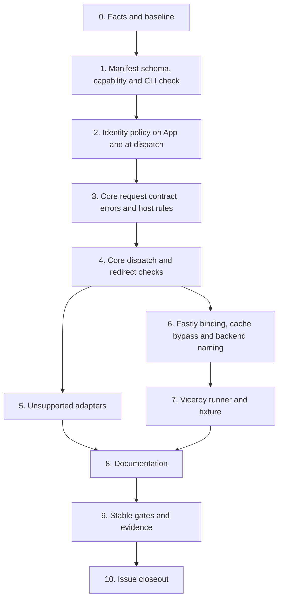

# Outbound client identity (mTLS) implementation plan

Status, 2026-11-23: tasks 0 to 8 implemented through `d1d02171`; local gates and the Fastly ci suite pass. PR #524 is open and task 10 is done. Revised after review: the Fastly binding moved the certificate and hosts to the Config Store and reads it once per inbound request; identity requests bypass the response cache; the fingerprint covers the whole chain; core builds the policy from the baked manifest and attaches it to each request's client at dispatch.

Worktree: `/home/pav/worktrees/feat-523-outbound-client-identity`, branch `feat/523-outbound-client-identity`, based on `origin/feat/474-portable-record-providers` at `6fb738491584d432516af9e0ec13281f0823ffdd`. The spec commit `2b08eac6` is the first commit on the branch.

The [agreed design](../specs/2026-11-23-outbound-client-identity-design.md) owns behavior. This file owns implementation tasks and verification. Deliver one EdgeZero PR that closes [#523](https://github.com/IABTechLab/edgezero/issues/523), based on #522. Do not push, open the PR, merge or deploy without separate permission.

## Delivery contract

- Core owns the manifest schema, the identity policy built from `Hooks::manifest()` and attached to each request's `HttpClient` at dispatch, `ClientIdentityName`, the declaration and scheme checks, host parsing and matching, the error type, and redirect handling. Adapters own support checks and runtime binding.
- Fastly reads `<name>.certificate` and `<name>.hosts` from the identity's Config Store, and `<name>.private-key` from its Secret Store as a `fastly::secret_store::Secret` handle only. It does this at most once per identity per inbound request.
- Identity requests always bypass Fastly's response cache. Identity plus a surrogate-key cache policy, or plus Image Optimizer, is `Unsupported`.
- The Fastly backend name covers the identity name and the SHA-256 of the whole certificate chain, under the `ez_b31v2_` prefix. Requests without an identity get new names too, because the prefix changes.
- Cloudflare, Spin and Axum reject identity requests before I/O and report the capability as `Unsupported`.
- Every rule in the spec's dispatch section fails before network I/O.
- Merge evidence is local: native tests, the Fastly Viceroy runner with host-side mutual-TLS origins, and the repository gates. There is no hosted check.

## Execution order



Each numbered unit ends with its focused tests before the next dependent unit starts. Run the affected `cargo test` selections after every code change. New type, function, feature, binary and test names below are planned names, not existing APIs.

## 0. Confirm facts and establish the baseline

- [x] Confirm HEAD's parent is `6fb73849` and the worktree is clean apart from this plan.
- [x] Run focused baselines before changes and record counts here: `edgezero-core` outbound, redirect and manifest tests; `edgezero-macros` tests; Fastly native outbound tests, including the `ez_b31v1_` golden-name test near `outbound.rs:5801`; `edgezero-adapter` registry tests; `edgezero-cli` capability tests; and the harness's own unit tests.
- [x] Probe the patched Viceroy from `patches/viceroy` with a throwaway guest and record the results here:
  - It reads a certificate and a hosts list from `[local_server.config_stores]`.
  - It opens a key from `[local_server.secret_stores]` with `SecretStore::open(alias)` then `try_get(key)`, and passes the `Secret` to `provide_client_certificate` without any plaintext call.
  - It registers a dynamic backend against a local rustls origin that requires client certificates, while Viceroy runs with `SSL_CERT_FILE` pointing at the probe CA.
  - The handshake succeeds and the origin sees the client certificate.

  Viceroy `0.21.0` builds its roots with `rustls-native-certs` `0.6.3`, which honors `SSL_CERT_FILE`, and it applies `client_cert` for HTTPS backends. The probe confirms both at runtime.
- [x] Confirm `rcgen` with the `aws_lc_rs` feature and `rustls =0.23.46` resolve for the harness's separate workspace. Fetching them updates `crates/edgezero-test-harness/Cargo.lock` intentionally. Every later command runs `--offline`.

Exit: no fact contradicts the spec. If one does, stop and report it rather than change the design.

## 1. Manifest schema, capability and CLI check

Files: `crates/edgezero-core/src/manifest.rs`, `crates/edgezero-adapter/src/registry.rs`, `crates/edgezero-adapter-fastly/src/cli.rs`, `crates/edgezero-cli/src/adapter.rs`.

- [x] Add `client_identities: BTreeMap<String, ClientIdentityDeclaration>` to `ManifestOutboundCapability` (`manifest.rs:401`), serialized as `client-identities`. `ClientIdentityDeclaration { secret_store: Option<String>, config_store: Option<String> }` uses `deny_unknown_fields` and serializes as `secret-store` and `config-store`.
- [x] Validate names as `[a-z0-9-]`, 1 to 64 characters, not starting or ending with `-`. Share this validator with `ClientIdentityName` in task 3.
- [x] Add a `Manifest`-level schema validator beside `validate_capabilities_disjoint`. It requires any named `secret-store` to be declared in `[stores.secrets]`, and any named `config-store` in `[stores.config]`. It does not require either kind of store to exist.
- [x] Add `Capability::OutboundClientIdentity`, written `outbound-client-identity`, to the enum and to `as_str` (`manifest.rs:86`, `:131`).
- [x] Add `AtomicHost::permits(scheme, host, port) -> bool`, so a concrete origin can be tested against a canonical allowlist entry, wildcards included. Unit-test wildcard host, wildcard port, exact match and scheme mismatch.
- [x] Fastly's `capability()` (`edgezero-adapter-fastly/src/cli.rs:2040`) maps the new capability to `Native`. Axum, Cloudflare and Spin keep the `_ => Unsupported` arm.
- [x] Add `Adapter::validate_client_identities(&self, manifest: &Manifest) -> Result<(), String>` to `registry.rs`, defaulting to `Ok(())`. Call it from `ensure_capabilities` (`edgezero-cli/src/adapter.rs:422`) when the baked manifest is present. Fastly's version resolves each identity's secret and config store from its explicit field or the declared default, and names every identity it can't resolve.
- [x] Tests:
  - Manifest: valid declarations, explicit and default stores, unknown stores, a manifest with identities and no stores (valid), bad names, an unknown field in an entry, and a round trip.
  - Registry: the capability's support level on all four adapters.
  - CLI: `required = ["outbound-client-identity"]` fails for Axum, Cloudflare and Spin and passes for Fastly. Fastly's identity check passes with resolvable stores and fails when either store is missing.

Exit: manifest, registry and CLI tests pass. Nothing at runtime reads the new data yet.

## 2. Identity policy on App and at dispatch

Files: `crates/edgezero-core/src/app.rs`, a new `crates/edgezero-core/src/outbound/client_identity.rs`, `crates/edgezero-core/src/outbound.rs` (`HttpClient`).

- [x] Add `ClientIdentityMetadata { name, secret_store: Option<String>, config_store: Option<String> }` and `ClientIdentityPolicy`. The policy holds the declared identities with their stores resolved, and the outbound allowlist as canonical `AtomicHost` entries (default `https://*:*`).
- [x] Build it in `App::from_router::<A>` (`app.rs:466`) from `A::manifest()`, as an `Arc<ClientIdentityPolicy>` field next to `name`. `Absent` and `Malformed` yield an empty policy. Constructors that don't take `Hooks` get an empty policy. Expose `App::client_identity_policy()`. No new `Hooks` methods and no macro changes.
- [x] Add a private `client_identity_policy: Option<Arc<ClientIdentityPolicy>>` to `HttpClient` (`outbound.rs:436`), with `HttpClient::with_client_identity_policy` and a crate-private setter that only fills an empty slot.
- [x] In `dispatch_admitted_with_request_facts` (`app.rs`, the function every `dispatch_admitted*` and `dispatch_ingress` path reaches), before routing, give the app's policy to the `HttpClient` in the request's extensions when that client has none. Leave every other extension unchanged.
- [x] Tests:
  - A manifest with two identities and an explicit allowlist produces the expected policy. Default stores resolve. Absent and malformed manifests give an empty policy. A macro-generated test app gives the same policy as its manifest.
  - Through `dispatch_admitted`, a handler's `ctx.http_client()` carries the app's policy. So does a client supplied by a preparation hook. A client that already carries a policy keeps it. A request without an `HttpClient` gains none.

Exit: core and macro tests pass. Handlers' clients carry the policy, and nothing enforces it yet.

## 3. Core request contract, errors and host rules

Files: `crates/edgezero-core/src/outbound.rs`, `outbound/client_identity.rs`, `outbound/redirect.rs`, `error.rs`, `context.rs`, `response_egress_framing.rs`, `lib.rs` re-exports.

- [x] Add `ClientIdentityName` with `new`, `as_str`, `Display` and `Debug`.
- [x] Add the `client_identity` field to `OutboundRequest` (`outbound.rs:309`) and `OutboundRequestParts`, carried through `from_parts`, `into_parts` and `replay_request` (`redirect.rs`, which destructures every field). Do not strip it in `prepare_redirect`. Add the builder and getter.
- [x] Add `ClientIdentityError` with the spec's variants and a `which` enum (`Certificate`, `Key`, `Hosts`, `Store`). Add `EdgeError::ClientIdentity { name, reason }`, with `wire_status` and `wire_kind` on the reason, following `StoreExtractionReason` (`error.rs:78`). Statuses:
  - 500: `Undeclared`, `RequiresHttps`, `Unsupported`.
  - 503: `MaterialMissing`, `MaterialInvalid`, `HostNotAllowed { redirect: false }`.
  - 502: `HostNotAllowed { redirect: true }`.
- [x] Update every exhaustive `EdgeError` match: `status`, `kind`, `message`, and the arms at `error.rs:368`, `:411`, `:428`, `:497`, `:577` and `:793`, plus `context.rs:192`/`:240`/`:292` and `response_egress_framing.rs:300`. Add `EdgeError::client_identity_error() -> Option<&ClientIdentityError>`.
- [x] Add `ClientIdentityHosts::parse(bytes, &ClientIdentityPolicy) -> Result<Self, ClientIdentityError>` and `ClientIdentityHosts::check(&Uri) -> Result<(), ClientIdentityError>`, following the spec's parsing rules.
- [x] `Display` and `Debug` for the new error show the name, reason, fingerprint when present, and the request's scheme, host and port for `HostNotAllowed`. Test that they never include paths, queries, PEM text or entry contents.
- [x] Unit tests: name validation; builder round trip through parts and replay; each error's status and kind; every parse and check case in the spec's testing table; a host-override request passing the check.

Exit: core unit tests pass. Dispatch does not enforce anything yet.

## 4. Core dispatch and redirect checks

Files: `crates/edgezero-core/src/outbound.rs` (`HttpClient`), `outbound/dispatch.rs`, `outbound/redirect.rs`.

- [x] Clients without a policy (task 2) treat every identity as undeclared.
- [x] In `dispatch::prepare` (`dispatch.rs:80`), after `validate_supported_options` and before `validate_for_dispatch`, return `Undeclared` for names not in the policy and `RequiresHttps` for non-`https` URIs. Attach the resolved `ClientIdentityMetadata` and a handle to the policy to `OutboundDispatchRequest`, exposed as `OutboundDispatchRequest::client_identity()`, so adapters don't repeat the lookup.
- [x] In `FollowChain::hop` (`redirect.rs:109`), when the hop index is above zero, turn `HostNotAllowed { redirect: false }` into `redirect: true`.
- [x] Tests with a recording fake `OutboundHttpClient`, asserting that none of these makes a dispatch call: an undeclared identity, `http://`, and a client without a policy. A same-origin redirect and a redirect to another listed host are dispatched with the identity. A redirect to an unlisted host fails as `Hop { index: 1 }` with status 502. In batches, a failing identity slot fails alone and the other slots complete.

Exit: core outbound and redirect suites pass, including the existing ones without changes.

## 5. Unsupported adapters

Files: `validate_supported_options` in `crates/edgezero-adapter-cloudflare/src/outbound.rs:3845`, `crates/edgezero-adapter-spin/src/outbound.rs` and `crates/edgezero-adapter-axum/src/outbound.rs`.

- [x] Return `EdgeError::ClientIdentity { reason: Unsupported { adapter } }` when `client_identity_name()` is set.
- [x] Each adapter gets a test showing an identity request fails before its transport is touched, using the adapter's existing recording or native seam.

Exit: adapter unit tests pass on native and on their wasm targets (`wasm32-unknown-unknown` for Cloudflare, `wasm32-wasip2` for Spin).

## 6. Fastly binding, cache bypass and backend naming

Files: `crates/edgezero-adapter-fastly/src/outbound.rs`, a new `src/outbound/client_identity.rs`, `src/config_store.rs`, `src/secret_store.rs`.

- [x] Fastly's `validate_supported_options` (`outbound.rs:6946`) rejects, in every mode, an identity combined with Image Optimizer options or with `OutboundCachePolicy::PlatformDefaultWithSurrogateKey`, as `Unsupported`.
- [x] Add a per-request binding cache to `FastlyOutboundClient`. It's a `Mutex<HashMap<String, CachedBinding>>`, because `OutboundHttpClient` is `Send + Sync`. The client is built per inbound request, so the cache's lifetime is one request.
  - It caches successful bindings, and `MaterialMissing` and `MaterialInvalid` outcomes, so a broken binding doesn't spend more reads in the same request.
  - It doesn't cache a deadline (`GatewayTimeout`), so a later dispatch with more budget can try again.
- [x] Add `resolve_binding(metadata, budget, clock)`:
  - Resolves the store IDs from the policy. A missing store becomes `MaterialMissing { which: Store }`.
  - Opens the config store alias and reads `<name>.hosts` (4,000-character cap) and `<name>.certificate` (8,000 characters) through the bounded config read (`config_store.rs:176`). An absent entry becomes `MaterialMissing`, an oversized one `MaterialInvalid`, and a deadline keeps `GatewayTimeout`.
  - Opens the secret store alias and gets `<name>.private-key` with `try_get` as a `Secret` handle, never reading its plaintext.
  - Parses the hosts with `ClientIdentityHosts::parse`.
  - Decodes every PEM `CERTIFICATE` block to DER. The chain fingerprint is SHA-256 over each DER length-prefixed in order. The leaf's own SHA-256 is kept for logs.
- [x] On every dispatch with an identity, get the binding from the cache or `resolve_binding`, then call `ClientIdentityHosts::check` on the request URI.
- [x] `build_fastly_request` (`outbound.rs:1132`) calls `set_pass(true)` for identity requests, whatever cache policy is set.
- [x] Add `client_identity: Option<(String, [u8; 32])>` to `BackendIdentity` (`outbound.rs:542`). In `backend_name` (`:1038`), hash a `client-identity-v1` tag, the name, a zero byte and the chain fingerprint when present, and change the prefix to `ez_b31v2_`. Regenerate the golden name near `:5801`, and state in the test why it changed.
- [x] Resolve the binding in the dispatch preparation before `ensure_backend` (`:707`), inside the existing budget checks. Pass the certificate PEM and `Secret` to `ensure_backend` (`:628`), which calls `provide_client_certificate` after the TLS settings and changes nothing else.
- [x] `RequestPlan::new` (`:565`) can't know an identity request's backend name before the binding is read. Its `is_registered` therefore reports identity requests as not registered, which keeps them out of the warm-first batch ordering.
- [x] Log the name and leaf fingerprint at debug level when a new identity backend registers. Never log the key, the certificate text or the hosts entry.
- [x] Native tests:
  - `backend_name` differs for no identity, two identities, and two chains for one identity, and is equal for one identity with one chain.
  - Changing only an intermediate changes the chain fingerprint.
  - Against `cached_backend` with an injected registration, the same identity with a changed chain registers a new backend while the old entry stays cached.
  - Missing, oversized and malformed entries, and a missing store, map to their reasons.
  - Identity requests build with `pass` set under each cache policy that's accepted. The surrogate-key and Image Optimizer combinations are rejected.
  - Two dispatches and a redirect hop with one identity in one client read each entry once. A cached `MaterialMissing` isn't re-read. A deadline outcome is.

Exit: Fastly native tests pass, and the adapter builds for `wasm32-wasip1` with `--features fastly`.

## 7. Viceroy runner and fixture

Files:
- A new `crates/edgezero-test-harness/fixtures/reusable-app/crates/fixture-fastly/src/bin/client_identity.rs`, with its `edgezero.toml`.
- That crate's `Cargo.toml`: feature `client-identity`, binary `fixture-fastly-client-identity`.
- A new `crates/edgezero-test-harness/src/runners/client_identity.rs`, plus `src/runners.rs`, `src/runners/ci.rs` and `src/main.rs`.
- The harness `Cargo.toml` and `Cargo.lock`.

Work:

- [x] Fixture binary built with `app!` and a small `edgezero.toml`. The manifest declares `fixture-mtls`, with `secret-store = "fixture_secrets"` and `config-store = "fixture_config"`, and the default outbound allowlist. If `app!` can't build inside the fixture workspace, override `Hooks::manifest()` with `Manifest::from_baked_json`, and record why here. Routes:
  - `/identity?target=<url>&identity=<0|1>` sends a GET with or without the identity. It returns JSON with the status, body, `EdgeError` kind, `ClientIdentityError` reason and redirect hop index.
  - `/identity-io?target=<url>` sends with Image Optimizer options set.
  - `/identity-undeclared?target=<url>` uses an undeclared name.
  - `/identity-follow?target=<url>&limit=<n>` follows redirects with the identity.
- [x] Runner `client-identity`, for Fastly only, built like `record_contract::run` (`runners/record_contract.rs:199`):
  1. Check the pinned Viceroy version and build the fixture binary for `wasm32-wasip1`.
  2. Generate with `rcgen` a per-run CA, `localhost` server certificates, a client certificate with the `clientAuth` EKU, a second client certificate from an unrelated CA, and a replacement client certificate from the first CA.
  3. Start two rustls origins on loopback ports. Origin A requires client certificates from the first CA, answers with the presented certificate's fingerprint, and has a route that redirects to origin B. Origin B is not in the hosts entry.
  4. Each origin records every TCP accept before TLS starts, and separately records the client certificate from each completed handshake.
  5. Write a per-run `fastly.toml`, copied from the fixture with generated `[local_server.config_stores.fixture_config]` entries for `fixture-mtls.certificate` and `fixture-mtls.hosts` (`https://localhost:<port A>`), and a `[[local_server.secret_stores.fixture_secrets]]` entry for `fixture-mtls.private-key`. Launch Viceroy with `SSL_CERT_FILE` set to the per-run CA file.
- [x] Runner cases and assertions:
  - With the identity: 200, and origin A's handshake record shows the client certificate.
  - Without the identity: the guest reports a transport error. Origin A records a TCP accept, a failed handshake and no accepted client certificate. Viceroy doesn't fill in send-error detail ([Viceroy#727](https://github.com/fastly/Viceroy/issues/727)), so the runner records the cause it reports (`InternalError` in task 0) without asserting it.
  - A wrong-CA certificate (relaunch with those entries): the same transport error, and origin A records a failed handshake that rejected the presented certificate.
  - A replaced certificate (relaunch): 200, and the handshake record shows the new certificate.
  - Undeclared name: 500 `Undeclared`, and origin A records no TCP accept.
  - Image Optimizer: `Unsupported`, and origin A records no TCP accept.
  - `http://` target: 500 `RequiresHttps`, and neither origin records a TCP accept.
  - A redirect from A to B: 502 `HostNotAllowed`, hop index 1, and origin B records no TCP accept.
  - Missing `fixture-mtls.hosts` (relaunch without it): 503 `MaterialMissing`, and origin A records no TCP accept.
  - Hosts entry outside the allowlist: covered natively in task 3, because the fixture's allowlist is the default `https://*:*`.
- [x] The runner writes events and a receipt in the record-contract style. Add `validate_events` and wire it into the `ci` suite (`runners/ci.rs:240`). Restrict the suite name to `--adapter fastly` in `main.rs:113`, and add the matching parse test.

Viceroy loads its stores at startup, so the runtime cases prove a replaced certificate is read after a restart. The warm-registry case is proved natively in task 6.

Exit: `scripts/test_integration.sh --adapter fastly --suite client-identity` passes with the patched Viceroy, and the `ci` suite includes it.

## 8. Documentation

- [x] `docs/guide/proxying.md`: a "Client certificates (mTLS)" section covering the manifest, `.client_identity()`, what application code can rely on, the host rules, redirects, the response-cache bypass, the error table and adapter support.
- [x] `docs/guide/adapters/fastly.md`: the three entries and their stores, PEM format, the key-handle rule, the Secret Store read budget, rotation and its non-atomic window, the backend-name change, and commented `[local_server.config_stores]` and `[local_server.secret_stores]` examples.
- [x] `docs/guide/capabilities.md`: add `outbound-client-identity` to the matrix.
- [x] `docs/guide/configuration.md`: `[capabilities.outbound.client-identities.<name>]` with `secret-store` and `config-store`.
- [x] Code examples compile through existing doc tests, or match tested fixture code.

## 9. Stable gates and evidence

### Focused and stable command record

```sh
export RUSTUP_TOOLCHAIN=1.98.1
export CARGO_NET_OFFLINE=true

# Focused
cargo +1.98.1 test --locked --offline -p edgezero-core --features test-utils outbound
cargo +1.98.1 test --locked --offline -p edgezero-core manifest
cargo +1.98.1 test --locked --offline -p edgezero-core app
cargo +1.98.1 test --locked --offline -p edgezero-macros
cargo +1.98.1 test --locked --offline -p edgezero-adapter
RUST_TEST_THREADS=1 cargo +1.98.1 test --locked --offline -p edgezero-cli </dev/null
cargo +1.98.1 test --locked --offline -p edgezero-adapter-axum --features test-utils
cargo +1.98.1 test --locked --offline --manifest-path crates/edgezero-test-harness/Cargo.toml
cargo +1.98.1 check --locked --offline -p edgezero-adapter-fastly --features fastly --target wasm32-wasip1
cargo +1.98.1 check --locked --offline -p edgezero-adapter-cloudflare --features cloudflare --target wasm32-unknown-unknown
cargo +1.98.1 check --locked --offline -p edgezero-adapter-spin --features spin --target wasm32-wasip2
VICEROY_BIN=/absolute/patched/viceroy scripts/test_integration.sh --adapter fastly --suite client-identity --output /new/empty/client-identity-run
VICEROY_BIN=/absolute/patched/viceroy scripts/test_integration.sh --adapter fastly --suite ci --output /new/empty/ci-run

# Stable repository gates
cargo +1.98.1 fmt --all -- --check
cargo +1.98.1 clippy --locked --offline --workspace --all-targets --all-features -- -D warnings
cargo +1.98.1 test --locked --offline --workspace --all-targets
cargo +1.98.1 check --locked --offline --workspace --all-targets --features 'fastly cloudflare spin'
cargo +1.98.1 fmt --manifest-path crates/edgezero-test-harness/Cargo.toml --all -- --check
cargo +1.98.1 clippy --locked --offline --manifest-path crates/edgezero-test-harness/Cargo.toml --all-targets -- -D warnings
scripts/run_tests.sh
(cd docs && npm ci && npm run lint && npm run format && npm run build)
git diff --check
```

Also run the Fastly target-matched runtime unit tests that the `ci` suite already covers, and the reusable-app fixture's fmt and clippy for `fixture-fastly` with the new feature. Internal superpowers Markdown is excluded from the docs formatter, so inspect it directly rather than claiming a formatting pass.

- [x] Run everything above, inspect the combined diff against `6fb73849`, and record counts, outcomes and evidence paths in the table below.
- [x] Present commits, checks and anything unverified. Publication needs separate permission.

## 10. Issue closeout

Run when the PR opens, with permission to publish.

- [x] Open the Cloudflare, Spin and Axum follow-up issues. Opened as #525 (Cloudflare), #526 (Spin) and #527 (Axum). Each states its expected binding and its answers to the spec's "What application code can rely on". Spin's records that a request without an identity still presents a configured certificate, and that two identities can't share a host. Cloudflare's records `wrangler dev --remote` and the proxied-zone 520.
- [x] Add #523 to #79's child list.
- [x] Comment on #81 that origin CA pinning is not a dependency of #523.
- [ ] Open a follow-up for chunked certificate entries only if an operator needs a chain longer than 8,000 characters.

## Decisions made during planning

1. Core owns the identity policy end to end. `App::from_router` builds it once from `Hooks::manifest()`, and `dispatch_admitted_with_request_facts` attaches it to the request's `HttpClient` unless that client already has one. Adapters write no policy code. There are no new `Hooks` methods, no macro changes, and no new parameter on the public `send_*` functions. Chosen over adapter-installed `App` state and per-adapter client factories so every current and future adapter gets the same declarations from one code path.
2. The follower turns `HostNotAllowed` into its redirect form using the hop index it already tracks, so adapters need no hop information.
3. Viceroy trusts the test origins through `SSL_CERT_FILE`, without `ca_certificate`, so #81 stays out of scope. Task 0 confirms this works.
4. The harness gains `rcgen` and `rustls` for its origins and certificates. It's a separate workspace with its own lockfile, so the main workspace gets no new dependencies.
5. Identity requests skip warm-first batch ordering, because their backend name depends on the certificate read during dispatch.
6. Fastly keeps the certificate and hosts in the Config Store and only the key in the Secret Store (option d), so the binding spends one Secret Store read per identity per inbound request.
7. The per-request binding cache keeps successes and material errors, but not deadlines.

Decided during implementation:

8. `fastly::secret_store::Secret` is neither `Clone` nor `Sync`, and `provide_client_certificate` takes it by value, so the key handle cannot be cached. The Fastly adapter caches the config binding per inbound request and opens the key only when a backend must be registered. That is one Secret Store read per backend registration and none when the instance already has the backend, instead of one per identity per inbound request. The spec records this.
9. The hosts entry reuses the outbound allowlist grammar (ASCII only, punycode for internationalized names) instead of IDNA through `url`, so hosts and the allowlist parse identically. Errors carry the identity name and reason, not a fingerprint. The spec records both.
10. The Viceroy fixture overrides `Hooks::manifest()` with `ManifestLoader::load_from_str` instead of using `app!`, because the reusable fixture workspace has no `edgezero.toml` app layout for the macro. Core tests cover the macro-built policy, and the policy path from `Hooks::manifest()` onward is shared.
11. Fastly reports rejected handshakes in Viceroy as a generic `InternalError` ([Viceroy#727](https://github.com/fastly/Viceroy/issues/727)); the runner records that cause and proves rejection from origin-side records.
12. Adding `base64` to `edgezero-core` updates the lockfiles of every workspace that builds core by path. `examples/geo-spin-loader` was edited by hand to add only that edge, because an offline re-lock downgraded unrelated crates. The harness gains 60 packages for `rcgen` and `rustls` with `aws-lc-rs`; the main workspace gains none.

## Requirement coverage

| Spec section | Tasks |
| --- | --- |
| What application code can rely on | 5, 8, 10 |
| Manifest, capability, identity policy | 1, 2 |
| Request contract | 3 |
| Dispatch rules, redirects, response cache | 3, 4, 6, 7 |
| Errors | 3, 4, 5, 6, 7 |
| Fastly entries, reads per request, rotation | 6, 7, 8 |
| Backend registration | 6, 7 |
| Other adapters | 1, 5, 10 |
| CLI and configuration | 1 |
| Documentation | 8 |
| Testing | 1 through 7, 9 |

## Proposed commit boundaries

1. Add the outbound client identity design spec (done, `2b08eac6`).
2. Add this implementation plan.
3. Manifest schema, capability, CLI check, identity policy and its dispatch attachment (tasks 1 and 2).
4. Core request contract, errors, host rules and dispatch (tasks 3 and 4).
5. Reject client identities on Cloudflare, Spin and Axum (task 5).
6. Fastly client identity binding, cache bypass and backend naming (task 6).
7. Fastly client identity Viceroy runner (task 7).
8. Documentation (task 8).

Commit only tested, coherent units, keeping each regression test in the same commit as its behavior. These boundaries are the PR's review sequence, not permission to publish. The PR description says `Closes #523`.

## Progress and evidence

| Check | Tested state | Result | Evidence |
| --- | --- | --- | --- |
| Starting branch | `6c63056e` on parent `6fb73849` | Clean tree, parent matches | `git log`, `git status` |
| Patched Viceroy identity | `~/.cache/rc-refresh-20261110/target-viceroy-repair/debug/viceroy`, `viceroy 0.21.0` | The same binary #522's full Viceroy run recorded as its runtime | `~/.cache/edgezero-474/worker-orchestrator/full-3/viceroy/events.jsonl` |
| Baseline, `edgezero-core --features test-utils` | `6c63056e`, Rust 1.98.1 | 1,292 passed, 0 failed, 14 ignored | `~/.cache/edgezero-523/baseline/core.log` |
| Baseline, `edgezero-macros` | same | 156 passed | `baseline/edgezero-macros.log` |
| Baseline, `edgezero-adapter` | same | 17 passed | `baseline/edgezero-adapter.log` |
| Baseline, `edgezero-cli` | same, `RUST_TEST_THREADS=1` | 284 passed, 8 ignored | `baseline/cli.log` |
| Baseline, Fastly native (`--features test-utils`) | same | 212 passed | `baseline/fastly-native.log` |
| Baseline, Fastly runtime unit tests (`wasm32-wasip1 --lib`, patched Viceroy) | same | 363 passed, including `backend_identity_uses_every_canonical_property` | `baseline/fastly-runtime-unit.log` |
| Baseline, Fastly SDK contract (`--test contract`, patched Viceroy) | same | 37 passed | `baseline/fastly-sdk-contract.log` |
| Baseline, harness unit tests | same | 682 passed, 4 ignored | `baseline/harness.log` |
| Viceroy probe, identity | Throwaway guest, `fastly` 0.13.1; certificate and hosts from `[local_server.config_stores]`; key from `SecretStore::open` then `try_get`, no plaintext call; `openssl s_server -Verify 1 -verify_return_error`; Viceroy with `SSL_CERT_FILE` = probe CA | HTTP 200. The origin verified `CN=ez523 probe client` chained to `CN=ez523 probe CA`. Viceroy trusted the probe server certificate through `SSL_CERT_FILE` | `~/.cache/edgezero-523/probe/` (`origin.log`, `viceroy.log`) |
| Viceroy probe, no identity | Same | Origin: `peer did not return a certificate`. Viceroy log: `received fatal alert: CertificateRequired`. The guest's `SendError` carried only `InternalError(Some(FastlyStatus::ERROR))`, with no TLS-specific cause | same |
| Harness dependency resolution | Scratch crate, `rcgen` 0.14 (`aws_lc_rs`, `pem`, `crypto`) and `rustls =0.23.46` (`aws_lc_rs`) | Resolved `rcgen` 0.14.10, `rustls` 0.23.46, `aws-lc-rs` 1.19.0; generated a `clientAuth` certificate and loaded the `aws_lc_rs` provider | `~/.cache/edgezero-523/rcgen-scratch/` |
| Core and manifest (tasks 1 to 4) | `d1d02171`, Rust 1.98.1 | `edgezero-core --features test-utils`: 1,311 passed, 14 ignored (19 new). Macros 160, adapter registry 17, CLI 285 with 8 ignored | `~/.cache/edgezero-523/checkpoint/` |
| Unsupported adapters (task 5) | same | Axum lib 486 passed, 1 ignored; Spin lib 103; Cloudflare contract 6, each including its new rejection test | same |
| Fastly native and runtime (task 6) | same, patched Viceroy | Native 220 passed; CLI module 267; runtime unit tests 374 (363 at baseline plus 11 new, including the regenerated `ez_b31v2_` golden name and the warm-registry rotation test); SDK contract 37 | same |
| Client identity suite (task 7) | same, patched Viceroy | 9 of 9 cases pass across 4 launches. Identity requests succeed with the expected client certificate; requests without the identity and with a wrong-CA certificate fail as transport errors (Viceroy cause `InternalError`) with a failed handshake recorded at the origin; the replaced certificate is presented after relaunch; `Undeclared`, `Unsupported`, `RequiresHttps` and `MaterialMissing { Hosts }` record no TCP accept; the unlisted redirect fails at hop 1 with 502 and origin B records no accept | `~/.cache/edgezero-523/runs/client-identity-1/` |
| Fastly ci suite | same | Exit 0, including record-contract and the new client-identity phase | `~/.cache/edgezero-523/runs/ci-1/` |
| Harness | same | 683 passed, 4 ignored; three reviewed owner fingerprints updated for the new suite dispatch. `net::wire::tests::finish_and_drop_release_pending_gates_join_workers_and_close_both_ports` failed once under parallel load and passed alone and in the next full run | `~/.cache/edgezero-523/task7/` |
| Lint | same | Workspace clippy `--all-features`; Fastly wasm32-wasip1 for `fastly`, `fastly,cli`, `fastly,test-utils`, `fastly,cli,test-utils`; Fastly native `cli` and no-default; Cloudflare and Spin wasm feature sets; harness; fixture `fixture-fastly` with `client-identity` and `fixture-core`/`fixture-axum`: all clean with `-D warnings` | `~/.cache/edgezero-523/clippy/`, `gates/` |
| Repository gates | same | `fmt --check` for all three workspaces; `check --features 'fastly cloudflare spin'`; Spin wasm32-wasip2 check; workspace tests 3,265 passed, 16 ignored; `git diff --check`; docs lint, Prettier check and build; outbound docs contract | `~/.cache/edgezero-523/gates/` |
| `scripts/run_tests.sh` | same | Passed through the Axum and Fastly `ci` suites, the adapter feature matrices, harness acceptance and `examples/app-demo` tests and checks, and both outbound docs contract scripts. Three steps failed for reasons outside this change: Cloudflare `ci` failed at `npm ci` building `sharp` for the request-fidelity fixture; Spin `ci` reported that local `spin 4.1.0` does not match the harness pin; `generated_workspace_compiles` failed its rustfmt check identically on the base commit `6fb73849` | `~/.cache/edgezero-523/runs/run_tests.log`, `tail_suites.log`, `/tmp/base-generated.log` |

## References

- Spec: [`2026-11-23-outbound-client-identity-design.md`](../specs/2026-11-23-outbound-client-identity-design.md)
- Issue [#523](https://github.com/IABTechLab/edgezero/issues/523), consumer [trusted-server#1650](https://github.com/IABTechLab/trusted-server/issues/1650)
- Fastly `BackendBuilder::provide_client_certificate`, `fastly` 0.13.1; [Compute resource limits](https://docs.fastly.com/products/compute-resource-limits) (Secret Store reads per request); [cache key](https://www.fastly.com/documentation/guides/concepts/cache/)
- Viceroy `v0.21.0` `src/upstream.rs` (root store and client certificate handling) and [`patches/viceroy/README.md`](../../../patches/viceroy/README.md)
