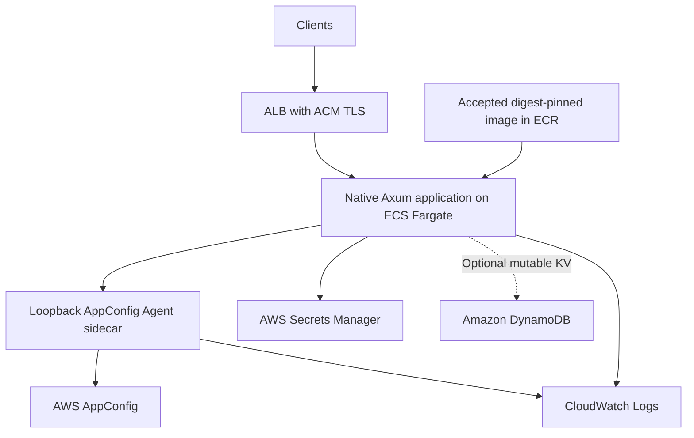
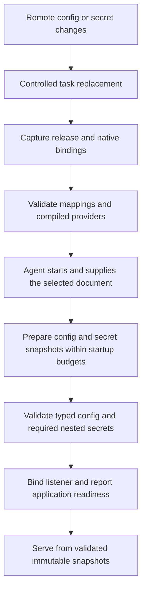

# AWS reference deployment and acceptance

- Status: Draft for review. No deployed support claim.
- Epic: [#391](https://github.com/IABTechLab/edgezero/issues/391)
- Related work: [#400](https://github.com/IABTechLab/edgezero/issues/400), [#410](https://github.com/IABTechLab/edgezero/issues/410), [#401](https://github.com/IABTechLab/edgezero/pull/401) and [#414](https://github.com/IABTechLab/edgezero/pull/414)

## Purpose

Define an AWS-first deployment recipe for native Axum applications, with one acceptance contract shared by Docker, ECS/Fargate and Kubernetes. Prefer AWS-managed configuration, secrets and durable storage over operating additional services merely to supply those functions.

The first cloud target is ECS/Fargate with AppConfig Agent and Secrets Manager. DynamoDB is an optional application-state extension, not a requirement for applications without mutable state. Kubernetes remains part of EdgeZero #400, but is not a prerequisite for deploying on AWS.

This is a draft for discussion, not authorization to provision resources, publish images, merge branches or close issues. It extends [the container deployment guide](../../guide/deploying-axum-containers.md) with an AWS-first design. Existing delivery and security approvals remain unchanged unless explicitly revised.

## Outcome and boundaries

A disposable generated application can use reviewed AWS resources through EdgeZero's existing portable interfaces, validate required inputs before serving, and run as a replaceable Fargate task. Operators can upgrade and roll back using retained image digests and compatible external inputs.

EdgeZero owns reusable providers, runtime contracts, generic examples and fixture verification. Application repositories own deployable images, configuration schemas, required secrets, signing policy, workload sizing, infrastructure, credentials and release approval. Trusted Server's actual deployment and identity backend remain downstream.

The reference demonstrates a deployment mechanism. It does not certify arbitrary applications, unlimited concurrency, end-client receipt, all AWS regions or every target architecture.

## Acceptance boundary

Packaging checks are not production acceptance. Provider integration, required-input
startup validation, durable-state recovery and bounded shutdown must be accepted
and exercised through the actual candidate images. Kubernetes and AWS service/IAM
acceptance require their own execution evidence and authorization.

Commit-specific CI, scan and implementation status belongs in the linked PRs and
issues, not this design contract. Report-only packaging scans never waive strict
application-release verification.

## Proposed decisions

| Concern           | First choice                                                                 | Boundary                                                                                                               |
| ----------------- | ---------------------------------------------------------------------------- | ---------------------------------------------------------------------------------------------------------------------- |
| Compute           | ECS/Fargate, one region                                                      | No EKS dependency; AZ placement and scaling claims require separate execution evidence                                 |
| TLS and ingress   | Application Load Balancer with ACM                                           | Tasks accept application traffic only from the approved ingress boundary                                               |
| Configuration     | AppConfig Agent sidecar, free-form documents                                 | Whole-document mapping; no arbitrary JSON flattening or configuration publishing in the runtime                        |
| Secrets           | Secrets Manager through the native provider                                  | Whole values and explicit version selectors; no automatic signing-key rotation                                         |
| Application state | No embedded mutable store in the first fixture; optional DynamoDB KV profile | No shared redb filesystem or Redis requirement; ordinary KV does not supply CAS                                        |
| Images            | ECR option for AWS deployments                                               | Reuse tested OCI artifacts; do not replace or duplicate the existing GHCR recipe                                       |
| Observability     | Application stdout/stderr to CloudWatch Logs                                 | Reviewed retention and redaction; AWS dependency DEBUG/TRACE and sensitive-body logging off unless separately reviewed |
| Updates           | Validated startup snapshots and controlled task replacement                  | No live application reload in the initial version                                                                      |
| Kubernetes        | Plain manifests consuming the same runtime/fixture contract                  | Separate disposable-cluster proof; no Helm, operator or EKS qualification implied                                      |

ECR support is a proposed extension. Digest preservation, metadata association and verification must execute against ECR before that path is described as tested. The existing publisher's GHCR-specific authentication and attestation steps cannot simply be assumed to work unchanged.

## Reference architecture

Use non-root application identity, read-only root, dropped capabilities where supported, and explicit port/bind settings. Verify the actual task restrictions rather than translating Docker flags mechanically. Give the Agent its own reviewed security/resource settings and operator-verified image digest.

The first fixture has no required local mutable data. AppConfig and Secrets Manager snapshots do not make an application stateful in the durable-storage sense. Fargate ephemeral storage is not a redb persistence recipe.

## Bootstrap, IAM and network ownership

Keep logical store declarations in the portable application definition. Put deployment resource mappings in the native bindings file selected by `EDGEZERO__STORE_BINDINGS_FILE`. Region, resource identifiers and credential discovery must be available before fetching configuration. Never fetch bootstrap credentials from the provider they are needed to authenticate.

Settle how the non-secret bindings file reaches the task before implementing the example. An application-owned file in the reviewed release artifact is one option. Fargate has no Kubernetes ConfigMap equivalent to assume. Any delivery helper must preserve exec startup, file permissions, immutable-input identity and the read-only application root. Secret values do not belong in that file or image.

Separate IAM responsibilities:

- Task execution role for approved ECR pulls and CloudWatch logging. Add secret-read permission here only for a deliberately selected ECS-injected secret or registry-credential path.
- Task role for application Secrets Manager reads, Agent AppConfig reads and optional DynamoDB operations. Grant access only to reviewed resources and the required KMS decrypt scope.
- Operator/release roles for configuration deployments, secret mutation, image publication and infrastructure changes. Runtime roles do not inherit these powers.

Containers in one ECS task share the task-role authority. The Agent and application are not isolated IAM principals. Scope the combined task permissions accordingly.

Choose private task networking and document the approved outbound route or VPC endpoints for image pull, logs, configuration and secrets. Include those resources in cost and cleanup approval. Do not expose Agent port 2772 through the ALB or task ingress rules.

The provider requires a literal-loopback Agent endpoint. Review the selected Agent's binding, token and cache settings. Resolve local endpoint authentication without storing tokens in source, URLs or diagnostic output. Agent disk backup/preload remains disabled for the initial recipe; an acceptable cached response is not independent proof of current AWS reachability.

## Startup and update contract

Every required mapping and application-declared dependency must succeed before readiness. Missing data, denied access, invalid envelopes, failed secret resolution and incompatible release inputs must not silently fall back to development files or environment values.

The production initializer validates typed application state. Successful provider preparation alone does not prove that the application's required configuration or secrets were checked.

AppConfig Agent polling does not update a running typed application. Secret rotation, remote deletion and permission revocation do not erase bytes already loaded into a running process. Restart-based adoption is explicit, including an emergency replacement procedure for secret revocation.

Use ECS startup dependency wiring only after identifying a health-check mechanism actually supported by the selected Agent image. Do not assume curl, wget or an undocumented endpoint exists. `HEALTHY` dependencies apply at startup, not as a continuing readiness guarantee. Agent health also does not replace application validation.

Application readiness and process liveness are different checks. ALB health checking is a routing signal, not a security boundary. ALB can fail open when every target is unhealthy, so startup and draining safety must be enforced by the application/listener contract and tested through real ingress.

## Release identity, upgrades and rollback

Record one application release with:

- Immutable source revision and build context, lockfile, toolchain and base-image identities.
- Accepted native child digests, runtime index digest and authenticated scan/SBOM/provenance evidence.
- Reviewed AppConfig application/environment/profile mappings and expected document revision or digest.
- Selected secret version IDs or stages, without secret values.
- Bindings-file identity, Agent image digest, task-definition revision and architecture.
- Application compatibility decisions, startup/drain budgets and operator approval.

AppConfig profile identifiers do not pin arbitrary historical document versions. Choose release-specific profiles or explicitly deploy and validate the required document revision. Reject mismatched revisions when an application requires coordinated inputs. Multiple config profiles and secrets are not an atomic cross-service snapshot.

Prefer explicit secret version IDs in the rollback fixture. If production uses `AWSCURRENT`, record how stage movement affects replacement tasks and rollback. Do not mistake an old image plus today's secret stage for the old release.

Publication preserves tested manifests and blobs. Verify destination digests and metadata subjects after any registry copy. Tags are aliases, not release identity. Report-only packaging scans cannot authorize a deployment release; strict release policy and any independently approved exceptions still apply.

Retain the previous compatible release before upgrade. Failed initialization must not become healthy or replace usable capacity without a documented failure outcome. Rollback restores compatible image and external inputs, not just an image tag. Database schema migration and signing-key rotation need application-owned policies beyond this fixture.

Align ALB deregistration delay, runtime drain budget and ECS stop timeout. Their mechanisms differ; no single timeout proves drain. Fargate's documented stop timeout maximum is 120 seconds. Test finite work, long-lived streams, stalled clients and forced termination against the selected budgets. Preserve BestEffort/Unsupported and protocol limitations of the accepted runtime.

## Acceptance matrix

Every row below is pending execution for this reference deployment. Reuse prior evidence only where the exact inputs, command and environment remain applicable. Capture client observations, sanitized logs and release identity, not merely control-plane success.

| ID  | Scenario                           | Required observation                                                                                                                                                                                                                  | Test location                                                            |
| --- | ---------------------------------- | ------------------------------------------------------------------------------------------------------------------------------------------------------------------------------------------------------------------------------------- | ------------------------------------------------------------------------ |
| A1  | Independent provider selection     | AppConfig plus local secrets, local config plus Secrets Manager, and both AWS providers work without replacing unrelated KV selection                                                                                                 | Deterministic native/generated-consumer tests, then selected AWS profile |
| A2  | Valid startup                      | Complete envelope and required secret resolution finish before listener/readiness; requests use validated snapshots                                                                                                                   | Candidate image and AWS through ALB                                      |
| A3  | Missing or invalid inputs          | Missing profile/secret, malformed config and unresolved nested secret fail startup without development fallback                                                                                                                       | Deterministic fixtures and disposable AWS resources                      |
| A4  | IAM and service failures           | Denied access and relevant decryption/network failures remain redacted errors, not successful misses; startup has an observable finite failure                                                                                        | Fixtures plus least-privilege AWS negative tests                         |
| A5  | Agent boundary                     | Verified image, loopback access, reviewed authentication/cache policy and supported startup ordering; endpoint unavailable through external ingress                                                                                   | Actual ECS task                                                          |
| A6  | Snapshot adoption                  | Remote updates do not silently alter a running app; replacement adopts the reviewed config/secret revision                                                                                                                            | Real AppConfig/Secrets Manager and task replacement                      |
| A7  | Mixed revisions                    | Incompatible config/secret/release combination is rejected by the fixture initializer before readiness                                                                                                                                | Candidate image and AWS negative release                                 |
| A8  | Runtime credentials                | Workload role supplies provider access; no static keys in image/config; runtime cannot publish images, deploy config, mutate secrets or change infrastructure; optional DynamoDB writes are limited to the approved application table | Approved IAM policy review and live allowed/denied operations            |
| A9  | Image handoff                      | ECR receives the exact accepted manifests/blobs; digest pull and subject/producer verification succeed; wrong artifacts are rejected                                                                                                  | Authorized publisher and separate deployment job                         |
| A10 | Container constraints              | Non-root identity, read-only application root, explicit writable paths if any, and no exposed Agent listener                                                                                                                          | Actual ECS task inspection and runtime checks                            |
| A11 | Probes and ingress                 | Application readiness differs from liveness; failed/all-unhealthy startup does not admit application work; spoofed proxy metadata is rejected or ignored under the accepted policy                                                    | Actual ALB client traffic and task observations                          |
| A12 | Graceful termination               | Dispatched finite work completes within budget; new work does not dispatch after drain begins; over-budget work reaches a bounded exit outcome                                                                                        | Actual ECS replacement/stop under traffic                                |
| A13 | HTTP boundaries                    | Claimed client/backend protocols, buffering/stream behavior, idle timeouts and unsupported capabilities match deployed evidence                                                                                                       | Actual ALB and accepted final-image checks                               |
| A14 | Upgrade and rollback               | New compatible release becomes ready; failed upgrade has a documented outcome; retained image and matching external inputs restore the old behavior                                                                                   | ECS service with two fixture releases                                    |
| A15 | Task replacement                   | Replace or kill a task and recover the documented capacity without relying on its ephemeral files                                                                                                                                     | ECS service, with outage/duration recorded                               |
| A16 | Architecture                       | Each claimed task architecture pulls and executes its accepted native variant; untested architectures stay labelled unverified                                                                                                        | Fargate per claimed architecture                                         |
| A17 | Logging safety                     | Startup/provider/ingress failures reveal no fixture secret or token; dependency logging configuration and log retention reviewed                                                                                                      | Captured application and Agent logs                                      |
| A18 | Cleanup                            | Disposable tasks and all approved billable dependencies are deleted or explicitly retained with an owner and expiry                                                                                                                   | AWS resource inventory after run                                         |
| D1  | Optional DynamoDB persistence      | Data written through the real provider survives replacement and is read by another replica; binary/TTL/list/limit behavior matches the provider contract                                                                              | Separate DynamoDB-enabled image and real table                           |
| D2  | Optional DynamoDB failures         | Denial/throttling and ambiguous writes remain explicit failures; no local fallback or unsafe retry guarantee                                                                                                                          | SDK fixtures and approved AWS negative tests                             |
| K1  | Kubernetes deployment              | Plain manifests run in a disposable cluster with actual probes, failed initialization, shutdown, replacement, digest upgrade and rollback                                                                                             | Separate cluster run                                                     |
| K2  | Kubernetes persistent redb profile | One writer, durable state and verified stop-before-start rollout; storage ownership and fencing/recovery limitations explicit                                                                                                         | Separate single-writer cluster profile                                   |

DynamoDB rows do not certify Trusted Server's identity backend. Its conditional creation, generation/CAS, strong withdrawal lookup and bounded prefix-list semantics require a separate backend design and acceptance. Ordinary read-modify-write is not atomic, and a shared managed database alone does not make an application safe to replicate.

## Kubernetes profile decisions

The [Kubernetes guide draft](../specs/deploying-axum-kubernetes.md) selects kind and Envoy Gateway with Gateway API for the first credential-free disposable-cluster proof. Plain manifests remain the application deployment format. EKS qualification is separate; ECS/Fargate remains the first managed AWS target.

The planned AWS Kubernetes profile includes AppConfig Agent, Secrets Manager and DynamoDB from its first delivery, once the providers are accepted and integrated. This does not make DynamoDB mandatory for stateless applications or change the initial no-store Fargate fixture. Local baseline checks do not contact AWS, and real provider/table acceptance still needs separate authorization.

## Delivery sequence and likely artifacts

1. Agree this draft's release-input policy, bindings-file delivery, Agent health/authentication wiring and AWS authorization checklist. Keep unresolved choices visible rather than fill examples with invented commands or pins.
2. Reconcile accepted HTTP/lifecycle/provider contracts at their owning boundaries, rather than adding another runtime implementation to deployment helpers. Extend the disposable fixture to validate typed config and secrets before readiness.
3. Build and test the candidate final images using #401's existing preparation/handoff checks. Keep the portable consumer proof separate from staged-source fixture builds. A provider-enabled image is a new candidate, not the already-tested packaging artifact.
4. Draft generic task/service, role and bindings examples under `examples/axum-deployment/ecs-fargate/`; extend `docs/guide/deploying-axum-containers.md` and link the provider guide. Add an ECR publishing option only after its preserving path and metadata checks are specified.
5. Add bounded opt-in execution/cleanup helpers only where they make acceptance repeatable. Re-running after partial failure must use stable run identities and avoid duplicate resources. Credential-free PR checks must never gain publisher/deployment authority.
6. Execute the approved AWS matrix, then repeat affected native, provider, generated-consumer, docs and WASM compatibility gates. Record the exact checked state and gaps.
7. Add plain Kubernetes manifests and a kind/Envoy Gateway exercise using the same accepted fixture/runtime contract. Default local checks require no AWS credentials. Prepare a separate AWS profile with AppConfig Agent, Secrets Manager and DynamoDB, and preserve the single-writer redb profile required by #400.
8. Run the DynamoDB-enabled AWS profile after accepted provider integration and separately authorized service access. Qualify Trusted Server's stronger identity contract independently; neither local Kubernetes nor ordinary KV evidence replaces it.

Deployment preparation and provider implementation have separate acceptance boundaries. Kubernetes preparation must reuse the accepted fixture contract. Implementation, GitHub metadata and issue-closing decisions remain separate from this design draft.

AWS execution can begin without waiting for Kubernetes completion. #400 still cannot close until Docker/Compose, Kubernetes and the selected managed-target requirements are all met. #410 still needs real provider/IAM acceptance; deployment smoke alone does not close its entire contract.

## Authorization and execution record

Before any AWS run, obtain approval for account, region, allowed architectures, principal/role usage, resource names, VPC/subnets/security groups, registry and publication rights, ALB/TLS inputs, AppConfig/secret/table resources, log retention, maximum spend, maximum duration, cleanup owner and permitted retained artifacts. Approval for one service is not approval for the others.

Each test record must include `ID | command | checked revision/input hashes | environment | image/config/secret identities | observed result | elapsed time | sanitized evidence | cleanup outcome`. Never include secret values, tokens or credential material. Mark unrun or failed cases explicitly.

No AWS resources, credentials, publication or runtime tests were used while drafting this document. No performance, cost, IAM or production-support claim is established here.

## Decisions needed before implementation

- Approve ECS/Fargate as the primary AWS path and ECR as an additional registry example, without replacing existing GHCR evidence requirements.
- Select the reviewed Agent release/digest, supported health check and local authentication policy.
- Select non-secret bindings-file delivery and the fixture's compatible config/secret release-identity checks.
- Agree the first AWS test's resource/cost/time/cleanup authorization and architecture scope.
- Confirm the resource mappings and permitted IAM operations for the DynamoDB-enabled AWS Kubernetes profile after provider integration. Keep identity/CAS acceptance separate.

## Sources

- [EdgeZero #391, self-hosted runtime epic](https://github.com/IABTechLab/edgezero/issues/391).
- [EdgeZero #400, deployment guidance and acceptance](https://github.com/IABTechLab/edgezero/issues/400).
- [EdgeZero #410, AWS provider scope](https://github.com/IABTechLab/edgezero/issues/410), [provider PR #414](https://github.com/IABTechLab/edgezero/pull/414) and its [published native AWS guide](https://github.com/IABTechLab/edgezero/blob/b764a883ce57a323250d9d7a20787dc5937ef90e/docs/guide/native-aws-stores.md).
- [#401, packaging/release/deployment evidence](https://github.com/IABTechLab/edgezero/pull/401).
- [AppConfig Agent on ECS](https://docs.aws.amazon.com/appconfig/latest/userguide/appconfig-integration-containers-agent-starting-ecs.html).
- [ECS IAM role responsibilities](https://docs.aws.amazon.com/AmazonECS/latest/developerguide/security-ecs-iam-role-overview.html).
- [Fargate task parameters, startup dependencies and termination limits](https://docs.aws.amazon.com/AmazonECS/latest/developerguide/task_definition_parameters.html).
- [ALB health checks and fail-open behavior](https://docs.aws.amazon.com/elasticloadbalancing/latest/application/target-group-health-checks.html).
- [ECS load-balancer connection draining](https://docs.aws.amazon.com/AmazonECS/latest/developerguide/load-balancer-connection-draining.html).

## Related documentation

- [Deploying Axum containers](../../guide/deploying-axum-containers.md).
- [Deploying Axum on Kubernetes](../specs/deploying-axum-kubernetes.md).
- [Publishing Axum containers](../../guide/publishing-axum-containers.md).
- [Axum adapter guide](../../guide/adapters/axum.md).
- [Production lifecycle/configuration work, #406](https://github.com/IABTechLab/edgezero/pull/406).
- [Downstream AWS adoption, Trusted Server #1236](https://github.com/IABTechLab/trusted-server/issues/1236).
- [Downstream image/deployment ownership, Trusted Server #897](https://github.com/IABTechLab/trusted-server/issues/897).
