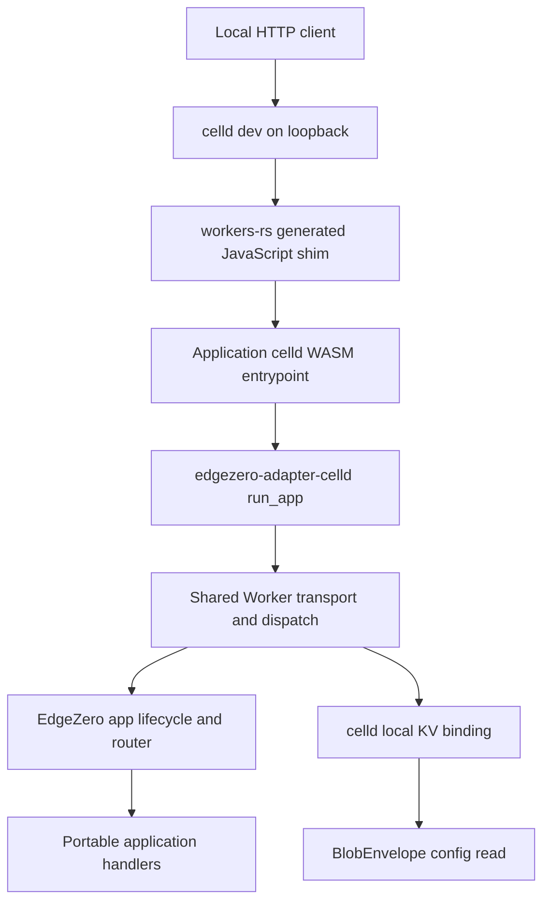

# Celld adapter specification

## Decision and delivery target

Add `edgezero-adapter-celld` as an experimental sibling runtime adapter. It runs EdgeZero applications as Rust WASM plus the workers-rs JavaScript shim inside celld. Axum is not in this request path. The first deliverable is a working localhost demo, including Mocktioneer's real OpenRTB route and typed application config.

The user authorized separate worktrees, a detailed specification and plan, implementation, and a local Mocktioneer run. This does not authorize a fleet, bucket provisioning, deployment, public listener, cloud credentials, GitHub issue creation, or publishing packages.

The larger adapter proposal remains the research record. This specification deliberately limits implementation to local build and serve. Missing secrets and remote operational features are acceptable if they are explicit and fail instead of pretending to work.

## Worktrees and prerequisites

| Repository | Worktree | Branch | Starting commit |
|---|---|---|---|
| EdgeZero | `/home/pav/worktrees/feat-celld-adapter` | `feat/celld-adapter` | `28038cce26a499499fd4e050387d4d02e35fa7c7` |
| Mocktioneer | `/home/pav/worktrees/feat-celld-demo` | `feat/celld-demo` | `cb6f2389d1366756f0aa14a936861ef77381613b` |
| celld reference | `/tmp/edgezero-celld-research` | pinned research checkout | `90b43017241f81189453d326d05948f388b34652` |

The EdgeZero branch starts at the current draft #275 HTTP-contract branch, not the older main HTTP API. Adoption depends on that prerequisite or an equivalent merged contract. This work does not resolve #275 or any Axum production-readiness issue.

Original checkouts and their existing untracked native-store documents remain untouched. No commits or pushes are required for the demo. The new EdgeZero branch has no upstream so it cannot accidentally update the prerequisite branch.

## Success criteria

A completed local delivery has all of these:

1. A separately named celld adapter with celld platform metadata and manifest selection.
2. Existing Cloudflare runtime APIs retain their behavior.
3. Rust WASM compiles through `worker-build`; celld loads the generated shim and wasm asset.
4. EdgeZero's CLI registers celld, scaffolds a runnable consumer, and supports local build and serve.
5. A generated consumer answers through celld on loopback.
6. Mocktioneer runs through `edgezero_adapter_celld::run_app::<MocktioneerApp>`, not an Axum proxy or an imitation of its handlers.
7. A real OpenRTB request returns the fixture CPM and stable input-related bid fields from a valid config-store BlobEnvelope. Generated bid IDs remain UUIDs.
8. Missing config fails through the existing typed-config error path.
9. Secrets and unsupported CLI operations fail clearly. No plaintext variable is represented as a secret store.
10. A run record lists checks, observed outputs, remaining gaps, replay commands, and process ownership.

Do not infer production support, fleet durability, parity with Cloudflare, or performance from these checks.

## Architecture and boundaries



Reuse the existing Cloudflare Workers transport behind a narrow runner API. Do not copy its ingress, response, outbound, compression, or store modules into a new adapter. The first implementation may depend on the Cloudflare adapter crate's Worker runtime feature. This is code reuse, not Cloudflare registration or use of Wrangler services.

The shared runner needs explicit inputs for the manifest adapter key, `PlatformMetadata`, secret policy, and config reader mode. A small options type or corresponding functions are acceptable. Preserve the existing Cloudflare `run_app` and dispatch APIs as wrappers with the original defaults.

The celld wrapper must select `celld` for environment and store bindings. The existing Worker adapter installs no Rust `log` backend; preserve that behavior. Manifest logging declarations remain available to an application-owned backend, but adapter-level logging is not implemented by this experiment. The current app macro registers all declared route handlers; trigger adapter lists are metadata, not runtime isolation. Preserve that existing behavior and add celld to the intended declarations. Runtime-enforced route filtering is outside this demo. App assembly owns platform identity before configure hooks execute. Do not build an app in the consumer, replace its platform after construction, or bypass the accepted ingress/response lifecycle.

Do not add a generic plugin framework or extract a broad shared runtime crate unless compilation proves the small seam insufficient.

## Runtime identity and capabilities

The adapter ID is `celld`. The public consumer entrypoint is:

```rust
edgezero_adapter_celld::run_app::<Application>(req, env, ctx).await
```

The exact Cargo feature may be `celld`, matching other adapter runtime features. Native CLI support must remain independently feature-gated so host tooling does not compile Worker-only runtime code.

Celld metadata must use its own platform name and vendor facts. Do not copy Cloudflare's 128 MB memory claim or assign geography, colo, client TLS metadata, a managed secret service, or autoscaling guarantees. Unknown facts stay unknown. The celld request context may expose a documented Worker-compatible context alias for this first release, but that must not change core platform identity.

A conservative capability declaration is better than an inherited Cloudflare declaration. Advertise only facts exercised or justified by the Worker runtime contract. Raw framing, header-byte admission, strict allocation/resource accounting, and platform guarantees not available at the Worker API remain unsupported. Deadline/cancellation/egress claims remain best-effort where that is what the underlying implementation promises. If initial runtime evidence does not justify a capability, leave it unsupported or document the limitation.

Outbound Fetch transport may be reused. Mocktioneer's signature verification can fetch Trusted Server JWKS through its older proxy API, so the consumer must migrate that real code to the new `HttpClient` API. The earlier source-only investigation missed this call by searching newer outbound names. The unsigned auction demo does not exercise JWKS retrieval or prove signed verification. Do not add invented application traffic. A local fixture can exercise a narrow outbound path separately if time permits; that is not broad transport acceptance.

## Stores

### Ordinary KV

Use celld's public Worker KV binding through the existing workers-rs API and EdgeZero `KvHandle`. Binding names and logical IDs must follow the manifest's existing store-resolution contract.

No namespace is an implied sharded database. A namespace remains one cell/writer in the research snapshot. The demo establishes only tested local operations. Celld local SQLite storage does not establish object-bucket durability or fleet semantics. Values beyond local celld's documented size support remain an explicit limitation, not an adapter success claim.

EdgeZero's existing 60-second minimum relative TTL applies. Do not modify expiry interpretation based on the celld documentation discrepancy. Absolute-expiration findings in the research report came from a helper test, not fleet acceptance.

### Typed config

Reuse the existing KV-backed config read path. Typed application config remains a serialized `BlobEnvelope` containing `data`, `generated_at`, `sha256`, and `version`. The normal extractor verifies the envelope, enforces bounded reads, deserializes the application type, and validates it.

A missing binding, absent key, bad digest, unsupported envelope version, or invalid application config must retain the existing explicit error behavior. Do not replace the normal extractor with embedded defaults or environment JSON.

Local publication is a separate demo setup concern. Celld v0.6.2 has no established local KV seed CLI in the inspected documentation. Remote `celld kv bulk put`, Wrangler local state, and Axum local config files are not substitutes.

The allowed demo seeder is an explicitly selected local-development JavaScript wrapper around the generated worker shim. It writes a validated fixture into the real celld KV binding before forwarding to the actual WASM entrypoint. It is not part of the adapter or portable handlers. Requirements:

- Keep the normal `wrangler.json` pointing at the generated worker shim without seeding.
- Put any wrapper in a separately named local-demo manifest and source file.
- Require an explicit local seed variable or mode. No silently embedded fallback.
- Generate a correct envelope through EdgeZero's `BlobEnvelope::new` and Mocktioneer's typed config loader, or another tested equivalent using the same hash rules.
- Store the intended config key through `env.<binding>.put`; never edit celld's internal database or namespace files.
- Await seeding before the first handler uses config. Share a pending seed operation to avoid concurrent first-request races.
- A failed seed fails the request and remains retryable or reports a persistent setup error; do not suppress it.
- No public seed endpoint or handler is added.
- The demo envelope contains only public CPM data. `.dev.vars` is plaintext and ignored.
- Without the explicit fixture/mode, forward without creating config so the missing-config test exercises the real error path.
- Tests cover disabled setup, correct key/value, concurrent initialization, and failed setup as applicable.

Whether to retain this wrapper after a real local publication backend exists is deferred. It must not be described as `config push --adapter celld`.

### Secrets and stronger identity contracts

Managed secret delivery is out of scope and unsupported. The shared runner must have a celld secret policy that prevents `CloudflareSecretStore` from interpreting ordinary variables as secrets. Conservatively rejecting a manifest that declares secret stores is acceptable. A typed unavailable store is also acceptable if errors retain the right category and do not expose values.

Do not send secret material to `vars`, `.dev.vars`, fixture files, logs, or generated manifests. There is no secret publication, rotation, versioning, or auditing feature in this deliverable.

Trusted Server's conditional Add, generations, CAS, strong listing/existence, and synchronous identity backend are not implemented. A working Mocktioneer config binding does not prove that stronger backend.

### Config reader compatibility

Local celld v0.6.2 returned a valid 99-byte KV value through text and ordinary stream reads, but its BYOB reader immediately reported end-of-stream with zero bytes. The first seeded WASM auction consequently received an empty config string and failed envelope parsing. This was an observed host compatibility failure, not a bad envelope.

The shared runner now carries an explicit `ConfigReadMode`. `CELLD_RUNTIME_OPTIONS` selects `DefaultStream` through `RegistryInputs` and the config-store factory. Cloudflare defaults remain `Byob`. There is no retry into an unbounded text read and no silent reader fallback.

The default reader inspects each JavaScript `Uint8Array` length before copying into Rust. It enforces the smaller backend/value cap, checks the absolute deadline around reads, yields periodically for timers, and requests cancellation when an incomplete reader drops. The outer timer covers acquisition, draining, and conversion. This does not bound a host allocation that happened before chunk delivery or prove finite host teardown. `ConfigReadAllocationBounds` and complete resource accounting remain unsupported. Raw config-store `get` remains explicitly unbounded; these limits apply to `get_bounded` and the typed extractor.

A Node-executed WASM regression rejected a 151-byte host chunk at 10-byte caps and accepted exactly 10 bytes. Real celld HTTP acceptance separately read 20 bytes, rejected independent backend and value caps of 3 bytes, and rejected an expired deadline.

## Build, CLI, and generated files

Register a celld CLI adapter and scaffold blueprint. Use unique template names, crate suffix `adapter-celld`, and dependency `edgezero-adapter-celld`.

Celld accepts Wrangler-compatible JSON/JSONC, not the existing EdgeZero Wrangler TOML template. Emit `wrangler.json` with the generated shim path and KV binding declarations. Do not add account IDs, Cloudflare-specific migration/auth settings, or remote bucket credentials. Avoid Handlebars escaping that produces invalid JSON.

Build invokes `worker-build --release` in the selected application adapter crate. Serve builds if needed, then invokes `celld dev` with the selected manifest on loopback. The generated shim and its relative wasm asset remain together. `no_bundle` or bundling options must match actual celld behavior and the generated module layout.

Use the existing CLI execution-target contract so manifest selection, working directory, forwarded arguments, and errors remain predictable. Do not infer paths from the user's original checkout. Preserve exit failures from child tools.

Only build and local serve are supported. Auth, deploy, staging, healthcheck/rollback release operations, fleet provisioning, remote config reads/writes, and secret publication must return unsupported errors. Never route them to Wrangler or a fleet command. Do not advertise generic config push success when no celld publication backend exists.

Forwarded arguments must not accidentally turn local serve into a public listener. Set or validate loopback `--host`; reject public addresses for this experimental local adapter. The local demo uses port 9876 for Mocktioneer, 9877 for the generated fixture if available. Check availability before starting. Do not kill an unrelated process to claim a port.

Tool prerequisites are explicit. Celld v0.6.2, Worker SDK/build 0.8.5, esbuild, the configured Rust toolchain, and `wasm32-unknown-unknown` are the initial target. User-local tooling is installed in `~/.cache/edgezero-celld-demo/bin`; no system-wide runtime installation is needed. Record actual versions and downloads. Verify celld's release digest and available GitHub artifact attestation.

Do not run fleet bootstrap or any cloud command.

## Mocktioneer integration

Add `mocktioneer-adapter-celld` with a thin Worker fetch event function. It delegates only to the new EdgeZero adapter. Preserve the existing portable routes, auction implementation, typed config, middleware, and other adapter crates.

The worktree currently pins EdgeZero v0.0.7. Patch all relevant EdgeZero git packages to the single local checkout, or use consistent local path dependencies. Do not mix git and path instances of core/macro/adapter types. A local-only patch section with an explicit sibling-worktree path is acceptable for this development branch. Record that packaging limitation.

Add celld to intended route adapter lists, adapter environment, config binding metadata, logging, and manifest introspection. Do not claim those lists enforce route isolation. Existing sync handlers use `std::env` for some authorization/domain settings, which is unavailable on this WASM target; this experiment does not certify those routes for production. Any source migration required by #275 should be limited to actual API incompatibilities and keep the same handler behavior.

The demo should use a CPM visibly different from the historical 0.20 fallback, for example 0.37, to prove typed config drove the bid. Generate the envelope from that value using the normal application config type. Keep this a demo fixture, not a change to the shipped example default.

## Validation and evidence

Use focused tests while implementation changes. Reuse passing results when their relevant inputs remain unchanged. Before handoff run the relevant host tests, wasm builds, formatting, and Clippy checks with warnings denied. Report unrelated failures separately rather than repairing other work.

The runtime smoke test must observe the actual HTTP status and body through celld. At minimum:

- Generated application GET succeeds through the new adapter.
- Mocktioneer config-free route succeeds.
- Manifest introspection includes the celld adapter declarations. A distinct manifest variable in a generated fixture or focused selection test separately proves the runtime key is celld.
- Missing config returns the expected error, not a successful bid.
- Seeded unsigned OpenRTB request produces the fixture CPM, auction/impression IDs, and expected seat/bid fields. Bid IDs remain UUIDs; deterministic assertions concern prices and input-related fields, not identical full response bytes.
- Malformed auction input takes the application's existing error path.
- Unsupported adapter actions fail without invoking cloud tools.
- Secret-store declaration cannot activate the plaintext Worker secret adapter.

Check KV write/read/list/delete through the real local binding when a suitable development fixture is included. If not tested, mark ordinary KV runtime behavior unverified beyond the config read/write path.

The smoke test is not a benchmark. Tail latency, cancellation under load, streaming fidelity, recovery/restart, namespace contention, upgrades, backup/restore, operator isolation, and distributed durable acknowledgements remain unverified.

## Follow-up gates

Remote support needs a separately approved design for secure bindings and deployments, real config publication, capability acceptance, recovery and upgrade tests, restore, and representative workload benchmarks. Keep Axum preparedness independent. No issue is closed by this experiment.

## Evidence used for this specification

- A pure workers-rs 0.8.5 probe compiled and answered HTTP 200 through celld dev on 2026-10-13. `no_bundle: true` failed because the generated shim re-exports `../index.js`; default bundling succeeded. This proves the ABI/tool path only, not EdgeZero dispatch. worker-build also downloaded its own wasm-bindgen CLI, wasm-opt, and esbuild 0.28.1 under `~/.cache/worker-build`; those helper artifacts were not independently attestation-verified.
- Source inspection of `edgezero-macros/src/app.rs::build_route_tokens` on 2026-10-13 confirmed that trigger adapter lists do not filter runtime registration. This corrected the initial design wording before implementation acceptance.
- EdgeZero PR275 head, especially `edgezero-adapter-cloudflare/src/lib.rs`, `request.rs`, `context.rs`, `cli.rs`, `edgezero-core/src/blob_envelope.rs`, and scaffold/registry interfaces.
- Mocktioneer `Cargo.toml`, `edgezero.toml`, `mocktioneer-core/src/routes.rs`, `config.rs`, and Cloudflare entrypoint.
- celld v0.6.2 `docs/wasm.md`, `docs/cloudflare-compat.md`, `docs/services/kv.md`, `docs/limitations.md`, and `dev.rs`.
- Source-only investigations `/tmp/celld-adapter-investigation.md` and `/tmp/mocktioneer-celld-investigation.md`. These are recommendations, not passing tests.
- `celld dev --help` confirmed loopback default, persistent `.celld/dev`, JSON/project selection, and local variable loading on 2026-10-13.

## Local delivery outcome

The local scope passed acceptance on 2026-10-13. The generated consumer used the registered celld CLI build/serve path and returned the celld-scoped variable. KV put/get/exists/list/delete, bounded config caps, an expired deadline, ingress grant consumption, and a three-chunk response passed through celld.

The final Mocktioneer WASM returned OpenRTB and APS bids at CPM 0.37 using the real KV-backed `BlobEnvelope`. The clean normal manifest returned 503 `config_out_of_date` and config introspection 404. The seeded manifest returned config 0.37, malformed JSON 400, and semantic validation 422. UUID bid IDs were not treated as deterministic output.

Generated manifests omit all-empty command overrides so registered adapter validation is not bypassed. A real build exposed a missing generated app-core dependency; the template and regression assertion were fixed, and a fresh project built and served successfully. Mocktioneer stages the genuine shim/WASM inside each manifest's project directory and invokes the workers-rs default class with `new worker(ctx, env).fetch(request)`.

The generated fixture and Mocktioneer ran serially on port 9876 because the generic CLI serve command does not expose port forwarding. Only the final seeded Mocktioneer process remains running. Replay commands, process ownership, test results, and remaining gaps are in [[2026-10-13 - Celld Adapter Local Demo]].

## Related

- Proposal: [[Celld Store Provider Evaluation]]
- Plan: [[Celld Adapter Implementation Plan]]
- Context: [[Axum Self-Hosting Dependency Map]]
- Project: [[Trusted Server]]
