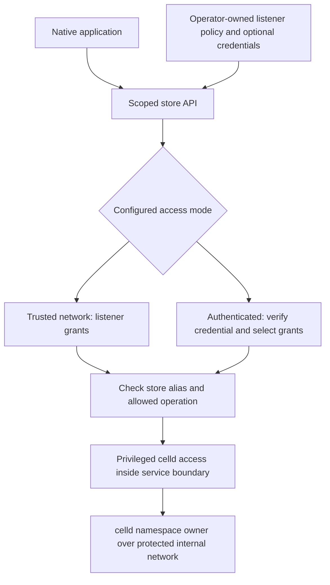
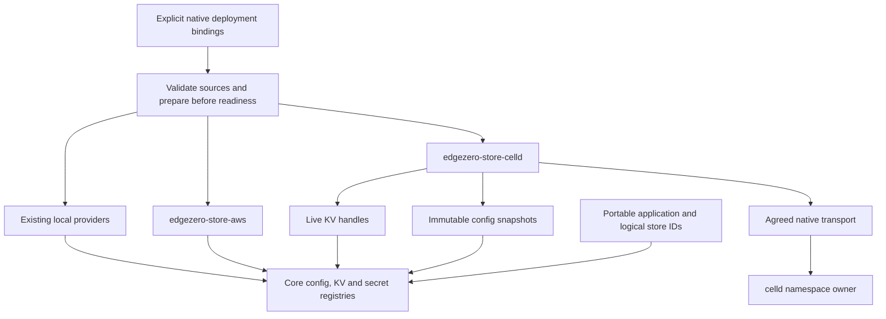

# Native celld store providers

Status: draft. Scoped access, optional application authentication and AWS-style config snapshots are agreed. API placement and detailed protocol contracts remain open.

## Goal and scope

Extend the native provider composition on `issue-410-native-store-providers` so a native application can select celld for configuration and ordinary KV, independently of its HTTP adapter. Axum is the first consumer. AWS, celld and local providers may coexist across logical store IDs.

Do not add a celld application runtime, Rust WASM entrypoint, Worker build tooling, or celld secret provider. Do not merge PR #420 as a prerequisite. Secrets may continue to use the existing AWS provider or another explicitly selected existing source.

Planning baseline: EdgeZero commit `350527e4`, PR #414. PR #420 is reference material for celld semantics and prior local experiments, not implementation to import. The working tree was clean before adding this document.

## What exists already

The current branch provides the needed application boundary:

- Core `ConfigStore`, `KvStore`, handles and per-ID registries remain provider-neutral.
- `NativeStoreOverrides` accepts ready handles or deferred preparation per logical ID.
- `NativeStoreBindings` selects built-in providers in a deployment file, outside portable `edgezero.toml` declarations.
- Native startup validates all source selections before polling deferred setup, prepares stores before readiness, and runs an application-owned initializer.
- AWS config and secrets are startup snapshots. DynamoDB KV is live.
- Compiled provider features and CLI target-feature resolution determine built-in provider availability.

Keep these contracts. Do not introduce a universal store trait or a dynamic provider registry.

## celld findings

Documentation and source were inspected at celld `90b43017241f81189453d326d05948f388b34652`, version 0.6.2.

1. The documented application KV API is a Worker binding. There is no documented standalone config service. Config can be stored as complete UTF-8 documents in KV.
2. Non-Worker KV access exists in `celld kv`. Its internal `operator_cell::Reachable` discovers live nodes through the fleet bucket, loads the shared fleet secret and signs requests to `/runtime/<scope>`. A receiving node forwards to the namespace owner.
3. That client is crate-private, not a standalone supported Rust client. Depending on the full `celld` crate would also bring its runtime dependencies, including V8.
4. The internal listener requires a trusted private network or encrypted overlay. celld terminates no TLS there. The operator API is alpha and may change between releases.
5. The fleet HMAC secret is fleet-wide authority, not a namespace-scoped application credential. Normal CLI discovery also requires access to fleet bucket metadata. Do not silently give an HTTP application these privileges.
6. A namespace has one owner/writer. Reads reach that owner and are documented not to return stale values. These facts do not provide application-key CAS, conditional create or an atomic multi-call read-modify-write.
7. Documented limits include 512-byte keys, 25 MiB values, pages of at most 1000 keys and a 60-second minimum expiry. Values above 1 MiB require a fleet bucket. Expired keys become invisible at expiry.

These are source/documentation findings. This planning pass has not executed a native client against celld.

## Agreed decisions

- Applications use a scoped service API. Do not put the fleet HMAC secret or celld fleet-bucket discovery credentials in the EdgeZero process.
- Support explicit trusted-network and authenticated access modes. Application bearer tokens are optional, not a prerequisite for private deployments. Both modes restrict exposed stores and operations.
- Config uses startup snapshots, matching the native AWS config provider. Restart to adopt published changes.
- No celld Worker runtime or celld secret provider is added.

A Worker HTTP bridge is excluded from this proposal. Spawning `celld kv` per application operation and reading or modifying celld's backing SQLite/bucket files are also excluded.

## Proposed scoped API

The scoped API must be implemented. It is not an existing celld feature established by this research. It could live in celld itself or in a small, separately operated native gateway. Prefer upstream support if celld will own this contract. A gateway is an alternative that avoids waiting for an upstream release, but adds another privileged process to deploy and maintain. Placement is not yet agreed.

### Access modes and grants

Configure one explicit access mode per listener. Missing or invalid configuration must not silently select tokenless access.

| Mode | Caller access control | Store permissions |
| --- | --- | --- |
| Trusted network | No application credentials. Firewall rules, security groups or network policies control who can connect. | Every caller that can reach the listener receives its configured store and operation grants. |
| Authenticated | Verify a caller credential. Operator-provisioned random bearer tokens over TLS are the proposed first method. | The verified credential selects explicit store and operation grants. |

In trusted-network mode, reachability grants access. A private IP alone does not identify an application or isolate it from other workloads. Applications needing different permissions require separate listeners with enforced network isolation, or authenticated access. An application-supplied name or header is not caller identity.

For authenticated mode, the service keeps token verifiers and grants. The application receives only its own token through deployment secret injection, not through remote config or a celld secret store. Credential replacement and revocation must not require changing the application API. Exact reload and rotation behavior still needs a defined contract. No credential-issuance service is proposed initially.

For example, a trusted-network listener or an authenticated credential may grant:

| Store alias | Physical namespace, service-side only | Allowed operations |
| --- | --- | --- |
| `checkout-config` | `production-checkout-config` | Read |
| `checkout-state` | `production-checkout-state` | Read, write, delete, list |

The client requests a store alias, never an arbitrary celld runtime scope, node address or bucket path. Resolve the alias and check its grant before any backend call in both modes. Start with whole-namespace grants and dedicated config namespaces. Prefix-based authorization is unnecessary for the initial requirement and would add key-normalization and listing risks.

Do not expose fleet discovery, deployments, eviction, shutdown, arbitrary cell calls or an administrative proxy endpoint. Neither trusted-network reachability nor a compromised application token authorizes these actions. A compromised gateway still has fleet authority, so its host and internal network remain security boundaries.

### Defaults and transport protection

- The API is disabled unless configured. When enabled, tokenless access binds to loopback by default.
- Non-loopback tokenless access requires explicit trusted-network configuration and deployment-level network restrictions. Binding to a private address does not prove those restrictions exist.
- Authentication failures never fall back to trusted-network access. Do not mix authenticated and anonymous grants on one listener in the initial design.
- The provider supports tokenless connections without application credential provisioning. If a binding explicitly selects a token source, a missing or empty token is an error, not a request to connect anonymously.
- Authentication and encryption are separate decisions. Bearer credentials require TLS. Trusted-network mode may use HTTP on loopback or an explicitly accepted protected network. A private network does not inherently provide confidentiality; use TLS or an encrypted overlay where needed.
- Fleet credentials remain inside celld or the gateway in both modes. Optional application authentication does not disable authentication on celld's internal reserved-cell protocol.

### Operations

Use a small versioned HTTP contract with raw bytes for values and bounded JSON for key pages. Exact route spelling is a proposal, not a shipped API:

- `GET /v1/stores/{alias}/value?key=...` reads bytes. Missing is distinct from an empty successful body.
- `HEAD` on the same route checks existence without returning the value body.
- `PUT` on the same route stores raw bytes, with an explicit relative TTL option. Omitting TTL clears a previous expiry.
- `DELETE` on the same route deletes a key, including a missing key.
- `GET /v1/stores/{alias}/keys?prefix=...&cursor=...&limit=...` returns a bounded page and opaque continuation.

Construct URLs using an encoding library and define one decoding rule. Reject malformed or duplicate parameters rather than accepting ambiguous input. Bind continuation to the authorized store and prefix, and reauthorize every page. Never treat a cursor as authority.

The service and client both enforce finite deadlines and body/page limits. The service owns celld wire-version compatibility, namespace scope derivation, fleet authentication and node discovery/refresh. Raw-byte HTTP avoids exposing celld's JSON byte-array expansion to application clients, but the privileged backend transport still needs its own encoded-body budget.

No automatic replay of ambiguous mutations in the first version. A timeout does not prove that a write failed. Error categories must distinguish authentication, authorization, missing values, invalid input, limits and backend unavailability without returning internal error chains.

Authorization tests must prove out-of-grant store denial and config write denial before backend dispatch in both access modes. Authenticated mode must also prove isolation between credentials. Trusted-network tests must make shared listener permissions explicit. Test disabled and loopback defaults, rejection of implicit remote tokenless exposure, missing selected tokens, and no fallback after authentication failure. Deployment tests must separately prove network restrictions on the scoped listener and that application workloads cannot reach the internal listener or read fleet credentials.

## Proposed provider design

Add a native-only `edgezero-store-celld` crate, independent of Axum, the CLI and `edgezero-store-aws`. Use the existing runtime rather than creating another executor. Do not pull the full celld runtime, V8, workers-rs or worker-build into native application dependencies.

Suggested opt-in Axum features are `celld-config` and `celld-kv`. Keep them independent, disabled by default and compatible with AWS features. Final provider tags and settings depend on the transport decision.

### Config

Use startup snapshots to match native AWS config adoption:

- Map each logical config lookup key explicitly to a remote namespace/key. Require the default key to name a mapping.
- Fetch each mapped complete document during bounded preparation. Missing required mappings, invalid UTF-8, limits and transport errors fail before readiness.
- Preserve exact document bytes as UTF-8. Do not parse JSON fields, reserialize envelopes or resolve secrets in the provider.
- Publish immutable config bindings implementing ordinary and bounded core reads. Unmapped keys are misses, not remote discovery.
- Restart to adopt remote changes. Multiple documents do not imply one atomic release. Applications needing coordinated versions validate them in the existing initializer.
- Typed `BlobEnvelope` validation and nested secret resolution remain in core and application startup. celld config may reference a separately bound AWS secret store.

Live config refresh is a separate decision, not implied by using KV as storage.

### KV

Implement the existing byte-oriented operations: get, put, TTL put, delete, exists and paginated prefix listing.

- Preserve binary bytes and distinguish absent values from empty values.
- Keep namespace identity explicit and test isolation between logical IDs. Reusing one physical namespace is explicit sharing, not automatic isolation.
- Enforce transport, encoded-body, decoded-value and page limits before unbounded allocation. JSON byte-array expansion on the internal protocol needs its own budget.
- Preserve native expiry semantics. A plain overwrite removes an old TTL; TTL overwrite renews it. Verify the actual wire behavior rather than assuming it matches the Worker API.
- Bind opaque continuation state to the relevant namespace and prefix. Handle partial and empty continuation pages without unbounded scans.
- Apply finite connection and whole-operation deadlines. Do not replay ambiguous writes after a timeout or disconnect. A relative-TTL retry can change expiry even when overwriting identical bytes.
- Return closed, redacted errors. Do not retain URLs, remote bodies, namespace names, credentials or raw error chains in EdgeZero-owned diagnostics.

Do not claim conditional writes, atomic counters, snapshot listing or a stronger identity backend.

### Native composition and CLI

Extend existing built-in dispatch rather than creating parallel startup:

- Add typed config/KV binding variants and compiled-provider capabilities. Reject celld under the secret kind.
- Preserve duplicate-source rejection, undeclared-ID checks and validation-before-I/O.
- Select provider-specific preparation sessions by their actual variants. Current AWS session selection treats any built-in binding as AWS, which must not remain true once celld exists.
- Separate celld connection credentials from the AWS-specific `AgentAccessToken` config-source tuple. Keep AWS preparation limits AWS-owned. Add only the celld budget mechanism needed by the selected transport.
- Preserve AWS-only and local-only startup behavior. A celld-only deployment must not require AWS credentials or local roots for remote-bound IDs.
- Extend generated target feature forwarding and offline availability detection. Validation remains structural, not a remote connectivity or authorization check.
- Generalize the AWS-specific config-push guard so selected celld config cannot accidentally report a local file write as remote publication.

Initial publication remains operator-owned. Do not add fleet provisioning, deployment, config publication or secret management to this provider task.

## Delivery sequence and proof

1. **Specify the scoped API.** Choose upstream integration or a native gateway, then define listener grants, optional credential provisioning/revocation, versioning, network boundaries and operation/error contracts. Scoped access, the two access modes and startup config snapshots are already agreed.
2. **Prove scoped native access.** Use a disposable local celld setup and a small native client with no application Worker. Exercise tokenless loopback and authenticated access. Observe binary put/get/delete, missing versus empty values, namespace isolation, pagination and explicit version/authentication failures. Prove config-write and out-of-grant store denial before dispatch, plus no fallback between access modes. Keep all fleet credentials inside the service boundary and record their acquisition. This is a transport and authorization gate, not production acceptance.
3. **Implement live KV.** Add typed settings, strict offline validation, bounded transport and operation tests. Prove TTL renewal/reset, malformed responses, oversized encoded/decoded payloads, continuation and ambiguous-write behavior. Use provider-specific TTL tests because the shared native contract macro currently expects direct sub-second TTLs that celld rejects.
4. **Implement config snapshots.** Prove whole-document preservation, missing and invalid UTF-8 failures, per-value/session budgets, bounded snapshot reads and restart-based adoption.
5. **Integrate Axum and CLI.** Prove mixed AWS/celld/local source selection, missing-feature rejection, source conflicts, root requirements, readiness ordering and config-push refusal through public entrypoints.
6. **Exercise a generated consumer.** Run a generated native Axum app against real celld. Check mutable KV, typed config initialization and restart adoption. Where available, compose celld config/KV with existing AWS fixtures for secrets. Run feature/dependency checks proving celld does not add Worker/V8 dependencies or change AWS-only builds.

Each behavioral unit ends with its focused regression and neighboring tests. At the combined checkpoint run affected formatting, lint, builds and integration checks. Missing external tooling or a failed service startup is an unverified gate, not a passing skip.

Fleet failover, encrypted-overlay operation, crash recovery, large-value bucket behavior, upgrades and performance need separate runtime acceptance. A single-node local result does not establish them.

## Open decisions

- Should the scoped API be implemented upstream in celld or as a separately operated native gateway?
- Define the exact trusted-network opt-in and listener policy configuration. For optional authenticated mode, finalize the bearer-token method and credential reload, rotation and revocation behavior.
- Select concrete API limits, error shapes and celld version compatibility policy before implementation.

## References

- [Native AWS provider PR #414](https://github.com/stackpop/edgezero/pull/414)
- [Experimental celld runtime PR #420](https://github.com/stackpop/edgezero/pull/420), reference only
- [celld KV](https://celld.dev/docs/services/kv/)
- [celld security](https://celld.dev/docs/security/)
- [celld guarantees](https://celld.dev/docs/guarantees/)
- [Pinned operator client](https://github.com/denoland/celld/blob/90b43017241f81189453d326d05948f388b34652/crates/celld/operator_cell.rs)
- [Pinned KV CLI](https://github.com/denoland/celld/blob/90b43017241f81189453d326d05948f388b34652/crates/celld/kv_cli.rs)
- [Pinned peer authentication](https://github.com/denoland/celld/blob/90b43017241f81189453d326d05948f388b34652/crates/celld/peer_auth.rs)
- Existing branch design: [native store providers](2026-10-07-native-store-providers-design.md)
