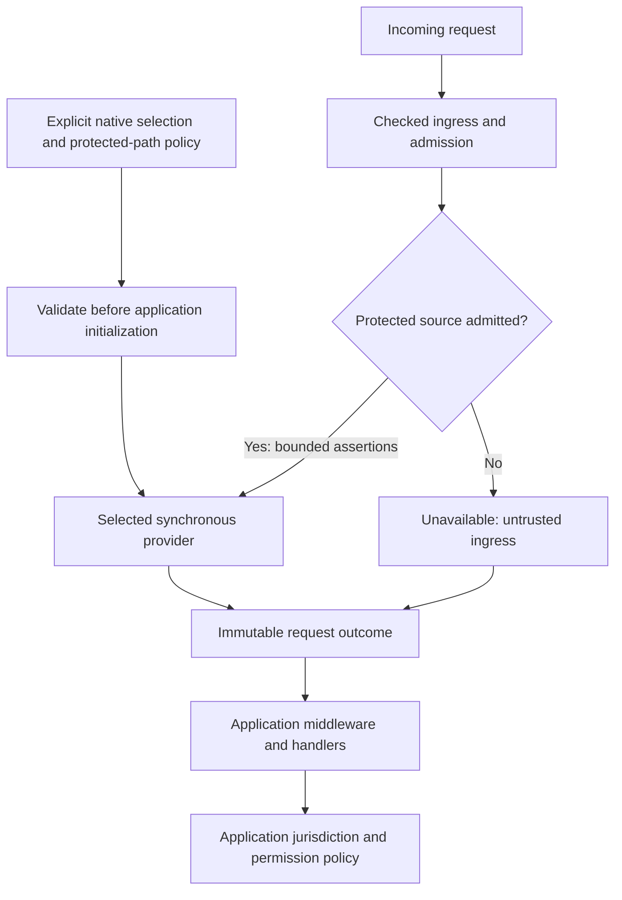

# Pluggable Geo providers

- Status: implemented and locally verified. The implementation plan records test evidence. Cloud deployment and downstream acceptance remain separate and unproven.
- Date: 2026-10-22
- Owning issue: [EdgeZero #432](https://github.com/IABTechLab/edgezero/issues/432), under [#391](https://github.com/IABTechLab/edgezero/issues/391).
- Initial deployment: CloudFront through an HTTPS, origin-secret-gated ALB to network-isolated native Axum.
- Planning baseline: EdgeZero `5426ea65`. Checked native ingress from [PR #409 at `66a05e25bee674ced69387467acec3c87b06c8b6`](https://github.com/IABTechLab/edgezero/tree/66a05e25bee674ced69387467acec3c87b06c8b6) was reconciled by adapting its own commit delta onto the newer native-store stack. Current asynchronous egress and connection ownership remain intact. The separate #407 buffered JSON-cap/body-carrier feature was not imported. No second forwarding parser was added.
- Composition reference: [native startup lifecycle](2026-10-05-axum-production-startup-lifecycle-design.md). Geo remains separate from [native store providers](2026-10-07-native-store-providers-design.md) and [PR #414](https://github.com/IABTechLab/edgezero/pull/414).

## 1. Outcome and scope

Applications obtain an estimated country and optional first-level subdivision through one portable Geo contract. EdgeZero supplies geographic assertions and their provenance. Applications decide jurisdiction, consent, identity behavior and disclosure. An estimate is not proof of residence, identity or consent.

The first implementation includes portable outcomes, a synchronous provider contract, explicit native selection, the CloudFront provider, a request accessor, focused tests and deployment guidance. Application-supplied providers use the same narrow, local-only contract. No local GeoIP database or external lookup service is included.

This deliberately narrows #432. Its local-database, reader-IP input and database-lifecycle requirements are tracked separately in [#438](https://github.com/IABTechLab/edgezero/issues/438), not satisfied by CloudFront support. The split is recorded on #432. Trusted Server adoption is a separate follow-up, not an EdgeZero delivery step.

Required invariants:

- Select zero or one provider per deployment. No selection means unavailable geography. A selected provider never falls back to another source.
- Country-only geography remains partial. A US country without a state does not identify a privacy regime.
- Invalid configuration or an unavailable selected implementation fails native startup before listen/readiness.
- Missing or rejected request metadata produces an outcome, not a provider-selection change or an automatic HTTP error.
- One immutable outcome belongs to the request. Consumers do not resolve geography again or reinterpret forwarding headers.
- Provider calls use bounded, source-admitted assertions, not the request, reader IP or unrestricted services.
- Core acquires no AWS SDK, Axum, Tokio or filesystem dependency from this feature.

## 2. Ownership and data flow

| Concern                                                             | Owner                         |
| ------------------------------------------------------------------- | ----------------------------- |
| Socket peer, protected-path policy, admission and source provenance | Native ingress and adapter    |
| Selection, assertion normalization and bounded failure categories   | Geo composition and providers |
| Country/subdivision outcome and read-only accessor                  | Portable core                 |
| CloudFront policies, ALB rules, credentials and network isolation   | Deployment operator           |
| Jurisdiction, consent, identity and data disclosure                 | Application                   |

An AWS deployment region, browser language, timezone, arbitrary country header or absent consent signal is not visitor geography. This feature introduces no identity lifecycle, regulatory lists, permission language, device assessments or response-header middleware.

## 3. Provider and request contract

Core owns the outcome types and a small synchronous provider interface. Resolution is bounded local computation. It performs no network, filesystem or other blocking I/O, launches no background work and returns an owned outcome without a future. These restrictions apply to application-supplied implementations as well as the built-in provider.

Applications may supply an already-constructed provider through typed native composition. There is no plugin discovery, registry, per-ID Geo store, asynchronous preparation interface or provider-specific shutdown hook. Any application-owned construction precedes handing the provider to the runner; this feature adds no resource-loading lifecycle. The CloudFront implementation needs no AWS client, credentials or local directories.

The initial input contains only the two geographic assertion slots described in section 6. Each slot is absent, a bounded value or an invalid-assertion marker. Ingress owns source admission, duplicate detection and byte bounds. The provider owns code validation and normalization. Source-admitted does not mean the geographic value is already valid. Preserve invalid markers rather than treating rejected input as absent.

Do not include reader IP, cookies, authorization, query/path, arbitrary headers, application settings or service handles. Future GeoIP or remote providers require an explicit input-contract extension. Reuse #409 if reader-IP support is added later; this implementation neither requires a resolved reader IP nor parses forwarding headers for Geo.

For managed Axum dispatch:

1. Remove the configured origin-credential header before application callbacks can observe the request. Its contents do not establish trust inside EdgeZero.
2. Complete framework ingress validation and admission. Refused or aborted ingress performs no provider resolution.
3. Use the runner-owned socket peer and original ingress snapshot to establish source admission. No selection yields `Unavailable(NoSelection)`; a selected provider without source admission yields `Unavailable(UntrustedIngress)`. Neither invokes the provider.
4. For an admitted request from the configured source, invoke the selected provider exactly once, including when both assertion slots are absent. Store the outcome before request preparers, application middleware and handlers run.

`RequestContext` exposes a read-only accessor. Header mutation or insertion/removal of public extensions cannot replace the runner-owned outcome. All consumers see the same result. Admission callbacks do not have Geo; no new Geo-dependent admission hook is introduced.

No lookup occurs during response finalization. Other adapters and the unmanaged request converter expose `Unavailable(NoSelection)` in v1 and never infer trust from raw headers or caller-inserted extensions. Optional application response middleware can read the outcome, but implementing that middleware is outside this change.

Application-supplied Rust remains trusted code. The input contract prevents accidental coupling; it is not a sandbox or enforcement against malicious provider code.

## 4. Outcomes and provenance

Names below describe behavior, not final Rust spelling.

| Outcome                         | Meaning                                                                               |
| ------------------------------- | ------------------------------------------------------------------------------------- |
| `Unavailable(NoSelection)`      | No provider is attached to this request path                                          |
| `Unavailable(UntrustedIngress)` | A provider is selected, but the request lacks the required protected-source admission |
| `Unavailable(MissingMetadata)`  | The source is admitted, but neither geographic assertion is present                   |
| `Located`                       | A supported country is present, with an optional syntax-checked subdivision assertion |
| `Error(InvalidAssertion)`       | A selected assertion is malformed, duplicated, unsupported or inconsistent            |
| `Error(ProviderFailure)`        | A supplied provider reports an execution failure, without exposing a raw source error |

Attach the selected provider's identity to every outcome except `NoSelection`, including source rejection before invocation. A located result also records the source kind and trust basis. For CloudFront, distinguish `CloudFront` as source from the declared protected-ALB path as trust basis. Neither is a cryptographic attestation of distribution identity. Do not retain raw headers, credentials or reader IP in the outcome.

A located result requires a country. A subdivision cannot exist without its country. Shared validated types enforce the normalization rules for built-in and supplied-provider outputs alike. The subdivision is a provider assertion with ISO 3166-2 component syntax, not independently verified membership in a worldwide subdivision catalogue.

These outcomes do not set an HTTP status or grant permissions. Applications distinguish missing geography from an error and decide whether unrelated functionality may proceed. Unknown or unrecognized subdivisions must not silently become known non-regulated jurisdictions.

## 5. Selected CloudFront trust model

### One supported deployment recipe

Use AWS's documented [origin-secret ALB pattern](https://docs.aws.amazon.com/AmazonCloudFront/latest/DeveloperGuide/restrict-access-to-load-balancer.html), with these controls required together:

1. CloudFront adds a dedicated, high-entropy origin credential using a custom header. Only the intended distribution and authorized operators possess it. Do not reuse it across unrelated distributions. Keep its name and value out of logs and responses; document value rotation.
2. Viewer access uses HTTPS. CloudFront connects to the ALB using HTTPS-only with a valid origin certificate.
3. The ALB listener forwards to the application target group only when the credential matches a configured non-wildcard value. Its default action denies access. No other listener or rule may forward unverified viewer traffic to that target group.
4. The ALB security group admits origin traffic only from the CloudFront origin-facing managed prefix lists for the enabled IP families. These lists admit CloudFront infrastructure, not a particular distribution, so they do not replace the credential check.
5. The Axum application port is private and accepts traffic only from the intended ALB security group. The ALB-to-Axum hop stays inside the isolated VPC. No public target port, alternate proxy or other route may bypass the ALB gate. Adding a native TLS server is outside this feature.

The ALB validates the credential. EdgeZero does not receive its configured value, fetch AWS credentials or implement another authentication layer. AWS documents that [custom origin headers replace viewer-supplied values](https://docs.aws.amazon.com/AmazonCloudFront/latest/DeveloperGuide/add-origin-custom-headers.html).

### Private ingress witness

Add one explicit protected-ALB policy to native Geo composition, separate from ordinary proxy trust. It contains a nonempty, bounded literal CIDR allowlist for the actual ALB socket peers and the dedicated credential-header name to remove. Reuse #409's CIDR validation and address normalization, including rejecting unrestricted ranges. Reject a credential-header name that conflicts with geographic, forwarding or standard transport/authentication headers.

Selecting this policy declares that every deployment control above is enforced. It cannot be inferred from generic trusted-proxy CIDRs, a forwarding header, a claimed distribution ID or an application-provided extension.

After admission, the managed runner compares the actual connection peer with this policy. A match creates an adapter-private, request-bound witness; a missing or nonmatching peer does not. Only this witness admits the two Geo assertion slots. The low-level converter and request preparers cannot create or replace it. Ordinary proxy trust without the separate protected-ALB policy never admits geographic assertions.

Remove every occurrence of the configured credential header before application admission callbacks, request preparers or middleware run. Neither its name nor value belongs in Geo diagnostics. Live rotation changes the value under a fixed header name: the ALB temporarily accepts old and new values while CloudFront deploys the new value, then removes the old one. Renaming the header requires a coordinated stop/reconfigure/restart; v1 does not add dual-name removal state.

This witness means the request arrived on the operator-declared protected path. EdgeZero cannot inspect security groups or distinguish a correctly gated ALB from the same ALB with a broken listener rule. Local tests prove peer/policy enforcement, not the external credential check. Deployment tests must prove the latter before production use.

### Why this option

This recipe adds no AWS SDK integration, application-side credential comparison or new VPC-origin resources. It is the smallest documented option for this native-Axum feature, at the cost of operator-owned secret rotation and an internet-facing ALB protected by network and listener rules.

[AWS VPC origins](https://docs.aws.amazon.com/AmazonCloudFront/latest/DeveloperGuide/private-content-vpc-origins.html) remove public origin access and are a valid future deployment option. They require separate VPC-origin setup and currently exclude gRPC and Lambda@Edge origin triggers. They are not a second supported trust mode in v1. A private subnet or a CloudFront network range alone still must not be described as authentication of one distribution.

## 6. CloudFront assertions and normalization

Explicitly configure CloudFront to add `CloudFront-Viewer-Country` and `CloudFront-Viewer-Country-Region` through an origin request policy. Merely forwarding arbitrary viewer headers is not sufficient. Do not install static custom values for these names or edge functions that rewrite the generated geography.

[AWS documents header replacement](https://docs.aws.amazon.com/AmazonCloudFront/latest/DeveloperGuide/lambda-at-edge-function-restrictions.html#lambda-at-edge-restrictions-cloudfront-headers) when these CloudFront headers are configured: viewer-supplied values are overwritten after the viewer-request event. No Lambda@Edge function is required by this recipe. The [header reference](https://docs.aws.amazon.com/AmazonCloudFront/latest/DeveloperGuide/adding-cloudfront-headers.html) also says subdivision is omitted for requests originating from the AWS network. Deployment proof must cover spoofed values in that missing-subdivision case; do not assume that absence of generated data permits forwarding a viewer's value.

Apply the following rules to values exposed by the HTTP parser. Do not promise detection of whitespace already removed by an upstream HTTP parser.

| Input                                                                                          | Required behavior                                                                                                          |
| ---------------------------------------------------------------------------------------------- | -------------------------------------------------------------------------------------------------------------------------- |
| No selection                                                                                   | `NoSelection`, without inspecting geographic values                                                                        |
| Selected provider, source not admitted                                                         | `UntrustedIngress`, regardless of absent, valid or malformed values                                                        |
| Admitted source, both headers absent                                                           | `MissingMetadata`                                                                                                          |
| Duplicate instances, including identical duplicates, or comma-joined values                    | `InvalidAssertion`; do not concatenate or choose one                                                                       |
| Country value                                                                                  | Exactly two ASCII letters; normalize to uppercase, then require membership in the compiled-in ISO 3166-1 alpha-2 allowlist |
| Country sentinel, reserved/user-assigned or unsupported code, such as `XX`, `ZZ`, `UK` or `XK` | `InvalidAssertion`; no alias substitution or guessed country                                                               |
| Subdivision value                                                                              | One to three ASCII letters or digits; normalize letters to uppercase; no country prefix or separator                       |
| Empty value, whitespace, non-ASCII data, invalid encoding or excess length in either slot      | `InvalidAssertion`; do not trim, decode or truncate into a valid value                                                     |
| Subdivision present without country                                                            | `InvalidAssertion`                                                                                                         |
| Valid country, subdivision absent                                                              | `Located` with unknown subdivision                                                                                         |
| Valid country, invalid subdivision assertion                                                   | `InvalidAssertion` for the whole result, not country-only success                                                          |
| `us` with `ca`                                                                                 | `Located` with `US` and `CA`                                                                                               |
| `US` with `ZZ`                                                                                 | `Located` with the syntax-checked `ZZ` assertion; no claim that it is an assigned US subdivision or a known jurisdiction   |

Use the officially assigned ISO country codes from a pinned, checked-in dataset or dependency. Record the source revision beside the allowlist and test reserved/user-assigned exclusions. Updates are explicit code/dependency changes, not runtime downloads. V1 has no subdivision-membership database. Consumers own recognition of subdivision assertions and must preserve unknowns.

Inspect all occurrences of the two names, but copy at most two country bytes and three subdivision bytes. Mark oversize or duplicate input invalid before copying it. Existing ingress header limits remain in force. All malformed trusted assertions yield the same bounded `InvalidAssertion` category; raw values never enter errors or diagnostics.

The initial deployment recipe disables shared caching for these application routes using CloudFront's [managed `CachingDisabled` policy](https://docs.aws.amazon.com/AmazonCloudFront/latest/DeveloperGuide/using-managed-cache-policies.html), with minimum/default/maximum TTL zero. Also set [Error Caching Minimum TTL](https://docs.aws.amazon.com/AmazonCloudFront/latest/DeveloperGuide/custom-error-pages-expiration.html) to zero for cacheable application-error statuses; CloudFront otherwise defaults to caching errors for ten seconds. Other shared caches must not reuse application responses. A custom Geo-aware cache key is outside this recipe. Forwarding Geo headers alone does not separate cached responses by geography or permissions.

## 7. Selection and startup

Use one typed selection value: off, built-in CloudFront, or supplied provider. Do not model selection as independent flags/provider slots with precedence. Both active variants require the protected-ALB input policy in v1. Other sources require a later contract extension.

Selection is programmatic through native run options. New environment/manifest selectors and CLI configuration are outside v1. Keep the built-in implementation default-off and native-scoped. Its selector must remain recognizable when the implementation feature is absent, so selection returns a bounded startup error rather than silently behaving as off.

Validate selection, implementation availability and policy inputs before opening runner-owned resources or calling the application initializer. Valid CloudFront selection constructs a local provider; no deferred Geo preparation is polled. Existing initialization, readiness, shutdown and response-terminal ownership remain unchanged. Geo is not part of `PreparedStores`.

The existing application initializer may inspect the selected Geo capability. This confirms configuration, not per-request coverage or infrastructure protection. Off is valid general hosting. Missing, untrusted or malformed request metadata does not change startup readiness or select another provider.

## 8. Downstream compatibility, separate follow-up

A later Trusted Server task supplies the translation and tests through its real request/policy path. It must preserve unavailable/error distinctions, country-only and unrecognized-subdivision handling, and independence from Edge Cookies. This spec does not relax the fail-closed behavior in [Trusted Server #1134](https://github.com/IABTechLab/trusted-server/issues/1134).

Jurisdiction lists, consent interpretation, assumed-jurisdiction settings, identity lifecycle, auction mapping and response disclosure remain application work. No Trusted Server code or policy change is part of EdgeZero acceptance.

## 9. Acceptance and proof boundaries

### EdgeZero implementation acceptance

1. Selection tests cover off, unavailable implementation, invalid policy and typed supplied-provider composition. Validation precedes runner resource opening and application initialization. No Geo dependency on AWS store features, credentials or local roots appears.
2. Ingress tests cover the selected policy plus a matching real socket peer, missing/nonmatching peers, ordinary proxy trust without the protected policy, forged public extensions and credential-header removal before application callbacks. They do not claim to validate an ALB rule.
3. Parsing fixtures cover every row in section 6, both value-length boundaries, identical duplicates and numeric subdivision components. Supplied providers cannot construct an invalid located value through the shared public types.
4. Real managed dispatch proves one resolution for a trusted admitted request, zero for rejected/untrusted/off paths, immutable outcomes across consumers and preparers, and no finalization lookup. Other adapters and the unmanaged converter retain no-selection behavior.
5. Privacy tests prove bounded inputs and diagnostics with no credential, reader IP, arbitrary headers, path/query or raw error chain. A supplied local test provider proves composition without adding remote execution or general preparation machinery.
6. Default builds, existing adapters and native lifecycle tests remain intact. Fastly, Cloudflare and Spin WASM dependency checks prove no native-runtime/SDK leakage. No new portable `Send` future requirement is introduced.

### Separate deployment acceptance

Before claiming the CloudFront deployment is safe, exercise the actual distribution, ALB and application network:

- Intended requests reach the application; direct ALB access and an unrelated CloudFront distribution without the credential cannot reach it.
- Direct target access and alternate listeners/proxies cannot bypass the ALB gate.
- Viewer-supplied country/subdivision values do not survive as accepted geography. Include AWS-network requests with a forged subdivision where CloudFront omits its own value.
- Origin credential replacement, validation, removal and rotation work without exposing the credential in application-visible headers, responses or logs.
- Missing subdivision remains country-only; missing metadata never becomes guessed geography.
- Responses and application errors are not shared across requests through CloudFront or another shared cache.

An incorrectly configured ALB behind an otherwise matching socket peer is an external trust failure, not something local parser tests can detect. A failed deployment check blocks production use of the declared policy; it does not authorize fallback or broader header trust.

Downstream policy tests remain a separate adoption gate. Neither local provider tests nor deployed origin protection proves that an application handles unknown geography safely. The implementation plan records local runtime evidence; this design claims no cloud deployment or downstream acceptance.

## 10. Delivery order and deferred work

1. Reconcile the pinned #409 ingress revision and implement the private protected-ALB policy/witness without duplicating forwarding interpretation.
2. Add the portable synchronous contract, validated outcomes, typed selection and startup validation.
3. Add CloudFront parsing, immutable request integration and focused local tests.
4. Publish the selected deployment recipe and acceptance checklist. Record local results separately from any deployed evidence.

Deferred work:

- Local GeoIP databases, reader-IP inputs and remote/asynchronous providers.
- VPC-origin and other trust modes, plus Fastly/Cloudflare providers.
- Geo preparation, persistence, hot reload and fallback chains.
- Environment/manifest configuration and CLI support.
- Richer geography and subdivision catalogues.
- Custom geographic shared caching and automatic response headers.
- Trusted Server adoption and its policy tests.

The earlier Trusted Server [pluggable-module](https://github.com/IABTechLab/trusted-server/blob/a854526e8186c20c4f0320761db6c14cd2cb267f/docs/superpowers/specs/2026-07-30-pluggable-providers-design.md), [device-signal](https://github.com/IABTechLab/trusted-server/blob/a854526e8186c20c4f0320761db6c14cd2cb267f/docs/superpowers/specs/2026-10-12-device-signals-design.md) and [request-based Geo](https://github.com/IABTechLab/trusted-server/blob/79a0421fda634ce75ec06bc336af368daaa0a22f/docs/superpowers/specs/2026-10-15-geo-module-request-design.md) proposals are background references only. They do not expand this delivery or supply its API contract.
