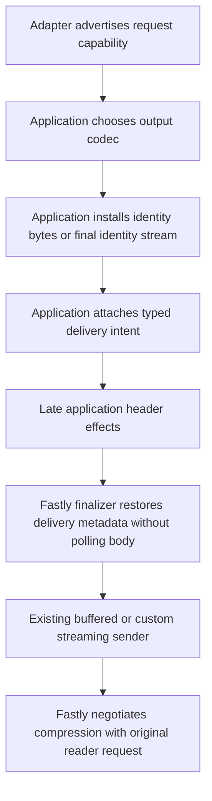

# Adapter delivery compression

## Goal and scope

[Issue #362](https://github.com/IABTechLab/edgezero/issues/362) tracks reusable
adapter delivery compression. The immediate consumer is
[Trusted Server #858](https://github.com/IABTechLab/trusted-server/issues/858)
and its draft [PR #884](https://github.com/IABTechLab/trusted-server/pull/884).
Applications should be able to select identity output before encoding and ask a
capable adapter to compress delivery. Existing unmarked responses must not change.

Baseline: EdgeZero main `87456c708ffe9edf86b3a0f8b06dfd15d60b07b5`.
Implementation steps are in the [matching plan](../plans/2026-11-02-362-delivery-compression.md).

## Ownership

EdgeZero owns the portable delivery capability and response intent, plus Fastly's
final compression headers. The application owns eligibility, response rewriting,
decoding, output-codec selection, privacy and cache policy. No SSAT, auction,
consent, template-cache, or publisher configuration enters EdgeZero.

Fastly supports dynamic gzip/Brotli compression through `X-Compress-Hint: on`.
Axum, Cloudflare, and Spin retain their current delivery behavior. Do not claim a
compatible facility exists on them without a separate implementation and proof.

## Design

### Capability before encoding

Add `edgezero_core::delivery_compression::DeliveryCompressionSupport` with
`Unavailable` as its default and `GzipBrotli` as the only supported capability.
`from_request(&Request)` reads the typed request extension, defaulting to
unavailable. This is a normal trusted adapter extension, not an authenticity token.
It describes delivery codecs, not a cache-header family or upstream-response
streaming capability. Consult it before choosing to skip the application's encoder.

Fastly's common `convert_request` inserts `GzipBrotli`, covering standard runners
and custom callers of the raw request converters. Other adapters do not insert
support, so their default remains unavailable. Do not add a new registry, macro,
configuration flag, or per-adapter application literal for this capability.

Keep reader negotiation outside this extraction. Fastly uses the original native
reader request at delivery. The application retains existing negotiation and
fallback logic; Trusted Server keeps in-guest output when negotiation fails or
selects deflate. Add no parallel `Accept-Encoding` parser or synthetic reader
headers in EdgeZero.

### Explicit identity-body intent

Define an opaque `DeliveryCompressionIntent` response extension in the same core
module. It is public for query/removal but privately constructed.
`DeliveryCompressionSupport::mark_identity_response(&mut Response)` returns
`Result<(), EdgeError>` and attaches the intent only for supported identity output.
Reject unavailable support or an existing non-identity encoding without changing
headers, body, or extensions. Accept absent encoding or a single case-insensitive
`identity` field with optional surrounding whitespace; reject coded, stacked,
repeated, or malformed fields. This prevents the concrete encoded-origin relabeling
risk, without inspecting body bytes.

Do not use a configurable or network-supplied header as the authoritative marker.
The application must install completed identity bytes or its final identity-
producing stream before marking, not mark a raw origin body awaiting a decoder.
The intent survives ordinary response-header mutations. A component that later
re-encodes or replaces body representation must first remove the intent.

The API must document that it neither decodes nor inspects body bytes and cannot
prove a stream's encoding. It must not silently opt an unavailable adapter into
offload. Unmarked responses, including already encoded bodies, remain unchanged.
Do not relabel compressed bytes as identity merely to enable the hint.

### Fastly finalization

Expose `edgezero_adapter_fastly::delivery_compression::finalize_response(&mut Response)`
in a feature-independent module using only core HTTP types. Standard
`from_core_response` calls it before consuming parts. Custom senders call the same
operation after their last header effects, before committing headers or consuming
response parts. No new universal sender abstraction is needed.

For a selected identity-body response, finalization:

- removes stale `Content-Encoding` and `Content-Length`;
- sets `X-Compress-Hint: on`;
- preserves all existing `Vary` values and adds `Accept-Encoding` only when neither
  that token nor `*` already covers it;
- leaves body bytes, status, cookies, cache directives, validators, and privacy
  policy untouched.

Finalization is idempotent and does not poll, collect, replace, or wrap the body.
It reasserts the selected identity-output contract after late effects, not a new
codec decision. Applications must not replace identity bytes with encoded bytes
while retaining that intent.

The current standard Fastly converter collects streamed core bodies before
returning a native response. Preserve that behavior rather than redesigning the
converter here. Trusted Server's custom sender must call the new finalizer
without going through that collecting path, preserving prefix-before-auction and
lazy origin consumption.

### Alternatives

- Keep all helpers application-local. Smallest immediate change, but duplicates
  platform behavior and prevents other EdgeZero consumers from sharing it.
- Add only the hint to the standard Fastly converter. Misses custom streaming
  senders and gives applications no way to choose their output codec beforehand.
- Rewrite response transport and all adapters. Unnecessary for this feature and
  increases lifecycle and compatibility risk.

The proposed capability, typed intent, and shared finalizer are the smallest split
that supports the actual consumer without moving application policy.

## Compatibility and failure behavior

This is an additive API with no manifest, route, or configuration changes. The
absence of capability/intent preserves existing behavior. Do not add body reads,
new buffering, codecs, retries, tasks, limits, or dependencies for this mechanism.
Existing conversion and body-read errors keep their current propagation.

Other adapters must not interpret the intent as proof they can compress. Their
capability remains unavailable. Consumers are responsible for checking the
capability before changing output and for marking only response families whose
encoding they own. Existing HEAD/range/error policy remains application-owned.

## Verification

Core tests cover unavailable defaults, capability reporting, intent selection/query,
rejection of unavailable and encoded/malformed marking, and zero mutation on
failure. Fastly tests cover marked identity responses and unmarked identity/encoded
responses, repeated/case-insensitive/wildcard Vary, idempotence, stale framing,
late header effects, intent removal before re-encoding, and untouched privacy.
A stream that records polls must remain unpolled after the reusable finalizer.
Exercise the real standard converter under Viceroy as well as the custom-sender
header operation. Keep current multi-value header/body conversion regressions.

Run focused tests before workspace format, tests, strict all-feature Clippy,
feature compilation, Spin WASM checks, and docs checks. The consumer integration
must pin one exact EdgeZero PR commit across all EdgeZero dependencies and prove
its actual buffered, lazy, template, and ordered-EOF paths.

Local/Viceroy checks prove guest bytes and metadata only. Actual Fastly gzip/br
negotiation, identity refusal, progressive wire delivery, transfer sizes, and vCPU
benefits need a later staging run. Do not claim those from this implementation.

## Review log

- Design investigation, independent agent using `openai-codex/gpt-6.1-sol`:
  confirmed the common Fastly conversion and custom sender boundaries. Required
  marking only after installing identity output, not on an origin body awaiting
  transformation. The consumer must carry a pending application output plan until
  its buffered/lazy/template/EOF finalizers return the actual identity response.
  The written contract was then checked against the same source with no blockers.
- Second solution/spec review, fresh `openai-codex/gpt-6.1-sol` session:
  no blocking design defects. Confirmed the smallest API needs only the support
  value, opaque intent, request lookup, checked marking, and shared finalizer.
  Ordinary response extensions already supply query/removal. Required an explicit
  pending-output plan for the consumer migration, including template encoding,
  rather than mechanically replacing its early markers.
