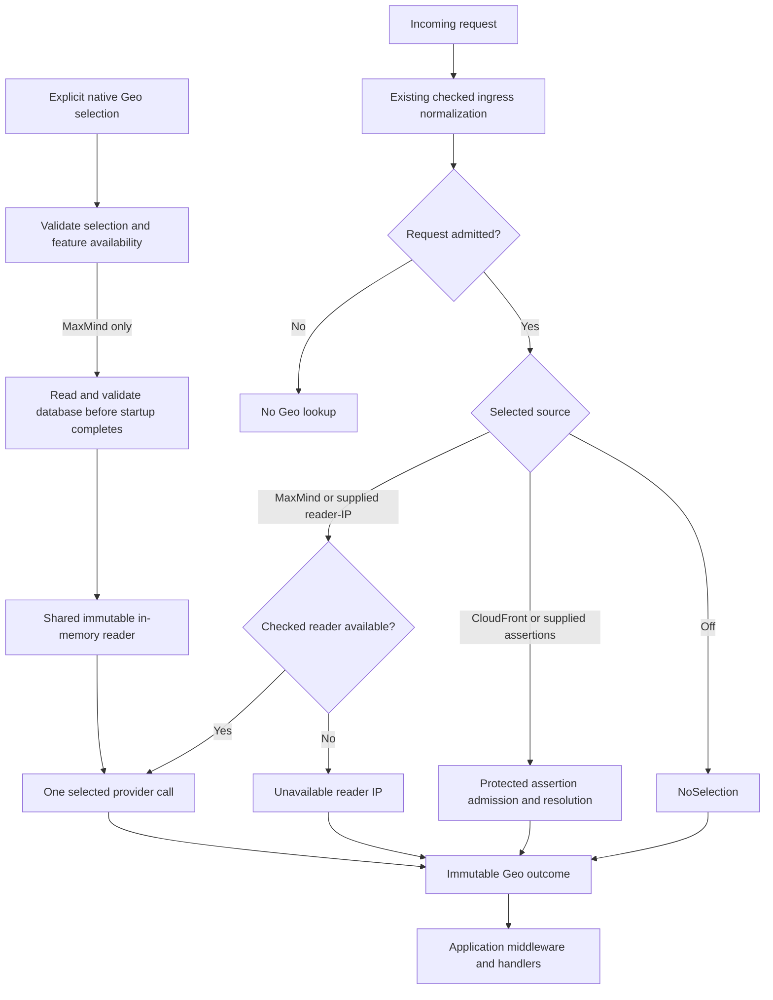

# Local GeoIP for Axum

- Status: approved for implementation by the user. Implementation and outstanding acceptance gaps are tracked in the [implementation plan](../plans/2026-11-04-axum-local-geoip.md). No production acceptance is claimed.
- Date: 2026-11-04
- Owning issue: [EdgeZero #438](https://github.com/IABTechLab/edgezero/issues/438), under [#391](https://github.com/IABTechLab/edgezero/issues/391).
- Baseline: `72ceed7e` on `feature/pluggable-geo-providers`.
- Extends: [pluggable Geo providers](2026-10-22-pluggable-geo-providers-design.md), specifically its deferred reader-IP input and database lifecycle.
- Uses: [native lifecycle ownership](2026-10-05-axum-production-startup-lifecycle-design.md), with the pre-runtime preparation limitation in section 6.

## 1. Outcome and scope

An ordinary native Axum deployment can resolve an estimated country and optional first-level subdivision from a checked reader IP, using an operator-supplied local database. CloudFront, AWS infrastructure, AWS credentials and paid data are not required.

Website consent management motivates this work. EdgeZero supplies estimates, availability and provenance. Applications own jurisdiction recognition and permission decisions. Unknown geography must not mean "no consent requirements."

Required invariants:

- Geo stays off by default. A deployment explicitly selects at most one provider.
- Local GeoIP, CloudFront and supplied providers share the existing request-outcome architecture, not each other's source-admission rules.
- A selected provider never falls back to another source.
- Database preparation succeeds before the application initializer, listener binding and readiness. Invalid selected configuration is a startup error, not Geo off.
- Request lookup uses an immutable in-memory database and checked ingress facts. No request-time filesystem access, remote lookup or background work occurs.
- The managed request owns one immutable Geo outcome, established after admission and before middleware and handlers.
- Country-only, no-match, missing-input and error outcomes remain distinguishable.

Scope includes the input contract, native provider, startup/replacement behavior, documentation and regression tests. No plugin framework, store binding, downloader, watcher, hot reload, remote lookup or consent engine is added. Trusted Server adoption remains downstream work.

## 2. Database choice and cost

### Initial supported dataset

Use MMDB binary files with the Rust `maxminddb` reader. MMDB is a file format, GeoLite is a dataset, and `maxminddb` is a separately licensed library. No database server is needed.

Support GeoLite2 City for country and first-level subdivision estimates, and GeoLite2 Country for country-only estimates. Both are free of charge. Consume only geographic codes, not city names, postal codes or coordinates.

No paid license, subscription or paid upgrade is required. Operators downloading GeoLite data need a free MaxMind account and download license key. Download credentials stay in the operator's distribution process; the running application needs neither credentials nor an external lookup account.

Document GeoLite's EULA, attribution, redistribution and update/deletion obligations separately from the reader's ISC license. The EULA reviewed on 2026-11-04 requires ceasing use of and destroying old data within 30 days of a new release, including running snapshots and rollback copies. Recheck terms before publishing instructions.

MaxMind does not recommend GeoLite City for commercial use cases because of accuracy limitations, not a blanket commercial-use prohibition. Applications must evaluate state-level suitability against representative traffic.

### Alternatives and schema boundary

DB-IP City Lite is a free, monthly MMDB alternative under CC BY 4.0. It needs separate code-mapping/schema evaluation before support; MMDB format compatibility is insufficient. Other formats, including IP2Location BIN, also need separate integrations. Neither is included here.

Accept metadata `database_type` values `GeoLite2-City` and `GeoLite2-Country`, with `ip_version` 4 or 6. Reject other types regardless of filename. Metadata identifies the expected schema, not publisher authenticity. Use synthetic or upstream-derived fixtures matching these types, with provenance and redistribution terms; never bundle production GeoLite data.

## 3. Ownership and flow

| Concern                                                                        | Owner                           |
| ------------------------------------------------------------------------------ | ------------------------------- |
| Socket peer, trusted proxy configuration, forwarding parsing and normalization | Existing native checked ingress |
| Source-specific Geo inputs, selection and outcome provenance                   | Native Geo composition          |
| Read-only snapshot loading, schema validation and bounded lookup               | Local GeoIP implementation      |
| Portable values, outcome types and `RequestContext::geo()`                     | Core                            |
| Downloading, licensing, attribution, distribution, freshness and replacement   | Deployment operator             |
| Jurisdiction recognition, consent, permission and response disclosure          | Application                     |

## 4. Checked reader-IP contract

Reuse `CheckedProxyMetadata` from `proxy.rs`. Do not add a forwarding parser, interpret raw forwarding headers in a provider, or obtain trusted input by reading caller-mutable request extensions.

Capture the needed Geo input from the runner-owned checked result before moving that result into public ingress metadata. Resolve only after application ingress admission succeeds. Refused, aborted or draining requests invoke no provider.

### Direct and proxied deployments

Selection explicitly chooses `PeerAllowed` or `ForwardedRequired`, an input expectation rather than a forwarding policy. `PeerAllowed` declares that the socket peer is a usable reader if forwarding does not resolve one. Reverse proxies use `ForwardedRequired` to avoid geolocating the proxy.

| Checked ingress facts                                                           | `PeerAllowed`                          | `ForwardedRequired`                    |
| ------------------------------------------------------------------------------- | -------------------------------------- | -------------------------------------- |
| Client source is trusted `Forwarded` or `X-Forwarded`, with an effective client | Use that checked client and its source | Use that checked client and its source |
| Client source is direct, with an actual peer                                    | Use the normalized peer                | Unavailable reader IP                  |
| No actual peer or no usable checked address                                     | Unavailable reader IP                  | Unavailable reader IP                  |

Unavailable input invokes no provider. Checked ingress initializes `effective_client()` from the peer, so address presence alone cannot prove reader resolution. Use `client_source()`, not an aggregate forwarding-success flag. A partial result that resolved the client remains usable even if host or scheme was absent.

Local GeoIP never uses geographic headers. Existing ingress rules alone decide which forwarding assertions are trusted. It does not require `ProtectedCloudFrontAlb`, origin credentials or CloudFront headers.

Retain existing normalization, including IPv4-mapped IPv6. Do not substitute addresses or invent private-address jurisdictions. Missing records remain no match.

### Portable provider input

Extend `GeoInput` to a typed input enum with two cases, using final names selected during implementation:

- Geographic assertions: the existing bounded country and subdivision slots, with their absent/value/invalid states unchanged.
- Reader IP: a typed `IpAddr` plus portable source provenance identifying direct peer, trusted `Forwarded`, or trusted `X-Forwarded` resolution.

Missing/inadmissible readers produce a framework-owned unavailable outcome, never a fabricated address. Input carries no request, arbitrary headers, cookies, consent signals, service handles or filesystem access. The adapter owns admission and output provenance.

Keep `GeoProvider::resolve` synchronous, bounded and local-only, returning an owned `GeoResolution`. Native ownership adds `Send + Sync`; the portable trait retains its existing bounds. An input case unsupported by a provider returns `Error(ProviderFailure)` without retrying another case. Supplied Rust remains trusted application code, not sandboxed code.

`GeoInput` changes, public enum additions and a reserved provider ID break external consumers, including exhaustive matches. Inventory consumers, migrate repository code/examples together, and document release/migration handling.

## 5. Selection, capability and extensibility

Extend `NativeGeoSelection` with a local MaxMind selection containing the database path, preparation limits and reader expectation. Use the default-off native feature `geo-maxmind`. The selector and its configuration types remain available without the feature; selecting an unavailable implementation returns a bounded startup error.

Keep programmatic selection through `AxumRunOptions`. There are no new CLI, environment or manifest selectors, automatic path discovery, or ambient dataset choices. Repeated `with_geo` calls continue to replace the entire selection.

Preserve CloudFront and supplied-assertion composition with its protected-source policy. Add application-constructed supplied reader-IP composition using the same checked-IP admission contract as MaxMind. It must work with only `axum`, without built-in Geo features. Selection declares the input contract; do not infer it from provider IDs or probe different inputs.

Reserve provider ID `maxmind` alongside `cloudfront` in public ID construction and native supplied-provider validation. Located MaxMind results identify a local database; supplied reader-IP results identify checked-IP input without claiming a database implementation. Both retain direct, trusted `Forwarded` or trusted `X-Forwarded` provenance, never the address.

`geo_capability()` reports provider identity, input contract and configured reader expectation. It validates configuration without file I/O or preparation, and cannot report eventual request provenance. Split the current `native_geo()` validation/construction path accordingly. Loaded metadata belongs to the prepared provider, outside `PreparedStores` and portable registries.

## 6. Preparation, resource ownership and replacement

### Preparation boundary

Prepare the database once per runner invocation at the existing native Geo construction boundary, before serving resources and application initialization. Keep pure selection validation separate. CloudFront requires no preparation.

1. Validate selection, feature availability and finite preparation limits before reading the file.
2. Open the operator-supplied local regular file read-only. Bound the actual read, not merely a prior metadata size check; reject pipes and devices without waiting for their contents. Do not create files or discover a different path.
3. Build an owned in-memory reader from those bytes, without mmap or `unsafe-str-decode`.
4. Validate metadata, structure and all reachable records, including off-path corruption. Check consumed country/subdivision field shapes; allow optional and unrelated fields. Reader construction alone is insufficient. Reuse its verifier and iteration APIs, not another MMDB parser.
5. Record dataset type, build timestamp and a SHA-256 checksum of the loaded bytes. These identify the snapshot, not its accuracy or authenticity.
6. Share the prepared immutable reader across requests through native ownership. Return a bounded error on failure before the initializer, bind or readiness.

Structural corruption and incompatible field types fail startup. Geographic code validation remains request-time behavior from section 7. For example, a structurally valid record containing `XK` must not prevent the entire database from loading; a lookup of that record returns `InvalidAssertion`.

Document the file-byte bound and traversal/allocation bounds for validation and lookup. Select concrete limits from the pinned reader's guarantees and representative supported files, and record their rationale in the implementation plan. Exceeding a limit fails preparation, never truncates the file or skips validation.

Preparation is synchronous and pre-runtime, before signal registration and embedding-stop polling. The runner's cooperative startup-cancellation contract does not cover this phase; an early process signal follows the caller/OS signal disposition. Byte/work limits cannot bound filesystem I/O time. Add no detached task or cosmetic async timeout. Measure preparation time and peak memory on representative data and document this exception.

### Lifetime and replacement

The runner owns the reader; request/connection clones share it until teardown. Preparation failures drop partial state without creating files or requiring recovery. Startup retries repeat a read-only operation.

Operators publish a complete replacement, update the file reference/mount and restart. Never rewrite a file in place during preparation. Active processes retain their snapshot after source changes/deletion. New processes validate the replacement before readiness; invalid replacements fail startup without substituting an older file.

No update loop, live swap, update lock, persistence or database-specific shutdown hook is added. Operators may roll back only to data still permitted by its terms.

## 7. Lookup and outcome semantics

Extend resolution with an explicit no-match result and framework status with missing-reader-IP and no-match reasons. These must not collapse into CloudFront's missing-assertion outcome. Preserve selected provider identity in every selected outcome.

| Situation                                                                            | Outcome                                          |
| ------------------------------------------------------------------------------------ | ------------------------------------------------ |
| Geo off                                                                              | Existing `NoSelection`                           |
| Selected input expectation cannot admit a reader IP                                  | Unavailable reader IP, no provider call          |
| No record, no geographic codes, or IPv6 lookup against an IPv4-only database         | Unavailable no match                             |
| Valid country with no subdivision                                                    | Located, country-only                            |
| Valid country and first-level subdivision                                            | Located, country and subdivision assertion       |
| Syntax-valid but application-unrecognized subdivision                                | Located; application recognition remains unknown |
| Malformed/unsupported country, malformed subdivision, or subdivision without country | Error, invalid geographic assertion              |
| Unexpected decode/reader failure after successful preparation                        | Error, provider failure                          |
| CloudFront source not admitted or assertions absent/invalid                          | Existing CloudFront outcomes unchanged           |

Read `country.iso_code`, never registered/represented country as substitutes. For City records, use only `subdivisions[0].iso_code`; the schema orders entries largest to smallest. A missing/empty array or missing first-entry code means unknown subdivision, even if later entries have codes. Never promote a later district or infer codes from names. Country records are country-only. Decode only the geographic projection; structural verification may inspect unrelated fields.

Use existing `CountryCode`, `SubdivisionCode` and `GeoLocation` validation. Preserve leading zeroes and normalize code case. Absent code fields are unknown; present empty or malformed strings are invalid. Unsupported country codes, including `XK`, remain errors without alias substitution. Never discard an invalid subdivision into country-only success. A record with neither selected code is no match; subdivision without country is an error.

Provenance describes an estimate, not authenticated residence. Outcomes retain no IP, raw record or vendor error chain. Never resolve again during finalization. Unmanaged conversion and non-Axum adapters retain `NoSelection`.

## 8. Deployment and privacy guidance

Provide generic Axum examples with a read-only GeoLite City mount, explicit Rust selection and no stores/AWS/CloudFront dependencies. Cover direct `PeerAllowed` and reverse-proxy `ForwardedRequired` deployments using existing proxy trust. Explain that VPNs and intermediaries can make estimates unsuitable for jurisdiction decisions.

Document external download, artifact verification, complete publication and restart. Record dataset version/build timestamp, checksum, source and terms. Keep download keys out of options, logs and images. Startup requires no writable config/data root or sidecar files.

After logging initialization, emit a bounded native startup record with the loaded type, build timestamp and checksum. Earlier preparation failures return source-free error categories. New errors and input/selection `Debug` output redact IPs and paths. Expose no raw records, download keys, vendor error chains, diagnostic endpoint or automatic response header.

Freshness remains the operator's obligation. Neither parsing nor file modification time proves it. No age threshold changes permission behavior or selects another source. Include attribution and update/deletion duties in the deployment checklist.

Applications must preserve uncertainty, prevent cross-visitor shared caching of permission-sensitive responses and retain existing fail-closed behavior. Cache configuration, consent-cookie interpretation and real consent-policy tests remain downstream work.

## 9. Acceptance and delivery checkpoints

The input/lifecycle contract is reviewed before implementation. Deliver the following independently checkable units, reusing passing results while their inputs remain unchanged:

| Unit                         | Required proof                                                                                                                                                                                                                                                |
| ---------------------------- | ------------------------------------------------------------------------------------------------------------------------------------------------------------------------------------------------------------------------------------------------------------- |
| Portable contract            | Typed inputs, no-match/missing-reader outcomes, assertion validation, wrong-input behavior, reserved IDs and consumer migration compile and test                                                                                                              |
| Checked-IP admission         | Both reader modes with IPv4/IPv6, mapped addresses, both trusted forwarding families, partial client resolution, absent/malformed/unresolved chains, untrusted/missing peer and forged headers/extensions                                                     |
| Local reader                 | City/Country fixtures cover numeric and unknown subdivisions, missing first-entry code with a later code, absent/empty/invalid codes, unsupported country codes, no match and IPv6 against IPv4-only data                                                     |
| Startup preparation          | Missing/unreadable/empty/truncated/oversized files, nonregular sources, unsupported metadata/schema, validation budget exhaustion and off-path corruption fail before initializer, bind and readiness; unsupported code strings alone do not fail preparation |
| Feature isolation            | Test `axum` alone, each built-in separately and both together; unavailable selection fails startup, supplied reader-IP works without built-ins, off and CloudFront behavior stay unchanged                                                                    |
| Real Axum hosting            | One provider call per admitted request with admissible selected input, including no-match results; zero for off/inadmissible-input/refused/aborted/draining paths; immutable outcomes across preparers/middleware/handlers; no finalization lookup            |
| Read-only lifetime           | Read-only file/mount starts without sidecar writes; changing/removing the source does not change active results; restart loads a valid new snapshot and rejects an invalid replacement                                                                        |
| Boundaries and lifecycle     | Native startup/shutdown and WASM dependency regressions pass; after preparation, an already-requested embedding stop exits without initializer/bind/readiness; reader/filesystem dependencies stay native and default-off                                     |
| Documentation and operations | Public Rust examples compile; mount/update/attribution instructions name supported schemas and terms; representative preparation time/memory and remaining accuracy gaps are recorded                                                                         |

Exercise startup failures through the real runner. Remove the loaded source and issue more requests to prove file independence. Assert loaded diagnostic values and redaction. Repeated capability inspection must perform no file I/O, even with a missing path.

Extend `scripts/check_geo_dependency_contract.sh` and the existing CI feature matrix. Use focused tests, then native integration, formatting, lint, docs and affected adapter checks at the stable checkpoint. Report runtime evidence separately from compilation.

Before implementation, the implementation plan must settle the remaining decisions:

- Pin the reader version and confirm its verifier/decoder work bounds. Version 0.32.0 was inspected for this review; dependency compilation and representative-dataset measurements are not yet done.
- Set preparation limits and confirm the pre-runtime stop-observation exception is acceptable.
- Finalize Rust input/provenance/capability shapes and record the public API migration/release handling.

These are explicit implementation gates, not claims of completed validation. DB-IP support and downstream consent-policy tests remain separate.

## 10. Sources

Database format and reader behavior are distinct from dataset licensing and accuracy. Recheck these sources when pinning implementation dependencies and publishing operator guidance:

- [Rust `maxminddb` 0.32.0 reader](https://docs.rs/maxminddb/0.32.0/maxminddb/struct.Reader.html): owned in-memory construction, lookup, iteration and validation APIs; reader library uses the ISC license.
- [MaxMind City/Country database documentation](https://dev.maxmind.com/geoip/docs/databases/city-and-country/) and [City binary fields](https://dev.maxmind.com/geoip/docs/databases/city-and-country/city-binary/): code semantics, optional fields and subdivision ordering.
- [GeoLite integration and obligations](https://dev.maxmind.com/geoip/geolite2-free-geolocation-data/): free datasets, account/download keys, accuracy guidance and update/deletion obligations.
- [GeoLite EULA](https://www.maxmind.com/en/geolite/eula) and [external use/attribution guidance](https://support.maxmind.com/knowledge-base/articles/sell-or-display-data-from-geolite-databases-and-web-services): dataset terms, reviewed 2026-11-04 and to be rechecked before distribution.
- [MaxMind database updates](https://dev.maxmind.com/geoip/updating-databases/): operator-owned update process.
- [DB-IP Lite](https://db-ip.com/db/lite.php): alternative MMDB datasets, CC BY 4.0 attribution and monthly releases.
