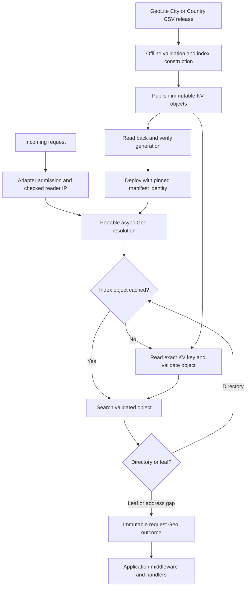

# Portable KV-backed Geo

- Status: draft for review. The format prototype is measured; production Geo integration and remote KV behavior are not implemented or verified.
- Date: 2026-11-05.
- Base: `72ceed7e2a802cfa536851dd20c95ca55ebea4fc`, the shared base of this branch and `feature/axum-local-geoip` before its MMDB implementation.
- Related work: [pluggable Geo providers](2026-10-22-pluggable-geo-providers-design.md), issues [#432](https://github.com/IABTechLab/edgezero/issues/432) and [#438](https://github.com/IABTechLab/edgezero/issues/438).

## 1. Outcome and decisions

Consumers can resolve an admitted reader IP to an estimated country and optional first-level subdivision without platform-provided geography, a runtime filesystem, or loading the entire dataset into memory. They supply a populated KV store through EdgeZero's existing store abstractions.

Use GeoLite CSV as the initial import format. Transform it outside the serving runtime into an immutable, versioned IP index. Resolve requests asynchronously through `KvHandle`, with optional bounded in-memory caching. Geography remains an estimate; applications own jurisdiction recognition and policy.

KV is the portable serving dependency, not a claim of better lookup performance than MMDB. Remote KV adds read cost, latency and failure modes. The first implementation must measure these costs before making production performance claims.

Required invariants:

- A deployment explicitly selects zero or one Geo provider. There is no automatic source selection or fallback.
- One immutable Geo outcome is resolved after ingress admission and before application middleware and handlers.
- The adapter owns reader-IP trust. The resolver receives a typed, admitted IP rather than parsing request headers.
- Request lookup uses exact-key reads, never key listing, full-dataset loading or per-prefix probing.
- Every request uses one pinned dataset generation, including cache hits and misses.
- Missing or corrupt required index data is a provider failure, not an unmatched address.
- Runtime Geo resolution requires no filesystem, local sidecar, MaxMind credentials or downloader.
- Portable code gains no native SDK, Tokio dependency, mandatory `Send` future or platform-specific timer.

CloudFront assertions remain an optional selected provider. This work does not depend on the sibling MMDB implementation and does not remove it from that branch.

## 2. Ownership and flow

| Concern | Owner |
| --- | --- |
| Dataset acquisition, download integrity and licensing | Operator's update process |
| CSV validation, geographic projection and index construction | Offline importer |
| KV resource creation, credentials and backend bindings | Existing platform tooling and operator |
| Index lookup and decoding | Portable KV Geo implementation |
| Socket/platform client identity and forwarding trust | Adapter ingress |
| Per-request outcome and geographic value types | Portable Geo contract |
| Jurisdiction, consent, permissions and response caching | Application |



## 3. Import contract

Initially support GeoLite2 City and Country CSV releases. City is needed for subdivisions. For City, consume these files from the same archive:

```text
GeoLite2-City-Blocks-IPv4.csv
GeoLite2-City-Blocks-IPv6.csv
GeoLite2-City-Locations-en.csv
```

Country uses the corresponding Country filenames and produces country-only locations. Read columns by header name so unrelated added columns do not change the projection.

Join block `geoname_id` to location `geoname_id`. Keep `country_iso_code` and, for City, `subdivision_1_iso_code`. Do not substitute `registered_country_geoname_id` or `represented_country_geoname_id`; those identify different geographic facts. Names, coordinates, postal codes and network registration metadata are not needed in the serving index.

Validate address-family membership, CIDRs, duplicate location identities, referenced locations and consumed geographic codes. A populated reference with no matching location is an import error. An absent geolocation reference or location without country yields no geographic coverage, not a guessed country. A subdivision without country is invalid. Country-only locations remain partial; subdivision validation checks syntax, not worldwide assignment or application recognition.

Convert networks into sorted numeric intervals, separately for IPv4 and IPv6. Reject conflicting or overlapping source intervals rather than inventing precedence. Adjacent intervals with identical projected locations may be merged. Preserve gaps. Use overflow-safe address arithmetic, including the last address in each family.

The importer emits deterministic objects, their keys and digests, and a publication inventory. Metadata records the dataset edition, source release identifier, source file digests, index schema version and importer version. Repeated import with the same source and format settings produces the same object bytes.

The importer may use a filesystem and native tools. Those requirements belong to the publishing environment, not deployed applications. MaxMind authentication stays outside the serving runtime.

## 4. KV index

### Object layout

Use a versioned tree of directory objects and leaf objects, separately addressable through exact KV keys. A small manifest identifies both family roots and the schema. Empty families are explicit.

Conceptual keys:

```text
geo/v1/<generation>/manifest
geo/v1/<generation>/v4/directory/<id>
geo/v1/<generation>/v4/leaf/<id>
geo/v1/<generation>/v6/directory/<id>
geo/v1/<generation>/v6/leaf/<id>
```

A leaf contains sorted, disjoint inclusive intervals and their country and optional subdivision. A directory contains sorted, disjoint child envelopes, exact child keys and expected content digests. Envelopes include any internal gaps; the selected leaf confirms actual coverage. A directory gap proves no coverage without another read.

Build leaves by encoded byte size, then build directories over contiguous groups until each family has one root. Additional directory levels allow the directory itself to exceed one KV value without requiring a whole-directory preload. Lookup chooses at most one child at each level by binary search. It never probes multiple prefixes or scans neighboring leaves.

Use a versioned binary encoding with explicit record counts, address-family widths and network-byte-order addresses. Locations are stored with the intervals, avoiding a second location-record read. The exact byte schema, directory fanout and default object size must be recorded after the prototype; this draft does not claim they are settled.

### Limits and validation

All accesses go through `KvHandle`. Build to an explicit target backend value budget, including serialization overhead. The portable 25 MiB ceiling is not a promise every backend accepts that size. For example, the current native DynamoDB adapter caps values at 384 KiB and permits operators to lower that cap.

The reader validates schema, digest, encoded lengths, counts, ordering, interval bounds, child bounds and geographic values before using an object. Child keys must remain within the selected generation and address family, and children must fit the parent's declared envelope. Expected digests bind decoded descendants to the selected manifest. Hashes identify bytes, not publisher authenticity.

The implementation must specify per-object bytes, traversal work and memory budgets. Derive defaults from the supported backend limits and measured index shape, rather than inventing an arbitrary fixed tree depth. Reject an incompatible dataset explicitly; never skip validation or truncate data to fit.

## 5. Async resolution and request lifecycle

The base's `GeoProvider` is synchronous and assertion-only. KV resolution requires a new async execution boundary and a typed reader-IP input; it cannot be implemented by blocking on KV inside that existing trait.

Retain the public synchronous supplied-provider contract for existing consumers. Add an object-safe asynchronous provider contract using the repository's non-`Send` future convention. Existing synchronous providers are wrapped at composition and return immediately. Native hosting retains the object ownership bounds it needs. The new provider owns its configured `KvHandle`; request input does not expose the request or a service registry.

Give the new async contract discriminated assertion and reader-IP inputs, with source admission owned by adapters. Preserve the existing synchronous `GeoInput` assertion struct; the composition wrapper converts only the assertion variant into it. Add `NoMatch` and `MissingReaderIp` outcomes and reader-IP provenance. Existing country/subdivision value types and `RequestContext::geo()` remain the consumer interface. New public variants need release notes and exhaustive-match migration examples.

Managed request sequence:

1. Perform existing ingress validation, forwarding normalization and admission. Rejected or aborted ingress makes no Geo lookup.
2. Establish the selected input contract from adapter-private facts. Missing usable reader input produces `MissingReaderIp` without provider calls.
3. Await the selected provider once, with the request's remaining execution/cancellation budget. Traverse index objects and return one resolution.
4. Attach an owned immutable outcome before request preparers, application middleware and handlers. Response finalization never resolves again.

A logical provider invocation can perform multiple KV reads. Without cache hits, read count is manifest acquisition plus one read per directory level and one leaf. The manifest may be retained for the configured instance lifetime. Concurrent cold requests may perform duplicate reads without changing correctness; request coalescing is not a first-version requirement.

Geo code adds no retry loop. Backend retry and timeout behavior must be documented separately. Adapter integration supplies runtime-specific deadline/cancellation mechanics; portable lookup does not acquire a timer dependency. Cancellation releases request ownership without detached lookup work. A dropped future does not promise the underlying platform has aborted its physical I/O.

| Condition | Outcome |
| --- | --- |
| Geo not selected | `NoSelection` |
| Selected, no admitted usable reader IP | `MissingReaderIp` |
| Validated directory or leaf proves address gap | `NoMatch` |
| Matched country, absent subdivision | Located, country only |
| Matched country and subdivision | Located, estimated subdivision |
| Expected object absent, invalid, unsupported or digest mismatch | Provider failure |
| KV error or Geo lookup deadline exhausted | Provider failure |

Provider failure does not choose CloudFront, another dataset, or an older cache generation. Outcomes do not automatically choose HTTP status or permission policy.

## 6. Configuration and adapter portability

Configuration selects a logical KV store ID, dataset generation, expected manifest digest and reader-IP expectation. Resolve the logical ID through existing bindings; the Geo selection contains no physical table name, namespace credentials or filesystem path. Fail configuration if the ID is undeclared, the selection is unsupported, or the configured backend cannot serve the dataset's object budget.

Use an explicit portable Geo selection that every managed adapter can consume. The exact Rust and manifest spelling remains a review decision. Selecting Geo must not silently create a new default store or reuse an application's default store by accident.

Native hosting prepares the manifest after KV handles are ready and before readiness. Request-scoped edge runtimes may acquire it during request initialization and optionally retain it in runtime-supported memory. They do not need a process-wide startup phase or full-data validation on every invocation. Unsupported schemas or missing manifests fail initialization; missing descendants remain request-time provider failures.

Every adapter must establish an admitted client IP independently of geographic metadata:

| Adapter | Required integration |
| --- | --- |
| Axum | Reuse checked peer and trusted-forwarding normalization; support direct-peer or forwarded-required expectation. |
| Fastly | Use platform client-address facts with documented provenance. |
| Cloudflare | Use the platform's documented client-address mechanism and prove its replacement/trust contract, rather than accepting an arbitrary copied header. |
| Spin | Use a verified runtime client-address mechanism or an explicit trusted-ingress integration; return missing input if neither is available. |

These are acceptance requirements, not assertions that the base already implements them. Preserve existing mapped-IPv4 normalization. Never geolocate a reverse proxy merely because its socket peer is available under a forwarded-required selection.

KV makes lookup portable, but does not create trustworthy reader identity. A runtime with KV but no trustworthy client address cannot produce reader-IP geography. Report that limitation explicitly rather than weakening admission.

## 7. Cache behavior

Caching is optional and bounded by bytes. Cache validated immutable objects using store identity, dataset generation and object digest. Eviction only causes another KV read. Fresh workers and caches disabled entirely must produce the same outcomes as warm workers.

Use in-memory caching where the runtime permits it, without requiring cross-request or cross-instance persistence. Do not cache reader IPs or add an IP-to-location cache. A missing expected object is a publication/storage failure, not a negative geolocation cache entry.

Retiring a dataset includes stopping or reconfiguring instances that retain its objects in memory. A version pin prevents accidental mixing; it does not establish freshness or permission to keep using old data.

## 8. Publication and lifecycle

A complete offline build precedes publication. One publishing operation owns a generation; concurrent publishers use separate generation targets. Upload objects under their immutable keys, read them back and verify their expected bytes or digests, then publish the manifest last. A retry of the same build writes the same bytes. Never overwrite a published generation with different data.

The portable KV API has no compare-and-swap or multi-key transaction. Immutable publication is therefore an operator/tooling ownership rule, not a storage-enforced lock. Deployment configuration pins the manifest digest. There is no mutable `active` pointer in the first version.

A manifest written last is not a global readiness barrier on eventually consistent KV. Validate propagation through the selected provider's supported mechanisms before rollout. A successful uploader-region read-back does not prove all serving locations can read every descendant. If an object is temporarily unavailable, readers return provider failure without switching generations. Document the backend-specific rollout check and residual uncertainty.

A stopped upload leaves an unselected partial generation. Re-running the same inventory converges; cleanup of abandoned generations uses the retained inventory outside request handling. Retire selected generations only after readers stop referencing them, subject to the dataset's mandatory update and deletion terms. Do not rely on KV TTL as proof of immediate deletion.

The publishing workflow needs two outputs: an artifact containing the exact key/value inventory, and a way to upload and verify it for the selected backend. Runtime `KvHandle` portability does not imply a workstation can instantiate every edge SDK's store binding. Reuse existing provider tooling where available; otherwise add an explicit uploader or document an operator-supported upload workflow. CLI syntax and initial backend uploader coverage must be agreed before implementation is considered end-to-end complete.

Keep dataset acquisition and MaxMind credentials outside these runtime APIs. Attribution and redistribution/deletion obligations apply to the derived KV index, retained export artifacts, caches and backups as well as the original CSV archive.

## 9. Diagnostics

Expose bounded categories for configuration, initialization and lookup failures. Record schema and loaded dataset identity in startup/initialization diagnostics, not per-IP labels. Useful metrics include lookup latency, KV reads, cache hits, bytes decoded and outcome category.

Do not retain reader IPs, raw forwarding headers, credentials or raw KV errors in Geo outcomes or default diagnostics. KV keys and values need the existing storage logging discipline; index keys encode dataset structure, not individual request addresses. Dependency logging is a separate operator concern.

## 10. Acceptance and delivery

Deliver in checkable units:

1. **Format prototype.** Build synthetic City/Country fixtures and a real permitted GeoLite release. Record encoded size, object count, depth, cold-read count, import cost and maximum decoded-object memory. Freeze schema and defaults only after these measurements.
2. **Importer and lookup.** Prove deterministic bytes and compare index results with an independent direct CSV-range lookup, including generated/random addresses, family boundaries, gaps, country-only records and subdivisions. Reject malformed references, overlaps and corrupt objects. Exercise actual `KvHandle` reads with caching off and on.
3. **Async contract and native integration.** Preserve existing CloudFront/supplied-provider behavior. Test checked-reader input, source rejection, request admission, deadlines, cancellation and immutable outcomes through managed Axum dispatch. No detached work, blocking KV bridge or response-finalization lookup.
4. **Edge adapter integration.** Run managed request tests for Fastly, Cloudflare and Spin, including forged address inputs and runtimes without usable reader facts. Compile all WASM targets without native dependency leakage. Generic data access alone is not adapter acceptance.
5. **Publication and deployed checks.** Exercise interrupted uploads, identical re-publication, read-back mismatch, incomplete visibility, pinned versions, missing descendants and retirement. Verify real provider upload/binding/read paths separately from mocks, with operator authorization for live resources.

Performance acceptance must include cold and warm lookup latency, reads and bytes per request, memory, and KV cost at the intended traffic level. Test representative native remote KV and edge KV. The current DynamoDB binding uses one partition key per namespace, so workload capacity and hot-partition behavior need explicit evaluation; index sharding alone does not change that physical partitioning.

The spec is ready for implementation planning when the byte format/object budgets, configuration spelling, reader-IP support matrix, publishing coverage and acceptable lookup budgets have been reviewed. Until then it is a design draft, not a production-readiness claim.

## 11. Prototype findings

The [standalone prototype](../../../examples/geo-kv-prototype/README.md) and [measurement record](../plans/2026-11-05-kv-geo-prototype-results.md) exercise the downloaded City CSV through `KvHandle` using a local artifact-store harness. A 64 KiB object budget produced about 40.3 MiB across 649 objects, with at most two object reads per lookup after manifest acquisition. This is not deployed-provider performance evidence or a frozen wire format.

One production decision is now concrete: the CSV contains `XK`, which core rejects. The format experiment preserves it in a source DTO and reports the mismatch without changing core policy. Resolve how a complete dataset containing unsupported source codes maps into Geo outcomes before implementing the import validation policy in section 3. It must not silently become an address gap or an accepted core country.

## 12. Scope boundaries and references

Included: City/Country CSV import, versioned KV index, portable async lookup, optional object caching, explicit selection, checked reader inputs, adapter integration, publication/retirement contract and focused proofs.

Deferred: remote geolocation APIs, automatic source fallback, automatic download/update scheduling, live version switching, richer city/coordinate output, jurisdiction catalogues, permission policy and mandatory MMDB support. Application response-cache variation remains an application responsibility.

- [GeoLite formats and account requirements](https://dev.maxmind.com/geoip/geolite2-free-geolocation-data/).
- [CSV fields and join semantics](https://dev.maxmind.com/geoip/docs/databases/city-and-country/).
- [Account downloads](https://www.maxmind.com/en/accounts/current/geoip/downloads), choose City CSV for subdivisions.
- [Dummy City CSV sample](https://dev.maxmind.com/examples/GeoIP2-City-CSV_Example.zip).
- [KV interface and provider consistency](../../guide/kv.md).
- [Native DynamoDB limits and semantics](../../guide/dynamodb-kv.md).
- [Native startup lifecycle](2026-10-05-axum-production-startup-lifecycle-design.md).
