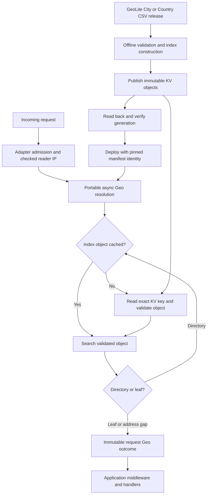

# Portable KV-backed Geo

- Status: design for [#454](https://github.com/IABTechLab/edgezero/pull/454). The prototype is measured; managed serving and backend proofs are not implemented or verified.
- Drafted: 2026-11-05. Revised: 2026-11-17.
- Dependencies: [native Geo providers (#439)](https://github.com/IABTechLab/edgezero/pull/439) and [Axum Geo manifest/settings selection (#502)](https://github.com/IABTechLab/edgezero/pull/502). Reconcile the shared settings and outcome changes before adding KV selection.
- Merge gate: reviewers must agree that the KV checks in [§10](#10-acceptance-and-delivery) replace the MMDB-specific requirements in [#438](https://github.com/IABTechLab/edgezero/issues/438) before claiming closure.

## 1. Outcome and decisions

Consumers can resolve an admitted reader IP to an estimated country and optional first-level subdivision without platform-provided geography, a runtime filesystem, or loading the entire dataset into memory. They supply a populated KV store through EdgeZero's existing store abstractions.

Use GeoLite CSV as the initial import format. Transform it outside the serving runtime into an immutable, versioned IP index. Resolve requests asynchronously through `KvHandle`, with optional bounded in-memory caching. Geography remains an estimate; applications own jurisdiction recognition and policy.

#454 ships opt-in managed Axum serving with a portable `KvHandle` reader. Stock celld with the EdgeZero store service and DynamoDB Local are the first end-to-end proof backends, not dependencies of Geo. Publish the same artifact to both. A compatible binding must support exact-key byte reads, fit the artifact's key and value limits, and make the pinned generation visible to readers before rollout. This design makes no performance claim over MMDB.

Required invariants:

- A deployment explicitly selects zero or one Geo provider. There is no automatic source selection or fallback.
- One immutable Geo outcome is resolved after ingress admission and before application middleware and handlers.
- The adapter owns reader-IP trust. The resolver receives a typed, admitted IP rather than parsing request headers.
- Request lookup uses exact-key reads, never key listing, full-dataset loading or per-prefix probing.
- Every request uses one pinned dataset generation, including cache hits and misses.
- Missing or corrupt required index data is a provider failure, not an unmatched address.
- Runtime Geo resolution requires no filesystem, local sidecar, MaxMind credentials or downloader.
- Portable code gains no native SDK, Tokio dependency, mandatory `Send` future or platform-specific timer.

Preserve protected CloudFront and supplied providers. Fastly, Cloudflare, and Spin keep their existing Geo behavior; their managed KV Geo integration is separate work. Trusted Server wiring and deployment are also separate.

## 2. Ownership and flow

| Concern                                                      | Owner                                  |
| ------------------------------------------------------------ | -------------------------------------- |
| Dataset acquisition, download integrity and licensing        | Operator's update process              |
| CSV validation, geographic projection and index construction | Offline importer                       |
| KV resource creation, credentials and backend bindings       | Existing platform tooling and operator |
| Index lookup and decoding                                    | Portable KV Geo implementation         |
| Socket/platform client identity and forwarding trust         | Adapter ingress                        |
| Per-request outcome and geographic value types               | Portable Geo contract                  |
| Jurisdiction, consent, permissions and response caching      | Application                            |



## 3. Import contract

Initially support GeoLite2 City and Country CSV releases. City is needed for subdivisions. For City, consume these files from the same archive:

```text
GeoLite2-City-Blocks-IPv4.csv
GeoLite2-City-Blocks-IPv6.csv
GeoLite2-City-Locations-en.csv
```

Country uses the corresponding Country filenames and produces country-only locations. Read columns by header name so unrelated added columns do not change the projection.

Join block `geoname_id` to location `geoname_id`. Keep `country_iso_code` and, for City, `subdivision_1_iso_code`. Do not substitute `registered_country_geoname_id` or `represented_country_geoname_id`; those identify different geographic facts. Names, coordinates, postal codes and network registration metadata are not needed in the serving index.

Validate address-family membership, CIDRs, duplicate location identities, referenced locations and geographic code syntax. A populated reference with no matching location is an import error. An absent geolocation reference or location without country yields no geographic coverage, not a guessed country. A subdivision without country is invalid. Country-only locations remain partial; subdivision validation checks syntax, not worldwide assignment or application recognition.

Preserve syntactically valid source codes that core does not recognize, including `XK`, in the source-format record. A matching interval with such a country yields unsupported geography. It is neither a gap nor a backend failure and does not change the `CountryCode` allowlist.

Convert networks into sorted numeric intervals, separately for IPv4 and IPv6. Reject conflicting or overlapping source intervals rather than inventing precedence. Adjacent intervals with identical projected locations may be merged. Preserve gaps. Use overflow-safe address arithmetic, including the last address in each family.

The importer emits deterministic objects, their keys and digests, and a publication inventory. Metadata records the dataset edition, source release identifier, source file digests, index schema version and importer version. Repeated import with the same source and format settings produces the same object bytes.

The importer may use a filesystem and native tools. Those requirements belong to the publishing environment, not deployed applications. MaxMind authentication stays outside the serving runtime.

## 4. KV index

### Object layout

Use a versioned tree of directory objects and leaf objects, separately addressable through exact KV keys. A small manifest identifies both family roots and the schema. Empty families are explicit.

Conceptual keys:

```text
geo/v1/<generation>/manifest
geo/v1/<generation>/v4/directory/<id>
geo/v1/<generation>/v4/leaf/<id>
geo/v1/<generation>/v6/directory/<id>
geo/v1/<generation>/v6/leaf/<id>
```

A leaf contains sorted, disjoint inclusive intervals and their country and optional subdivision. A directory contains sorted, disjoint child envelopes and expected content digests. Derive each exact child key from the pinned generation, address family and digest rather than accepting arbitrary key strings from stored data. Envelopes include any internal gaps; the selected leaf confirms actual coverage. A directory gap proves no coverage without another read.

Build leaves by encoded byte size, then build directories over contiguous groups until each family has one root. Additional directory levels allow the directory itself to exceed one KV value without requiring a whole-directory preload. Lookup chooses at most one child at each level by binary search. It never probes multiple prefixes or scans neighboring leaves.

Use a versioned binary encoding with explicit record counts, address-family widths and network-byte-order addresses. Store locations with intervals to avoid a second read. Compare 16 KiB and 64 KiB objects on both proof backends before freezing the production schema and defaults. Record the resulting encoding and limits; the experimental `p1` encoding is not a stable contract.

### Limits and validation

All accesses go through `KvHandle`. Build to a key and value budget that fits the intended backends, accounting for storage overhead. The portable 25 MiB ceiling does not override the stock celld service's 1 MiB value ceiling or the DynamoDB binding's 384 KiB ceiling. Operators can configure lower limits. Celld caps bytes while collecting a response; DynamoDB checks its configured value cap after the AWS SDK decodes the item. Measure SDK allocations separately rather than treating the index limit as a wire limit.

The reader validates schema, digest, encoded lengths, counts, ordering, interval bounds, child bounds and geographic values before using an object. Child keys must remain within the selected generation and address family, and children must fit the parent's declared envelope. Expected digests bind decoded descendants to the selected manifest. Hashes identify bytes, not publisher authenticity.

Enforce limits for manifest and object bytes, record counts, tree depth, retained cache bytes and entries, and concurrent lookups. Include transport buffers, validation scratch and objects still held after eviction in memory measurements. Derive defaults from the backend limits and measured index shape. Reject an incompatible dataset rather than truncating it or skipping validation.

## 5. Async resolution and request lifecycle

Keep the public synchronous `GeoProvider` and assertion-only `GeoInput` unchanged. Axum's internal prepared provider selection distinguishes synchronous assertion providers from the async KV resolver. The portable reader takes a typed IP and owns its configured `KvHandle`; it does not get a request, headers or a service registry. No public async plugin trait, blocking KV bridge, native SDK or mandatory `Send` future is needed.

Use the existing country and subdivision types and `RequestContext::geo()` as the consumer interface. Record reader-IP provenance without exposing the IP itself. Document new outcome variants and any exhaustive-match migration.

Managed request sequence:

1. Perform existing ingress validation, forwarding normalization and admission. Rejected or aborted ingress makes no Geo lookup.
2. Take the reader IP from checked ingress facts, including its provenance. Missing usable reader input produces `MissingReaderIp` without provider calls.
3. Await KV Geo once under an Axum-owned concurrency and time budget, separate from the body-read deadline. If lookup cannot start within that budget, return provider failure without entering an unbounded queue.
4. Attach one owned outcome before request preparers, application middleware and handlers. Response finalization uses that outcome without resolving again.

A lookup follows at most one path, with up to one read per directory level plus one leaf read. Manifest acquisition is startup work. Concurrent cold requests may duplicate reads; request coalescing is not required.

Geo adds no retry loop or detached task. Document backend retry and timeout behavior separately. The adapter owns deadline and cancellation mechanics. Dropping the request future stops Geo work owned by that request; it does not guarantee the backend aborted physical I/O.

| Condition                                                       | Outcome                        |
| --------------------------------------------------------------- | ------------------------------ |
| Geo not selected                                                | `NoSelection`                  |
| Selected, no admitted usable reader IP                          | `MissingReaderIp`              |
| Validated directory or leaf proves address gap                  | `NoMatch`                      |
| Matched country, absent subdivision                             | Located, country only          |
| Matched country and subdivision                                 | Located, estimated subdivision |
| Matched interval contains an unsupported source country code    | Unsupported geography          |
| Expected object absent, invalid, unsupported or digest mismatch | Provider failure               |
| KV error, saturation or Geo lookup deadline exhausted           | Provider failure               |

Provider failure does not choose CloudFront, another dataset, or an older cache generation. Outcomes do not automatically choose HTTP status or permission policy.

## 6. Configuration and adapter portability

Extend #502's Axum selection path: `with_geo` overrides settings, then the Axum manifest, then Off. KV takes a dedicated logical store ID, a pin containing both generation and manifest digest, and a reader-IP mode. Override the pin as a unit. The selection contains no physical table, credentials or filesystem path. Reject undeclared bindings, incompatible limits and mixed provider fields. Do not silently select the application's default KV store.

Resolve the named `KvHandle` once after store preparation. Under a bounded startup budget, fetch and validate the pinned manifest and both nonempty roots through the serving binding before readiness. If those reads fail, the selected provider prevents readiness. Full-tree verification belongs to rollout, not every startup. A missing or corrupt required descendant after startup remains a provider failure.

Require one reader-IP mode:

- **Direct peer** is for a listener that receives reader connections directly. Use the checked socket peer, not a forwarding or geographic header.
- **Forwarded required** uses the normalized effective client only when its client provenance is trusted forwarding. Checking that an IP exists is not enough: normalization can retain the socket peer on forwarding failure. A checked client can also appear in a `Partial` forwarding summary when other fields are absent, so use the client provenance rather than the summary alone.

Preserve IPv4-mapped IPv6 normalization. A missing or untrusted reader input never falls back to the proxy's IP. Portable lookup does not imply trustworthy reader-IP acquisition on any other managed adapter.

## 7. Cache behavior

Caching is optional and bounded by bytes and entry count. Cache validated immutable objects by digest within one prepared binding and generation. Eviction only causes another KV read. With the same available generation, cache-disabled and warm lookups must produce the same geography.

Use in-memory caching where the runtime permits it, without requiring cross-request or cross-instance persistence. Do not cache reader IPs or add an IP-to-location cache. A missing expected object is a publication/storage failure, not a negative geolocation cache entry.

Retiring a dataset includes stopping or reconfiguring instances that retain its objects in memory. A version pin prevents accidental mixing; it does not establish freshness or permission to keep using old data.

## 8. Publication and lifecycle

Extend the [standalone tool](../../../examples/geo-kv-prototype/README.md) with offline `build`, plus `publish` and remote `verify` using the existing ordinary celld and DynamoDB preparation APIs. Only handle preparation knows the backend. Leave provisioning and credentials with the operator. The Geo serving identity is read-only; the operator may both publish and retire. No third identity, new authorization code, dedicated DynamoDB table or celld fork is required.

1. **Build.** Produce the exact key/value inventory and a generation/digest receipt from one permitted CSV release.
2. **Publish.** Assign one publisher to each generation. Read each object first: skip identical bytes, write only if absent, and abort on different bytes. Verify the read-back of new writes. Publish the manifest last. An interrupted or uncertain write is reconciled by rerunning the same inventory. Ordinary `KvHandle` writes are unconditional; read-before-write is not a lock.
3. **Verify and select.** From the serving path, validate the full reachable tree through the serving binding and compare sampled lookups against the independent source oracle. One uploader's read-back or a manifest written last does not prove that other serving locations can read every object. Check visibility at the serving locations before rollout. Deploy the pin and restart canaries, then the fleet. Rollback re-verifies and restores a previous pin only while it is still permitted. There is no mutable `active` key or request-time fallback.
4. **Retire.** After readers stop referencing a generation, delete it by inventory within the applicable retention deadline. Include artifacts, caches and backups; don't use TTL as evidence of deletion. Keep licensed inputs and outputs out of Git and release images. Keep MaxMind credentials off serving hosts and document attribution and permitted use under the [GeoLite EULA](https://www.maxmind.com/en/geolite/eula).

## 9. Diagnostics

Expose bounded categories for configuration, initialization and lookup failures. Record schema and loaded dataset identity in startup/initialization diagnostics, not per-IP labels. Useful metrics include lookup latency, KV reads, cache hits, bytes decoded and outcome category.

Do not retain reader IPs, raw forwarding headers, credentials or raw KV errors in Geo outcomes or default diagnostics. KV keys and values need the existing storage logging discipline; index keys encode dataset structure, not individual request addresses. Dependency logging is a separate operator concern.

## 10. Acceptance and delivery

Complete and record these checks before merging #454:

1. **Deterministic CI.** Use synthetic City and Country fixtures. Prove deterministic bytes and compare IPv4/IPv6 boundary, neighbor, gap and sampled lookups against the independent CIDR oracle. Cover country-only, subdivisions and unsupported geography. Reject malformed imports and corrupt objects. Exercise cache disabled and warm, eviction and bounds. Include the standalone crate in CI and verify the portable reader's WASM dependency graph stays free of the importer and native SDKs.
2. **Managed Axum.** Prove selection precedence, Off and existing CloudFront/supplied behavior, direct and trusted forwarded input, mapped IPv4, and zero KV reads for rejected ingress or missing reader. Reject bad manifest/root data, unavailable bindings and denied reads before readiness. Exercise missing or corrupt descendants, deadlines, cancellation and concurrent limits. Assert the same immutable outcome reaches application dispatch and finalization without a second lookup.
3. **Two backend runs.** Publish the same artifact to stock celld with the EdgeZero service and DynamoDB Local. Verify through each serving binding and drive requests through a managed Axum listener. Cover interrupted and identical publication, conflicting bytes, incomplete visibility, simultaneous A/B pins, restart, rollback and inventory retirement. Prove stock celld denies writes under the serving grant. For DynamoDB, prove serving issues no writes and document a minimal IAM policy with `DescribeTable` and `GetItem`. Local DynamoDB does not enforce IAM; actual denial under a deployed role is hosted qualification.
4. **Licensed-size evidence.** Use a permitted production-size City release on both test backends. Compare 16 and 64 KiB objects, verify sampled source-oracle agreement, and report encoded size, object count, depth, startup time and RSS, cold and warm lookup latency, reads and bytes per request, and concurrent peak RSS alongside the enforced limits. Record exact commands, tested revision, and source and artifact digests. Synthetic Country coverage does not qualify production-size Country data.

Managed AWS IAM, stock-celld fleet durability, production capacity and deployment latency targets require separate qualification. Neither local proof demonstrates them. Check the production owner or hot partition under the intended traffic: stock celld has one owning object per namespace, and DynamoDB uses the namespace as its partition key.

## 11. Prototype findings

The [standalone prototype](../../../examples/geo-kv-prototype/README.md) and [measurement record](../plans/2026-11-05-kv-geo-prototype-results.md) exercise the downloaded City CSV through `KvHandle` using a local artifact-store harness. A 64 KiB object budget produced about 40.3 MiB across 649 objects, with at most two object reads per lookup after manifest acquisition. This is not deployed-provider performance evidence or a frozen wire format.

The measured CSV contains `XK`, which core rejects. The prototype preserved the source code and reported the mismatch. The serving contract in §3 keeps that distinction as unsupported geography.

## 12. Scope boundaries and references

Deferred: managed KV Geo outside Axum, hosted deployment qualification, Trusted Server selection and consent-path proof, automatic download/update scheduling, live version switching, remote geolocation APIs, richer location fields and MMDB support. The application continues to own jurisdiction, consent, permissions and response caching.

- [GeoLite formats and account requirements](https://dev.maxmind.com/geoip/geolite2-free-geolocation-data/).
- [CSV fields and join semantics](https://dev.maxmind.com/geoip/docs/databases/city-and-country/).
- [Account downloads](https://www.maxmind.com/en/accounts/current/geoip/downloads), choose City CSV for subdivisions.
- [Dummy City CSV sample](https://dev.maxmind.com/examples/GeoIP2-City-CSV_Example.zip).
- [KV interface and provider consistency](../../guide/kv.md).
- [Native DynamoDB limits and semantics](../../guide/dynamodb-kv.md).
- [Native celld store service and grants](../../guide/native-celld-stores.md).
- [Native startup lifecycle](2026-10-05-axum-production-startup-lifecycle-design.md).
