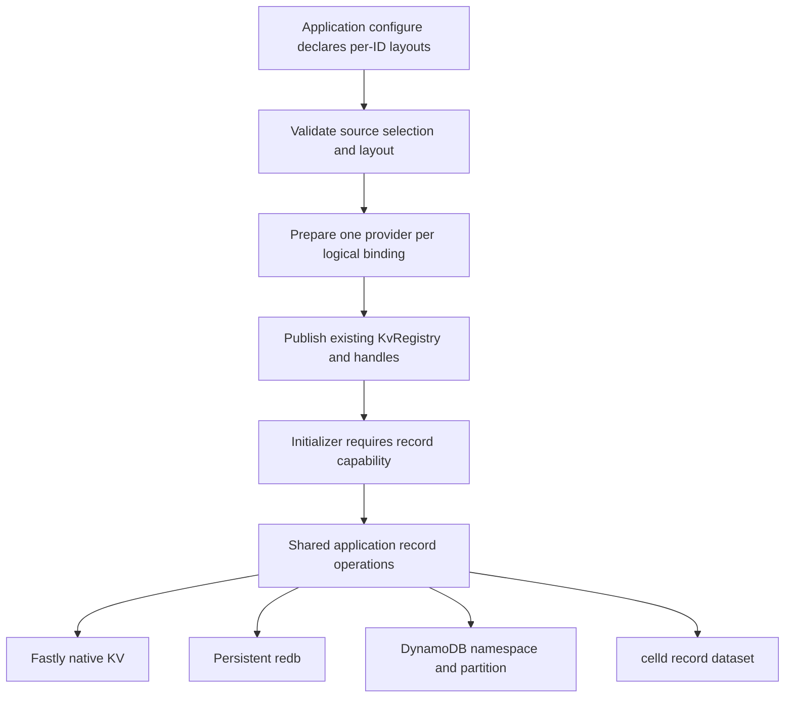
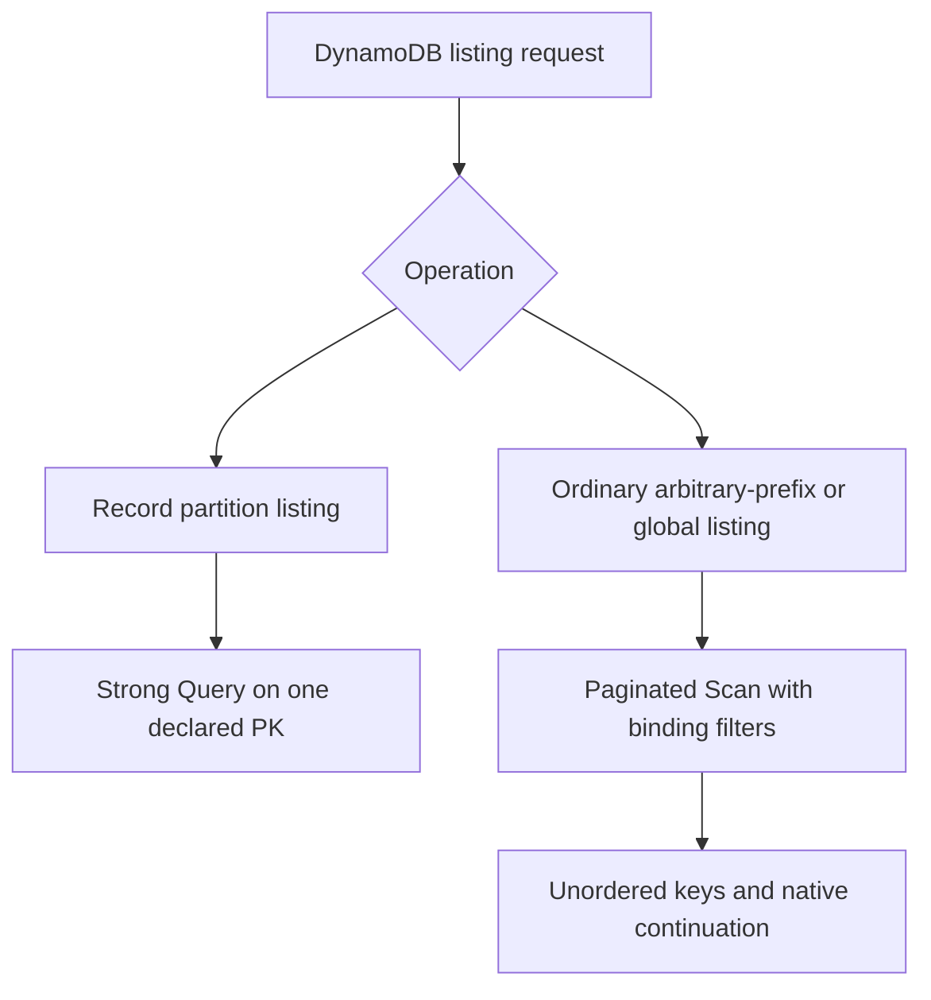

# Portable KV records and native providers

Status: draft for review. Requirements were agreed on 2026-11-13; implementation and runtime acceptance have not started. Concrete type names and the technical choices called out below remain subject to spec review.

Delivery: one EdgeZero PR closes [#472](https://github.com/IABTechLab/edgezero/issues/472) and [#473](https://github.com/IABTechLab/edgezero/issues/473), stacked after [#439](https://github.com/IABTechLab/edgezero/pull/439) and before [#454](https://github.com/IABTechLab/edgezero/pull/454). Planning baseline is `645703bf39f5965dad5b54d7907e28c9197a7034`, including #414 and #422. Recheck heads before implementation or publication.

The [EdgeZero implementation plan](../plans/2026-11-13-kv-record-contract.md) owns repository-level execution tasks and checks. The Obsidian plan at `Projects/Trusted Server/plans/Implement the Record Contract and Reconcile Provider Adoption.md` owns cross-repository celld/TS coordination, dependencies, publication and stack disposition. The user requested the repository plan after reviewing this spec, superseding the earlier single-plan restriction. This spec remains the behavior contract. The interview record is `Projects/Trusted Server/notes/Record Contract and Provider Reconciliation Decisions.md`.

## Goal

Let an application require one record-capable KV binding and use the same code on native Fastly KV, Axum's local persistent store, DynamoDB on Axum, or celld on Axum. EdgeZero owns provider mechanics. The application owns key grouping, content validation, consent rules and operation-specific conflict handling.

A record binding guarantees generation-bearing reads, atomic conditional writes, authoritative exact-key existence and strongly consistent partition-local pagination. It must not simulate atomicity with a read followed by an unconditional put or a process-local lock.

Trusted Server is the first consumer. Its shared identity graph already depends on these operations. This spec does not move identity policy into EdgeZero or implement the whole server-side identity roadmap.

## Scope and requirements

| ID | Requirement |
| --- | --- |
| R1 | Add record operations to the existing `KvStore` contract and a validated `RecordHandle` over the same provider and logical store. Preserve ordinary-only bindings. |
| R2 | Declare an immutable application-owned key layout once before provider preparation. Preserve full logical keys. Resolve point operations through that layout and validate complete partition prefixes for record listing. |
| R3 | Within a record binding, ordinary and record operations reach the same value. Every ordinary overwrite invalidates previous generations. Ordinary no-TTL put remains non-expiring. |
| R4 | Supply generation-bearing lookup, Add, Overwrite, generation-match write, definitive precondition-failed outcome, strong exact existence, delete and resumable partition listing. |
| R5 | Implement and run one contract suite on Fastly under Viceroy, `PersistentKvStore`, DynamoDB Local and a rebuilt matching celld service. |
| R6 | DynamoDB uses distinct namespace-qualified partition-key values for distinct declared partitions. No namespace-wide item is updated on every record insert. |
| R7 | Metadata is optional UTF-8 text. Missing and empty are equivalent; preserve nonempty text exactly. Bodies remain arbitrary bytes. |
| R8 | Every record partition-list page uses the promised strong partition query. Pagination is live, not a frozen cross-page snapshot. Only absence of continuation establishes traversal completion. |
| R9 | Report ambiguous mutation completion explicitly and do not automatically replay the mutation. The application owns reconciliation and conflict policy. |
| R10 | Use documented provider TTL behavior. Do not add a common exact-deadline read/list guarantee or an expiry envelope. Expiry and physical cleanup are separate. |
| R11 | Reject unsupported record bindings during initialization without a mutating probe. Missing capability, invalid layout, unavailable provider and runtime write failure are not interchangeable. |
| R12 | Keep native SDK/runtime dependencies optional and out of core/WASM graphs. Extend existing DynamoDB Local and celld infrastructure rather than add Floci or another emulator framework. |
| R13 | Retain ordinary arbitrary-prefix/global listing on the partitioned DynamoDB binding through paginated Scan, without an ordering guarantee. It is separate from strong partition listing. |

Out of scope: hosted AWS/IAM qualification, data migration implementation, production load certification, deployment, main merges, after-response work, new identity-provider policy, Cloudflare/Spin record implementations, and DynamoDB/celld execution on WASM. Existing unrelated acceptance obligations are not completed by this work.

## Existing gaps

- `edgezero-core/src/key_value_store.rs` has ordinary KV operations but no portable record contract. The default `exists` is a read, not an authoritative existence promise.
- Fastly already supplies generations, Add, conditional insert and strong list; the EdgeZero wrapper drops those distinctions.
- `PersistentKvStore` stores body and expiry only. It needs transactional metadata/generation state without breaking ordinary-only files.
- #414's DynamoDB provider uses `pk = namespace`, `sk = key`. It supplies strong reads/query but not conditional records or distributed logical partitions.
- #422's celld record client is separate from raw KV. The service stores raw values in `__kv` and conditional records in `__kv_records`. Record listing has no continuation, and every record write currently requires a positive TTL.
- TS has provider mechanics in its Fastly adapter and in the older Axum DynamoDB/celld line. The target is one shared TS `EcKvStore` over this contract, not another adapter implementation.

## Boundaries and construction



Keep `BoundKvStore = KvHandle` and the existing per-ID registry. Do not introduce another provider registry or independently routed record dataset behind the same binding.

Register layout requirements through the portable application's existing configure path. Axum currently builds/configures the App before `build_production_stores`; pass the declarations into that preparation. The initializer runs after stores are prepared, so it may validate/acquire a handle but must not install or change routing. Thread the same declarations through local development and platform registry construction.

Supplied ready/deferred handles must already satisfy the requested layout and record mode. Reject mismatches before publishing stores. Existing local preparation deduplicates by backing-store name; two IDs that resolve to the same store cannot silently use conflicting layouts.

Capability checking establishes supported operations and applicable local/protocol compatibility, not hosted write authorization or permanent availability. Fastly's request initialization may perform platform binding checks; do not invent a process-wide startup phase it does not have.

## Public API direction

Names below are a proposed spelling of the agreed API, not existing Rust definitions. Place portable record types in a focused core module and add object-safe record operations to the existing provider trait. Unsupported defaults must return `KvError::Unsupported`, never fabricate success. Preserve the existing local-future model and `Send + Sync` provider boundary.

```rust
// Portable configure phase, before provider preparation.
app.require_record_store("identity", TsIdentityLayout)?;

// Initializer: no layout argument and no routing mutation.
let identity = stores.kv("identity")?.require_records()?;

let record = identity.lookup(&ec_id).await?;
let outcome = identity.insert(&ec_id, write).await?;
let held = identity.exists_strong(&ec_id).await?;
let partition = identity.partition(&partition_prefix)?;
let page = identity.list_partition(&partition, cursor, limit).await?;
identity.delete(&ec_id).await?;
```

The earlier interview sketch combined declaration and acquisition as `require_records(id, layout)`. The implementation separates these phases because `PreparedStores` is already immutable at initializer time. Grouping is still declared once; point operations still take only full keys.

Conceptual values:

```rust
struct Record {
    body: Bytes,
    metadata: Option<String>,
    generation: RecordGeneration,
}

struct RecordWrite<'a> {
    body: &'a [u8],
    metadata: Option<&'a str>,
    ttl: Option<Duration>,
    mode: RecordWriteMode,
}

enum RecordWriteMode {
    Add,
    Overwrite,
    IfGenerationMatch(RecordGeneration),
}

enum RecordWriteOutcome {
    Written,
    PreconditionFailed,
}

struct RecordPage {
    keys: Vec<String>,
    cursor: Option<String>,
}
```

A successful insert acknowledges the write, not its new generation. Fastly cannot atomically return that generation on insert, and a subsequent read might observe a competing writer. Consumers must not assume every lookup is strongly consistent; conditional writes reject stale generations and authoritative operations handle decisions about absence.

### Layout contract

The application supplies a stable, versioned declaration that resolves a full key to its enumerable partition prefix and validates a proposed complete partition prefix. The prefix must actually prefix the key. Partitions must be disjoint and stable for the lifetime of the stored format. No Unicode normalization or delimiter rewriting is permitted.

Use validated prefix values at the provider boundary. Check resolved membership on point operations and returned keys on listing. Layout identity/version participates in binding compatibility and cursor identity. Application-specific parsing stays in the application; EdgeZero must not parse EC IDs or consent markers. Do not build an unrelated universal templating or partition-directory framework.

TS's declaration will recognize existing root keys `<ip-hash>.<suffix>` and completion markers `__ts_ec_withdrawal_complete__:<ec-id>:<expiry>`. Roots group by IP hash; markers group by their marker prefix and EC ID. TS declares key-shape rules, not every individual IP hash. The rules and their non-overlap need focused TS tests.

Changing a layout changes data placement. Treat it as an explicit format/cutover choice, not a mutable request option or automatic migration.

Complete-partition validation applies to `list_partition`, not ordinary arbitrary-prefix/global enumeration. Do not reject an ordinary prefix merely because it spans groups or does not resolve to one complete partition. Ordinary listing must still enforce the logical binding's namespace, format and requested prefix.

### Value identity and replacement

Within a record-capable binding, ordinary get/put/TTL-put/delete/exists and record operations route to the same value row. Ordinary reads return the body without a hidden record JSON envelope. Ordinary puts are unconditional replacements with no metadata and a fresh generation; test that stale CAS fails afterward. A no-TTL put removes the prior expiry rather than substituting a long lifetime.

This is an explicit technical design choice for review. Ordinary-only stores keep their current format and behavior. Opting into records must not silently redirect existing raw celld data or the legacy DynamoDB namespace into a different dataset.

### Metadata and limits

Normalize absent and empty metadata to `None`. Reject invalid UTF-8 returned as portable metadata rather than perform lossy decoding. Preserve nonempty text and body bytes exactly.

Retain existing key/value/page validation and documented provider limits. Fastly 0.13.1 accepts 2000 metadata bytes; celld currently accepts 1024. Do not promise 2000 bytes on unchanged celld or encode binary metadata into the body. State the effective metadata limit in capability documentation; shared conformance values must fit every selected provider. No unrelated dependency or arbitrary new size restriction is required.

## Atomicity, generations and outcomes

Add may not overwrite an existing record under the backend's documented expiry rules. A generation-match write applies only when that same key still has the expected generation. Overwrite has no generation precondition. Comparison and mutation must be one provider-atomic operation or transaction.

Generations are equality tokens scoped to a key/binding, not timestamps, sequence numbers for business decisions, or authorization. A stale token must not become valid after ordinary overwrite, deletion/recreation, expiry/recreation or restart. Deleting a value must not delete the state needed to prevent token reuse.

Draft generation design: retain opaque `u64` markers for compatibility with current Fastly/celld and TS primitives. A `RecordGeneration` newtype exposes equality, not ordering/arithmetic promises. DynamoDB uses retained per-key allocation described below. Allocation gaps are valid. Acknowledged writes need not expose numerically increasing markers when competing unconditional writers commit out of allocation order.

The cost of this choice is two DynamoDB write operations per attempted record insert and retained per-key history. An opaque random 128-bit generation could avoid that history and one request, but would change the TS generation representation and provide probabilistic uniqueness. This draft chooses deterministic retained allocation; review its cost before implementation.

A definitive provider rejection maps to `PreconditionFailed` only for Add or generation-match. Failure of an unconditional overwrite is not normal contention. Validation, unsupported capability, unavailability and malformed responses remain errors.

After a request may have mutated storage, a lost response/timeout must produce a payload-free error indicating the mutation may have committed. Do not turn it into `PreconditionFailed`, success, or a hidden retry. Keep SDK mutation attempts at one. Reads and application reconciliation do not authorize replay of the original mutation. Apply this to delete as well as insert; a repeated delete could erase a newly recreated value.

## Pagination and existence

`list_partition` requires a validated complete partition prefix. It returns logical full keys with an opaque continuation; alphabetical order is not a portable requirement. Continue until `cursor = None`; a short or empty page can still have a cursor. Exact page-size multiples must not lose the final continuation decision.

Bind continuation to the logical store/backing scope, format/layout version, requested prefix or partition, and operation/query mode. A global Scan cursor is not interchangeable with a partition Query cursor. Preserve and validate native continuation rather than replace it with a guessed last key where the provider does not support that. Reject foreign, malformed or nonadvancing cursors without leaking credentials or record content.

For a quiescent partition, traversal must return every matching visible key exactly once. Pages are strongly read, but the whole traversal is not a snapshot. Do not promise inclusion of keys inserted behind a consumed cursor or an atomic cleanup protocol against concurrent writers.

Strong existence checks exact key equality against authoritative provider state. An ordinary lookup miss, a neighbouring prefix match, or an inconclusive page budget cannot prove absence. Return an error if authority cannot be established. Expired-but-retained rows may remain visible under native TTL rules; neither existence nor listing is a physical-erasure certificate.

### Global ordinary listing

The user approved retaining `list_keys_page(prefix, cursor, limit)` across all groups, including the empty prefix, without an alphabetical ordering guarantee. This supersedes the earlier proposal to reject cross-partition requests. Existing ordinary-only bindings retain their current behavior; update the common documentation so it does not promise universal lexical ordering on the new record binding.

DynamoDB implements this operation with native paginated Scan. Apply the binding's versioned namespace and value-row-kind filters and the requested logical key prefix; never expose allocator rows or another namespace's values. Do not collect/sort the full namespace per output page or add a global index/catalog. Scan reads broadly and its filters do not make those reads cheap; document the read cost and required Scan operation without claiming hosted IAM qualification.

The Scan limit bounds evaluated items, not matching returned keys. Return at most the requested number of logical keys, preserve LastEvaluatedKey, and allow empty/short pages with continuation. The native continuation may refer to a filtered internal row or another namespace's physical row: validate its structure and bind the outer cursor to the requested operation/scope, but do not require that native scan position itself be a returned logical value. Namespace/prefix filters remain mandatory on every page.

Global enumeration carries ordinary-KV consistency and no cross-page snapshot or ordering promise. It must not replace the strongly consistent base-table Query used by `list_partition`, and must not be used as the authority for exact-key absence. In a quiescent store, following Scan continuation to completion returns all matching logical values exactly once, ignoring order.



## Provider implementations

### Fastly native KV

Use the pinned SDK's `current_generation()`, not deprecated `generation()`. Map Add and generation-match to native insert options and map definitive precondition rejection separately from transport/platform errors. Use native metadata and TTL; normalize empty metadata without a body envelope.

Use explicit Strong list mode and native continuation. Partitions are logical prefixes within the existing store, not separate provisioned Fastly stores. Strong existence may enumerate the full key prefix and test exact equality, following continuation until absence is established or the provider/runtime returns an error. Do not infer presence from descendants or absence from a truncated page.

Run record contracts in Viceroy. SDK compilation alone does not prove atomic races, expiry behavior or generation non-reuse.

### Local persistent store

Use an explicit versioned record table in redb; do not silently reinterpret the old ordinary-only row tuple. Store body, text metadata, generation and optional expiry together. Conditional evaluation and replacement occur in one write transaction. Ordinary record-mode methods use that same transaction path.

Keep durable allocator state separate from value expiry/deletion. Reopening the database must not reset it. Preserve the existing expired-row recheck before lazy cleanup so cleanup cannot remove a concurrent fresh overwrite.

Use a read view per record page with bounded scan batches and exclusive continuation. Scan caps or skipped expired keys must preserve a cursor, even for an empty returned page. Native redb expiry may hide values before physical cleanup; no shared exact TTL deadline is added.

### DynamoDB on Axum

Keep the provider native/default-off and use the existing AWS SDK/preparation infrastructure. Introduce an explicit record-format selection rather than silently reusing the legacy ordinary schema.

A collision-free encoding of format version, namespace and declared partition prefix forms PK. Value SK is a reserved value-kind prefix plus the unchanged full logical key; a different reserved kind identifies that key's allocator. These encodings must remain disjoint for arbitrary valid logical keys. Returned keys never contain provider kind prefixes.

Retain one allocator item per logical key in that same partition. Allocate a unique `u64` candidate through native atomic UpdateItem with a non-wrapping ceiling condition, then conditionally PutItem on the value row. Add and CAS use native value-row conditions, not a client read/check. Ordinary replacement uses the same allocation path. Allocator rows have no TTL, are not removed by value delete and never appear in user listings. No item is updated by inserts into every group.

An allocation can succeed without a subsequent value write. Gaps and losing-CAS allocations are acceptable. A value-write acknowledgement can be lost. Use one absolute operation budget across both requests, retain single-attempt mutations, and distinguish error stages without implying success.

Use strongly consistent base-table GetItem for authoritative existence and strongly consistent Query on the exact derived PK for record pages. Preserve LastEvaluatedKey, including on empty pages. Exclude internal allocator rows correctly without dropping continuation. Do not use a GSI for strong record listing.

Keep ordinary arbitrary-prefix/global enumeration available through the separate filtered Scan path described above. Preserve native scan position across all evaluated rows, bind cursors to Scan versus Query and the requested scope, and make no global ordering or strong snapshot claim.

Use native DynamoDB TTL for the new record format; do not introduce a portable logical-expiry envelope or claim exact deletion timing. Keep the legacy ordinary binding's existing expiry behavior unchanged. The new format is explicit and does not migrate or fall back to old rows.

Document required SDK operations and new format implications. No hosted AWS/IAM acceptance or provisioned-capacity claim is required here. DynamoDB Local proves the local integration path, not production service behavior.

### celld on Axum

Add an explicit record-capable binding mode. All its ordinary operations use the conditional-record dataset, including no-TTL puts. Existing ordinary-only `/value` bindings stay raw KV; do not mix the two datasets under one binding.

The companion service contribution must make the full current scoped-store/record implementation reviewable, not publish only a cursor patch against an unavailable base. Existing local source is `denoland/celld` branch `feat/scoped-store-cas` at `9350a043860c4f41dccb692ec9de98ebd9dac3ae`; no published PR/fork was verified during planning.

The new record protocol must supply:

- A read-only capability/version handshake proving pagination and no-expiry support before publishing the binding.
- Keyset continuation across record prefix, optional cursor, limit and relevant list mode, returning keys plus continuation.
- Scope/prefix-bound cursor validation and authoritative end detection. Raw KV cursors are not record cursors.
- An explicit non-expiring record representation for ordinary no-TTL writes. Do not invent a maximum TTL or put the value in raw KV instead.
- Atomic preconditions/generation allocation for every record-mode overwrite, including ordinary puts.

Draft format choice: a fresh versioned record format with nullable expiry, leaving the existing positive-expiry-only record table/protocol and raw KV data untouched. The new server must treat no expiry correctly in reads, Add/CAS checks, listing, sweeps and alarm scheduling. No automatic table/data migration is included. Older services must fail preparation for the new binding instead of silently downgrading.

celld's existing namespace-local transactional allocator can remain if it preserves generation lifetime. The no-namespace-wide DynamoDB mutation-item requirement does not impose an unrelated celld allocator redesign.

Rebuild the server from the exact new source/lockfile and record source commit, tree, toolchain, build command and binary hash. Pin that rebuild into both EdgeZero and TS acceptance. The cached 0.6.2 binary and earlier receipts do not implement or prove the new protocol.

## Acceptance and evidence

| Proof | Required observation |
| --- | --- |
| Shared suite on all four providers | Exercise the public record handle, not only a provider-specific helper or in-memory double. |
| Same-row coherence | Ordinary write appears in record lookup and vice versa; ordinary replacement/TTL-put invalidates prior CAS; delete is visible through both views. |
| Conditional races | Independent writers racing Add or the same generation produce exactly one acknowledged winner. Do not substitute a single-process client mutex. |
| Generation lifetime | Old generations fail after ordinary overwrite, deletion/recreation, expiry/recreation and restart. Allocation gaps, failure between allocation/value write and allocator exhaustion do not reuse markers. |
| Strong absence | Stale lookup misses cannot override authoritative existence; prefix neighbours and multi-page exact-key checks do not yield false conclusions. |
| Distributed DynamoDB keys | Different declared groups produce different PK values. No namespace-wide mutation allocator traffic. Query targets only the declared group. |
| Pagination | Multiple pages, exact multiples, more than one provider page, empty/short continuation pages, expired rows, prefix neighbours, live changes and foreign/nonadvancing cursors. Stop only on no continuation; do not require alphabetical order. |
| Global ordinary listing | Scan traverses values across multiple groups, supports arbitrary/empty prefixes, excludes other namespaces and allocator rows, and preserves continuation through filtered-only pages. In a quiescent store compare key sets for completeness/uniqueness. Reject Scan/Query cursor interchange. |
| Metadata/body | Empty/missing normalization, exact nonempty multibyte text, actual provider byte limits, malformed UTF-8 rejection and binary body fidelity. |
| No-expiry | Ordinary no-TTL replacement remains non-expiring through the record-capable provider, including celld restart/sweep. |
| Ambiguous mutations | Lose a response after commit; report possible completion and observe no hidden replay. Definitive contention remains distinguishable. |
| Initialization | Unsupported/old-protocol/layout-mismatched stores fail before accepting identity work, without a mutation probe or fallback. Ordinary-only bindings remain usable. |
| Isolation | Required default-off and enabled native feature graphs, generated consumers and portable WASM checks pass without native dependencies in core. |

Extend `scripts/run_native_aws_integration.mjs`, the matching celld runner, existing provider wire fixtures and Fastly/Viceroy contracts. Do not add another emulator stack. New test selectors must be nonzero and must not pass by skipping unavailable services.

At stable checkpoints run repository-required formatting, strict Clippy, workspace tests, feature/target compilation and affected docs/consumer checks. Match evidence to exact source, dependencies, service artifact and environment. Source inspection, historical receipts and all-features compilation are not runtime conformance.

## Trusted Server adoption boundary

The coordinating plan repurposes user-owned TS #1536 for the shared core `EcKvStore` adapter plus DynamoDB adoption and #1537 for celld through that same adapter. TS owns its layout and caller-specific merge/retry/defer behavior. Port persistence-before-cookie, concurrent enrichment, withdrawal and restart tests before deleting duplicate Fastly/Axum provider mechanics.

Awaitable core #1526 is a prerequisite, not something this EdgeZero spec delivers. Existing TS PR ancestry includes unrelated HTTP, Geo and consent work; preserving public commit history does not mean retaining all of that work in the new review diffs. Review an explicit disposition manifest before repurposing. Do not edit Aram's #1506/#1559 or Dhruv's #1487.

## Review checkpoint

Before code changes, review this draft's concrete technical choices: pre-preparation layout registration, retained per-key DynamoDB generation history, ordinary replacement metadata behavior and fresh celld format/no-expiry support. These are exposed for review rather than silently added to the interview decisions. The listing follow-up is settled: preserve global ordinary enumeration through unordered paginated Scan, while record partition listing uses strong Query.

Implementation completion stops at tested, review-ready PRs and a reconciled official stack. No deploy, main merge, data migration, release tag or image publication is implied.

## References

- [EdgeZero #472](https://github.com/IABTechLab/edgezero/issues/472) and [#473](https://github.com/IABTechLab/edgezero/issues/473).
- Native AWS [#414](https://github.com/IABTechLab/edgezero/pull/414), combined celld [#422](https://github.com/IABTechLab/edgezero/pull/422), superseded [#463](https://github.com/IABTechLab/edgezero/pull/463).
- Native provider design: [AWS](2026-10-07-native-store-providers-design.md) and [celld](2026-10-15-native-celld-store-providers-design.md).
- Read-only TS [identity design #1559](https://github.com/IABTechLab/trusted-server/pull/1559), especially EZI-2a/EZI-2b, AX-4 and DEC-3/DEC-6. This spec records the later user decision to preserve owned PR identities while replacing their provider architecture.
- Shared TS consumer [#1587](https://github.com/IABTechLab/trusted-server/issues/1587), awaitable prerequisite [#1526](https://github.com/IABTechLab/trusted-server/pull/1526), adoption units [#1536](https://github.com/IABTechLab/trusted-server/pull/1536) and [#1537](https://github.com/IABTechLab/trusted-server/pull/1537).
