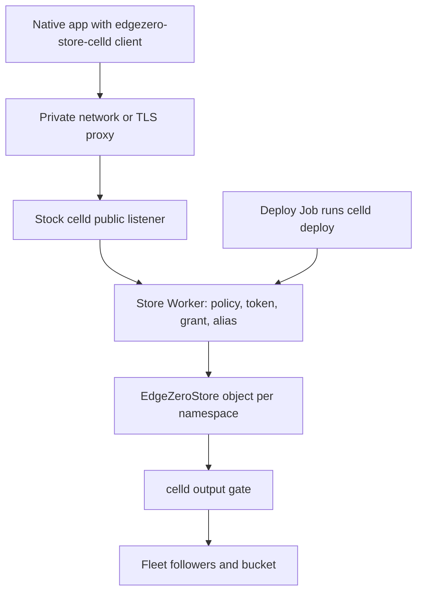

# EdgeZero store service on stock celld

**Status:** Implemented on `plan/celld-no-fork` for [#422](https://github.com/IABTechLab/edgezero/pull/422), with local evidence below. The user accepted the service direction on 2026-11-16 on condition that it adds no manual deployment step, then approved implementation and an update of #422. Fleet capacity, production buckets and the record contract on this service remain open.

**Supersedes:** the scoped listener inside celld in the [native celld providers design](2026-10-15-native-celld-store-providers-design.md), and that design's exclusion of a Worker bridge and its in-celld TLS. Those choices assumed a modified celld was acceptable. It is not.

**Coordination:** `Projects/Trusted Server/plans/Reconcile EdgeZero PR 422 Onto Stock celld.md` in the Obsidian vault holds cross-repository sequencing, TS adoption and RC disposition.

## Goal

Native EdgeZero applications use celld for live KV while every celld node runs the official, unmodified release. EdgeZero owns the guarantees it promises and enforces each with a documented stock celld mechanism.

## Why a service exists

Stock celld exposes storage only to Worker code deployed into it. The internal listener's operator API is alpha and unauthenticated, and its `/runtime/<scope>` routes need the fleet HMAC secret (`docs/security.md`, v0.6.3). A process outside celld has no supported way to read or write celld storage, so some EdgeZero code has to run inside celld. That code is an ordinary Worker application here.

CAS matters for the later record contract: several TS pods can update one EC record at once, and without an atomic check-and-write at the store a concurrent enrichment can overwrite a consent withdrawal. This change keeps the row format ready for that work but ships ordinary KV only.

## Decisions

| ID | Decision |
| --- | --- |
| D1 | EdgeZero ships a Worker plus one SQLite Durable Object class, deployed with stock `celld deploy`. Deployment is automated in manifests, so operators have no manual step. |
| D2 | Remove the v1 record API from #422. It was the client for the fork's `/record` endpoints. |
| D3 | Plain HTTP on a private network is the documented default. Authenticated mode requires HTTPS through a TLS proxy, ingress or mesh, because celld does not terminate TLS. |
| D4 | Remove the `celld-config` provider. Trusted Server selects only celld records and KV. |
| D5 | One Durable Object per namespace. **Raise in review:** every write for a namespace is serialized on one node and waits for durability, that node carries all of the namespace's traffic, a node failure pauses the namespace until takeover (lease default 10 s), and moving to sharding later is a storage format change. |

## Requirements

| ID | Requirement | Status |
| --- | --- | --- |
| S1 | Run on an official celld release, verified by version. Reject a build that exposes `--store-api-config`. | Runner checks `celld 0.6.3` and the help text |
| S2 | Ship the service in this repository, versioned with `edgezero-store-celld`. | `services/celld-store/` |
| S3 | No manual deployment step. | Kubernetes Job recipe in the guide |
| S4 | Keep #422's client contracts: default-off feature, bindings schema, token handling, deadlines, limits, redaction, startup ordering. | Kept, minus config |
| S5 | Allocate generations and apply each mutation in one SQLite transaction inside the object. | Done |
| S6 | A duplicate delivery applies nothing and returns the first outcome. | Ledger |
| S7 | A mutation does not apply after a bounded window from Worker receipt. | Apply-before |
| S8 | The client never resends a mutation and reports a possible commit on failure. | Unchanged client policy |
| S9 | Detect a reset or replaced store instead of answering for it. | Instance header on every success and logical miss, and cursor binding |
| S10 | Old forked servers fail against the new client. | Different version header |
| S11 | Ordinary rows carry generation, metadata and nullable expiry, ready for same-row records. | `rows-v1` |

## Architecture



The service fleet runs only this application, because celld runs one application per fleet.

## Service package

`services/celld-store/src/index.js` is one module deployed with `no_bundle`. celld's `no_bundle` mode does not discover additional JavaScript modules, so the service is a single file, and the deploy job needs no esbuild. celld accepts only handlers and classes as module exports; tests reach pure helpers through `EdgeZeroStore.internals`.

Fixed identities are part of the storage format: Worker `edgezero-store`, binding `EDGEZERO_STORE`, class `EdgeZeroStore` in migration `v1`, object name `edgezero-store/v1/<namespace>`.

## Wire protocol

Every response carries `x-edgezero-store-version: 1`. Every response from an object also carries `x-edgezero-store-instance`, 22 base64url characters.

| Request | Grant | Result |
| --- | --- | --- |
| `GET /v1/stores/{alias}/capabilities` | any grant | 200 JSON |
| `GET /v1/stores/{alias}/value?key=` | read | 200 raw bytes, 404 `not_found` |
| `HEAD /v1/stores/{alias}/value?key=` | read | 200 or 404, no body |
| `GET /v1/stores/{alias}/keys?prefix=&limit=&cursor=` | list | 200 `{"keys":[...],"cursor":null}` |
| `POST /v1/stores/{alias}/put?key=&ttl_seconds=` | write | 204, raw body |
| `POST /v1/stores/{alias}/delete?key=` | delete | 204, including a missing key |

Mutations require `x-edgezero-mutation-id`. They use POST because common proxies retry PUT and DELETE on upstream errors by default. Query decoding, key rules, page bounds, cursor size, body limits and error categories match #422: `invalid_input` 400, `unauthenticated` 401, `forbidden` 403, `not_found` 404, `limit_exceeded` 413, `unsupported_version` 426, `unavailable` 503, `deadline` 504. A 204 has no body and no media type.

Capabilities for this version:

```json
{
  "service": "edgezero-celld-store",
  "protocol": 1,
  "format": "rows-v1",
  "pagination": "keyset",
  "no_expiry": true,
  "mutation_ledger": true,
  "records": false,
  "max_value_bytes": 1048576,
  "max_metadata_bytes": 1024,
  "instance": "<22 base64url characters>"
}
```

The Worker reaches the object with `stub.fetch` on an internal URL that carries the operation and a JSON metadata parameter, plus an internal version header the object requires.

## Storage

| Table | Columns |
| --- | --- |
| `edgezero_meta` | `schema_version`, `instance`, `allocator` (decimal u64 text) |
| `edgezero_rows` | `key TEXT PRIMARY KEY`, `body BLOB`, `metadata TEXT NULL`, `generation TEXT`, `expires_at_ms INTEGER NULL` |
| `edgezero_mutations` | `id TEXT PRIMARY KEY`, `fingerprint TEXT`, `outcome TEXT`, `expires_at_ms INTEGER` |

Each mutation runs in one `transactionSync` with no await inside:

1. If the ledger holds the ID with the same request fingerprint, return the stored outcome. A different fingerprint is `invalid_input`.
2. If the apply-before time has passed, return `deadline` and apply nothing.
3. Put allocates `allocator + 1`, refusing at u64 exhaustion, and replaces the row with no metadata. No TTL stores no expiry. Delete removes the row.
4. Insert the ledger entry.

An alarm deletes expired rows and ledger entries in batches of 256 and rearms for the next deadline. A mutation moves the alarm only earlier, because each durable alarm write costs a bucket round trip. Deletes and sweeps never touch the allocator. A database with rows but no metadata fails every request.

### Why the ledger exists

When a Worker on one node calls an object owned by another node, stock celld resends a buffered call once on a fresh tunnel after a pooled tunnel fails, even when the owner already ran it (`crates/celld/main/peer_tunnel.rs:434-469`, v0.6.3). The outer redispatch skips ambiguous attempts (`crates/logic/routing.rs:47`), so the inner resend is the hazard. The fork patched it with `ReplayPolicy::Never` in commit `f72ae21a`. The fleet proof below reproduces the resend on stock celld.

### Apply-before window

celld can hold a call while a cell recovers, by default up to 240 retries at one-second intervals (`docs/guarantees.md`). The Worker stamps `apply_before = receipt + 10 s`. Ledger entries are kept for 10 minutes. The window uses node clocks: skew beyond the retention margin widens the uncertainty window but cannot apply a mutation twice, because the ledger check comes first.

### Instance identity

`meta.instance` is 16 random bytes created with the database. A client handle records the first instance it sees and fails every later response from a different one. Service cursors embed the instance. Discarding cell data or renaming the script or class creates a new database and therefore a new instance, which fails visibly. Restoring an older snapshot of the same store keeps its instance, so a rollback is not detected; generations and ledger entries from after the snapshot could then be reused.

## Client changes

- `client.rs`: new headers, POST mutations with a fresh 128-bit ID from `getrandom`, instance validation, 204 without media type.
- `kv.rs`: new paths, per-handle instance check, `InstanceChanged` maps to `KvError::Unavailable`.
- `preparation.rs`, `settings.rs`, `lib.rs`: config and records removed; `kv` is the only feature.
- `test_support.rs`: loopback fixture speaks the new protocol and records mutation IDs.

The Axum adapter loses the `celld-config` binding variant, capability and feature. Generated Axum templates no longer forward it.

## Guarantees and limits

| Guarantee | Enforced by | Limit |
| --- | --- | --- |
| Durable acknowledgement | celld output gate | One-node fleets wait for the bucket on every write; the bucket must pass `celld diagnose` |
| Atomic generation allocation | Object transaction | Writes to one namespace are serialized in one cell (D5) |
| No duplicate effects | Mutation ledger | Retention must exceed the apply window plus clock skew |
| Bounded uncertainty | Apply-before window | Node clocks |
| Reset detection | Instance header | Detects a new database, not a rollback to an older snapshot of the same one |
| Auth and grants | Worker policy in `vars` | Changes need a redeploy, adopted within about 30 s |
| Transport security | Deployment network or TLS proxy | celld does not terminate TLS |

## Compatibility

- No migration from the fork's raw KV, `__kv_records` or records-v2 tables. No production celld data exists; The Sun evaluation uses DynamoDB.
- Published tags `v0.0.12-rc-axum.202611.2`, `v0.0.12-rc-records.202611.1` and TS `v0.1.1-rc-axum.202611.4` need the fork. They stay untouched.
- The local record-contract branch must retarget `records_v2.rs` at record endpoints on this service.

## Evidence (2026-11-16)

All against official celld v0.6.3, `celld-x86_64-unknown-linux-gnu.gz` SHA-256 `5084a083…3047` (attestation verified), binary SHA-256 `eb0a8158421b69d68dd5d28f2298a7d411dde498295833deeb1cc5ce53b7eb75`.

| Check | Result |
| --- | --- |
| `node --test services/celld-store/test/service.test.mjs` | 17 passed |
| `node --test scripts/run_native_celld_integration.test.mjs scripts/run_celld_store_fleet_proof.test.mjs` | 9 and 4 passed |
| `cargo test -p edgezero-store-celld --all-features --lib` | 32 passed |
| `cargo test -p edgezero-adapter-axum --features celld-kv,test-utils --lib` and `--test native_celld_startup` | 440 passed, 1 ignored; 4 passed |
| Generated consumer, deterministic loopback fixture | passed |
| Generated consumer against `celld dev` plus a TLS proxy: binary values, empty value, listing, 61-second TTL expiry, restart, wrong token | passed |
| Fleet proof: RustFS 1.0.1 container, two nodes, reply dropped after B ran a put | celld resent the call; client got 204; value applied once |
| Fleet proof: kill -9 of the owner, takeover by the other node | all ten acknowledged writes present |
| Spike: same fault with an instrumented build | the object saw the second delivery, answered from the ledger, allocator advanced once |
| Spike: loopback two-node write rate on one namespace | about 63 writes/s sequential (p50 15 ms), about 240 writes/s at concurrency 32 (p50 113 ms). Laptop numbers, not capacity. |

Not covered: production buckets, network isolation, upgrades under load, adjacent-version behavior during in-place adoption, sustained throughput and record operations.

## References

- celld v0.6.3 (`8702f6d1`): `docs/security.md`, `docs/guarantees.md`, `docs/limitations.md`, `docs/cloudflare-compat.md`, `docs/wasm.md`, `docs/services/durable-objects.md`, `crates/celld/main/peer_tunnel.rs`, `crates/celld/main.rs`, `crates/logic/routing.rs`.
- Fork evidence, not a dependency: local branch `feat/scoped-store-cas` at `9350a043` and `03d26d6a`.
- [#422](https://github.com/IABTechLab/edgezero/pull/422), [#437](https://github.com/IABTechLab/edgezero/issues/437), [#472](https://github.com/IABTechLab/edgezero/issues/472), [#473](https://github.com/IABTechLab/edgezero/issues/473), TS [#1537](https://github.com/IABTechLab/trusted-server/pull/1537).
