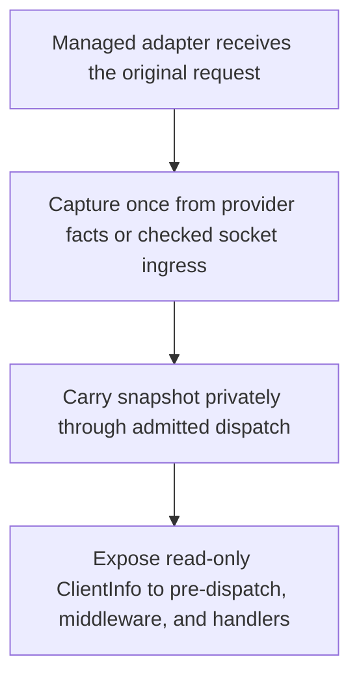

# Portable ClientInfo for Fastly, Axum, Cloudflare, and Spin

## Goal and scope

Give EdgeZero handlers a provider-neutral, read-only view of the client addresses and viewer TLS facts that an adapter can establish. Capture once at ingress, distinguish direct peers from effective clients, and explain unavailable values without exposing rejected inputs. Header or extension edits during dispatch must not change the captured facts.

This change covers the shared contract [#475](https://github.com/IABTechLab/edgezero/issues/475) and the Fastly [#90](https://github.com/IABTechLab/edgezero/issues/90), Cloudflare [#91](https://github.com/IABTechLab/edgezero/issues/91), Axum [#92](https://github.com/IABTechLab/edgezero/issues/92), and Spin [#485](https://github.com/IABTechLab/edgezero/issues/485) mappings. It also connects Axum's protected CloudFront ingress to the existing JA4 API. It does not move the rest of the Cloudflare or Spin identity rollout forward. Spin Geo ([#486](https://github.com/IABTechLab/edgezero/issues/486)) comes from [#514](https://github.com/IABTechLab/edgezero/pull/514), which this branch merges as a baseline; Spin ClientInfo reuses its authenticated visitor IP.

EdgeZero owns network metadata capture and trust checks. Trusted Server owns how identity and DataDome use those facts. DataDome already consumes TLS version and cipher separately from JA4; this API makes a later migration possible without dropping those inputs. Do not migrate the consumer or change its payload, identity policy, or HTTPS detection here.

## Handler contract

Proposed Rust shape. Exact internal layout may change; the distinctions below are part of the contract.

```rust
use std::net::{IpAddr, SocketAddr};

pub struct ClientInfo {
    direct_peer: Capture<SocketAddr>,
    effective_client: Capture<ClientAddress>,
    tls_version: Capture<ViewerTlsValue>,
    tls_cipher: Capture<ViewerTlsValue>,
}

#[non_exhaustive]
pub enum Capture<T> {
    Captured(T),
    Unavailable(UnavailableReason),
}

#[non_exhaustive]
pub enum UnavailableReason {
    NotExposed,
    Missing,
    Rejected,
}

pub struct ClientAddress {
    ip: IpAddr,
    source: ClientIpSource,
}

#[non_exhaustive]
pub enum ClientIpSource {
    Fastly,
    Cloudflare,
    TrustedForwarded,
    TrustedXForwardedFor,
    DirectPeer,
    PeerFallback(UnavailableReason),
    AuthenticatedHeader,
}

pub struct ViewerTlsValue {
    value: String,
    source: ViewerTlsSource,
}

#[non_exhaustive]
pub enum ViewerTlsSource {
    Fastly,
    Cloudflare,
}
```

- `RequestContext::client_info() -> Option<&ClientInfo>` returns `None` if no adapter snapshot was attached. It does not synthesize a snapshot from request headers. Every managed adapter attaches a snapshot, including Spin. An opted-out Cloudflare or Spin managed request still has one, with the gated fields `NotExposed`.
- Fields are private. Read-only field accessors expose captures and their reasons; `effective_client_ip() -> Option<IpAddr>` returns the effective address only when its source is `Fastly`, `Cloudflare`, `TrustedForwarded`, `TrustedXForwardedFor`, `AuthenticatedHeader`, or `DirectPeer`. It returns `None` for `PeerFallback`, because that address belongs to a trusted proxy, not a visitor. `DirectPeer` still reflects a trust assumption (no trusted proxy is configured in front of this peer), so callers that need stronger guarantees inspect the source.
- `NotExposed` means the adapter or configured path cannot supply the field; `Missing` means a supported source supplied no value for this request; `Rejected` means a candidate could not be accepted, for example because it was malformed. A peer fallback is a captured address with a fallback reason, not an unavailable effective address. Do not return rejected input in a reason or error.
- Version and cipher are independently optional and describe the viewer's negotiated TLS connection, not the connection from a proxy to the origin. Keep provider strings as reported, under the rules in [Viewer TLS values](#viewer-tls-values). Equivalent ciphers can have different names. Do not infer either value from scheme, JA4, or origin TLS. No certificate, SNI, or ALPN fields.
- `Debug` output for the snapshot and captured address/TLS types must not expose captured IPs or TLS values. It may describe capture state and source. Do not add headers, response fields, or automatic logging of values.
- Keep Fastly's and Axum's existing adapter contexts and their behavior. Keep [`ctx.geo()`](2026-10-22-pluggable-geo-providers-design.md) and [`ctx.ja4()`](2026-11-12-ja4-request-interface-design.md) as separate authorities. ClientInfo neither copies their values nor changes their mutation contracts.

### Viewer TLS values

Each field is classified on its own.

| Adapter | `Missing` | `Rejected` | Captured |
| --- | --- | --- | --- |
| Fastly | Non-client request; no client TLS metadata (plain HTTP, including Viceroy); empty bytes | `get_tls_protocol()` or `get_tls_cipher_openssl_name()` returns `Utf8Error` | Any other value, as reported |
| Cloudflare | No `cf` object; property absent, `undefined`, or `null`; `""`, which Cloudflare documents for plaintext requests | Property present but not a string, or the property read throws | Any non-empty string, as reported |

- Apply no grammar, allowlist, character rule, or length limit to captured values. They come from the provider runtime, not the client, and a list of known versions or ciphers would turn the next valid one into `Rejected`. Fastly reports OpenSSL names such as `ECDHE-RSA-AES128-GCM-SHA256`; Cloudflare reports names such as `AEAD-AES128-GCM-SHA256`.
- On Cloudflare, read the properties from the `cf` object with `Reflect` and `as_string()`. Do not call `worker::Cf::tls_version()` or `tls_cipher()`: both unwrap the binding's `Result` and panic when the value is missing or not a string (worker 0.8.5, `cf.rs`).
- On Fastly, the no-panic rule covers EdgeZero's parsing. The SDK's lazy load of client TLS metadata panics on invalid UTF-8 in SNI or JA4 (fastly 0.13.1, `handle.rs`). #469 already triggers that load on every request, so ClientInfo adds no new panic path.
- The Cloudflare row applies only with `direct_ingress` on. With it off, both fields are `NotExposed`. Spin and Axum report both fields as `NotExposed`.

## Capture and dispatch



Use the existing admitted-dispatch ownership path rather than a replaceable request extension. Capture before an application can mutate the inputs. The admission hook gets no new API; pre-dispatch and later consumers see the same snapshot. Neither altered headers nor inserted or removed extensions override it. Unmanaged request construction need not manufacture a claim. Malformed ClientInfo metadata rejects the affected field, not the HTTP request; existing ingress admission and rejection rules still apply.

`PreDispatchRequest::client_info()` delegates to the wrapped `RequestContext`. Trusted Server's `TracePreDispatchHook` (`trusted-server-core/src/trace/dispatch.rs`) needs the client IP before routing and currently gets it from its own forwarder header and a per-adapter metadata closure; this accessor gives it a portable source. JA4 is already readable in pre-dispatch through `RequestIngress`. This change does not add `geo()` to `PreDispatchRequest`.

| Adapter | Direct peer | Effective client | Viewer TLS version and cipher |
| --- | --- | --- | --- |
| Fastly | Not exposed | Runtime downstream client IP | Runtime TLS protocol and cipher accessors |
| Axum | Owned socket address, when available | Existing checked client result, including peer fallback and source | Not exposed on this path; a forwarded HTTPS scheme or trusted JA4 does not change this |
| Cloudflare | Not exposed | Managed `CF-Connecting-IP` on the explicitly enabled direct path | `request.cf` TLS fields on that same path |
| Spin | Last runtime `spin-client-addr` field in direct-ingress mode | That address, source `DirectPeer`, or #514's authenticated IP, source `AuthenticatedHeader` | Not exposed |

### Fastly

Capture from the original downstream request before the raw prepare hook. Preserve the existing Fastly context IP accessor. Do not use a header to substitute for the runtime IP. Non-client requests with no downstream address remain missing. Classify TLS values by [Viewer TLS values](#viewer-tls-values). Reuse #502's existing Geo capture and #469's JA4 capture; do not add another Geo lookup.

### Axum

Project the existing checked peer, effective client, client-field source, and forwarding outcome into the portable snapshot. Use the client-field result, not the forwarded host or an aggregate acceptance flag: a request can have an accepted forwarded host and still fall back to the socket peer. Preserve the existing forwarding parser, normalization, and chain policy. A direct peer is not proof of who the visitor is. A lower-level converter with caller-supplied extensions is not the managed socket trust boundary.

`PeerFallback` means one thing: the socket peer is a trusted proxy, and EdgeZero could not resolve the client behind it. The projection follows this table.

| Checked ingress result | `effective_client` | `effective_client_ip()` |
| --- | --- | --- |
| Client accepted from a trusted chain (`Accepted`, or `Partial` with a client) | Captured, `TrustedForwarded` or `TrustedXForwardedFor` | `Some` |
| Peer not trusted, including `UntrustedPeer` and the default no-trust policy | Captured, `DirectPeer` | `Some` |
| Trusted peer with no client node (`Absent`, or `Partial` with only host or proto) | Captured, `PeerFallback(Missing)` | `None` |
| Trusted peer, `UnresolvedChain` (every hop trusted, or an `unknown` or obfuscated node) | Captured, `PeerFallback(Missing)` | `None` |
| Trusted peer, `Malformed`, including duplicate `X-Forwarded-Host` or `X-Forwarded-Proto` and assertions over the byte budget | Captured, `PeerFallback(Rejected)` | `None` |
| No owned socket peer (lower-level converter) | `Unavailable(NotExposed)` | `None` |

- An untrusted peer that sends forwarding headers maps to `DirectPeer`, not `Rejected`. Its socket address is the right answer, and diagnostics already record `UntrustedPeer`.
- An obfuscated node such as `for=_hidden` maps to `Missing`. The proxy withheld the address on purpose, which is not malformed input.
- `CheckedProxyMetadata` does not record whether the peer was trusted. `normalize()` adds that field. This is not a second parser.
- Repeated `X-Forwarded-For` fields join into one chain. A duplicate `X-Forwarded-Host` or `X-Forwarded-Proto` makes the whole assertion `Malformed`, so the client falls back even when its `X-Forwarded-For` was valid. This is existing #409 behavior, and the tests pin it.

### Cloudflare

```toml
[adapters.cloudflare.client_info]
direct_ingress = true
```

The setting gates the client IP and viewer TLS. The default is off. This is an operator declaration that Cloudflare enforces direct-only traffic to the managed entrypoint and that service-binding calls do not reach that entrypoint. It is not an assertion the Worker can independently verify. The Workers request API has no documented direct-visitor discriminator. A `cf` object or absent `CF-Worker` is not proof. At the public edge, Cloudflare's [WAF upstream-zone field](https://developers.cloudflare.com/ruleset-engine/rules-language/fields/reference/cf.worker.upstream_zone/) can be used to enforce the routing contract. A caller-constructed request does not gain trusted provenance by having `cf` data or a matching header.

Both facts can come from another Worker. Cloudflare documents that in same-zone Worker subrequests `CF-Connecting-IP` takes the value of `x-real-ip`, which the calling Worker can alter. The `cf` object can also be caller-supplied: workerd deep-clones the `cf` passed to `new Request(url, { cf })` and serializes it into the subrequest sent through a service binding, where it becomes the receiving Worker's `request.cf` (`Request` constructor and `serializeCfBlobJson` in `src/workerd/api/http.c++`). Reading `cf` alone does not show that the TLS values describe a viewer connection, so viewer TLS sits behind the same declaration as the client IP.

`ctx.geo()` (#502) and `ctx.ja4()` (#469) read the same `cf` object without an opt-in. This change does not alter them; their exposure to service-binding callers belongs to those features.

- With the opt-in off, the effective client and both TLS fields are `NotExposed`, whatever `cf` and headers the request carries. Do not attempt to recover original visitor IP across Worker subrequests.
- With the opt-in on, parse `CF-Connecting-IP` as a single IP literal. Missing is `Missing`; malformed or multiple values are `Rejected`. Do not fall back to another header. Deployments using this feature must leave Pseudo IPv4 **Overwrite Headers** disabled; recovering original IPv6 in that mode is out of scope.
- With the opt-in on, read `cf.tlsVersion` and `cf.tlsCipher` independently and classify them by [Viewer TLS values](#viewer-tls-values). Local requests or partial metadata must not panic. Do not change `ctx.geo()` or `ctx.ja4()` behavior in either mode.

See Cloudflare's [HTTP headers and subrequest semantics](https://developers.cloudflare.com/fundamentals/reference/http-headers/) and [Workers request metadata](https://developers.cloudflare.com/workers/runtime-apis/request/#incomingrequestcfproperties).

### Spin

Spin has no SDK accessor for the client address. ClientInfo supports two operator-declared modes, both off by default. Each matches one deployment shape.

| Mode | Deployment | Effective client source | Direct peer |
| --- | --- | --- | --- |
| Off (default) | Any | `NotExposed` | `NotExposed` |
| Direct ingress | Visitors connect to the Spin host directly | Last `spin-client-addr` field, source `DirectPeer` | Same socket address |
| Authenticated header | An operator proxy authenticates the visitor IP for Spin, as #514 defines for KV Geo | #514's authenticated `x-edgezero-geo-ip`, source `AuthenticatedHeader` | `NotExposed` |

Viewer TLS is `NotExposed` in every mode. Spin passes the request scheme in `spin-full-url` but no protocol version or cipher. `ctx.ja4()` keeps reporting `NotExposed` (#469).

#### Direct ingress

```toml
[adapters.spin.client_info]
direct_ingress = true
```

Spin's HTTP trigger reports its TCP peer in a `spin-client-addr` header formatted as `ip:port`. Three facts limit how far it can be trusted.

- A client can place its own value first. Spin's WASI HTTP executor copies the client's headers and then appends its own `spin-client-addr` after them (`prepare_request` in `crates/trigger-http/src/wasi.rs`, unchanged from v3.0.0 through v4.3.0, using `HeaderMap::extend`, which appends). `SpinRequestContext` reads the first field today, so the client chooses the value. Trusted Server already works around this by reading the last field in `normalize_spin_request`.
- Not every host sets the header. The [Spin HTTP trigger docs](https://spinframework.dev/v4/http-trigger) say "Some Spin runtimes do not set this header." On such a host every field is client-supplied, including the last one. `wasmtime serve`, which runs the contract tests, sets none.
- The peer is often a proxy. Spin's maintainers call the header best-effort and note that in many environments it points at a proxy, not the end user ([spin#2989](https://github.com/spinframework/spin/issues/2989)). Under SpinKube it is the ingress controller.

The setting is an operator declaration that the Spin host sets `spin-client-addr` and that the peer it reports is the visitor. The component cannot verify either one. The baked manifest carries the setting to the component.

- Read only the last `spin-client-addr` field and parse it as a socket address (`ip:port` or `[ipv6]:port`, the form Spin writes). The direct peer is that socket address. The effective client is its IP with source `DirectPeer`.
- No field is `Missing`. A last field that is not UTF-8 or not a socket address is `Rejected`. Do not fall back to an earlier field or to `X-Forwarded-For`.
- Capture runs in the Spin request conversion before any application hook.

#### Authenticated header

```toml
[adapters.spin.geo]
provider = "kv"
reader_ip = "authenticated-header"
credential_variable = "geo_token"
# store_id, pin, and lookup_timeout_ms as #514 defines
```

#514 already admits one visitor IP on Spin. An operator proxy replaces `x-edgezero-geo-ip` and sends `x-edgezero-geo-token`, which the adapter compares in constant time against a Spin variable. Both headers are captured privately and removed before admission callbacks. ClientInfo reuses that admission instead of adding a second Spin trust setting, the same way protected JA4 reuses the Axum Geo path. Geo and ClientInfo then always describe the same visitor IP. This mode is what proxied deployments such as SpinKube use.

- Split #514's `SpinKvGeo::resolve` into an authentication step and a lookup step. Authentication yields the admitted IP or a failure. The Geo lookup consumes the admitted IP; ClientInfo projects the same result. Token rules, the secret read, and its deadline stay as #514 defines them. One capture change is needed: #514's `capture_inputs` turns a missing, invalid, or duplicated token into the same `None` before it strips the headers, which loses the difference between `Missing` and `Rejected`. Capture the token as absent, valid, or invalid instead. All three non-valid states keep #514's `UntrustedIngress` Geo outcome.
- Authentication runs after admission and before `dispatch_admitted_with_geo`, so pre-dispatch, middleware, and handlers see the snapshot. The admission hook does not.
- Classify the effective client as follows. A KV lookup failure, no match, or timeout after successful authentication does not change it.

| Authentication result | `effective_client` |
| --- | --- |
| Valid token, one valid IP | Captured, source `AuthenticatedHeader`, IPv4-mapped IPv6 canonicalized |
| No token | `Missing` |
| Token invalid, duplicated, or not matching the secret | `Rejected` |
| Secret unreadable or deadline expired before comparison | `Rejected` |
| Valid token, no IP header | `Missing` |
| Valid token, IP duplicated or malformed | `Rejected` |

- The mode is active only when the Spin Geo selection uses `reader_ip = "authenticated-header"`. With Geo off, it is unavailable.
- Selecting it together with `direct_ingress = true` is a configuration error. One declares that visitors connect directly, the other that a proxy speaks for them, and the two IPs would disagree with `ctx.geo()`.

#### Both modes

- `SpinRequestContext::client_addr` and `full_url` read the last field instead of the first. A request that carries only Spin's own fields sees no change.
- Spin gets no `Forwarded` or `X-Forwarded-For` trust policy.

## Protected CloudFront JA4 on Axum

```toml
[adapters.axum.geo]
provider = "cloudfront"
alb_peer_cidrs = ["10.42.1.0/24", "10.42.2.0/24"]
origin_credential_header_name = "x-origin-verify"

[adapters.axum.ja4]
source = "protected-cloudfront"
```

Protected JA4 reuses the protected CloudFront path that the Axum Geo selection already resolves: the `ProtectedCloudFrontAlb` policy carried by `provider = "cloudfront"` or a supplied provider, with the existing manifest table and `EDGEZERO__ADAPTER__GEO__*` overrides from #439 and #502. This change adds one manifest key, `[adapters.axum.ja4] source`, and no new path settings.

With protected JA4 selected, check the owned socket peer against that policy before parsing the fixed `CloudFront-Viewer-JA4-Fingerprint` header through #469's parser. Ordinary forwarding trust or an effective client IP is not sufficient. The external ALB validates the origin credential. EdgeZero checks the socket peer and keeps removing the credential header, which `NativeGeo::strip_credential` already does whenever this policy is selected. The setting names the header; it does not contain the credential value or prove isolation of the live deployment.

The owned socket peer is the listener's `remote_addr`, the value Geo and forwarding normalization already use. Today the generic JA4 path reads `ConnectInfo` and its trust configuration from request extensions after the application's received-head preparer has had mutable access to them. Capture JA4 in the managed service from `remote_addr` for both modes and pass the result to the request converter, so no extension edit changes the trust decision.

Peer admission proves the route to Axum, not who generated the header. Deployments using this mode must also meet two CloudFront requirements, which EdgeZero cannot check:

- The origin request policy includes `CloudFront-Viewer-JA4-Fingerprint`, so CloudFront generates it. CloudFront adds it only to HTTPS requests.
- No viewer-supplied header with that name can reach the origin. AWS does not document what CloudFront does with a viewer-sent header of the same name, so verify it on the deployment before enabling the mode.

JA4 depends on the Geo selection's path, not on its lookups. An unknown country or a failed Geo lookup does not change JA4 capture. Protected JA4 is unavailable when Geo is off or uses KV Geo, because neither carries the protected path. No issue asks for JA4 without Geo, and Trusted Server's reference deployment turns Geo on.

| Axum JA4 configuration or request | Result |
| --- | --- |
| No JA4 source selected, including Geo-only | No JA4 capture from either proxy header |
| Generic proxy selected (`EDGEZERO__ADAPTER__JA4_*`) | Existing behavior unchanged |
| Protected CloudFront selected, valid fingerprint from an admitted peer | Existing `CapturedJa4::Captured` with `Ja4Source::TrustedProxyHeader` |
| Protected CloudFront selected, peer not admitted | Unavailable; do not parse the assertion |
| Protected CloudFront selected, header missing or malformed from an admitted peer | Existing JA4 missing or malformed outcome; no fallback header |
| Protected CloudFront selected and Geo off, KV Geo, or generic proxy JA4 also configured | Configuration error before listening |

Do not add a CloudFront provenance variant or a second JA4 API. Handlers need a validated fingerprint, not the ingress mode name. The fixed viewer header and the existing generic configured header are not alternate sources within a single mode.

## Configuration

Managed Axum startup validates the JA4 selection and fails before listening on the errors in the table above. `config validate` is not extended to resolve deployment settings. The new tables, `[adapters.axum.ja4]`, `[adapters.cloudflare.client_info]`, and `[adapters.spin.client_info]`, parse only for their own adapter, as `[adapters.axum.geo]` does today. Spin rejects `direct_ingress = true` together with an authenticated-header Geo selection, in `run_app` and `dispatch_app` alike, using #514's configuration error path. Existing Geo settings and generic proxy JA4 settings keep working unchanged.

No configuration check can establish that a distribution supplies JA4, an ALB enforces the origin credential, the origin is isolated, Cloudflare exposes only direct traffic, a Spin host sets `spin-client-addr`, or a proxy replaces the Spin visitor IP header.

## Documentation

Documentation ships in this PR. #89, #91, and #92 each list documented behavior as a completion condition.

| Page | Content |
| --- | --- |
| `docs/guide/handlers.md`, Request Context | `ctx.client_info()`, its accessors, and `effective_client_ip()`. Explain `None` versus a snapshot with unavailable fields, and what `NotExposed`, `Missing`, and `Rejected` mean. List client IP, viewer TLS, `ctx.geo()`, and `ctx.ja4()` together as the client metadata a handler can read, with a link to each authority |
| `docs/guide/capabilities.md` | A client metadata matrix with one row per adapter (Fastly, Axum, Cloudflare, Spin) and columns for direct peer, effective client, TLS version, TLS cipher, Geo, and JA4. Each cell gives the source or the unavailable reason |
| `docs/guide/adapters/fastly.md` | The source of each field, the absence of a downstream address on non-client requests, plain HTTP under Viceroy, and the OpenSSL cipher names Fastly reports |
| `docs/guide/adapters/axum.md` | How the effective client depends on the trusted proxy policy. Cover chain walking, peer fallback and its reasons, a host accepted while the client falls back, IPv4-mapped IPv6 handling, and the fact that viewer TLS is not exposed. For protected CloudFront JA4, state the two CloudFront deployment requirements and the live checks to run before enabling it |
| `docs/guide/adapters/cloudflare.md` | The `direct_ingress` opt-in, the routing contract it declares, and why it gates both the client IP and viewer TLS, including service bindings carrying caller-supplied `cf`. Cover Worker subrequest and service binding behavior, the Pseudo IPv4 restriction, Cloudflare cipher names, and absence in local and test runtimes |
| `docs/guide/adapters/spin.md` | Both client address modes and which deployment each fits. For direct ingress, cover header ordering and the last-field rule, hosts that do not set `spin-client-addr`, and absence under `wasmtime serve`. For authenticated header, cover the shared #514 Geo setting and why both modes cannot be combined. Cover the `SpinRequestContext` change |
| `docs/guide/configuration.md` | `[adapters.cloudflare.client_info]`, `[adapters.spin.client_info]`, and `[adapters.axum.ja4] source`, including protected JA4's dependence on the CloudFront Geo selection |

The docs CI checks (ESLint and Prettier on `docs/`) pass on the changed pages.

## Issue coverage

ClientInfo carries IP and viewer TLS. Geo stays with `ctx.geo()` and JA4 with `ctx.ja4()`. This change adds no Geo code. #502, below this branch in the stack, already delivers Fastly and Cloudflare Geo with tests, and this table cites them. Each issue closes only when every row for it has passing evidence.

| Issue | Completion condition | Met by | Evidence |
| --- | --- | --- | --- |
| #475, #485 | Same accessors on each adapter as its part lands | `ctx.client_info()` on Fastly, Axum, Cloudflare, and Spin | One handler per adapter reads `client_info()`, `geo()`, and `ja4()` with no adapter import |
| #475, #485 | JA4 header from an untrusted peer reads as absent | `ctx.ja4()` from #469, plus [protected CloudFront JA4](#protected-cloudfront-ja4-on-axum) | `ja4_proxy_untrusted_or_unknown_peer_is_not_exposed`, `server_reads_ja4_only_from_trusted_proxy_peers`, `ingress_reports_ja4_not_exposed`, and the protected JA4 cases |
| #89 | IP, Geo, and TLS access documented with unavailable behavior | [Documentation](#documentation) | Documentation evidence row |
| #89 | Mappings cover available facts without inventing values | ClientInfo per adapter, `ctx.geo()` | Adapter evidence rows and the Geo rows below. The condition names Fastly, Cloudflare, and Axum; Spin Geo is #486, not a #89 condition |
| #89 | Tests cover presence, absence, provenance, and untrusted forwarding | ClientInfo sources and reasons | Core, Axum, Cloudflare, and Spin evidence rows |
| #90 | Existing client-IP access preserved | Effective client from `get_client_ip_addr()`, `FastlyRequestContext` unchanged | Downstream IP parity with the legacy context |
| #90 | Geo captured, unavailable values absent | `ctx.geo()` from #502 | `client_geo_reads_fastly_country_and_region` under Viceroy: loopback gives US/CA, no address and an unknown address give `MissingMetadata` |
| #90 | TLS captured, unavailable values absent | ClientInfo viewer TLS | Fastly evidence row. Viceroy serves plain HTTP, so a mapping test that feeds runtime-shaped values covers populated TLS |
| #91 | `cf` and client-IP fields populate | ClientInfo client IP and viewer TLS with [`direct_ingress`](#cloudflare), `ctx.geo()` from #502 | Cloudflare evidence row, `cf_metadata_becomes_cloudflare_geo`, `dispatch_exposes_cf_metadata_through_ctx_geo` |
| #91 | Missing and malformed metadata deterministic | ClientInfo reasons, Geo `MissingMetadata` | Cloudflare evidence row; the absent-`cf` case in `cf_metadata_becomes_cloudflare_geo` |
| #92 | Direct peer available through the shared contract | `direct_peer()` | Axum evidence row |
| #92 | Forwarded clients need an explicit policy; chain and provenance documented | Existing #409 policy, projected without a second parser | Axum evidence row, `docs/guide/adapters/axum.md` |
| #92 | Spoofing, malformed and duplicate headers, untrusted peers, IPv4/IPv6 | Existing #409 parser and the fallback mapping | Axum evidence row |

Local and synthetic evidence is enough to close every issue in this table. Cloudflare rows use synthetic `cf` metadata in the Worker runtime tests. The PR description closes #475, #89, #90, #91, #92, and #485. Live checks are follow-ups and do not hold any of them open.

## Evidence and review

| Area | Required review evidence |
| --- | --- |
| Core and hooks | No-snapshot versus unavailable; values with source; per-field errors; redacted debug; `PreDispatchRequest::client_info()` and handlers agree despite header/extension edits. No admission API or HTTP behavior change |
| Fastly | Downstream IP parity with legacy context, non-client absence, local runtime handler access; populated, empty, missing, and non-UTF-8 TLS mapping; raw prepare does not replace captured facts |
| Axum | Managed listener cases for every row of the [fallback table](#axum): direct peer, trusted forwarding, untrusted peer with spoofed headers, trusted peer with absent, unresolved, obfuscated, and malformed chains, and client fallback with an accepted forwarded host. Repeated `X-Forwarded-For` fields; duplicate `X-Forwarded-Host` and `X-Forwarded-Proto`. IPv4, IPv6, and IPv4-mapped IPv6. `effective_client_ip()` is `None` for every `PeerFallback`. No duplicate forwarding parser |
| Cloudflare | Managed handler path with opt-in off and on; IPv4 and IPv6, missing and invalid IP, partial or absent `cf`, independent TLS fields with `""`, `null`, and non-string values; with the opt-in off, a request carrying forged `cf` TLS values and `CF-Connecting-IP` reports all three fields `NotExposed`; unsupported path behavior; preserve Geo and JA4 contracts |
| Spin | Off ignores `spin-client-addr` and the #514 headers. Direct ingress, under the `spin up` request fidelity fixture, keeps the runtime value when the client sends its own `spin-client-addr` first (the existing `spoof` case); IPv4 and bracketed IPv6; missing under `wasmtime serve`; a malformed last field is `Rejected` with no fallback. Authenticated header: every row of its table, and `client_info()` and `ctx.geo()` describe the same IP when the lookup succeeds; a lookup failure leaves the captured client unchanged; #514's existing Geo tests still pass after the split. Combining both modes fails configuration. TLS `NotExposed`; `SpinRequestContext` reads the last field |
| Protected JA4 | Both proxy modes independently; admitted and denied peers; absent, malformed, and duplicate assertions; capture unchanged by an unknown country or failed Geo lookup; a received-head preparer that replaces `ConnectInfo` or the JA4 trust extension does not change the decision in either mode; credential header removed before handlers; no alternate header fallback |
| Config and compatibility | Geo-only and generic proxy JA4 settings unchanged; `EDGEZERO__ADAPTER__GEO__*` overrides apply to the path protected JA4 uses; startup fails for protected JA4 with Geo off, with KV Geo, or with generic proxy JA4 also set; new tables rejected on other adapters |
| Documentation | Every page in [Documentation](#documentation) updated. Examples compile or match tested behavior. The capabilities matrix agrees with the adapter tests |
| Integration | Workspace gates in `CLAUDE.md`, affected local provider and WASM runtime contracts, and hosted CI on the review candidate |

Local contracts, synthetic runtime metadata, and CI qualify the PR for review and close its issues. They do not prove deployed behavior. Track these as follow-up live checks, not closing conditions: positive Fastly viewer TLS, Cloudflare direct-ingress IP and viewer TLS on a live Worker, Spin client address behavior on each hosted Spin runtime, and protected CloudFront JA4 provenance: a generated fingerprint on HTTPS requests, no fingerprint when CloudFront has none to report, a viewer-supplied header of that name never reaching the origin, and origin isolation. The [#491](https://github.com/IABTechLab/edgezero/issues/491) combined integration milestone is not this feature's merge target.

## Branch and delivery boundary

Stack the feature after [#454](https://github.com/IABTechLab/edgezero/pull/454), `feature/kv-geoip`. #454 already contains [#439](https://github.com/IABTechLab/edgezero/pull/439) and [#502](https://github.com/IABTechLab/edgezero/pull/502). Two local merges complete the development baseline: [#469](https://github.com/IABTechLab/edgezero/pull/469) at `078d872b`, and [#514](https://github.com/IABTechLab/edgezero/pull/514) head `ec0b912b` at `c8613016`. Their content and merge resolutions are not ClientInfo changes. The PR keeps `feature/kv-geoip` as its base, so its diff includes both until they land; the PR description names the ClientInfo commits for review. When #514 merges into `feature/kv-geoip`, merge that branch back in so its changes leave the diff. #469 targets `main` and leaves the diff only when `main` reaches this stack. This PR cannot merge before #469 and #514. New #514 commits are merged in only when ClientInfo needs them. ClientInfo's split of `SpinKvGeo::resolve` is a change on this branch; expect to reconcile it if #514 changes that function. No RC is a target or merge destination; no edits or pushes to another author's branch. The record contract, Geo providers, existing JA4 implementation, and Trusted Server adoption stay separately reviewable.
