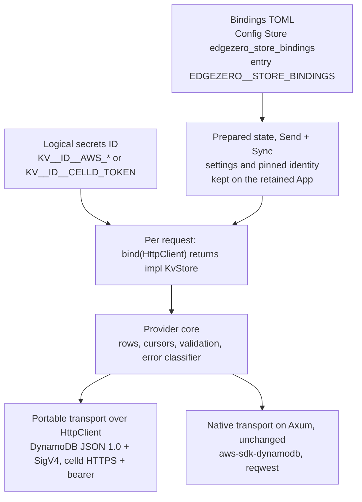

# Portable DynamoDB and celld record providers

Status: draft. Requirements were agreed on 2026-11-19. Implementation has not started.

Delivery: one EdgeZero PR closes [#474](https://github.com/IABTechLab/edgezero/issues/474). It stacks on [#517](https://github.com/IABTechLab/edgezero/pull/517) (`feat/portable-client-info`, planning baseline `10ed3803`), which already contains [#275](https://github.com/IABTechLab/edgezero/pull/275) and [#510](https://github.com/IABTechLab/edgezero/pull/510). Recheck heads before publication. The interview record is `Projects/Trusted Server/notes/Portable Record Providers Decisions.md` in the Obsidian vault.

## Goal

Run the DynamoDB and celld record providers from #510 on WASM targets over EdgeZero's outbound HTTP, and prove them on Fastly. Native stores (Fastly KV, Cloudflare KV, Spin KV) stay on their own platform (Trusted Server DEC-3). Each provider states the credential source it uses on WASM and a latency budget for a conditional write.

This is requirement EZI-2p in the [server-side identity design](https://github.com/IABTechLab/trusted-server/blob/c7dc9de77d31692412aec2768ae3f11fe0d52bbb/docs/superpowers/specs/2026-11-11-server-side-identity-all-adapters-design.md#ezi-asks-of-edgezero). It unblocks [#479](https://github.com/IABTechLab/edgezero/issues/479) (Cloudflare) and [#484](https://github.com/IABTechLab/edgezero/issues/484) (Spin).

## Requirements

| ID  | Requirement |
| --- | ----------- |
| P1  | One provider core per backend holds row encoding, cursors, validation and error classification. A transport trait sits under it. Axum keeps its native transport (`aws-sdk-dynamodb`, `reqwest`). WASM targets use `edgezero_core::outbound::HttpClient`. |
| P2  | The portable DynamoDB transport implements the JSON 1.0 protocol for GetItem, UpdateItem, PutItem, DeleteItem, Query and Scan, signed with the runtime-free `aws-sigv4` crate. It does not use `aws-sdk-dynamodb` on WASM. |
| P3  | Portable and native providers read and write the same rows: DynamoDB PK/SK layout, `r#` and `g#` kinds, allocator items, cursors, and celld `rows-v1`. An interop test writes with one transport and reads with the other, both ways. |
| P4  | DynamoDB on WASM signs with an access key, a secret key and an optional session token. A rotator can push short-lived STS credentials without code changes. Docs give a least-privilege IAM policy for the six runtime actions on one table. |
| P5  | celld on WASM accepts only `authenticated` access (HTTPS plus bearer token). Parsing rejects `trusted-network` on WASM. |
| P6  | The Fastly record contract runner passes in Viceroy for both providers, including the Add/CAS races and the 1001-key existence pages. CI runs it as a required job. |
| P7  | Fastly selects providers per KV ID from a runtime bindings document. Build features gate the provider code. IDs with no binding stay on Fastly KV. A binding for a provider the binary lacks fails the request. There is no fallback. |
| P8  | Fastly does no preparation I/O. The binding carries a pinned identity written by an offline preflight. |
| P9  | Credentials come from a declared logical secrets ID with namespaced, derived key names. They are read once per request when first needed and never cached across requests. |
| P10 | Portable providers do not retry. Failures map with the same classifier native uses. |
| P11 | The enforced default budget for a conditional write is 1,000 ms total with a 250 ms connect timeout. Measured p50 and p95 from a real Fastly service against `us-east-1` are recorded before merge. |
| P12 | The portable crates also compile for `wasm32-unknown-unknown` (Cloudflare) and `wasm32-wasip2` (Spin). Runtime wiring on those adapters stays in #479 and #484. |

Out of scope: Cloudflare and Spin runtime wiring, automated Config Store upload, hosted IAM or capacity qualification, global tables, data migration, and replacing the native Axum transports.

## Current state at `10ed3803`

- `KvStore` is `#[async_trait(?Send)]`. `HttpClient` returns `LocalBoxFuture`, so a portable provider fits the trait as is.
- `HttpClient` is per request, through `ctx.http_client()`. The Fastly adapter builds it in `outbound_client(clock)` (`crates/edgezero-adapter-fastly/src/request.rs`). Fastly outbound uses dynamic backends (`Backend::builder`), so any HTTPS endpoint is reachable.
- Fastly builds its KV registry on every request in `build_kv_registry_with_records`, and every ID becomes `FastlyKvStore`. There is no hook to pick another provider.
- `serve_app_with_hooks` keeps the `App` in a retained `Sandbox` across requests. The sandbox can be recycled at any time.
- `edgezero-store-aws` and `edgezero-store-celld` put every runtime dependency behind `cfg(not(target_arch = "wasm32"))`. `DynamoDbKvSettings` and `CelldKvSettings` are plain serde and already compile on WASM.
- Native DynamoDB record insert is UpdateItem (allocate a per-key generation) followed by a conditional or unconditional PutItem. celld insert is one request.
- Native preparation calls DescribeTable (`validate_table` rejects non-ACTIVE tables, indexes, replicas, global tables and the wrong key schema) and captures endpoint, table ARN and table ID into `RecordBinding.scope`. celld preparation calls `GET /v1/stores/{alias}/capabilities` and captures the store instance. Every celld record request must send `x-edgezero-expected-instance`.
- Native error mapping: `max_attempts(1)`. A construction failure or a 4xx service error becomes `Unavailable`. Any other mutation failure becomes `MutationUncertain`.
- Axum reads provider bindings from the TOML file at `EDGEZERO__STORE_BINDINGS_FILE` (`crates/edgezero-adapter-axum/src/native_bindings.rs`). Fastly already reads adapter settings from an optional Config Store, `edgezero_logging`, entry `EDGEZERO__LOGGING__LEVEL` (`crates/edgezero-adapter-fastly/src/config_store.rs`).
- Secrets: a logical secrets ID maps to a real Fastly Secret Store. Axum, Cloudflare and Spin secrets are flat, so the logical ID does not isolate keys there.
- CI already runs DynamoDB Local from a pinned image (`scripts/run_native_aws_integration.mjs`) and Viceroy (`scripts/ci_viceroy.sh`). The Fastly record contract runner is `crates/edgezero-test-harness/src/runners/record_contract.rs` with the fixture bin `fixture-fastly/src/bin/record_contract.rs`. Today it only checks `fastly-native`.

## Design



### Provider core and transports

Split `dynamodb_records.rs` and celld `records.rs` into a pure core and a transport. The core owns partition keys, sort keys, allocator items, cursor encoding, size checks, value-kind checks and the error classifier. The transport exposes the provider calls the core needs and nothing else. The native transport wraps the existing SDK and `reqwest` code. Axum behavior does not change.

The DynamoDB core cannot use SDK types such as `AttributeValue` or `SdkError` once it compiles for WASM. It needs its own small attribute model that both transports convert to and from.

### Portable transports

DynamoDB builds JSON 1.0 requests with `X-Amz-Target: DynamoDB_20120810.<Operation>`, signs them with `aws-sigv4` using wall-clock time, and sends them through `HttpClient`. Response errors parse `__type` so `ConditionalCheckFailedException` maps to `PreconditionFailed`.

celld reuses the existing request and response checks in `client.rs` (version headers, instance header, content type, strict JSON, size caps) over `HttpClient` instead of `reqwest`.

Both transports set an outbound deadline and connect timeout from the binding limits. Both disable redirects and decompression to match native behavior.

### API shape

Each portable provider has two parts.

- A prepared state that is `Send + Sync`. It holds parsed settings, the pinned identity, the `RecordBinding` and the secrets reference. The Fastly adapter builds it once per sandbox from the bindings document and keeps it on the retained `App`.
- `bind(HttpClient) -> impl KvStore`, which is cheap. The adapter calls it while building the per-request KV registry, with the same `HttpClient` it builds for that request.

The provider never reads `ctx`. `record_binding()` comes from configuration, so `require_records()` stays I/O-free. DynamoDB reports the configured payload budget. celld reports its fixed 1024-byte metadata limit.

### Bindings on Fastly

`edgezero.toml` only enables code:

```toml
[adapters.fastly.build]
features = ["aws-dynamodb-records", "celld-records"]
```

At runtime the adapter reads the optional Config Store `edgezero_store_bindings`, entry `EDGEZERO__STORE_BINDINGS`. The entry holds the same `version = 1` schema Axum reads from its file, extended with `pinned`, `credentials`, `token_secret` and the DynamoDB `endpoint`:

```toml
version = 1

[kv.identity]
provider = "aws-dynamodb-records"
region = "us-east-1"
table = "ts-identity"
namespace = "ts-prod/identity"
pinned = { table_arn = "arn:aws:dynamodb:us-east-1:111122223333:table/ts-identity", table_id = "…" }
credentials = { secrets = "stores" }

[kv.sessions]
provider = "celld-records"
endpoint = "https://celld.example.net"
store = "sessions"
pinned = { instance = "…" }
access = { mode = "authenticated", token_secret = { secrets = "stores" } }
```

A Config Store entry holds at most 8,000 characters. Bindings hold no secret values, so this is enough. Parse errors and unknown providers fail the request with a typed error. They never fall back to Fastly KV.

### Pinned identity and preflight

`edgezero config bindings pin --adapter fastly --store-bindings <file>` runs native preparation from the operator's machine. DynamoDB uses DescribeTable with the AWS SDK credential chain. celld uses `/capabilities` with a token from an environment variable. The command rejects tables and services that native preparation rejects, then writes `pinned` back into the file. `config validate` stays offline.

At runtime:

- DynamoDB builds `RecordBinding.scope` from endpoint, pinned ARN and ID, region, table and namespace, the same tuple native builds. Cursors stay bound to one physical table.
- celld sends the pinned instance as `x-edgezero-expected-instance` on every record request. After a store reset, requests fail on instance mismatch until the binding is updated.

Runtime IAM no longer needs DescribeTable. Converting the table to a global table after preflight breaks Add and CAS and is documented as an unsupported operator change.

Uploading the file uses the `fastly config-store-entry` commands, documented in the guide.

### Credentials

`credentials = { secrets = "<logical-id>" }` names a declared `[stores.secrets]` ID. EdgeZero derives key names from the KV logical ID:

| Provider | Keys for `[kv.identity]` |
| -------- | ------------------------ |
| DynamoDB | `KV__IDENTITY__AWS_ACCESS_KEY_ID`, `KV__IDENTITY__AWS_SECRET_ACCESS_KEY`, `KV__IDENTITY__AWS_SESSION_TOKEN` (optional) |
| celld | `KV__IDENTITY__CELLD_TOKEN` |

Bindings cannot name arbitrary keys, so a binding cannot read another component's secret. The prefix keeps keys apart on adapters with flat secrets. On Fastly the logical ID also maps to its own Secret Store. KV IDs that use these providers must match `[a-z0-9_]`, so uppercasing cannot make two IDs collide.

The provider reads credentials on the first operation of a request and reuses them for the rest of that request. Nothing is cached across requests, so rotation and revocation take effect on the next request.

### Axum handling of the new fields

Axum rejects `credentials` and `token_secret`, because it keeps env and SDK-chain sources. It accepts `pinned`. Startup fails if native preparation sees a different table ARN, table ID or celld instance.

### Errors and retries

One classifier serves both transports.

| Outcome | Result |
| ------- | ------ |
| `ConditionalCheckFailedException`, celld precondition rejection | `PreconditionFailed` |
| Failure before dispatch (binding, signing, backend creation, validation), definitive 4xx | `Unavailable` |
| Any failure after dispatch on a mutation (timeout, reset, 5xx, unreadable body) | `MutationUncertain` |

There are no automatic retries.

### Latency budget

The enforced default for portable bindings is a 1,000 ms operation deadline and a 250 ms connect timeout. Native keeps 5,000 ms and 1,000 ms. A DynamoDB Add or CAS makes two sequential calls under one shared deadline. A celld write is one call.

Expected cost is about 2 × POP-to-region RTT plus signing for DynamoDB and 1 × RTT for celld. Before merge, a scratch Fastly service against `us-east-1` records p50 and p95 for both providers with the POP named. The evidence goes in `docs/audits/evidence/` and the guide links it.

### Verification

- The Viceroy record contract runner gains `dynamodb-portable` and `celld-portable` receipts, with Add/CAS races, existence pages and cleanup for each.
- `fastly.toml` `[local_server]` supplies `edgezero_store_bindings` and fake credentials through `[local_server.secret_stores]`.
- DynamoDB Local uses the image already pinned in `run_native_aws_integration.mjs`. celld uses the official binary and the EdgeZero store service, as in the existing celld proofs.
- Interop tests cover native writes read by portable and the reverse, for both providers.
- Compile-only CI checks for `wasm32-unknown-unknown` and `wasm32-wasip2`.
- `scripts/check_native_store_dependency_contract.sh` allows the new WASM dependencies only behind the portable features.

### Docs

Update `docs/guide/kv-records.md`, `docs/guide/dynamodb-kv.md` and `docs/guide/native-celld-stores.md`. Cover Fastly bindings, preflight, credentials keys, the IAM policy, the upload steps and the latency evidence.

## Facts to confirm during implementation

Findings recorded on 2026-11-19 against `10ed38035cfa1ab2c88005f113720ff99a233893`. No factual contradiction with the agreed design was found. These checks used disposable probes outside the repository, not an implementation of the providers.

| Fact | Finding and evidence |
| ---- | -------------------- |
| SigV4 target support | Executed. The existing lockfile's `aws-sigv4 1.6.0`, with `default-features = false` and `features = ["sign-http", "http1"]`, builds and links for all three targets using Rust `1.98.1`. The probe uses `aws-credential-types 1.3.0`, JSON request bytes, the DynamoDB signing name, `us-east-1` and an optional session token. Signing returns a 64-character signature. No SDK, HTTP client or executor is needed. The transitive Tokio features are `default,sync`, not runtime or native I/O features; the existing feature-aware dependency policy permits them outside core. |
| Wall-clock time | Executed. `web-time 1.1.0` supplies `SystemTime` on all three targets. Convert its duration since `web_time::SystemTime::UNIX_EPOCH` to `std::time::UNIX_EPOCH + duration` for the signer's input. This avoids `std::time::SystemTime::now()` on `wasm32-unknown-unknown`, where it panics. The signing probe runs under Wasmtime `48.0.2` for Preview 1 and Preview 2, and under Node `24.20.0` with `wasm-bindgen 0.2.128` for the JavaScript target. A separate Preview 1 probe reads wall time in Viceroy `0.21.0`. These are local host checks, not hosted Fastly latency evidence or Cloudflare/Spin runtime wiring. |
| Viceroy stores | Executed. Viceroy `0.21.0`, using the repaired binary recorded in the earlier record implementation plan, reads `[local_server.config_stores.edgezero_store_bindings]` with `format = "inline-toml"` and a string `EDGEZERO__STORE_BINDINGS` entry under `.contents`. It also reads `[[local_server.secret_stores.stores]]` with `key = "KV__IDENTITY__AWS_ACCESS_KEY_ID"` and fake inline `data`. One HTTP request returns `config_store=passed secret_store=passed wall_clock_epoch_s=1795123743`. The existing reusable Fastly fixture already uses these store forms. The pinned source enforces the 8,000-character entry limit in `config/dictionaries.rs`, using `DICTIONARY_ITEM_VALUE_MAX_LEN` from `config/limits.rs`. |
| Retained prepared state | Source and call path confirmed. `App::insert_state` and `App::state` already store and borrow typed `Clone + Send + Sync + 'static` state through the router. Install an `Arc` of the prepared provider map in `build_target_app` after record-declaration validation. `serve_app_with_hooks` retains that exact `App` in `Sandbox<App>`; `Sandbox::initialize` retains successful construction only. No new App field, global cache or Sandbox lifecycle is needed. Runtime retention and credential-rotation regression tests remain implementation work. |

### Reproduction and implementation consequences

The local evidence is retained under `/home/pav/.cache/edgezero-474-facts/`. It includes the probe manifests, lockfiles and sources, `confirmed.log`, `js-probe.log`, and `viceroy/response.txt`. The disposable build directories are `/tmp/ez474-facts/` and `/tmp/ez474-viceroy-facts/`. The signing probe started from a copy of the repository lockfile; no repository dependency or source file changed for these checks.

```sh
# In /tmp/ez474-facts, once its retained probe sources are in place.
for target in wasm32-wasip1 wasm32-unknown-unknown wasm32-wasip2; do
  cargo +1.98.1 build --locked --offline --bin ez474-facts --target "$target"
done
# Execute the Preview 1 and Preview 2 binaries with Wasmtime 48.0.2.
# Generate the JavaScript library with wasm-bindgen 0.2.128, then:
node -e 'require("./js/ez474_facts.js").run()'
```

The successful WASI runs each reported `wall_clock_epoch_s=1795123812 sigv4_hex_len=64`. The JavaScript run reported `unknown-unknown web-time and SigV4 passed`. The scratch library also produces a harmless unused-main warning on WASI. Initial probe attempts hit a missing Wasmtime shim version and two scratch-code SDK type errors; explicit installed executables and corrected probe code produced the results above. These were not provider build failures.

The Viceroy executable used was `/home/pav/.cache/rc-refresh-20261110/target-viceroy-repair/debug/viceroy`, SHA256 `c846e8db180beeb1477fb504ec1d89c09251203633cd98c7fd9d97abbd7b9755`. The PATH executable reports `0.17.0` and must not be used as the pinned runtime. No Viceroy patch or pin changed.

Source locations for retention are `crates/edgezero-core/src/app.rs`, methods `insert_state` and `state`; `crates/edgezero-adapter-fastly/src/lib.rs`, functions `build_target_app` and `serve_app_with_hooks`; and `crates/edgezero-adapter-fastly/src/lifecycle.rs`, `Sandbox::initialize`.

Two request/test details must be preserved during implementation:

- The canonical KV registry is currently assembled before the request's `HttpClient` exists. Bind portable stores after request preparation extensions have merged, so they clone the same effective client as `ctx.http_client()`, including a hook-supplied client.
- DynamoDB cleanup must drain global Scan continuation even when a page has no logical keys. Allocator rows remain after value deletion. The fixture's current first-page-only cleanup assertion is Fastly-specific; do not delete allocators to satisfy it.
- Code shared with WASM must read clocks through `web_time`. The AWS settings validators call `std::time::Instant::now()` and DynamoDB record TTL calls `std::time::SystemTime::now()`; both panic on `wasm32-unknown-unknown`.
- `[adapters.fastly.build] features` is not forwarded to Cargo today. Only the Axum path forwards manifest build features, so Fastly needs that wiring before the example in this spec takes effect.

Authenticated local celld TLS through Viceroy still needs an executed trust-path check. Viceroy loads native certificate roots through `rustls-native-certs`; a process-local test CA is a candidate without disabling certificate verification. The historical native Fastly CAS emulator limitation recorded in the earlier record implementation plan is not cleared by these probes. Neither limitation changes the settled provider contract.
