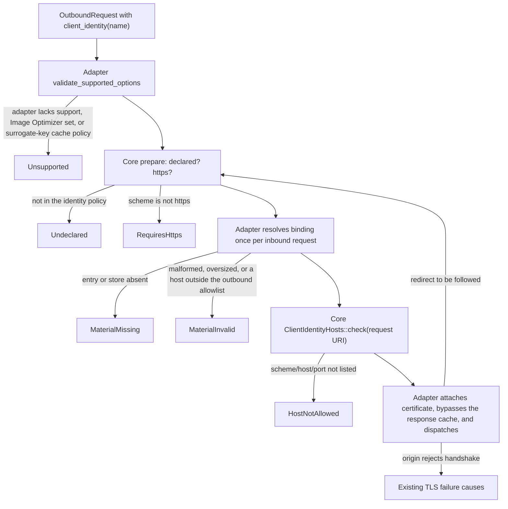

# Outbound Client Identity (mTLS), Fastly First

## Goal and scope

Let an EdgeZero application present a TLS client certificate on outbound HTTPS requests. The application names a declared client identity on the request. The adapter resolves that name to the provider's own certificate mechanism and attaches it to the connection. Application code never holds certificate or key bytes.

This change covers [#523](https://github.com/IABTechLab/edgezero/issues/523): the portable contract in core, and its Fastly implementation. Cloudflare, Spin and Axum reject any request that carries an identity until their follow-up issues land. The first consumer is Trusted Server's Prebid Server auction call ([trusted-server#1650](https://github.com/IABTechLab/trusted-server/issues/1650)).

Out of scope:

- Inbound mTLS, meaning certificates that clients present to EdgeZero.
- Verifying the origin's server certificate against a private CA. That belongs to [#81](https://github.com/IABTechLab/edgezero/issues/81). The first consumer's origin keeps a public certificate.
- Provisioning secret values through the CLI, certificate issuance, and automated rotation.
- Cloudflare, Spin and Axum implementations.

## Why a named identity

Each provider attaches client certificates differently, and two of them do it outside the application:

| Provider | Where the certificate is bound | Can the guest choose per request? |
| --- | --- | --- |
| Fastly Compute | `BackendBuilder::provide_client_certificate(pem_certificate, pem_key: Secret)` on a dynamic backend. Fastly asks callers to pass the key as a Secret Store handle without reading its plaintext | Yes, when the backend is registered |
| Cloudflare Workers | A `[[mtls_certificates]]` binding in the Wrangler config, used through `env.BINDING.fetch()` | No. One binding per certificate, fixed at deploy time |
| Spin | `[[client_tls]]` in the runtime config, matched by component and destination host | No. The host attaches it and the guest never sees it |
| Axum | `reqwest::Identity` on a dedicated `reqwest::Client` | Yes, with one client per identity |

A request that carried PEM bytes could not run on Cloudflare or Spin. On Fastly it would pull the private key into guest memory, which Fastly advises against. A name works on all four.

Trusted Server's release attestation rule R-CONFIG forbids operator configuration in the published binary. `edgezero.toml` may contribute logical facts, such as store IDs, but not deployment facts, such as a publisher's Prebid Server hostname. So the identity's name and the logical stores that hold its binding are compiled in, while its allowed hosts, certificate and key are bound at runtime.

## What application code can rely on

On every adapter that supports identities:

- An application selects an identity by name on one request, and nothing else changes on that request.
- A request that carries an identity is never sent without it. Every failure happens before network I/O.
- EdgeZero checks the request's scheme, host and port against the identity's runtime hosts on every hop.

These depend on the adapter:

- Whether a request without an identity presents a certificate. Spin attaches a configured certificate by component and destination host, whatever the guest asks for.
- Whether two identities can target the same host. On Spin they can't, for the same reason.
- Where the binding lives and how it is provisioned.

The Fastly binding meets all three guarantees and both adapter-dependent behaviors: a request without an identity presents no certificate, and identities choose per request. Each follow-up issue records its adapter's answers.

## Manifest

```toml
[capabilities]
optional = ["outbound-http", "outbound-client-identity"]

[capabilities.outbound]
hosts = ["https://*:*"]

[capabilities.outbound.client-identities.prebid-server]
secret-store = "default"      # optional; defaults to the [stores.secrets] default
config-store = "app_config"   # optional; defaults to the [stores.config] default

[stores.secrets]
ids = ["default"]

[stores.config]
ids = ["app_config"]
```

- `client-identities` is a table under `[capabilities.outbound]`, keyed by identity name. `ManifestOutboundCapability` keeps `deny_unknown_fields`. Each entry also rejects unknown fields, so later adapters must add their keys deliberately.
- Names match `[a-z0-9-]`, are 1 to 64 characters long, and do not start or end with `-`. Every derived entry name, such as `prebid-server.certificate`, is then a valid Fastly secret name (letters, digits, `-`, `_` and `.`) and config key.
- `secret-store` and `config-store` are optional. When one is given, manifest validation requires it to be declared in `[stores.secrets]` or `[stores.config]`. When one is omitted, the identity uses that kind's declared default, if there is one. The manifest itself does not require either kind of store, because only some adapters read their binding from stores.
- Fastly needs both stores. Its CLI check rejects an identity whose secret or config store cannot be resolved. See [CLI and configuration](#cli-and-configuration).
- The manifest carries no hosts, certificate or key. See [Fastly binding](#fastly-binding).

### Capability

Add `Capability::OutboundClientIdentity`, written `outbound-client-identity`. Fastly reports `Native`. Cloudflare, Spin and Axum report `Unsupported`, so an app that lists it under `required` fails the existing capability check for those adapters. An app that lists it under `optional`, or doesn't list it, still gets the runtime rejection described in [Dispatch rules](#dispatch-rules).

### Identity policy

Core owns the identity policy from manifest to client, so every adapter gets the same declarations without adapter code.

`app!` already bakes the validated manifest into `Hooks::manifest()`, which returns `BakedManifest::Present(&'static Manifest)` and caches it. `App::from_router::<A>`, which every adapter reaches through `App::build::<A>()`, builds a `ClientIdentityPolicy` from it once, the same way it already takes `A::name()`:

```rust
#[derive(Clone, Debug, Eq, PartialEq)]
pub struct ClientIdentityMetadata {
    pub name: String,
    /// Resolved logical `[stores.secrets]` id, if one could be resolved.
    pub secret_store: Option<String>,
    /// Resolved logical `[stores.config]` id, if one could be resolved.
    pub config_store: Option<String>,
}

pub struct ClientIdentityPolicy {
    // declared identities, plus [capabilities.outbound].hosts as canonical AtomicHost entries
}

impl App {
    /// Shared with each request's `HttpClient` by reference count.
    pub fn client_identity_policy(&self) -> &Arc<ClientIdentityPolicy>;
}
```

- No new `Hooks` methods and no new macro code. An absent or malformed baked manifest yields an empty policy, so every identity request fails as `Undeclared`.
- Every adapter dispatches through `App::dispatch_admitted_with_client_info` or `App::dispatch_ingress`, and both end in `dispatch_admitted_with_request_facts`, which already attaches Geo and ClientInfo to the request. There, core gives the policy to the `HttpClient` in the request's extensions, unless that client already carries one. That covers adapter-built clients and clients supplied by preparation hooks.
- Apps that build an `App` without `Hooks::manifest()` get an empty policy, and identity requests fail as `Undeclared`.
- The policy also carries the outbound allowlist. Today that allowlist is checked only against Spin's `allowed_outbound_hosts`, by the CLI at build time. The host check below needs it at runtime. It comes from the tracked manifest, so using it at runtime adds no operator configuration to the binary.
- `App` is retained across requests under `serve_app`, so the policy is built once per instance.

## Request contract

```rust
/// Validated identity name, using the manifest's naming rules.
#[derive(Clone, Debug, Eq, Hash, PartialEq)]
pub struct ClientIdentityName(/* private */);

impl ClientIdentityName {
    pub fn new(name: &str) -> Result<Self, EdgeError>;
    pub fn as_str(&self) -> &str;
}

impl OutboundRequest {
    /// Present this declared client identity on the TLS connection.
    pub fn client_identity(self, name: ClientIdentityName) -> Self;
    pub fn client_identity_name(&self) -> Option<&ClientIdentityName>;
}

pub struct OutboundRequestParts {
    // existing fields unchanged
    pub client_identity: Option<ClientIdentityName>,
}
```

- The identity is set on a single request. `HttpClient` has no default identity.
- `replay_request` in `outbound/redirect.rs` destructures every field, so the new field joins it and redirect hops carry the identity forward. Cross-origin hops keep it as well. They do not strip it the way they strip `Authorization`, `Cookie` and the host override. The host rule below decides whether such a hop may be sent.
- Core attaches the app's policy to the request's `HttpClient` at dispatch (see [Identity policy](#identity-policy)). Adapters don't pass it. Clients that never pass through dispatch, such as ones built directly in tests, have no policy and treat every identity as undeclared.

## Dispatch rules



All of these checks run before any network I/O, on the initial request and on every redirect hop.

1. **Adapter support.** `OutboundHttpClient::validate_supported_options` rejects an identity when the adapter lacks support. On every adapter it also rejects an identity combined with Image Optimizer options, or with `OutboundCachePolicy::PlatformDefaultWithSurrogateKey`:
   - #275 sends Image Optimizer requests through a separate Fastly path, and nothing shows that path can present a client certificate.
   - The surrogate-key policy exists only to manage cached objects, and identity responses are never cached (rule 5).
2. **Declaration and scheme.** `dispatch::prepare` looks up the name in the client's identity policy and requires `https`. This runs in core, so every adapter returns the same errors.
3. **Binding.** The adapter resolves the identity's runtime binding at most once per inbound request. Later hops and later calls in the same inbound request reuse it. The next inbound request reads it again, so rotation takes effect on the next request. On Fastly the binding is two config entries and one Secret Store entry, read through #275's bounded reads, so the reads count against the dispatch deadline.
4. **Hosts.** Core parses the hosts entry with `ClientIdentityHosts::parse(bytes, allowlist)`, and the adapter calls `ClientIdentityHosts::check(uri)` on every hop. Both are core functions, so parsing and matching are identical across adapters even though only the adapter can read the entry. Parsing rules:
   - One origin per line: `https://host` or `https://host:port`. No path, query, userinfo or wildcard. Blank lines are ignored. A missing port means 443. Hosts follow the outbound allowlist grammar: ASCII only, so internationalized names are written in punycode, and compared lowercase.
   - At least one origin.
   - Every origin must be allowed by the outbound allowlist in the identity policy. If any origin isn't, the whole identity fails as `MaterialInvalid`, so a provisioning mistake shows up on the first request instead of the first request to that host.
   - The check compares the request URI's scheme, host and port, which is where the connection goes. `host_authority_override` and the `Host` header are not compared, and overriding `Host` on an allowed origin stays permitted.
5. **Response cache.** An identity request always bypasses the provider's response cache, as if `OutboundCachePolicy::Bypass` were set. Fastly's default cache key is the request URL and `Host` header, without the backend or certificate. A cached identity response could otherwise be served to a request without the identity, and a cache hit would skip the handshake. Requests without an identity keep their cache behavior.
6. **Attach and send.** See [Fastly binding](#fastly-binding).

Redirects need no separate code path. Each hop goes through `dispatch::prepare` and the adapter's dispatch again. A hop to an origin outside the hosts list fails with `HostNotAllowed` before it is sent. The follower reports it as `OutboundFollowFailure::Hop { index, .. }`, and because it knows the hop index, it marks the error as a redirect failure.

Batches (`send_all_until`, `start_batch_until`) apply the same rules to each slot. A slot that fails a rule fails alone, under the existing slot-isolation behavior.

## Errors

Add `EdgeError::ClientIdentity { name: String, reason: ClientIdentityError }`. It follows `StoreExtraction`, where the reason chooses the HTTP status:

| `ClientIdentityError` | When | Status |
| --- | --- | --- |
| `Undeclared` | The name is not in the identity policy | 500. The application references an identity its manifest doesn't declare |
| `RequiresHttps` | The request URI is not `https` | 500. Application bug |
| `Unsupported { adapter: &'static str }` | The adapter lacks support, Image Optimizer options are set, or the cache policy carries surrogate keys | 500. Application or deployment-target bug |
| `MaterialMissing { which: Certificate \| Key \| Hosts \| Store }` | An entry is absent, a store can't be resolved or opened | 503, like `MissingSecret` |
| `MaterialInvalid { which }` | The certificate entry has no PEM `CERTIFICATE` block, an entry exceeds its size cap, or the hosts entry is malformed or outside the outbound allowlist | 503 |
| `HostNotAllowed { redirect: bool }` | The request origin isn't in the identity's hosts | 503 on the initial request, which is a deployment mismatch. 502 on a redirect hop, because the upstream sent the redirect |

- A bounded read that hits the deadline keeps #275's existing `GatewayTimeout`. Identity errors do not mask timeouts.
- An origin that rejects the handshake surfaces through the existing provider failure causes (`TlsCertificateError`, `TlsAlertReceived`, `TlsConfigurationError`) with no new mapping. A mismatched certificate and key, for example during rotation, fails the same way. Viceroy never fills in send-error detail ([Viceroy#727](https://github.com/fastly/Viceroy/issues/727)), so locally the guest sees a generic `InternalError` instead, and local tests don't check these causes.
- `Display` and `Debug` show the identity name and the reason. They never show key bytes or PEM contents. For `HostNotAllowed` they show the request's scheme, host and port, never the path or query.

## Fastly binding

### Entries

Only the private key needs the Secret Store. The certificate is public, and the hosts list isn't secret. Fastly allows 5 Secret Store reads per Compute request by default, and the application shares that budget. Fastly lists no per-request read limit for the Config Store. So the binding spends one Secret Store read:

| Store | Entry | Contents | Read | Cap |
| --- | --- | --- | --- | --- |
| Config Store (`config-store`) | `<name>.certificate` | PEM chain, leaf first | Bounded config read | 8,000 characters, Fastly's config value limit |
| Config Store (`config-store`) | `<name>.hosts` | Origins, one per line | Bounded config read | 4,000 characters |
| Secret Store (`secret-store`) | `<name>.private-key` | Unencrypted PEM private key | `fastly::secret_store::Secret` handle only. Never `plaintext()`, `try_plaintext()` or a bounded read | Fastly's 64 KB secret limit |

- Both stores open through the same resource-link aliases that `run_app` uses for `[stores.config]` and `[stores.secrets]` IDs.
- A chain longer than 8,000 characters fails as `MaterialInvalid`. A leaf plus one intermediate is usually 2 to 5 KB of PEM. Chunked storage for longer chains is a follow-up, if an operator needs it.
- The key handle stays inside the Fastly adapter. Core gets no portable secret-handle type, and the portable `SecretStore` trait still returns bytes.
- EdgeZero checks only that the certificate entry holds at least one PEM `CERTIFICATE` block that decodes to DER. It does not check expiry, the `clientAuth` EKU, or whether the key matches. The origin's handshake decides those.
- The certificate fingerprint is the SHA-256 of every certificate in the entry, each DER encoding length-prefixed, in entry order. So replacing only an intermediate also changes it. Logs show the leaf certificate's own SHA-256, which is what operators can compare against `openssl x509 -fingerprint -sha256`.

### Reads per inbound request

`FastlyOutboundClient` is built fresh for each inbound request, so it holds the resolved config binding for exactly one request. The first dispatch that uses an identity reads its two config entries. Later hops and calls in the same inbound request, for the same identity, reuse them.

The key is different. `fastly::secret_store::Secret` is neither `Clone` nor `Sync`, and `provide_client_certificate` takes it by value, so a handle cannot be cached and reused. The adapter opens the key only when a backend must be registered. A request whose backend is already registered in the instance's registry opens no key.

| Per identity | Count |
| --- | --- |
| Config Store reads | 2 per inbound request |
| Secret Store reads | 1 per backend registration; 0 when the backend is already registered |

One inbound request registers more than one backend for an identity only when it reaches different origins or uses different timeout settings with that identity. Whether Fastly counts opening a `Secret` handle as a read is not documented; this design assumes it does. The guide states the budget against Fastly's default of 5 reads per request, which the application's own reads share and Fastly can raise.

### Rotation

To rotate, the operator overwrites `<name>.certificate` in the Config Store and `<name>.private-key` in the Secret Store. Those are two writes to two stores, so they are not atomic. A request that reads one new entry and one old entry presents a mismatched pair, and the handshake fails with the existing TLS causes. Each new inbound request reads both again, so that window closes once both writes have reached the POP. The guide documents this, and the order that keeps the window short: write the new key and certificate in quick succession, then confirm with a request.

### Backend registration

- `BackendIdentity` gains `client_identity: Option<(String, [u8; 32])>`, holding the name and the chain fingerprint.
- `backend_name` hashes them when present. The backend name prefix moves from `ez_b31v1_` to `ez_b31v2_`, as the comment there requires for any change to the hashed key. Existing golden names are regenerated in the same commit, and each golden test states why its value changed.
- So these never share a backend: a request with an identity and one without, two identities, and one identity before and after a change to any certificate in its chain. That holds for #275's per-instance registry under `serve_app`, and for Fastly's connection pool, which matches on name and settings.
- `ensure_backend` calls `provide_client_certificate(certificate_pem, key_secret)` after the existing `enable_ssl`, `check_certificate` and `sni_hostname` calls. It changes no other builder setting. Connection pooling keeps its default (on).
- Fastly returns `BackendCreationError::Disallowed` when the service can't create dynamic backends, and that keeps its existing mapping.

### Logging

The adapter logs, at debug level, the identity name and the leaf fingerprint when it registers a new identity backend. It never logs key bytes, certificate PEM, or the hosts entry's contents.

## Other adapters

Cloudflare, Spin and Axum return `ClientIdentityError::Unsupported` from `validate_supported_options` and report `Unsupported` for the capability. The core contract leaves room for their bindings, and each follow-up issue records its adapter's answers to [What application code can rely on](#what-application-code-can-rely-on):

| Adapter | Expected binding | Known limits |
| --- | --- | --- |
| Cloudflare | A `[[mtls_certificates]]` binding per identity, which the adapter selects as the `Fetcher`. Hosts come from deploy-time operator config. The Wrangler config is operator config, so R-CONFIG still holds | `wrangler dev` needs `--remote` to use the binding. Requests to proxied Cloudflare zones fail with 520 |
| Spin | `[[client_tls]]` entries generated from the identity's hosts and the operator's certificate and key file paths, scoped to the app's component. The guest checks hosts the same way before dispatch | Spin attaches the certificate by component and host, so a request without an identity to a configured host still presents it, and two identities can't share a host |
| Axum | Certificate and key read from configured paths or env, with one `reqwest::Client` per identity, built lazily and reused | None known |

## CLI and configuration

- Manifest validation enforces the naming rules and checks that any named `secret-store` or `config-store` is declared.
- A new `Adapter::validate_client_identities(&Manifest)` hook, defaulting to no checks, runs in the same CLI step that enforces required capabilities. Fastly's version rejects an identity whose secret store or config store can't be resolved, from its explicit field or the declared default.
- The existing required-capability check covers `outbound-client-identity`.
- The CLI does not read, generate or push config or secret values. Viceroy setup is documented, not generated.

## Documentation

| Page | Content |
| --- | --- |
| `docs/guide/proxying.md` | A "Client certificates (mTLS)" section: declaring an identity, `.client_identity()`, what application code can rely on, the host rules, redirects, the response-cache bypass, the error table, and the per-adapter support status |
| `docs/guide/adapters/fastly.md` | The three entries and their stores, PEM format, the key-handle rule, the Secret Store read budget, rotation and its non-atomic window, the backend name change, and commented `[local_server.config_stores]` and `[local_server.secret_stores]` examples for Viceroy |
| `docs/guide/capabilities.md` | `outbound-client-identity` in the capability matrix |
| `docs/guide/configuration.md` | `[capabilities.outbound.client-identities.<name>]` and its fields |

`app-demo` gets no route, because demonstrating one would need a mutual-TLS origin.

## Testing

Merging requires local evidence only. Certificates are generated per run with `rcgen`, so the repository holds no keys or expiring certificates.

| Area | Evidence |
| --- | --- |
| Manifest and policy | Name rules, unknown stores, unknown fields, default stores, a manifest with no stores, and the policy `App` builds from `Hooks::manifest()`, including absent and malformed manifests. Dispatch attaches the policy to an adapter-built client and to a client supplied by a preparation hook, and leaves a client that already carries a policy unchanged |
| CLI | Fastly's identity check rejects unresolvable stores. The required-capability check fails for Cloudflare, Spin and Axum and passes for Fastly |
| Core | `ClientIdentityName` validation. `Undeclared` and `RequiresHttps` before I/O. Hosts parsing, covering ports, case, non-ASCII names, blank lines, paths, wildcards, an empty entry, and an origin outside the allowlist. A host-override request is still allowed. `replay_request` carries the identity. A same-origin hop and a hop to another listed host are sent, and a hop to an unlisted host fails with its index before dispatch. Batch slot isolation. Each error's status and redacted `Display` and `Debug` output |
| Unsupported adapters | Cloudflare, Spin and Axum reject an identity request before I/O |
| Fastly native | `backend_name` differs for no identity, two identities, and two chain fingerprints of one identity. Changing only an intermediate changes the fingerprint. A changed chain registers a new backend in a warm registry. Updated golden names. Missing entries, a malformed certificate and oversized entries map to their reasons. Identity requests are sent with the cache bypassed, and the surrogate-key policy is rejected. The binding cache reads each config entry once per inbound request, caches missing and invalid material, and retries after a deadline |
| Fastly runtime (patched Viceroy from `patches/viceroy`) | A new `edgezero-test-harness` runner starts host-side rustls origins that require client certificates from a per-run CA. The origins record every TCP accept before TLS, and separately record the certificate presented in each completed handshake. The runner writes the Viceroy config and secret store entries and runs the cases: the identity request succeeds with the expected certificate; requests without the identity, and with a certificate from a different CA, fail in the guest as a transport error, and the origin's records show a TCP accept with a failed handshake and no accepted client certificate. The runner records whatever cause Viceroy reports without asserting it; a relaunch with a replaced certificate presents the new one; `Undeclared`, `RequiresHttps`, Image Optimizer and a redirect to an unlisted host fail with no TCP accept at the origin they would have reached |
| Integration | The workspace gates in `CLAUDE.md`, `scripts/test_integration.sh --adapter fastly --suite ci` including the new runner, and the docs ESLint and Prettier checks |

Viceroy loads its config and secret stores at startup, so the runtime test proves a replaced certificate is read after a restart. The warm-registry behavior is proved natively.

Local evidence closes #523. A hosted Fastly check is not part of this change. Trusted Server's staging run for #1650 exercises the identity against a real origin, and is where the Secret Store read budget gets checked against Trusted Server's own reads.

## Issue coverage

| #523 condition | Met by |
| --- | --- |
| Reviewed design spec | This document |
| `OutboundRequest` carries a validated name and never key material | [Request contract](#request-contract) |
| An origin outside the identity's hosts, including after a redirect, fails before I/O | [Dispatch rules](#dispatch-rules) |
| Fastly presents the certificate with the key as a Secret Store handle | [Fastly binding](#fastly-binding) |
| Backend name includes the identity and certificate fingerprint | [Backend registration](#backend-registration) |
| Undeclared, missing and unsupported cases fail before I/O with documented errors | [Errors](#errors) |
| Viceroy test with handshake success and failure | [Testing](#testing) |
| Docs for declaring, provisioning and rotating | [Documentation](#documentation) |
| Follow-up issues for Cloudflare, Spin and Axum | Opened with the PR |

The PR description says `Closes #523`.

## Branch and delivery boundary

The branch `feat/523-outbound-client-identity` stacks on [#522](https://github.com/IABTechLab/edgezero/pull/522), `feat/474-portable-record-providers`. That is the top of a linear stack running from #275 through #499, #460, #406, #407, #409, #414, #422, #439, #510, #454 and #517. No RC branch is a base or merge target.

There is one PR, with commits in this order: this spec, the implementation plan in `docs/superpowers/plans/`, then the core and Fastly changes. When the PR opens:

- Create the Cloudflare, Spin and Axum follow-up issues, each with its adapter's known limits.
- Add #523 to #79's child list.
- Comment on #81 that origin CA pinning is not a dependency of #523.
