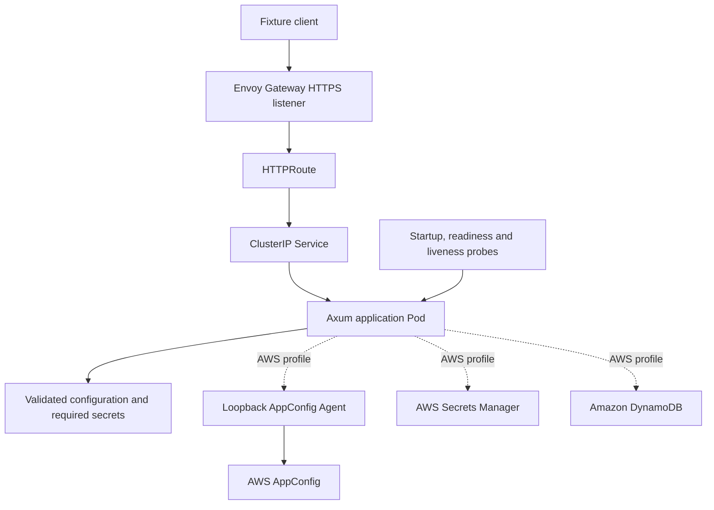

# Deploying Axum applications on Kubernetes

::: warning Draft, not deployment acceptance
This guide defines the Kubernetes recipe for [#400](https://github.com/IABTechLab/edgezero/issues/400). Runnable manifests, controller/image pins and disposable-cluster execution are not delivered yet. The YAML fragments below are design examples, not a complete deployment. Do not treat them as production verification.

Production entrypoints, probes, startup validation and shutdown must use the accepted runtime contracts. The current container packaging response at `/` is not readiness.
:::

## Deployment scope

Start with a disposable **kind** cluster and **Envoy Gateway** implementing Gateway API. Use plain application manifests. Envoy Gateway supports installation from Kubernetes YAML, so the initial recipe does not require an application Helm chart, a service mesh or an operator.

ECS/Fargate remains the first managed AWS deployment target. A local Kubernetes run does not establish EKS, IAM, cloud storage or AWS load-balancer support.

Use three separate profiles:

| Profile                     | Configuration and secrets                           | Mutable application state                          | Acceptance boundary                                                                   |
| --------------------------- | --------------------------------------------------- | -------------------------------------------------- | ------------------------------------------------------------------------------------- |
| Local stateless fixture     | Reviewed local inputs and synthetic fixture secrets | None                                               | Credential-free disposable-cluster checks                                             |
| AWS provider profile        | AppConfig Agent and Secrets Manager                 | DynamoDB through the accepted ordinary-KV provider | Real AWS calls require separate authorization and a reviewed workload-credential path |
| Local single-writer fixture | Reviewed local inputs and synthetic fixture secrets | Embedded redb on a durable volume                  | One writer, tested storage permissions and stop-before-start replacement              |

DynamoDB is included in the planned AWS profile from the outset, once its provider is accepted and integrated. It is not required for applications without mutable state. The default local checks require no AWS credentials and must not silently switch to cloud services.

EdgeZero owns the generic fixture, manifests and checks. Application repositories own images, required inputs, signing policy, infrastructure, workload sizing, releases and deployment approval. Trusted Server's identity/CAS and signing requirements remain downstream.

## Why Envoy Gateway

Gateway API separates infrastructure-owned listeners from application routing. The application uses a `Service` and `HTTPRoute`; the local test supplies a `GatewayClass`, `Gateway` and TLS certificate. Those application resources can be reviewed independently of a particular cloud load balancer.

Envoy Gateway is the selected reference controller, not a guarantee that every Gateway API implementation behaves identically. Its [YAML installation](https://gateway.envoyproxy.io/docs/install/install-yaml/) and [compatibility matrix](https://gateway.envoyproxy.io/news/releases/matrix/) provide the starting point for choosing a supported test combination.

Before execution, record the exact kind release, node image digest, Kubernetes version, Gateway API CRDs, Envoy Gateway release and controller/data-plane image digests. Do not install from `latest`, blindly replace existing CRDs or copy an upstream quickstart's echo application as EdgeZero runtime evidence. A public release number alone is not a verified image pin.



## Image and runtime prerequisites

Use the [container packaging contract](../../guide/deploying-axum-containers.md) and [application-owned publishing contract](../../guide/publishing-axum-containers.md). Deploy the accepted native child digest for a homogeneous test cluster, or a verified runtime index whose children support the selected nodes. Never rebuild during deployment.

A provider-enabled image is a new candidate if its binary or build inputs differ from the packaging fixture. Build and test it through the same artifact handoff, then retain its own release evidence. Report-only packaging scans do not authorize a deployment release.

Before writing runnable manifests, settle:

- The production entrypoint and initializer that validate required typed config and nested secret references before listening.
- Actual application-owned startup/readiness/liveness routes, their port and measured probe budgets.
- Image/node architecture agreement and the registry pull path inside kind. Imported tags or a host Docker image ID alone do not prove retained manifest identity.
- Supported local input paths and native provider bindings, with no runtime loading of an invented `edgezero.toml`.
- Fixture resource requests/limits, termination budget and bounded client/check timeouts. These are measured fixture settings, not universal workload defaults.

No fixed probe paths, resource limits or image digests are invented by this draft.

## Workload and security settings

The planned manifest set lives under `examples/axum-deployment/kubernetes/`. That directory is not delivered yet. Keep the default fixture, AWS additions and persistent profile separate rather than maintaining three independent deployment frameworks.

The default set needs a Namespace, ServiceAccount, Deployment, ClusterIP Service, reviewed ConfigMap/Secret references and the Gateway API resources. Keep cluster-scoped controller installation separate from application resources.

Use application UID/GID 10001 and restricted execution. This container fragment expresses the intended restrictions, but omits the image, probes, resources, volumes and deployment metadata:

```yaml
securityContext:
  runAsNonRoot: true
  runAsUser: 10001
  runAsGroup: 10001
  allowPrivilegeEscalation: false
  readOnlyRootFilesystem: true
  capabilities:
    drop: [ALL]
```

Set Pod `seccompProfile.type: RuntimeDefault`. The local fixture does not need Kubernetes API access, so disable automatic ServiceAccount token mounting there. An AWS identity mechanism may need a specific projected token and must be configured separately, not assumed from the local profile.

Provision only required writable paths. Do not attach an emptyDir or persistent volume to make the entire application root writable. Do not use a privileged startup wrapper, root chown init container or world-writable permissions to hide a storage ownership problem.

ConfigMaps can carry non-secret native bindings and accepted local configuration files. Kubernetes Secret references can supply synthetic local fixture values through the supported environment mechanism. Mounting a secret file alone does not populate an environment-backed secret store. Kubernetes Secret base64 encoding is not encryption or a replacement for production secret-access policy.

## Probes and initialization failures

Use kubelet HTTP probes against actual application routes. They need no curl/wget inside the image. A successful TCP connection or the packaging response at `/` does not establish initialized application readiness.

| Probe     | What it establishes                                                                    | What it must not imply                                                               |
| --------- | -------------------------------------------------------------------------------------- | ------------------------------------------------------------------------------------ |
| Startup   | The process has completed its bounded startup path sufficiently to begin normal probes | Unbounded waiting for missing configuration                                          |
| Readiness | This initialized application can accept the work defined by its dependency policy      | Every possible downstream service is healthy or every client will receive a response |
| Liveness  | The process needs replacement under the app's documented health policy                 | A transient AWS failure should restart every replica                                 |

Make the startup window accommodate the accepted initialization budget without hiding permanent failure. Required input or validation failure must exit or remain non-serving with an observable finite outcome. It must never load development defaults after selecting an explicit provider.

Exercise missing configuration, malformed envelopes, unresolved required secrets and incompatible release inputs. Observe the process and client traffic, not merely `kubectl rollout status`. Document whether a withdrawing listener produces refusal/reset or a probe response instead of promising a particular status code.

## HTTPS routing and proxy trust

Use an HTTPS `Gateway` listener and `HTTPRoute`, with TLS terminated at Envoy and the accepted Axum backend protocol configured explicitly. Client HTTP/2 negotiation does not prove HTTP/2 support on the backend connection.

The following routing fragment uses fictional fixture names. It assumes an installed matching GatewayClass, a same-namespace TLS Secret and an existing `axum-fixture` Service on port 8787. It does not create those prerequisites:

```yaml
apiVersion: gateway.networking.k8s.io/v1
kind: Gateway
metadata:
  name: axum-fixture
  namespace: edgezero-kubernetes-probe
spec:
  gatewayClassName: axum-fixture
  listeners:
    - name: https
      protocol: HTTPS
      port: 443
      hostname: axum-fixture.example.test
      tls:
        mode: Terminate
        certificateRefs:
          - kind: Secret
            name: axum-fixture-tls
      allowedRoutes:
        namespaces:
          from: Same
---
apiVersion: gateway.networking.k8s.io/v1
kind: HTTPRoute
metadata:
  name: axum-fixture
  namespace: edgezero-kubernetes-probe
spec:
  parentRefs:
    - name: axum-fixture
      sectionName: https
  hostnames: [axum-fixture.example.test]
  rules:
    - backendRefs:
        - name: axum-fixture
          port: 8787
```

Use a disposable certificate whose SAN covers the fixture hostname and an explicit test CA. Do not disable client certificate verification. Production certificate issuance, renewal and private keys are operator-owned, not generated application-image contents.

Check Gateway `Accepted`/`Programmed` and the matching HTTPRoute parent `Accepted`/`ResolvedRefs` conditions, then exercise actual HTTPS traffic. A kind cluster needs an explicit local exposure mechanism. For NodePort exposure, the kind node mapping's container port must match the Service's `nodePort`, and the host binding must stay loopback-only; do not assume a LoadBalancer address appears automatically. Record that mechanism and its limitations.

Forwarding to the application Service bypasses Envoy. Forwarding to Envoy can diagnose TLS/routing, but still does not prove the complete configured exposure path. Acceptance must use that path and test wrong-hostname and untrusted-CA rejection.

Restrict trusted forwarded metadata to the accepted proxy boundary. Do not trust the entire Pod CIDR, every namespace or any client-supplied `X-Forwarded-*` header. Test direct requests from an unrelated Pod and spoofed metadata through Envoy.

If NetworkPolicy is part of the isolation claim, select and test a CNI that enforces it. Creating policy objects is not enforcement evidence. Account for kubelet probes and required egress rather than accidentally blocking startup, DNS or the approved AWS access path. Keep controller/admin ports outside client routing.

## AWS profile with DynamoDB

Use the [AWS reference design](https://github.com/IABTechLab/edgezero/blob/main/docs/superpowers/plans/aws-reference-deployment.md) for provider, release and IAM ownership. The first AWS Kubernetes profile includes AppConfig Agent, Secrets Manager and DynamoDB through their accepted portable interfaces. Do not add Redis or a shared redb volume to bridge these services.

Mount non-secret native resource mappings through a reviewed ConfigMap and select the accepted bindings file explicitly. Keep actual credentials, application secrets and signing keys out of image layers, ConfigMaps and source-controlled YAML. Build features must include the selected providers; a bindings file cannot enable code absent from the binary.

Run AppConfig Agent in the application Pod's network namespace. Explicitly configure a literal-loopback endpoint and reviewed bearer-token authentication. Do not rely on its container-environment bind default or expose port 2772 through a Service/Gateway. Disable disk backups/preload in the initial profile and review both application and Agent logging for secret/token disclosure.

A loopback-only Agent cannot be checked by an ordinary HTTP probe targeting the Pod IP. Select a supported in-container probe for the reviewed Agent image, or an accepted bounded initialization/restart path. Do not invent an Agent health command or add curl merely to complete the YAML. Regular Pod containers have no implicit startup order; native sidecar ordering is available only under the pinned Kubernetes contract and still requires verified wiring.

Application configuration and secret values are immutable startup snapshots initially. Agent polling does not hot-reload typed application state. Restart to adopt a reviewed config revision or secret version. Secret deletion/revocation does not erase already loaded values, so emergency replacement remains an operator procedure.

DynamoDB is different: ordinary KV operations perform live remote I/O. Scope runtime access to the approved table and required operations. Runtime state writes are allowed; image publishing, configuration deployment, secret mutation and infrastructure changes remain operator-only. Apply the accepted provider's payload, key, TTL, pagination, timeout and retry limits. Asynchronous DynamoDB TTL deletion is not logical expiry, and a failed write may have an unknown effect.

A Kubernetes ServiceAccount alone does not grant AWS access. On a future EKS deployment, select and qualify a workload-identity mechanism supported by both the pinned SDK and Agent. Containers sharing the Pod's credential delivery are not independent security principals. Do not copy an ECS task-role example into Kubernetes or add long-lived AWS keys to a Secret.

The local baseline must run without AWS credentials or service calls. AWS wiring can be reviewed and tested with deterministic fixtures, but that does not prove real IAM, table access or version adoption. Real AWS acceptance needs an approved credential/environment path, resource and cost limits, and cleanup ownership. EKS deployment is not included in the first local milestone.

DynamoDB externalizes state; it does not certify application concurrency. Do not enable multi-replica identity mutation on the strength of ordinary CRUD/list tests. Trusted Server's conditional creation, generation/CAS and consent-withdrawal semantics need their separate backend acceptance.

## Single-writer redb profile

Keep embedded persistence separate from the stateless/AWS profiles. Use one application replica, no HPA and a verified stop-before-start rollout. A PVC, ReadWriteOnce access mode, a StatefulSet or `Recreate` alone does not prove that an old writer has stopped, especially after node isolation or force deletion.

Provision the volume for the runtime UID/GID with the chosen storage driver's supported ownership mechanism. Keep the root filesystem read-only. Record the actual storage class/driver and limit durability claims to its tested behavior.

Test container restart and replacement Pod reads from the same volume, denied ownership, competing-writer rejection and recovery after interrupted work. Confirm old process exit and lock release before replacement. If an old writer cannot be proven stopped, stop the replacement procedure and follow the operator's fencing/recovery policy. Do not force-delete a stuck Pod and call API-object disappearance proof of process exit.

Stop the sole writer before a file-level backup. Restore a known fixture value and check it through the application. Volume retention/deletion policy and backups belong to the application operator; deleting a namespace is not permission to delete production data.

## Shutdown, upgrades and rollback

Set `terminationGracePeriodSeconds` longer than the accepted runtime drain budget plus any selected hook/sidecar overhead. A `preStop` hook consumes the same grace period. Do not add a sleep hook and claim graceful shutdown from elapsed time.

EndpointSlice and proxy updates are asynchronous with termination. The application must enforce its own withdrawal/drain contract rather than assume all new connections disappear instantly. Test finite in-flight work, never-ending work, stalled readers and final forced termination through the actual routing path. Capture responses, connection outcomes, exit status and elapsed time.

A rolling update is allowed only for a fixture whose state and release inputs permit overlapping replicas. Use bounded rollout deadlines and record the selected availability policy. The redb profile must not overlap writers.

Retain the previous image digest and compatible config/secret identities before upgrading. Apply the reviewed image and external inputs together, then observe startup, readiness and client behavior. For a failed upgrade, preserve usable old capacity where the profile supports it and inspect the failure before rollback.

An image-only `kubectl rollout undo` does not restore a changed ConfigMap, secret stage or data schema. Restore the compatible release inputs explicitly. Use new immutable input references where practical, and validate expected revisions before serving. Stateful schema changes and signing-key rotation remain application-owned policies.

## Disposable-cluster acceptance

The repeatable test will be a bounded, opt-in exercise using the same retained fixture artifacts as container acceptance. It must target an explicitly selected disposable context, use unique run identities and clean up after partial failure. Do not run against the operator's current context by default.

| Check                       | Required observation                                                                                                                                                      | Evidence boundary                                                          |
| --------------------------- | ------------------------------------------------------------------------------------------------------------------------------------------------------------------------- | -------------------------------------------------------------------------- |
| Setup and identity          | Compatible pinned node/controller inputs; actual application/native manifest identity agrees with scheduled architecture                                                  | Local cluster; each architecture claimed must execute natively             |
| Restricted execution        | Non-root/read-only application root, explicit writable paths, reviewed service-account/token access and no exposed Agent/admin ports                                      | Actual Pod behavior, not manifest inspection alone                         |
| Valid and invalid startup   | Valid required inputs initialize before traffic; missing/malformed/mismatched inputs do not become ready or admit application work                                        | Process, probe and client observations                                     |
| Probe distinction           | Startup, readiness and liveness follow their documented meanings without masking permanent initialization failure                                                         | Actual kubelet behavior and events                                         |
| HTTPS and routing           | Gateway/route conditions agree with successful client traffic; wrong-hostname and untrusted-CA requests fail                                                              | Configured local exposure path, not direct app port-forward                |
| Proxy boundary              | Spoofed metadata is ignored/rejected under the accepted contract; claimed network isolation is enforced by the tested CNI                                                 | Gateway and unrelated-Pod requests                                         |
| Drain and forced exit       | Active finite work has the documented outcome; new work does not dispatch after drain begins; over-budget work reaches a bounded process-exit outcome                     | Real Pod termination under routed traffic                                  |
| Replacement                 | A replacement Pod recovers the documented stateless behavior without relying on predecessor-local files                                                                   | Local stateless profile                                                    |
| Upgrade and rollback        | Compatible release becomes ready; incompatible release fails safely; retained image and matching external inputs restore expected behavior                                | Two recorded fixture releases                                              |
| Persistent restart/recovery | Same durable value survives container and Pod replacement; wrong ownership and competing writer fail; stopped-writer restore works                                        | Separate redb profile and named storage driver                             |
| AWS providers               | Real AppConfig/secret mapping, pinned/current-version adoption, denied access and redacted startup failure match the accepted provider contract                           | Separately authorized AWS run; local fixtures are insufficient             |
| DynamoDB                    | Writes survive Pod replacement and are readable by another approved replica; denial/TTL/list/limit/failure behavior matches the provider contract                         | Real table plus deterministic failure tests; no identity/CAS certification |
| Cleanup                     | Test cluster, local published ports, registry containers, fixture secrets and disposable CA private keys are removed; external resources follow approved retention policy | Inventory after success and partial failure                                |

Record checked source/input hashes, native digests, config/secret identities, controller/CNI/storage versions, commands, client observations, sanitized events/logs, timing and cleanup outcomes. Do not publish fixture secrets or private keys in failure artifacts.

## Troubleshooting

- **Pending/ImagePullBackOff:** check node architecture, digest availability and the cluster's actual registry access path. A successful pull on the host is not a successful pull on a kind node.
- **CrashLoopBackOff or never ready:** inspect redacted initializer/provider failures, selected bindings and missing required inputs. Do not remove readiness checks or introduce development fallback to make the rollout green.
- **Gateway or route rejected:** check the matching parent status, installed CRD/controller versions, hostname, certificate reference and Service port. A ready application Pod does not prove accepted routing.
- **TLS failure:** check SAN, hostname, CA trust and the configured exposure path. Do not use insecure curl flags as the remedy.
- **Agent startup failure:** check loopback binding, supported startup ordering, authentication, compiled provider features and the approved credential path. Do not expose the Agent listener to make a probe succeed.
- **Storage permission/lock failure:** check UID/GID, mount ownership and whether another writer is still running. Do not chmod 777 or force-delete the predecessor as a substitute for fencing.
- **Termination or rollback failure:** compare the complete hook/drain/grace budget and external input compatibility. Control-plane deletion and image history alone are not recovery proof.

## Remaining implementation

Select and verify exact cluster/controller/registry inputs, integrate the accepted production/provider fixture, deliver plain manifests and a repeatable exercise, then execute the matrix. This guide records that work; it does not imply it has run.

Local Kubernetes acceptance can proceed independently of EKS qualification. #400 still needs its Docker/Compose and authorized managed-target requirements, and the AWS provider issues retain their own acceptance criteria. Documentation alone does not close them.

## References

- [AWS reference deployment and acceptance](https://github.com/IABTechLab/edgezero/blob/main/docs/superpowers/plans/aws-reference-deployment.md).
- [Envoy Gateway YAML installation](https://gateway.envoyproxy.io/docs/install/install-yaml/), [compatibility matrix](https://gateway.envoyproxy.io/news/releases/matrix/) and [HTTPS secure gateways](https://gateway.envoyproxy.io/docs/tasks/security/secure-gateways/).
- [kind configuration and local port mappings](https://kind.sigs.k8s.io/docs/user/configuration/).
- [Kubernetes probes](https://kubernetes.io/docs/tasks/configure-pod-container/configure-liveness-readiness-startup-probes/), [Pod termination](https://kubernetes.io/docs/concepts/workloads/pods/pod-lifecycle/#pod-termination) and [NetworkPolicy](https://kubernetes.io/docs/concepts/services-networking/network-policies/).
- [EdgeZero #400](https://github.com/IABTechLab/edgezero/issues/400), [AWS provider issue #410](https://github.com/IABTechLab/edgezero/issues/410) and [provider PR #414](https://github.com/IABTechLab/edgezero/pull/414).
