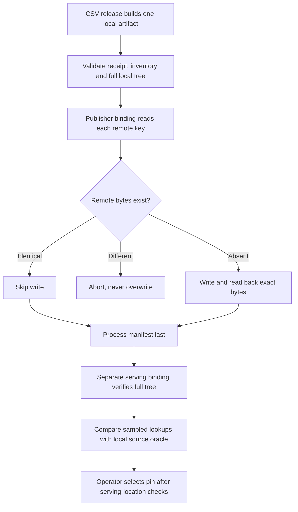

# KV Geo offline tools

Standalone build, publication and verification for [portable KV Geo](../../docs/superpowers/specs/2026-11-05-kv-geo-design.md). CSV import and the independent CIDR oracle stay here. `src/index.rs` selectively re-exports the core `geo::kv` encoder and reader, so the tool and serving code use the same `geo/v1` production-candidate format. Old `geo/p1` artifacts are not compatible; rebuild them.

This crate has its own workspace, lockfile and target directory. It does not provision resources or deploy an application. Native backends are optional dependencies, absent from default builds. The serving reader does not depend on this crate, CSV, the oracle, a filesystem or native SDKs.

## Build and local checks

From the repository root:

```sh
MANIFEST=examples/geo-kv-prototype/Cargo.toml
TARGET=examples/geo-kv-prototype/target
cargo test --locked --manifest-path "$MANIFEST" --target-dir "$TARGET"
cargo build --locked --release --manifest-path "$MANIFEST" --target-dir "$TARGET"
BIN="$PWD/$TARGET/release/geo-kv-prototype"

SOURCE="$HOME/.cache/edgezero/geo/source/GeoLite2-City-CSV_RELEASE"
OUT="$HOME/.cache/edgezero/geo/artifacts-64k"
"$BIN" build "$SOURCE" "$OUT"
"$BIN" verify "$SOURCE" "$OUT" 2048 4194304
"$BIN" lookup "$OUT" 1.0.1.1 ::1
```

Extract one permitted GeoLite City or Country release outside the repository. Supply the English Locations file and both Blocks files from that release. Import validates named columns, family membership, CIDRs, overlaps, referenced locations and geographic code syntax. It does not substitute registered or represented countries. City imports the first subdivision; Country produces country-only results. Empty references or locations without country leave gaps.

`build` merges adjacent equal locations and exports byte-bounded objects through `KvHandle`. It reads the inventory back, validates the full reachable tree, and writes:

- `receipt.json`, the exact manifest key and SHA-256 deployment identity.
- `inventory.json`, every exact key, byte count and SHA-256, including the manifest.
- `build-report.json`, source hashes, index shape, size, timings and whole-process peak RSS.

The default object budget is 16 KiB. In the [local two-backend proof](../../docs/superpowers/plans/2026-11-17-kv-geo-serving-results.md), the smaller objects fit the repeated-request working set and avoided further KV reads. A 64 KiB budget reduces object count and maximum path reads. Use separate output directories when comparing sizes. Keep the source, receipt and inventory together. Rerunning an interrupted build with identical inputs reuses complete objects. If an existing object differs, build into a fresh directory and compare the receipt before publishing.

`verify` checks inventory closure and the full local tree, then compares cache-disabled, cache-enabled first-pass and repeated-pass lookups with the independent original-CIDR oracle. Samples include family endpoints, stratified CIDR boundaries and neighbors, plus deterministic random points. IPv4-mapped IPv6 follows serving normalization. It writes `verification-report.json`.

`lookup` opens only the receipt and the local reader, without CSV or inventory loading. Results follow argument order without echoing addresses. `null` means no coverage. Required missing or corrupt objects fail the command. `XK` remains a source location with `core_country_supported: false`, rather than becoming a gap or an invented core country.

## Publish the same artifact to native backends

Build the native tool once:

```sh
cargo build --locked --release --manifest-path "$MANIFEST" \
  --target-dir "$TARGET" --features 'celld dynamodb'
```

A build with just `--features celld` or `--features dynamodb` works too. Native commands run on a current-thread Tokio runtime; the default offline tool uses the portable executor.



`publish <artifact-dir> <publisher-settings.json>` validates all local bytes before preparing a backend. Inventory keys must belong to the pinned generation, match their hashes and exactly cover the reachable tree. Duplicate, omitted and extra objects fail validation. Each object is checked again when read for upload. Backend value limits are checked before publication.

Remote publication reads before writing, skips identical bytes, aborts on different bytes, writes only absent objects, and reads new writes back. It processes the manifest last regardless of inventory ordering. After interruption or an uncertain write, rerun **the same command with the same artifact and inventory**. There is no internal retry loop, mutable `active` key, overwrite repair or fallback generation. Assign one publisher per generation. Ordinary KV writes are unconditional; read-before-write is not a lock against another publisher.

`verify-remote <artifact-dir> <serving-settings.json> <csv-dir> <samples-per-family>` opens the pinned manifest through the serving binding, verifies every reachable object and compares samples with the local CSV oracle. It issues only exact-key reads, never writes or listing. Source CSV is read by this offline verification process, not sent to the backend or loaded by serving applications. The source hashes must match the manifest. Success prints the pin, object count and checked sample count.

### Ordinary celld

Provision stock celld, install/configure the existing EdgeZero store service and create the alias and grants through existing operator tooling. See [native celld stores](../../docs/guide/native-celld-stores.md). No celld fork, special Geo service or namespace provisioning is built into this tool.

Publisher settings, stored outside Git:

```json
{
  "backend": "celld",
  "settings": {
    "endpoint": "https://celld.example.test:8443",
    "store": "geo",
    "access": { "mode": "authenticated", "token_env": "GEO_PUBLISH_TOKEN" }
  },
  "limits": { "max_value_bytes": 1048576 }
}
```

Serving settings use the same endpoint and alias with `token_env: "GEO_SERVING_TOKEN"`. Inject token values through the environment, not JSON, arguments or shell history. The publisher needs read/write access. The serving grant must be read-only. The ordinary settings validator requires HTTPS for authenticated access. Local trusted-network experiments can use `"access": { "mode": "trusted-network" }` with an explicit loopback HTTP endpoint, but that does not prove grant enforcement.

```sh
"$BIN" publish "$OUT" /secure/geo-celld-publisher.json
"$BIN" verify-remote "$OUT" /secure/geo-celld-serving.json "$SOURCE" 2048
```

Preparation uses `CelldPreparation::prepare_kv` with optional `CelldPreparationLimits`. It does not probe permissions. Publication and serving verification exercise actual reads. Prove stock celld denies writes under the serving grant separately using existing service tooling; this verifier intentionally does not attempt a write.

### DynamoDB and DynamoDB Local

Provision an ordinary compatible table and namespace outside this tool. See [DynamoDB KV](../../docs/guide/dynamodb-kv.md) for table keys and value layout. Do not create a dedicated Geo table merely for this workflow.

```json
{
  "backend": "dynamodb",
  "settings": {
    "region": "us-east-1",
    "table": "edgezero-kv",
    "namespace": "geo",
    "limits": { "max_value_bytes": 393216 }
  }
}
```

The tool calls `AwsPreparation::prepare_dynamodb`, including its ordinary `DescribeTable` validation, with ambient AWS credentials. `AWS_ENDPOINT_URL_DYNAMODB` selects DynamoDB Local through the SDK's normal configuration. For a disposable local instance only:

```sh
AWS_ENDPOINT_URL_DYNAMODB=http://127.0.0.1:8000 \
AWS_ACCESS_KEY_ID=local AWS_SECRET_ACCESS_KEY=local \
  "$BIN" publish "$OUT" /secure/geo-dynamodb-publisher.json
AWS_ENDPOINT_URL_DYNAMODB=http://127.0.0.1:8000 \
AWS_ACCESS_KEY_ID=local AWS_SECRET_ACCESS_KEY=local \
  "$BIN" verify-remote "$OUT" /secure/geo-dynamodb-serving.json "$SOURCE" 2048
```

Use a serving role allowing only `dynamodb:DescribeTable` and `dynamodb:GetItem` on the selected table ARN, with no write grants. A minimal identity policy is:

```json
{
  "Version": "2012-10-17",
  "Statement": [{
    "Effect": "Allow",
    "Action": ["dynamodb:DescribeTable", "dynamodb:GetItem"],
    "Resource": "arn:aws:dynamodb:us-east-1:123456789012:table/edgezero-kv"
  }]
}
```

Check the role's other attached policies and resource policies too. The publishing operator also needs `PutItem`; retirement needs `DeleteItem`. DynamoDB Local does not enforce IAM, so a local read-only verifier proves it issues no writes, not that a deployed role denies them. Actual role denial remains hosted qualification. This tool adds no retries; ordinary backend operation timeouts and preparation limits still apply.

## Rollout, retention and output safety

Uploader read-back and a manifest written last do not prove propagation to all serving locations. Run full verification through the actual serving identity and path at the required locations before selecting the pin. The deployment pin is `<generation>@<manifest_sha256>`, using the generation from `geo/v1/<generation>/manifest`. Restart canaries and then the fleet through existing deployment tooling. Rollback requires re-verifying a still-permitted previous pin. There is no automatic runtime fallback.

Retire only after readers stop referencing a generation. Use its exact inventory with existing operator deletion tooling, and include local artifacts, source files, retained caches and backups in the retention process. TTL is not deletion evidence. This tool does not delete remote data or prove retirement.

Do not put licensed CSV, derived artifacts, reports or credentials into Git or release images. Follow the [GeoLite EULA](https://www.maxmind.com/en/geolite/eula), attribution and permitted-use obligations. Geography is an estimate; applications own jurisdiction recognition and policy.

Successful commands print aggregate reports and dataset identity, never reader addresses or credentials. Errors print a fixed failure message and usage, not raw SDK, CSV, filesystem or parsing errors. Dependency logging is an operator concern. Explicit `lookup` results disclose geography in input order; use synthetic addresses when recording evidence.

## Format and measurement limits

Core owns the `EZG1` binary encoding and schema validation. Objects use sorted intervals, embedded six-byte source locations and digest-addressed children; the manifest binds both family roots and source hashes. No full index preload or key listing is required for lookup. Reader limits here are a 384 KiB object ceiling, 32 objects per path, and 4,096 cache entries. Cache payload bytes are configurable for local verification; remote verification disables caching. These are tool limits, not a claim about deployed capacity or final schema defaults.

`store.rs` is a local file-backed `KvStore` for artifact IO, not a production async filesystem backend. Local timings include file reads, hashing, validation and search. OS page cache is uncontrolled. Cache-disabled does not mean a cold disk. Linux `VmHWM` includes importer/oracle memory in those commands, so it is not serving RSS. Fresh `lookup` avoids retaining CSV.

Tests use synthetic City/Country data and in-memory fault injection. They cover deterministic exports, boundaries/gaps, unsupported codes, safe output, inventory tampering, manifest-last publication, identical replay, resuming after every uncertain write, conflict/read-back failures and missing/corrupt serving visibility without writes. Run optional-backend compilation and tests with `--all-features`; it does not contact services. Real stock-celld, DynamoDB Local, serving-grant denial, production-size 16/64 KiB measurements and hosted IAM qualification still require operator runs. Earlier [prototype measurements](../../docs/superpowers/plans/2026-11-05-kv-geo-prototype-results.md) describe the old `p1` experiment, not backend evidence for this implementation.
