# KV Geo format prototype

A standalone Rust experiment for [portable KV Geo](../../docs/superpowers/specs/2026-11-05-kv-geo-design.md). It imports GeoLite City/Country CSV, exports a compact IP index, and checks asynchronous point lookups through the real EdgeZero `KvHandle` against the original unmerged CIDRs.

This is the format/lookup prototype, not production Geo integration. It does not change `GeoProvider`, request dispatch, adapters, store bindings or CLI commands. The crate has its own workspace and lockfile so CSV/import dependencies do not enter production builds.

## Run

From the repository root:

```sh
cargo test --locked --manifest-path examples/geo-kv-prototype/Cargo.toml
cargo build --locked --release --manifest-path examples/geo-kv-prototype/Cargo.toml
```

The binary is `examples/geo-kv-prototype/target/release/geo-kv-prototype` unless `CARGO_TARGET_DIR` selects another directory. The commands below assume `BIN` points to that binary.

Extract the City CSV archive outside the repository. The source directory must contain the English locations file and both Blocks files. For Country CSV, use the corresponding Country filenames.

```sh
SOURCE="$HOME/.cache/edgezero/geo-kv-prototype/source/GeoLite2-City-CSV_20261103"
OUT="$HOME/.cache/edgezero/geo-kv-prototype/artifacts-64k"

"$BIN" build "$SOURCE" "$OUT" 65536
"$BIN" verify "$SOURCE" "$OUT" 2048 4194304
"$BIN" lookup "$OUT" 1.0.1.1 ::1
```

- `build` imports, merges adjacent equal locations, builds byte-bounded objects, exports them through `KvHandle`, reads every object back, and emits a pinned receipt, inventory and build report. Use a separate output directory for each object-size experiment. An identical rerun must reproduce the same receipt and object bytes.
- `verify` compares 2,048 points per family against an independent `ipnet::contains` lookup over source CIDRs. Points include family endpoints, stratified CIDR endpoints and neighbors, and deterministic random addresses. It measures cache-disabled, cache-enabled first-pass and cache-enabled repeated-pass lookups. The last two share a bounded cache, not a full dataset preload. The manifest read is measured separately from per-query object reads.
- `lookup` runs in a fresh process without reading CSV or an inventory. Results follow input order, without echoing addresses. A JSON `null` means no geographic coverage; a missing required object is an error.

Generated CSV, index files and machine-readable reports stay outside Git. Publication artifacts contain derived MaxMind data and retain its licensing, attribution, update and deletion obligations.

## Data and policy are separate

The downloaded release includes `XK`. EdgeZero's existing `CountryCode` rejects that code. The prototype's six-byte location is a source-format DTO, not a `GeoLocation` or production `GeoResolution`.

The prototype validates country syntax, preserves source codes, reports unsupported-code network counts and exposes `core_country_supported` in explicit lookup output. It does not add `XK` to EdgeZero's country allowlist, silently discard those intervals, or map them to another country. Production policy needs a decision before integrating this format with Geo outcomes.

## Experimental encoding

```mermaid
flowchart TD
    Receipt[Pinned manifest key and SHA-256] --> Manifest[Family roots and object byte budget]
    Manifest --> Directory[Sorted child envelopes and hashes]
    Directory --> Leaf[Sorted address intervals and source locations]
    Leaf --> Location[Country and optional subdivision]
```



Each binary object has a 12-byte header:

| Bytes | Meaning                             |
| ----- | ----------------------------------- |
| 0..4  | Magic `EZP1`                        |
| 4     | Address family, 4 or 6              |
| 5     | Kind, 0 for leaf or 1 for directory |
| 6..8  | Big-endian level, 0 for leaf        |
| 8..12 | Big-endian record count             |

Leaf records contain inclusive start and end addresses, then a six-byte location. IPv4 addresses occupy four bytes each; IPv6 addresses occupy sixteen. Location bytes are uppercase country code, subdivision length, and three zero-padded subdivision bytes. Leaf records are therefore 14 or 38 bytes.

Directory records contain inclusive child-envelope bounds and a 32-byte child SHA-256. They occupy 40 or 64 bytes. Child level decreases by one. Child keys derive from generation, family and digest; no arbitrary child key is decoded from dataset bytes. Directories are grouped until each family has one root. No key listing or CIDR-prefix probing occurs.

The JSON manifest binds source-file hashes, edition, object budget and both roots. `receipt.json` pins its exact key and digest. The experimental generation hashes schema number, object budget and source metadata. Changes to this encoding/build algorithm require a new format version; p1 is not frozen for consumers.

Objects are validated before use or caching. The reader checks content digest, family, level, lengths, ordering, envelopes and source-code syntax. The cache retains validated object bytes and searches records without materializing all intervals. Its configured budget counts retained payload bytes, not allocator/hash-map overhead. A fetched object and validation scratch memory exist in addition to retained cache payload.

## Measurement boundaries

`store.rs` is a local file-backed artifact transport implementing `KvStore`. Its synchronous filesystem operations are intentionally a prototype harness, not a production async backend. The lookup algorithm itself only uses `KvHandle` and requires no filesystem API. Replacing this harness with actual remote KV and integrating cancellation belongs to the next stage.

Local timings include file reads, SHA-256, validation and search. OS page cache is uncontrolled. Cache-disabled means the resolver object cache is disabled, not that disk or OS caches are cold. No simulated network delay is added. The sample mix is a correctness workload, not representative user traffic or a KV cost forecast.

Linux `VmHWM` supplies whole-process peak RSS. Import/verify processes retain source CIDRs for the oracle, so their RSS is not serving memory. Use a fresh `lookup` process to measure a small serving workload without that retained dataset.

The artifact writer demonstrates deterministic export/read-back, not crash-safe publication, distributed propagation, concurrent writer exclusion or a backend's upload API. Production retry, publication and retirement behavior remains specified separately.

See [measured results](../../docs/superpowers/plans/2026-11-05-kv-geo-prototype-results.md).
