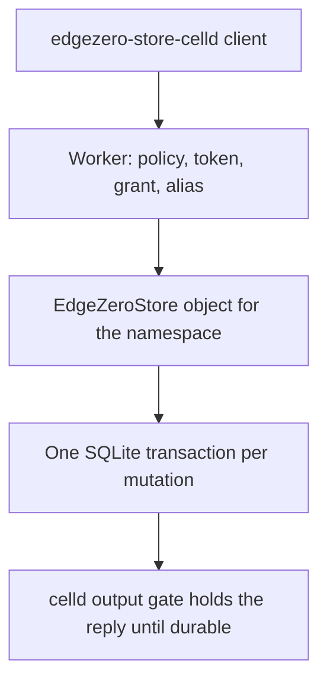

# EdgeZero store service for celld

This is the storage side of the `celld-kv` provider in `edgezero-store-celld`. It is a Worker and one SQLite Durable Object class that the official celld release runs as an ordinary application. No celld change or custom build is involved.

The application guide is [`docs/guide/native-celld-stores.md`](../../docs/guide/native-celld-stores.md). This file covers the service itself.

## Layout

| Path                      | Purpose                                                                          |
| ------------------------- | -------------------------------------------------------------------------------- |
| `src/index.js`            | The whole service, one module, deployed with `no_bundle` so no esbuild is needed |
| `wrangler.template.jsonc` | Deployment template. Copy it to `wrangler.jsonc` and set the policy              |
| `test/`                   | `node --test` suites over a real SQLite database through `node:sqlite`           |

celld accepts only handlers and classes as module exports, so tests reach the pure helpers through `EdgeZeroStore.internals`.

## What runs where



Each data namespace is one object, named `edgezero-store/v1/<namespace>`. All writes to a namespace run one at a time on the node that owns that object. That bounds write throughput per namespace. Splitting a namespace across objects would be a storage format change.

## Storage format `rows-v1`

| Table                | Contents                                                       |
| -------------------- | -------------------------------------------------------------- |
| `edgezero_meta`      | Schema version, a random instance ID, the generation allocator |
| `edgezero_rows`      | Key, body, optional metadata, generation, optional expiry      |
| `edgezero_mutations` | Mutation ID, request fingerprint, outcome, ledger expiry       |

Every write allocates a fresh generation from the allocator. Deletes, expiry and sweeps never reset it. A database with rows but no metadata fails every request instead of starting over.

## Record API version 1

The default-off Rust `records` feature prepares the `celld-records` binding.
It checks capabilities and then supplies `x-edgezero-record-version: 1` and
`x-edgezero-expected-instance` on every record operation.

GET/HEAD `/v1/stores/{alias}/record?key=` reads a record or checks physical
presence. POST `record-put?key=` accepts base64 body, optional base64 UTF-8
metadata, nullable integer `ttl_ms`, mode and optional decimal-string generation.
POST `record-delete?key=` deletes the value only. GET `record-keys` takes prefix,
limit, cursor and mode. Existing read/write/delete/list grants apply.

Add/CAS check the physical row in the same transaction as generation allocation,
replacement and the stored outcome. A rejected precondition is recorded too, so
a resend cannot change a rejection into a successful write. Expected instance
is checked before effects. Record cursors bind alias, instance, mode and prefix.

Lookup and list filter native expiry; physical HEAD and conditions retain the row
until sweep. No-TTL writes store NULL. Ordinary writes and record writes share
one row and allocator, with ordinary writes clearing metadata.

See the [record-service design](../../docs/superpowers/specs/2026-11-16-stock-celld-record-contract-design.md)
for exact protocol and proof boundaries.

## Why mutations carry an ID

When a Worker on one node calls an object owned by another node, celld resends a buffered call once on a fresh peer tunnel after a pooled tunnel fails, even if the owner already ran it (`send_inner` in `crates/celld/main/peer_tunnel.rs`, v0.6.3). Proxies can also retry. The client therefore sends a random `x-edgezero-mutation-id` with every mutation. The object records it in the same transaction as the write. A second delivery gets the first outcome and changes nothing.

The Worker also stamps an apply-before time 10 seconds after it receives a mutation. An object that receives the mutation later rejects it with `deadline`, unless its ledger already holds that ID. celld can otherwise hold a call through cell recovery long after the client gave up. Ledger entries are kept for 10 minutes. Both windows use node clocks.

## Policy

`EDGEZERO_STORE_POLICY` is a JSON string in `vars`. celld has no secret store, so the policy holds SHA-256 verifiers, never tokens.

```json
{
  "version": 1,
  "stores": [{ "alias": "identity", "namespace": "production-identity" }],
  "access": {
    "mode": "authenticated",
    "tokens": [
      {
        "id": "trusted-server",
        "sha256": "<64 lowercase hex digits>",
        "grants": [
          {
            "store": "identity",
            "operations": ["read", "write", "delete", "list"]
          }
        ]
      }
    ]
  }
}
```

`trusted-network` mode replaces `tokens` with a `grants` list that applies to every caller and rejects any supplied credential. An invalid policy makes every request fail with `unavailable`.

## Checks

```sh
node --test services/celld-store/test/service.test.mjs
```

Real-service proofs live in `scripts/`. See the guide for the exact commands.
